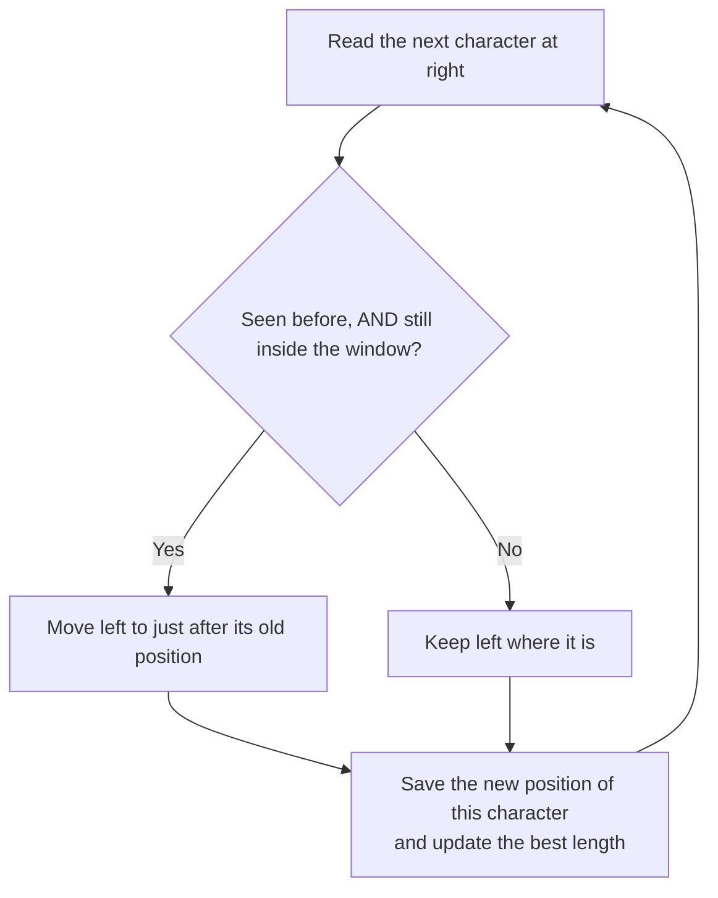
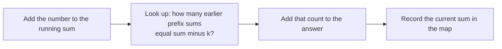

# Arrays and Strings

We start here because everything else builds on it. The four problems below use the same basic tools in different ways: **a loop, a couple of pointers, and a hash map**.

| Problem | Pattern | Time | Extra space |
| --- | --- | --- | --- |
| 3. Longest Substring Without Repeating Characters | Sliding window | O(n) | O(k) |
| 560. Subarray Sum Equals K | Prefix sum and hash map | O(n) | O(n) |
| 15. 3Sum | Sort and two pointers | O(n²) | O(1) |
| 56. Merge Intervals | Sort and merge | O(n log n) | O(n) |

---

## Problem 3: Longest Substring Without Repeating Characters

**LeetCode:** [3. Longest Substring Without Repeating Characters](https://leetcode.com/problems/longest-substring-without-repeating-characters/) · Medium

#### The question

You get a string. Find the length of the longest **substring** in which no character appears twice. A substring is a run of characters that sit next to each other (not just any picked characters).

Example: for `abcbdea`, the answer is **5**, from the substring `cbdea`.

#### Think first

The obvious way: for every starting position, keep adding characters until you see a repeat. That is O(n²), and it wastes effort. When you move to the next start, you re-check characters you already checked.

#### The idea: a sliding window

Imagine a window over the string. Rule: **the window never contains a repeated character**.

- Move the right edge forward one character at a time.
- If the new character is already inside the window, move the left edge to just **after** its old position. The window is clean again.
- After each step, check if this window is the biggest so far.

To jump the left edge quickly, remember the **last index** where each character was seen.



:::warning[The trap everyone falls into]
"Seen before" is not enough. The old position must be **inside the window** (at or after `left`). A character that appeared long ago, before the window started, is no problem. Without this check, `left` can jump backwards and give wrong answers.
:::

#### Dry run on `abcbdea`

| right | char | Old position | Inside window? | left | Window | Length | Best |
| --- | --- | --- | --- | --- | --- | --- | --- |
| 0 | a | none | no | 0 | `a` | 1 | 1 |
| 1 | b | none | no | 0 | `ab` | 2 | 2 |
| 2 | c | none | no | 0 | `abc` | 3 | 3 |
| 3 | b | 1 | **yes** (1 is at or after 0) | 2 | `cb` | 2 | 3 |
| 4 | d | none | no | 2 | `cbd` | 3 | 3 |
| 5 | e | none | no | 2 | `cbde` | 4 | 4 |
| 6 | a | 0 | **no** (0 is before 2) | 2 | `cbdea` | 5 | **5** |

At the last row, `a` was seen at index 0, but the window already starts at 2, so we ignore it. The answer is 5.

#### Java solution

```java
public int lengthOfLongestSubstring(String s) {
    Map<Character, Integer> lastIndex = new HashMap<>();
    int left = 0, best = 0;

    for (int right = 0; right < s.length(); right++) {
        char c = s.charAt(right);

        // seen before AND inside the current window? move left past it
        if (lastIndex.containsKey(c) && lastIndex.get(c) >= left) {
            left = lastIndex.get(c) + 1;
        }

        lastIndex.put(c, right);
        best = Math.max(best, right - left + 1);
    }
    return best;
}
```

#### Complexity

- **Time:** O(n). Each character is visited once.
- **Space:** O(k), where k is the number of different characters (at most the alphabet size).

:::tip[Interview follow-ups]
- Faster in practice: replace the `HashMap` with an `int[128]` array indexed by the character.
- To return the substring itself, remember the `left` value whenever you update `best`.
:::

---

## Problem 560: Subarray Sum Equals K

**LeetCode:** [560. Subarray Sum Equals K](https://leetcode.com/problems/subarray-sum-equals-k/) · Medium

#### The question

You get an array of integers (it **can contain negative numbers**) and a number `k`. Count how many **subarrays** (continuous parts) add up to exactly `k`.

Example: `[2, -1, 3, 1, 2]` with `k = 3` gives **3**. The subarrays are `[3]`, `[-1, 3, 1]`, and `[1, 2]`.

#### Think first

Try every start and end, and keep a running sum. That is O(n²). It works, but it is slow for big inputs.

You may think of a sliding window like in problem 3. It **does not work here**. A window works only when adding a number always makes the sum bigger. With negative numbers, a longer window can have a smaller sum, so we cannot decide when to shrink it.

#### The idea: prefix sums

A **prefix sum** is the total of everything from the start up to a position. For `[2, -1, 3, 1, 2]`:

```text
nums:      [  2,  -1,   3,   1,   2 ]
prefix:  0    2    1    4    5    7
           ^
           empty prefix (sum of nothing)
```

Here is the key fact. The sum of a subarray from position `i` up to `j - 1` is:

```text
sum of the subarray = prefix[j] - prefix[i]
```

We want that to be `k`. So for each position `j`, we are looking for an earlier prefix that equals `prefix[j] - k`. If we keep a map of **how many times each prefix sum has appeared**, one lookup tells us how many subarrays end here.



Two details:

- Start the map with `{0: 1}`. This counts subarrays that begin at the very start of the array (the "empty prefix").
- Update the map **after** the lookup. Otherwise, when `k = 0`, a prefix would be counted against itself.

#### Dry run: `[2, -1, 3, 1, 2]`, `k = 3`

| Number | Running sum | Look for (sum - k) | Found | Answer so far | Map after |
| --- | --- | --- | --- | --- | --- |
| start | 0 | | | 0 | `{0:1}` |
| 2 | 2 | -1 | 0 | 0 | `{0:1, 2:1}` |
| -1 | 1 | -2 | 0 | 0 | `{0:1, 2:1, 1:1}` |
| 3 | 4 | 1 | **1** | 1 | `{0:1, 2:1, 1:1, 4:1}` |
| 1 | 5 | 2 | **1** | 2 | `{..., 5:1}` |
| 2 | 7 | 4 | **1** | 3 | `{..., 7:1}` |

Each "found" is one subarray. At sum 4 we found prefix 1, which is the subarray `[3]`. At sum 5 we found prefix 2, which is `[-1, 3, 1]`. At sum 7 we found prefix 4, which is `[1, 2]`.

#### Java solution

```java
public int subarraySum(int[] nums, int k) {
    Map<Integer, Integer> seen = new HashMap<>();
    seen.put(0, 1);                       // the empty prefix

    int sum = 0, count = 0;
    for (int x : nums) {
        sum += x;
        count += seen.getOrDefault(sum - k, 0);   // subarrays ending here
        seen.merge(sum, 1, Integer::sum);          // record this prefix
    }
    return count;
}
```

#### Complexity

- **Time:** O(n). One pass, and each map operation is O(1) on average.
- **Space:** O(n) for the map.

:::tip[Pattern to remember]
"Count subarrays with a given sum" almost always means **prefix sum plus a hash map**. The same idea solves "subarray sums divisible by k" and "longest subarray with sum k".
:::

---

## Problem 15: 3Sum

**LeetCode:** [15. 3Sum](https://leetcode.com/problems/3sum/) · Medium

#### The question

You get an array of integers. Find all **unique triplets** (three numbers at three different positions) that add up to **0**. The answer must not contain the same triplet twice.

Example: `[-2, 0, 1, 1, 2, -1, -1]` gives four triplets: `[-2, 0, 2]`, `[-2, 1, 1]`, `[-1, -1, 2]`, and `[-1, 0, 1]`.

#### Think first

Three nested loops give O(n³). Removing duplicates (for example, `[-1, 0, 1]` and `[0, 1, -1]` are the same triplet) makes it messier.

#### The idea: sort, fix one, squeeze two

1. **Sort** the array. This makes duplicates sit next to each other, and it lets us use two pointers.
2. **Fix** the first number, `nums[i]`. Now we need two other numbers that add up to `-nums[i]`.
3. For the rest of the array, place a pointer `lo` at the left end and `hi` at the right end:
   - sum too small → move `lo` right (need a bigger number)
   - sum too big → move `hi` left (need a smaller number)
   - sum is 0 → record it, then move both

```text
sorted:  -2  -1  -1   0   1   1   2
          i   lo                  hi        sum = -2 + -1 + 2 = -1  (too small, lo moves right)
```

**Skipping duplicates** keeps the answer unique:

- If `nums[i]` equals the previous number, skip it (we already tried that first number).
- After finding a triplet, skip over repeated values of `lo` and `hi`.
- If `nums[i]` is positive, stop. Everything after it is also positive, so no triplet can reach 0.

#### Dry run on the sorted array `[-2, -1, -1, 0, 1, 1, 2]`

**i = 0, value -2** (we need two numbers adding to 2):

| lo | hi | Sum | Action |
| --- | --- | --- | --- |
| 1 (-1) | 6 (2) | -1 | too small, `lo++` |
| 2 (-1) | 6 (2) | -1 | too small, `lo++` |
| 3 (0) | 6 (2) | 0 | **found `[-2, 0, 2]`**, move both |
| 4 (1) | 5 (1) | 0 | **found `[-2, 1, 1]`**, move both, pointers meet, stop |

**i = 1, value -1** (we need two numbers adding to 1):

| lo | hi | Sum | Action |
| --- | --- | --- | --- |
| 2 (-1) | 6 (2) | 0 | **found `[-1, -1, 2]`**, move both |
| 3 (0) | 5 (1) | 0 | **found `[-1, 0, 1]`**, move both, pointers meet, stop |

**i = 2, value -1**: same as the previous number, so skip it. **i = 3, value 0**: the sums are too big, nothing found. **i = 4, value 1**: positive, so stop. Four triplets in total.

#### Java solution

```java
public List<List<Integer>> threeSum(int[] nums) {
    Arrays.sort(nums);
    List<List<Integer>> result = new ArrayList<>();

    for (int i = 0; i < nums.length - 2; i++) {
        if (nums[i] > 0) break;                          // no way to reach 0
        if (i > 0 && nums[i] == nums[i - 1]) continue;   // skip duplicate first number

        int lo = i + 1, hi = nums.length - 1;
        while (lo < hi) {
            int sum = nums[i] + nums[lo] + nums[hi];
            if (sum == 0) {
                result.add(List.of(nums[i], nums[lo], nums[hi]));
                lo++;
                hi--;
                while (lo < hi && nums[lo] == nums[lo - 1]) lo++;   // skip duplicates
                while (lo < hi && nums[hi] == nums[hi + 1]) hi--;
            } else if (sum < 0) {
                lo++;
            } else {
                hi--;
            }
        }
    }
    return result;
}
```

#### Complexity

- **Time:** O(n²). Sorting is O(n log n), and then each fixed number costs one O(n) squeeze.
- **Space:** O(1) extra, ignoring the sort and the output.

:::tip[Connection to a simpler problem]
The inner loop is the classic "two sum in a sorted array". 3Sum is just that problem repeated for every first number. The same idea solves 4Sum, by adding one more outer loop.
:::

---

## Problem 56: Merge Intervals

**LeetCode:** [56. Merge Intervals](https://leetcode.com/problems/merge-intervals/) · Medium

#### The question

You get a list of ranges, each written as `[start, end]`. Merge all ranges that overlap (ranges that only touch, like `[1,4]` and `[4,5]`, also merge) and return the resulting list of separate ranges.

Example: `[[8,10], [1,4], [9,12], [3,5], [15,18]]` becomes `[[1,5], [8,12], [15,18]]`.

#### Think first

Comparing every range with every other range is O(n²) and gets confusing, because merging changes the ranges.

#### The idea: sort by start, then sweep once

If the ranges are sorted by their start, then any range that overlaps the current one **must come right after it**. So we only ever compare with the last merged range.

```text
sorted by start:

  [1----4]
      [3--5]             overlaps [1,4]  ->  becomes [1,5]
                [8--10]  starts after 5  ->  a new group
                  [9---12]  overlaps [8,10]  ->  becomes [8,12]
                              [15--18]  starts after 12  ->  a new group
```

The rule for each next range:

- Its start is **at or before** the current end → overlap. Extend the end: `end = max(end, nextEnd)`.
- Otherwise → no overlap. Save the current range and start a new one.

We use `max` because the next range might sit completely inside the current one (like `[2,3]` inside `[1,10]`), and then the end must not shrink.

#### Dry run

Sorted input: `[1,4] [3,5] [8,10] [9,12] [15,18]`

| Next range | Current range | Overlap? (start at or before end) | Action | Result so far |
| --- | --- | --- | --- | --- |
| (begin) | `[1,4]` | | take the first range | |
| `[3,5]` | `[1,4]` | 3 ≤ 4, yes | current becomes `[1,5]` | |
| `[8,10]` | `[1,5]` | 8 ≤ 5, no | save `[1,5]`, current becomes `[8,10]` | `[1,5]` |
| `[9,12]` | `[8,10]` | 9 ≤ 10, yes | current becomes `[8,12]` | `[1,5]` |
| `[15,18]` | `[8,12]` | 15 ≤ 12, no | save `[8,12]`, current becomes `[15,18]` | `[1,5]` `[8,12]` |
| (end) | `[15,18]` | | save the last current range | `[1,5]` `[8,12]` `[15,18]` |

Do not forget the final step: the last range in progress must be saved after the loop.

#### Java solution

```java
public int[][] merge(int[][] intervals) {
    Arrays.sort(intervals, (a, b) -> Integer.compare(a[0], b[0]));   // by start

    List<int[]> merged = new ArrayList<>();
    int[] current = intervals[0];

    for (int i = 1; i < intervals.length; i++) {
        if (intervals[i][0] <= current[1]) {
            current[1] = Math.max(current[1], intervals[i][1]);   // overlap: extend
        } else {
            merged.add(current);                                  // gap: save and restart
            current = intervals[i];
        }
    }
    merged.add(current);                                          // the last one
    return merged.toArray(new int[0][]);
}
```

#### Complexity

- **Time:** O(n log n), mostly the sort. The sweep itself is O(n).
- **Space:** O(n) for the output (plus the sort's own space).

:::tip[Why `Integer.compare` and not subtraction?]
Writing `a[0] - b[0]` can overflow for very large or very small numbers and give a wrong order. `Integer.compare` is always safe.
:::

---

:::info[Next page]
So far we scanned arrays from left to right. Next we jump around arrays by **halving** them (binary search), rewire links in a list, and combine a map with a list to build a cache. Continue with [Searching, Linked Lists, and Design](./02-search-lists-design.md).
:::
