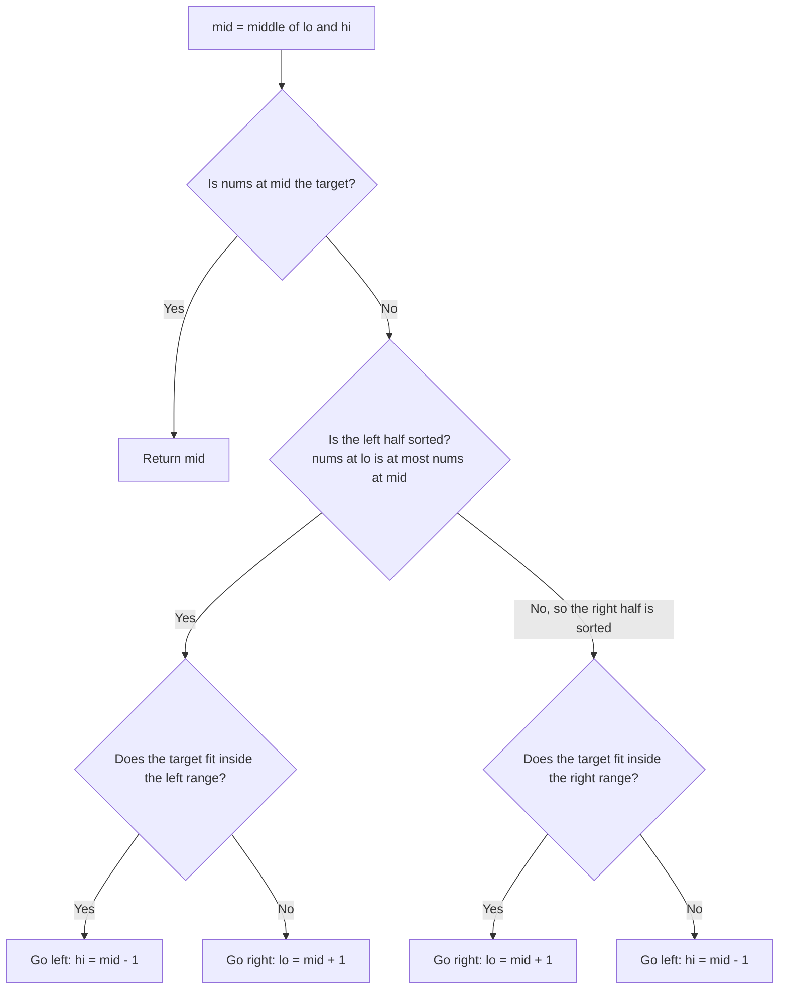
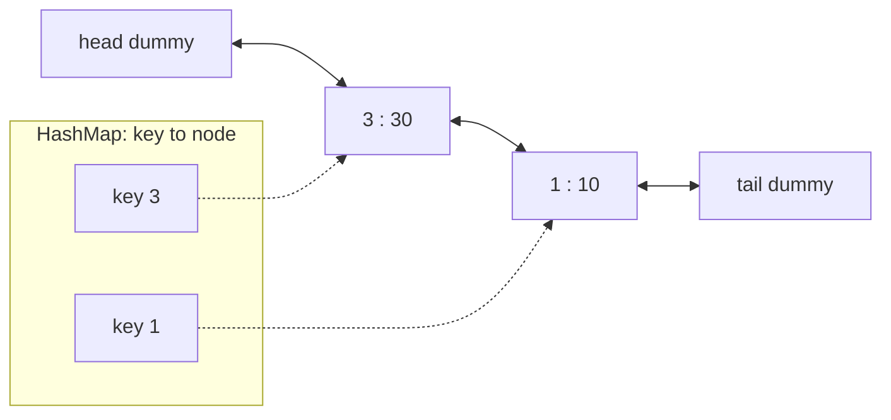

# Searching, Linked Lists, and Design

On the last page we walked through arrays one item at a time. Now we do three different things:

1. **Jump** through an array by cutting it in half each time (binary search).
2. **Rewire** the links of a linked list.
3. **Combine** a hash map with a linked list to build a real cache. This last one uses what you learn in the second problem.

| Problem | Pattern | Time | Extra space |
| --- | --- | --- | --- |
| 33. Search in Rotated Sorted Array | Modified binary search | O(log n) | O(1) |
| 206. Reverse Linked List | Pointer reversal | O(n) | O(1) |
| 146. LRU Cache | Hash map and doubly linked list | O(1) per operation | O(capacity) |

---

## Problem 33: Search in Rotated Sorted Array

**LeetCode:** [33. Search in Rotated Sorted Array](https://leetcode.com/problems/search-in-rotated-sorted-array/) · Medium

#### The question

A sorted array of **different** numbers was rotated: some items from the front were moved to the back, at a point you do not know. Given a target number, return its index, or `-1` if it is not there. Your solution must run in O(log n).

Example: the array `[5, 10, 15, 20, 30, 40, 50]` was rotated into `[30, 40, 50, 5, 10, 15, 20]`. Searching for `10` returns **4**.

#### Think first

A simple scan finds the target in O(n), but the question asks for O(log n). That means binary search. The problem: the array is not fully sorted any more, so the normal "go left or right" rule breaks.

#### The idea: one half is always sorted

Look at the middle item. Whatever the rotation point is, it can only be in **one** half. So the **other half is perfectly sorted**.

```text
[30, 40, 50,  5, 10, 15, 20]
  lo        mid             hi

Left half  [30 40 50 5]  -> contains the rotation point, NOT sorted
Right half [5 10 15 20]  -> sorted
```

So at each step:

1. Find out which half is sorted. If `nums[lo] <= nums[mid]`, the left half is sorted.
2. Check if the target fits inside that sorted half's range.
3. If yes, search that half. If not, search the other half.



#### Dry run: find `10` in `[30, 40, 50, 5, 10, 15, 20]`

| Step | lo | hi | mid | nums[mid] | Sorted half | Does 10 fit there? | Move |
| --- | --- | --- | --- | --- | --- | --- | --- |
| 1 | 0 | 6 | 3 | 5 | right (5 to 20), because 30 is more than 5 | 10 is after 5 and up to 20, yes | `lo = 4` |
| 2 | 4 | 6 | 5 | 15 | left (10 to 15), because 10 ≤ 15 | 10 is from 10 up to before 15, yes | `hi = 4` |
| 3 | 4 | 4 | 4 | 10 | | **found** | return 4 |

Three steps for seven items. That is the log n speed.

#### Java solution

```java
public int search(int[] nums, int target) {
    int lo = 0, hi = nums.length - 1;

    while (lo <= hi) {
        int mid = lo + (hi - lo) / 2;
        if (nums[mid] == target) return mid;

        if (nums[lo] <= nums[mid]) {                       // left half is sorted
            if (nums[lo] <= target && target < nums[mid]) {
                hi = mid - 1;                              // target is in the left half
            } else {
                lo = mid + 1;
            }
        } else {                                           // right half is sorted
            if (nums[mid] < target && target <= nums[hi]) {
                lo = mid + 1;                              // target is in the right half
            } else {
                hi = mid - 1;
            }
        }
    }
    return -1;
}
```

#### Complexity

- **Time:** O(log n). The search area is halved every step.
- **Space:** O(1).

:::warning[Small details that cause bugs]
- Use `<=` in `nums[lo] <= nums[mid]`. When `lo` and `mid` are the same position (a two-item range), the left "half" is one item and is sorted.
- Write `mid = lo + (hi - lo) / 2`, not `(lo + hi) / 2`. The second can overflow for huge arrays.
:::

:::tip[Interview follow-up]
What if the array can contain **duplicates** (LeetCode 81)? Then `nums[lo] == nums[mid]` tells you nothing about which half is sorted, and in the worst case you must shrink by one step, giving O(n).
:::

---

## Problem 206: Reverse Linked List

**LeetCode:** [206. Reverse Linked List](https://leetcode.com/problems/reverse-linked-list/) · Easy

#### The question

You get the first node (the **head**) of a singly linked list. Reverse the list and return the new head. For example, `1 → 2 → 3 → 4` becomes `4 → 3 → 2 → 1`.

Each node is defined like this:

```java
public class ListNode {
    int val;
    ListNode next;
    ListNode(int val) { this.val = val; }
}
```

#### Think first

You could copy all values into an array and write them back in reverse. That works but uses O(n) extra memory. The better way changes the **arrows** (the `next` links) instead of the values.

#### The idea: flip each arrow as you walk

Walk through the list with two pointers. At each node, make its `next` point **backwards** to the previous node. The only danger: once you flip the arrow, you lose the way forward. So **save the next node first**.

Each step does four small things:

```text
next = curr.next     // 1. remember where to go next
curr.next = prev     // 2. flip the arrow
prev = curr          // 3. move prev forward
curr = next          // 4. move curr forward
```

#### Dry run on `1 → 2 → 3`

Start: `prev = null`, `curr = 1`.

```text
Start:        null    1 -> 2 -> 3
                      ^
                     curr          prev = null

After step 1: null <- 1    2 -> 3        (1 now points back to null)
                           ^
                          curr         prev = 1

After step 2: null <- 1 <- 2    3        (2 now points back to 1)
                                ^
                               curr     prev = 2

After step 3: null <- 1 <- 2 <- 3        (3 now points back to 2)
                                       curr = null (done)
                                       prev = 3  <- the new head
```

When `curr` becomes `null`, we have walked off the end. `prev` is the last node we handled, which is the new head.

#### Java solution: iterative

```java
public ListNode reverseList(ListNode head) {
    ListNode prev = null, curr = head;

    while (curr != null) {
        ListNode next = curr.next;   // remember the way forward
        curr.next = prev;            // flip the arrow
        prev = curr;                 // step forward
        curr = next;
    }
    return prev;                     // new head
}
```

#### Java solution: recursive

The recursive way: "reverse everything after me, then fix my own link."

```java
public ListNode reverseListRecursive(ListNode head) {
    if (head == null || head.next == null) return head;   // empty or one node

    ListNode newHead = reverseListRecursive(head.next);   // reverse the rest
    head.next.next = head;                                // the next node now points back to me
    head.next = null;                                     // I am the new tail
    return newHead;
}
```

For `1 → 2 → 3`: the call for node 1 first reverses `2 → 3` into `3 → 2`. Then `head.next.next = head` makes node 2 point to node 1. Finally `head.next = null` makes node 1 the end.

#### Complexity

| | Time | Space |
| --- | --- | --- |
| Iterative | O(n) | O(1) |
| Recursive | O(n) | O(n), because of the call stack |

:::tip[Why this matters for the next problem]
The skill you just practised, **changing links without losing the rest of the list**, is exactly what the LRU Cache needs. There we will remove a node from the middle of a list and put it at the front.
:::

---

## Problem 146: LRU Cache

**LeetCode:** [146. LRU Cache](https://leetcode.com/problems/lru-cache/) · Medium

#### The question

Design a **cache** with a fixed size (capacity). It must support two operations:

- `get(key)`: return the value for the key, or `-1` if it is not there.
- `put(key, value)`: add or update a key. If the cache is full, first remove the **least recently used** key.

Both operations must run in **O(1)** time. "Used" means read or written.

Example with capacity 2: `put(1,10)`, `put(2,20)`, `get(1)` returns 10, `put(3,30)` throws out key 2 (the least recently used), and then `get(2)` returns `-1`.

#### Think first

- A **HashMap** alone finds a key in O(1), but it does not know which key is the oldest.
- A **list** alone keeps the order, but finding a key takes O(n).

We need both.

#### The idea: a hash map plus a doubly linked list

- The **list** keeps keys in order of use: **most recent at the front, least recent at the back**.
- The **map** points from each key straight to its node in the list, so we can find any node in O(1).



Why a **doubly** linked list? To remove a node from the middle, you must change the `next` of the node **before** it. With a doubly linked list, every node knows its previous node, so removal is O(1).

Why **dummy** head and tail nodes? They are fixed markers at both ends, so we never have to check for `null` when inserting or removing. The real first node is always `head.next`, and the real last node is always `tail.prev`.

What each operation does:

| Operation | Steps |
| --- | --- |
| `get(key)` | Not in the map → return -1. Otherwise move its node to the front, and return the value |
| `put(key, value)` for an existing key | Update the value, and move the node to the front |
| `put(key, value)` for a new key | If full, remove `tail.prev` (the oldest) from the list and the map. Then add the new node at the front |

#### Dry run (capacity 2)

The list is shown from **front (newest) to back (oldest)**.

| Operation | What happens | List | Result |
| --- | --- | --- | --- |
| `put(1, 10)` | add 1 | `[1]` | |
| `put(2, 20)` | add 2 at the front | `[2, 1]` | |
| `get(1)` | found, move 1 to the front | `[1, 2]` | 10 |
| `put(3, 30)` | full, remove the oldest (2), add 3 | `[3, 1]` | |
| `get(2)` | not in the map | `[3, 1]` | -1 |
| `put(4, 40)` | full, remove the oldest (1), add 4 | `[4, 3]` | |
| `get(1)` | not in the map | `[4, 3]` | -1 |
| `get(3)` | found, move 3 to the front | `[3, 4]` | 30 |
| `get(4)` | found, move 4 to the front | `[4, 3]` | 40 |

#### Java solution

```java
class LRUCache {

    private static class Node {
        int key, value;
        Node prev, next;
        Node(int key, int value) { this.key = key; this.value = value; }
    }

    private final int capacity;
    private final Map<Integer, Node> map = new HashMap<>();
    private final Node head = new Node(0, 0);   // dummy: newest side
    private final Node tail = new Node(0, 0);   // dummy: oldest side

    public LRUCache(int capacity) {
        this.capacity = capacity;
        head.next = tail;
        tail.prev = head;
    }

    public int get(int key) {
        Node node = map.get(key);
        if (node == null) return -1;
        moveToFront(node);
        return node.value;
    }

    public void put(int key, int value) {
        Node node = map.get(key);
        if (node != null) {                  // existing key: update and refresh
            node.value = value;
            moveToFront(node);
            return;
        }
        if (map.size() == capacity) {        // full: evict the least recently used
            Node oldest = tail.prev;
            remove(oldest);
            map.remove(oldest.key);          // that is why the node stores its key
        }
        Node fresh = new Node(key, value);
        map.put(key, fresh);
        addToFront(fresh);
    }

    private void moveToFront(Node node) { remove(node); addToFront(node); }

    private void remove(Node node) {
        node.prev.next = node.next;
        node.next.prev = node.prev;
    }

    private void addToFront(Node node) {
        node.next = head.next;
        node.prev = head;
        head.next.prev = node;
        head.next = node;
    }
}
```

:::note[Why does the node store its key?]
When we evict `tail.prev`, we only hold the node. To also delete it from the map, we need its key. That is why `Node` keeps both `key` and `value`.
:::

#### The Java shortcut

Java already has a class that does this: `LinkedHashMap` can keep its items in **access order**, and you can tell it when to drop the oldest. (You saw this in the Java page, in the question about Map types.)

```java
class LRUCache extends LinkedHashMap<Integer, Integer> {
    private final int capacity;

    LRUCache(int capacity) {
        super(capacity, 0.75f, true);      // true = order by recent access
        this.capacity = capacity;
    }

    int get(int key) { return super.getOrDefault(key, -1); }

    void put(int key, int value) { super.put(key, value); }

    @Override
    protected boolean removeEldestEntry(Map.Entry<Integer, Integer> eldest) {
        return size() > capacity;          // drop the least recently used
    }
}
```

In an interview, write the **manual version first**. The interviewer wants to see that you understand how it works inside. Mention the `LinkedHashMap` version as the practical choice in real projects.

#### Complexity

- **Time:** O(1) for both `get` and `put`.
- **Space:** O(capacity).

:::tip[Interview follow-ups]
- **Thread safety:** wrap methods in a lock, or use a concurrent design. `get` also changes the order, so even reads need protection.
- **Expiry time (TTL):** store a timestamp in each node, and check it on `get`.
- **In real systems:** libraries like Caffeine provide tuned caches, and Redis can evict by LRU too.
:::

---

:::info[Next page]
Binary search halves the data, and the LRU cache keeps data in order. Next we use two structures that **remember the best items so far**: a heap and a stack. Continue with [Heaps and Stacks](./03-heaps-and-stacks.md).
:::
