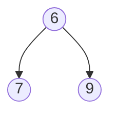
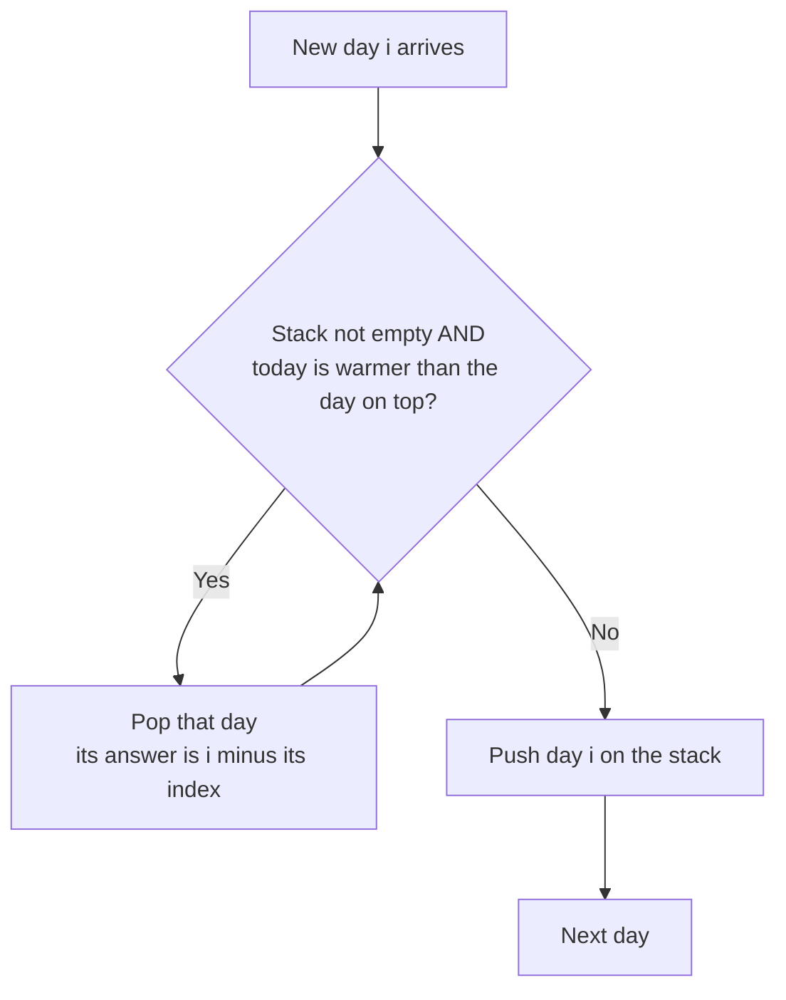

# Heaps and Stacks

The LRU cache on the last page kept items in a useful **order**. This page has two tools that keep exactly the right thing **ready to grab**:

- A **heap** always hands you the smallest (or largest) item quickly.
- A **stack** holds items that are still **waiting** for an answer.

| Problem | Pattern | Time | Extra space |
| --- | --- | --- | --- |
| 215. Kth Largest Element in an Array | Min-heap of size k | O(n log k) | O(k) |
| 739. Daily Temperatures | Monotonic stack | O(n) | O(n) |

---

## Problem 215: Kth Largest Element in an Array

**LeetCode:** [215. Kth Largest Element in an Array](https://leetcode.com/problems/kth-largest-element-in-an-array/) · Medium

#### The question

You get an unsorted array and a number `k`. Return the **kth largest** element, as if the array were sorted from big to small. Duplicates count separately (it is not the "kth different value").

Example: in `[7, 2, 9, 4, 6, 1]` with `k = 3`, the sorted-down order is `9, 7, 6, 4, 2, 1`, so the answer is **6**.

#### Think first

Sort the array and pick the item at position `k` from the end. That is O(n log n), and it is correct. But we are sorting **everything** just to find one item. Can we do less?

#### What is a heap?

A **heap** is a tree stored in an array with one simple rule. In a **min-heap**, every parent is smaller than or equal to its children. So the **smallest item is always on top**.



| Operation | Cost |
| --- | --- |
| Look at the smallest item (`peek`) | O(1) |
| Add an item (`offer`) | O(log n) |
| Remove the smallest item (`poll`) | O(log n) |

In Java, a `PriorityQueue` is a min-heap by default.

#### The idea: keep only the k biggest

Think of a club that only has **k seats**, for the k biggest numbers seen so far.

- Every new number tries to join the club.
- If the club now has more than k members, **the smallest member is thrown out**.
- At the end, the club holds the k biggest numbers. The **smallest of them** (the one sitting on top of the min-heap) is the **kth largest**.

That is why we use a **min-heap**, even though we want the largest. The top of the heap is the weakest member of the club, the one who gets thrown out first, and also the answer.

#### Dry run: `[7, 2, 9, 4, 6, 1]`, `k = 3`

(The heap content is written sorted here only to make it easy to read.)

| Number | After adding | Size more than 3? | After removing the smallest |
| --- | --- | --- | --- |
| 7 | `[7]` | no | `[7]` |
| 2 | `[2, 7]` | no | `[2, 7]` |
| 9 | `[2, 7, 9]` | no | `[2, 7, 9]` |
| 4 | `[2, 4, 7, 9]` | yes | remove 2, giving `[4, 7, 9]` |
| 6 | `[4, 6, 7, 9]` | yes | remove 4, giving `[6, 7, 9]` |
| 1 | `[1, 6, 7, 9]` | yes | remove 1, giving `[6, 7, 9]` |

The heap now holds the 3 biggest numbers: 9, 7, 6. The top is **6**, which is the 3rd largest.

#### Java solution

```java
public int findKthLargest(int[] nums, int k) {
    PriorityQueue<Integer> heap = new PriorityQueue<>();   // min-heap

    for (int x : nums) {
        heap.offer(x);
        if (heap.size() > k) {
            heap.poll();            // throw out the smallest
        }
    }
    return heap.peek();             // the smallest of the k biggest
}
```

#### Three ways to solve it

| Approach | Time | Space | Notes |
| --- | --- | --- | --- |
| Sort the array | O(n log n) | O(1) or O(n) | Simplest. Fine if n is small |
| Min-heap of size k | O(n log k) | O(k) | Great when k is small, and it works on a stream of data |
| Quickselect | O(n) on average, O(n²) worst case | O(1) | Fastest on average. See below |

**Quickselect** is quicksort with a shortcut. Pick a pivot, and partition the array so smaller items go left and bigger items go right. Now you know the pivot's final position. If it is the position you want, you are done. If not, you continue in **only one** side, not both. That is why it is O(n) on average.

:::warning[Quickselect traps]
- A bad pivot choice (for example always the first item on sorted data) gives O(n²). Pick a **random** pivot.
- Many equal values can also slow down a simple partition. Use a three-way partition (smaller, equal, bigger) to handle them.
:::

#### Complexity (heap solution)

- **Time:** O(n log k). Each of the n numbers costs at most one O(log k) heap operation.
- **Space:** O(k) for the heap.

:::tip[Interview follow-ups]
- "The numbers arrive one by one and you must always know the kth largest." Keep the min-heap of size k alive. This is the heap solution in its natural form.
- "Top k **frequent** elements." Count with a `HashMap`, then use the same size-k heap on the counts.
:::

---

## Problem 739: Daily Temperatures

**LeetCode:** [739. Daily Temperatures](https://leetcode.com/problems/daily-temperatures/) · Medium

#### The question

You get an array where each number is the temperature of one day. For **each day**, find how many days you must wait until a **warmer** day. If there is no warmer day ahead, write `0`.

Example: `[30, 25, 28, 35, 27, 29, 26, 31]` gives `[3, 1, 1, 0, 1, 2, 1, 0]`. Day 0 (30°) waits 3 days for the 35° on day 3.

#### Think first

For each day, scan forward until you find a warmer day. That is O(n²) in the worst case, for example when the temperatures only go down. Many scans repeat the same work.

#### The idea: a stack of days that are still waiting

Imagine you walk through the days from left to right. Some earlier days are **still waiting** for a warmer day. We keep their **indexes** on a stack.

When today arrives:

- If today is warmer than the day on top of the stack, that day's wait is over. Its answer is `today - thatDay`. Remove it from the stack, and check the next one below.
- Keep going until the top day is **not** colder than today (or the stack is empty).
- Then put today on the stack. Today is now waiting too.



Because of this rule, the temperatures of the waiting days **always go down** as you go up the stack, with the coldest at the top. That is why it is called a **monotonic** stack: it only goes in one direction. It also explains why the top is the first one to be answered: if today is not warmer than the top (the coldest waiting day), it is not warmer than any day below either.

#### Dry run: `[30, 25, 28, 35, 27, 29, 26, 31]`

The stack holds day **indexes**. The bottom is on the left.

| Day i | Temp | Stack before | What happens | Stack after |
| --- | --- | --- | --- | --- |
| 0 | 30 | empty | nothing to compare, push | `[0]` |
| 1 | 25 | `[0]` | 25 is not warmer than 30, push | `[0, 1]` |
| 2 | 28 | `[0, 1]` | warmer than day 1 (25): `answer[1] = 2 - 1 = 1`. Not warmer than day 0 (30), push | `[0, 2]` |
| 3 | 35 | `[0, 2]` | warmer than day 2 (28): `answer[2] = 1`. Warmer than day 0 (30): `answer[0] = 3` | `[3]` |
| 4 | 27 | `[3]` | not warmer than 35, push | `[3, 4]` |
| 5 | 29 | `[3, 4]` | warmer than day 4 (27): `answer[4] = 1`. Not warmer than 35, push | `[3, 5]` |
| 6 | 26 | `[3, 5]` | not warmer than 29, push | `[3, 5, 6]` |
| 7 | 31 | `[3, 5, 6]` | warmer than day 6 (26): `answer[6] = 1`. Warmer than day 5 (29): `answer[5] = 2`. Not warmer than day 3 (35), push | `[3, 7]` |

Days 3 and 7 are still on the stack at the end. They never found a warmer day, so their answers stay `0`.

Final answer: `[3, 1, 1, 0, 1, 2, 1, 0]`.

#### Java solution

```java
public int[] dailyTemperatures(int[] temps) {
    int[] answer = new int[temps.length];             // all zeros to start
    Deque<Integer> stack = new ArrayDeque<>();        // indexes of days still waiting

    for (int i = 0; i < temps.length; i++) {
        while (!stack.isEmpty() && temps[i] > temps[stack.peek()]) {
            int prev = stack.pop();
            answer[prev] = i - prev;                  // days waited
        }
        stack.push(i);
    }
    return answer;
}
```

#### Complexity

- **Time:** O(n). It looks like a loop inside a loop, but **each day is pushed once and popped at most once**, so the total work is about 2n steps.
- **Space:** O(n) for the stack in the worst case (when temperatures only go down).

:::tip[Where else this pattern appears]
Whenever a question asks for the **next greater** or **next smaller** item, think monotonic stack. Examples: Next Greater Element, Largest Rectangle in Histogram, and Trapping Rain Water. Always store **indexes** on the stack, so you can compute distances.
:::

:::note[Use `ArrayDeque`, not `Stack`]
Java's old `Stack` class is slow because it is synchronized, and it is considered outdated. `ArrayDeque` is the recommended choice for a stack or a queue.
:::

---

:::info[Next page]
We have worked with lines of data so far. Next, data that **branches and connects**: trees and graphs. We start with a tree, move on to grids and dependency graphs, and finish with backtracking. Continue with [Trees and Graphs](./04-trees-and-graphs.md).
:::
