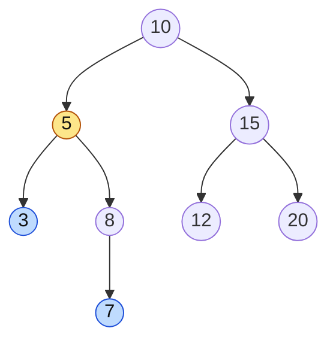
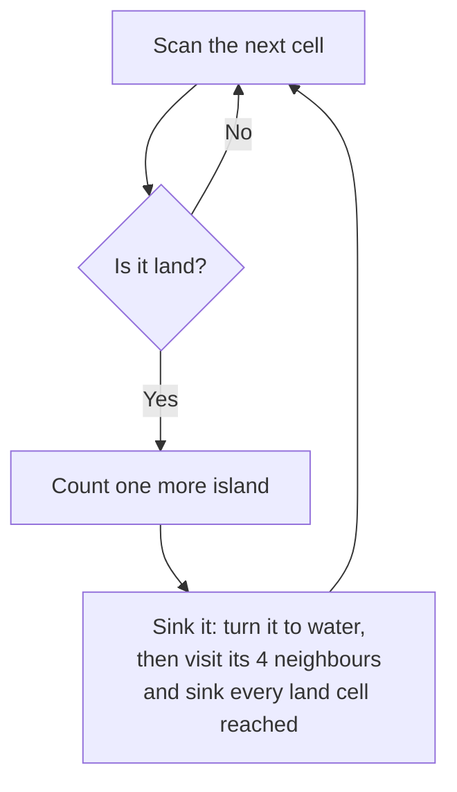
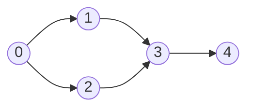
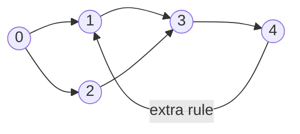
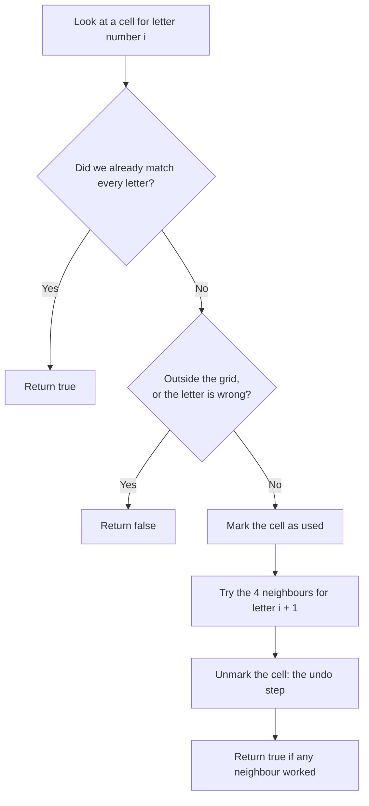

# Trees and Graphs

Up to now, our data sat in a line. Here, items connect to **many** other items. The four problems below go in a natural order:

1. A **tree** (each item has one parent), solved with recursion.
2. A **grid**, which is really a hidden graph, explored with DFS or BFS.
3. A **directed graph** with dependencies, where we must find a cycle.
4. **Backtracking** on a grid, which reuses the grid walking from problem 2 and adds an "undo" step.

| Problem | Pattern | Time | Extra space |
| --- | --- | --- | --- |
| 236. Lowest Common Ancestor of a Binary Tree | Tree recursion | O(n) | O(h) |
| 200. Number of Islands | DFS or BFS flood fill | O(rows × cols) | O(rows × cols) |
| 207. Course Schedule | Topological sort (Kahn) | O(V + E) | O(V + E) |
| 79. Word Search | Backtracking | O(rows × cols × 3^L) | O(L) |

(In the table, `h` is the height of the tree, `V` is the number of nodes, `E` is the number of connections, and `L` is the length of the word.)

---

## Problem 236: Lowest Common Ancestor of a Binary Tree

**LeetCode:** [236. Lowest Common Ancestor of a Binary Tree](https://leetcode.com/problems/lowest-common-ancestor-of-a-binary-tree/) · Medium

#### The question

You get a binary tree (it is **not** a search tree, so values are in no special order) and two nodes `p` and `q` that are in the tree. Return their **lowest common ancestor (LCA)**: the deepest node that has both `p` and `q` below it. A node counts as being below itself.

We will use this tree:



- `p = 7` and `q = 3` (blue): the LCA is **5** (yellow).
- `p = 7` and `q = 12`: the LCA is **10**, the root.
- `p = 5` and `q = 7`: the LCA is **5**, because 5 is above 7 and counts as its own ancestor.

#### Think first

You could find the path from the root to each node, and then compare the two paths to see where they split. It works, but needs extra lists. A short recursion does it directly.

#### The idea: ask each side "do you contain p or q?"

At every node, we ask the left subtree and the right subtree to report what they found. A call returns:

- `null` if neither `p` nor `q` is in that subtree.
- the node it found (`p` or `q`) if it contains one of them.
- the LCA itself, if both were found inside (this bubbles up unchanged).

Then at the current node:

1. If the current node **is** `p` or `q`, return it right away. We do not need to look deeper: if the other node is below, this node is the answer anyway.
2. If **both** left and right returned something (not `null`), then `p` and `q` are on different sides. **This node is the LCA.**
3. If only one side returned something, pass that up.

#### Dry run: `p = 7`, `q = 3`

| Node visited | Left result | Right result | Returns | Why |
| --- | --- | --- | --- | --- |
| 3 | | | 3 | it is `q`, return right away |
| 7 | | | 7 | it is `p`, return right away |
| 8 | 7 | `null` | 7 | only the left side found something |
| **5** | 3 | 7 | **5** | **both sides found something, so 5 is the LCA** |
| 12, 20 | `null` | `null` | `null` | nothing here |
| 15 | `null` | `null` | `null` | nothing in this whole side |
| 10 | 5 | `null` | 5 | passes the answer up unchanged |

The root returns 5, which is correct.

#### Java solution

```java
public class TreeNode {
    int val;
    TreeNode left, right;
    TreeNode(int val) { this.val = val; }
}

public TreeNode lowestCommonAncestor(TreeNode root, TreeNode p, TreeNode q) {
    if (root == null || root == p || root == q) return root;

    TreeNode left = lowestCommonAncestor(root.left, p, q);
    TreeNode right = lowestCommonAncestor(root.right, p, q);

    if (left != null && right != null) return root;   // p and q are on different sides
    return left != null ? left : right;               // pass up whatever was found
}
```

#### Complexity

- **Time:** O(n). In the worst case, every node is visited once.
- **Space:** O(h) for the recursion, where `h` is the height of the tree (up to n for a very unbalanced tree).

:::tip[Interview follow-up]
If the tree is a **binary search tree** (LeetCode 235), use the ordering. If both values are smaller than the current node, go left. If both are bigger, go right. Otherwise the current node is the LCA. That is O(h) and needs no full search.
:::

---

## Problem 200: Number of Islands

**LeetCode:** [200. Number of Islands](https://leetcode.com/problems/number-of-islands/) · Medium

#### The question

You get a grid of `'1'` (land) and `'0'` (water). An **island** is a group of land cells connected **up, down, left, or right** (not diagonally). Count the islands.

Our example grid (`.` is water, letters mark the islands):

```text
Grid:             Islands:

1 1 0 0 0         A A . . .
1 0 0 1 1         A . . B B
0 0 1 0 0         . . C . .
0 0 0 0 1         . . . . D
```

The answer is **4**.

#### Think first

Think of each land cell as a point, and each up, down, left, or right neighbour as a connection. A grid is a hidden **graph**. Counting islands means counting **connected groups** in that graph.

#### The idea: find land, then sink the whole island

1. Scan every cell, row by row.
2. When you meet a land cell that you have not seen, you found a **new island**. Add 1 to the count.
3. Now **sink the whole island**: visit every land cell connected to it and turn it into water (`'0'`). That way, you never count it again.

The sinking step is called a **flood fill**, and it can use DFS (go deep, with recursion) or BFS (go wide, with a queue).



#### Dry run

| Scan reaches | Land? | Count | What gets sunk |
| --- | --- | --- | --- |
| (0,0) | yes, new | 1 | island A: (0,0), (0,1), (1,0) |
| (0,1), (1,0) | now water | 1 | already sunk |
| (1,3) | yes, new | 2 | island B: (1,3), (1,4) |
| (1,4) | now water | 2 | already sunk |
| (2,2) | yes, new | 3 | island C: (2,2) alone |
| (3,4) | yes, new | 4 | island D: (3,4) alone |

Notice that (3,4) is **not** connected to (1,4), because the cell between them, (2,4), is water. The answer is **4**.

#### Java solution: DFS (recursive)

```java
public int numIslands(char[][] grid) {
    int count = 0;
    for (int r = 0; r < grid.length; r++) {
        for (int c = 0; c < grid[0].length; c++) {
            if (grid[r][c] == '1') {
                count++;
                sink(grid, r, c);
            }
        }
    }
    return count;
}

private void sink(char[][] grid, int r, int c) {
    if (r < 0 || c < 0 || r >= grid.length || c >= grid[0].length || grid[r][c] != '1') {
        return;                              // outside the grid, or not land
    }
    grid[r][c] = '0';                        // sink this cell
    sink(grid, r + 1, c);
    sink(grid, r - 1, c);
    sink(grid, r, c + 1);
    sink(grid, r, c - 1);
}
```

#### Java solution: BFS (safer for big grids)

```java
public int numIslands(char[][] grid) {
    int rows = grid.length, cols = grid[0].length, count = 0;
    int[][] dirs = {{1, 0}, {-1, 0}, {0, 1}, {0, -1}};

    for (int r = 0; r < rows; r++) {
        for (int c = 0; c < cols; c++) {
            if (grid[r][c] != '1') continue;

            count++;
            Deque<int[]> queue = new ArrayDeque<>();
            queue.add(new int[]{r, c});
            grid[r][c] = '0';                          // mark when added, not when taken out

            while (!queue.isEmpty()) {
                int[] cell = queue.poll();
                for (int[] d : dirs) {
                    int nr = cell[0] + d[0], nc = cell[1] + d[1];
                    if (nr >= 0 && nc >= 0 && nr < rows && nc < cols && grid[nr][nc] == '1') {
                        grid[nr][nc] = '0';
                        queue.add(new int[]{nr, nc});
                    }
                }
            }
        }
    }
    return count;
}
```

:::warning[DFS can overflow the stack]
On a big grid shaped like a long snake, the recursive DFS goes as deep as the number of land cells. A 300 by 300 grid can have 90,000 cells, and Java may throw `StackOverflowError`. The BFS version uses a queue on the heap, so it is safe. Use BFS (or an explicit stack) when depth can be large.
:::

:::note[Do not want to change the input?]
Both versions sink cells by editing the grid. If you must not modify it, use a separate `boolean[][] visited` array instead (this costs extra space).
:::

#### Complexity

- **Time:** O(rows × cols). Every cell is visited a constant number of times.
- **Space:** O(rows × cols) in the worst case, for the recursion depth or the queue.

:::tip[Pattern to remember]
"Visit the 4 neighbours of a cell" is the template for many grid problems. In the problem after next, Word Search, we use it again with one big change: we will **undo** each step.
:::

---

## Problem 207: Course Schedule

**LeetCode:** [207. Course Schedule](https://leetcode.com/problems/course-schedule/) · Medium

#### The question

There are `n` courses, numbered from `0` to `n - 1`. You also get a list of pairs `[a, b]`, each meaning "to take course `a`, you must first take course `b`". Return `true` if you can finish all the courses, or `false` if the rules make it impossible.

Our example has 5 courses, and the rules are `[1,0]`, `[2,0]`, `[3,1]`, `[3,2]`, `[4,3]`:



An arrow `0 → 1` means "take 0 before 1". Here, you can take them in the order 0, 1, 2, 3, 4. The answer is **true**.

Now add one more rule, `[1,4]` (course 1 needs course 4):



Now 1 needs 4, 4 needs 3, and 3 needs 1. They wait for each other forever. This is a **cycle**, and the answer is **false**.

#### Think first

The question is really: **does this directed graph have a cycle?** If it has no cycle, there is a valid order to take the courses (called a **topological order**).

#### The idea: take the free courses first (Kahn's algorithm)

Think of it like real life. You can start with any course that has **no prerequisites**. Once you take it, the courses that were waiting for it get one step closer to free.

1. For each course, count how many prerequisites it still has. This count is called its **indegree**.
2. Put all courses with indegree `0` into a queue. These are free to take.
3. Take a course from the queue. For every course that needed it, reduce its indegree by 1. If that reaches 0, it is now free, so add it to the queue.
4. Repeat until the queue is empty.
5. If you took **all** n courses, the answer is `true`. If some courses were never freed, they are stuck in a cycle, and the answer is `false`.

#### Dry run on the graph with the cycle

Starting indegrees: course 0 has 0, course 1 has 2 (needs 0 and 4), course 2 has 1, course 3 has 2, course 4 has 1.

| Step | Queue before | Take | Updates | Queue after | Taken so far |
| --- | --- | --- | --- | --- | --- |
| start | | | only course 0 has indegree 0 | `[0]` | 0 |
| 1 | `[0]` | 0 | course 1: 2 to 1. Course 2: 1 to 0, so it is free | `[2]` | 1 |
| 2 | `[2]` | 2 | course 3: 2 to 1 | `[]` | 2 |
| end | `[]` | | the queue is empty | | **2 of 5** |

Only 2 of 5 courses were taken. Courses 1, 3, and 4 never reached indegree 0, because they wait for each other. The answer is **false**.

On the first graph (without the extra rule), the same steps free course 1 and course 2 after taking 0, then course 3 after both of them, then course 4. All 5 courses are taken, so the answer is **true**.

#### Java solution

```java
public boolean canFinish(int numCourses, int[][] prerequisites) {
    List<List<Integer>> next = new ArrayList<>();   // next.get(b) = courses unlocked by b
    int[] indegree = new int[numCourses];
    for (int i = 0; i < numCourses; i++) next.add(new ArrayList<>());

    for (int[] p : prerequisites) {                 // p[0] needs p[1] first
        next.get(p[1]).add(p[0]);
        indegree[p[0]]++;
    }

    Deque<Integer> queue = new ArrayDeque<>();
    for (int i = 0; i < numCourses; i++) {
        if (indegree[i] == 0) queue.add(i);         // courses with no prerequisites
    }

    int taken = 0;
    while (!queue.isEmpty()) {
        int course = queue.poll();
        taken++;
        for (int nxt : next.get(course)) {
            if (--indegree[nxt] == 0) queue.add(nxt);   // now free
        }
    }
    return taken == numCourses;                     // anything left over is in a cycle
}
```

#### Complexity

- **Time:** O(V + E). We touch every course and every rule once.
- **Space:** O(V + E) for the graph.

:::tip[Interview follow-ups]
- **Course Schedule II (LeetCode 210)** asks for the actual order. Same algorithm: record each course as you take it.
- **DFS alternative:** walk the graph with three states for each node (not visited, in progress, done). Meeting an "in progress" node means a cycle.
- **Real-world uses:** build systems, task schedulers, and database migrations all rely on topological sorting.
:::

---

## Problem 79: Word Search

**LeetCode:** [79. Word Search](https://leetcode.com/problems/word-search/) · Medium

#### The question

You get a grid of letters and a word. Can the word be spelled by moving through **neighbouring cells** (up, down, left, right), using each cell **at most once** in a single path?

Our example grid:

```text
A B C
D E F
```

- The word `ABED` is **possible**: A (0,0) → B (0,1) → E (1,1) → D (1,0).
- The word `ABD` is **not**: after A and B, no neighbour of B is a D.

#### Think first

This is like Number of Islands, because we walk through a grid in 4 directions. But there is a difference. An island search marks a cell once and forever. Here, a cell can belong to a path that fails, and then another path may need to use that same cell. So we need to be able to **undo** our choice.

#### The idea: backtracking

Backtracking means: **try a choice, go as far as you can, and if it fails, undo the choice and try the next one.**

At each cell, for the letter we need now:

1. If the cell is outside the grid, or its letter is wrong, this path fails.
2. Otherwise, **mark the cell as used** (temporarily).
3. Try to match the **next** letter from each of the 4 neighbours.
4. **Unmark** the cell (this is the "undo"), and report whether any neighbour worked.

We try every cell on the grid as a starting point.



#### Dry run 1: `ABED` (success)

Neighbours are tried in this order: down, up, right, left.

| Depth | Letter needed | Cell | What happens |
| --- | --- | --- | --- |
| 1 | A | (0,0) | matches A. Mark it |
| 2 | B | (1,0) | down from A: it is D, not B, so this fails |
| 2 | B | (0,1) | right from A: matches B. Mark it |
| 3 | E | (1,1) | down from B: matches E. Mark it |
| 4 | D | (1,0) | down is outside. Up is (0,1), already marked with `#`, so no. Right is (1,2), which is F, so no. Left is (1,0): matches D |
| 5 | (none left) | | every letter matched, so **return true** |

#### Dry run 2: `ABD` (failure and undo)

1. A at (0,0) matches. Then B at (0,1) matches.
2. We need D now. The neighbours of (0,1) are E (down), C (right), and A (left). A is marked. None is D, so this path **fails**.
3. We **unmark** B and A as we return. The grid is back to normal.
4. No other cell holds the letter A, so the final answer is **false**.

That unmark step is the heart of backtracking. Without it, cells would stay blocked, and other possible paths would be missed.

#### Java solution

```java
public boolean exist(char[][] board, String word) {
    for (int r = 0; r < board.length; r++) {
        for (int c = 0; c < board[0].length; c++) {
            if (dfs(board, word, 0, r, c)) return true;    // try every start cell
        }
    }
    return false;
}

private boolean dfs(char[][] board, String word, int i, int r, int c) {
    if (i == word.length()) return true;                   // all letters matched

    if (r < 0 || c < 0 || r >= board.length || c >= board[0].length
            || board[r][c] != word.charAt(i)) {
        return false;                                      // outside, or wrong letter
    }

    char saved = board[r][c];
    board[r][c] = '#';                                     // mark as used

    boolean found = dfs(board, word, i + 1, r + 1, c)
                 || dfs(board, word, i + 1, r - 1, c)
                 || dfs(board, word, i + 1, r, c + 1)
                 || dfs(board, word, i + 1, r, c - 1);

    board[r][c] = saved;                                   // undo: put the letter back
    return found;
}
```

#### Complexity

- **Time:** O(rows × cols × 3^L), where `L` is the word length. From each start cell, the first step has up to 4 choices, and after that at most 3 (we cannot go back to where we came from).
- **Space:** O(L) for the recursion depth.

:::tip[Speed-ups for interviews]
- **Count letters first.** If the word needs more of a letter than the whole board has, return `false` immediately.
- **Search from the rarer end.** If the last letter of the word is rarer on the board than the first letter, search for the reversed word. It prunes more branches early.
:::

:::note[Island versus Word Search]
Number of Islands sinks cells **permanently**, because one cell can only belong to one island. Word Search marks cells **temporarily** and undoes it, because a cell can be part of many different attempted paths. Same grid walking, different rule for the mark.
:::

---

:::info[Next page]
Backtracking tries every path, which can be very slow (see the 3^L in the time). The last page shows how to avoid repeating work by remembering answers to smaller problems. This is **dynamic programming**. Continue with [Dynamic Programming](./05-dynamic-programming.md).
:::
