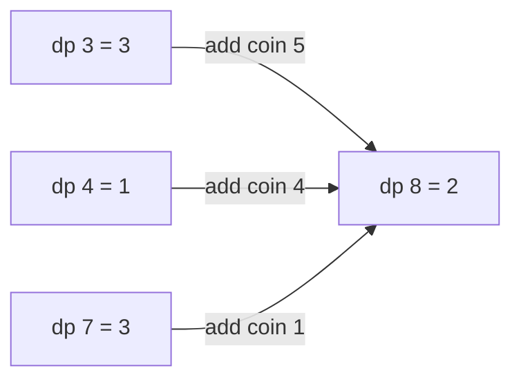

# Dynamic Programming

On the last page, backtracking tried **every** path, and its time grew very fast. **Dynamic programming (DP)** is the cure when the same smaller problem shows up again and again. The idea is simple:

> Solve each small problem **once**, write the answer down, and reuse it.

Like a student who writes formulas on a cheat sheet instead of working them out again for every question.

#### How to build a DP solution

Almost every DP solution follows the same three steps:

| Step | Question to ask | Coin Change example |
| --- | --- | --- |
| 1. **State** | What does one table entry mean? | `dp[a]` = fewest coins to make amount `a` |
| 2. **Transition** | How does a big answer come from smaller ones? | `dp[a]` = 1 + the best of `dp[a - coin]` |
| 3. **Base case** | What is the answer for the tiniest problem? | `dp[0]` = 0 coins |

You can fill the table **bottom-up** (from small to large, as we do below), or **top-down** with recursion plus a memory (called memoization). Both give the same answers.

| Problem | Pattern | Time | Extra space |
| --- | --- | --- | --- |
| 322. Coin Change | 1D DP, fewest items | O(amount × coins) | O(amount) |
| 300. Longest Increasing Subsequence | DP, or binary search on tails | O(n²), or O(n log n) | O(n) |

---

## Problem 322: Coin Change

**LeetCode:** [322. Coin Change](https://leetcode.com/problems/coin-change/) · Medium

#### The question

You have coins of different values, and **unlimited** coins of each value. Given a target amount, return the **fewest coins** needed to make exactly that amount. If it is impossible, return `-1`.

Example: coins `[1, 4, 5]` and amount `8`. The answer is **2** (4 + 4).

#### Think first

The natural idea is **greedy**: always take the biggest coin that fits. Let us test it on our example:

```text
Greedy:   8 -> take 5 -> 3 left -> take 1, 1, 1  =  5 + 1 + 1 + 1  =  4 coins
Best:     8 -> 4 + 4                              =  2 coins
```

Greedy gives 4, but the real answer is 2. So greedy **does not work** for general coins.

Trying every combination with recursion works, but it repeats the same work. The fewest coins for amount 3 would be computed again and again from many different paths.

#### The idea: build up from amount 0

Let `dp[a]` be the fewest coins needed to make amount `a`.

- `dp[0] = 0`. Making nothing takes no coins.
- For any amount `a`, the **last coin** we use could be any coin `c` (as long as `c` is at most `a`). Before that coin, we had to make `a - c`. So:

```text
dp[a] = 1 + min( dp[a - c] )   over all coins c that fit
```

- If an amount cannot be made at all, we keep a very large number there (we use `amount + 1` as "infinity", since no answer can ever need that many coins).



The picture shows how `dp[8]` is built from three smaller answers. The coin 4 route (`dp[4] + 1 = 2`) is the best.

#### Dry run: coins `[1, 4, 5]`, amount `8`

| a | Using coin 1 | Using coin 4 | Using coin 5 | dp[a] |
| --- | --- | --- | --- | --- |
| 0 | | | | **0** (base case) |
| 1 | dp[0] + 1 = 1 | | | **1** |
| 2 | dp[1] + 1 = 2 | | | **2** |
| 3 | dp[2] + 1 = 3 | | | **3** |
| 4 | dp[3] + 1 = 4 | dp[0] + 1 = 1 | | **1** |
| 5 | dp[4] + 1 = 2 | dp[1] + 1 = 2 | dp[0] + 1 = 1 | **1** |
| 6 | dp[5] + 1 = 2 | dp[2] + 1 = 3 | dp[1] + 1 = 2 | **2** |
| 7 | dp[6] + 1 = 3 | dp[3] + 1 = 4 | dp[2] + 1 = 3 | **3** |
| 8 | dp[7] + 1 = 4 | dp[4] + 1 = 2 | dp[3] + 1 = 4 | **2** |

(An empty cell means that coin is bigger than the amount, so it cannot be used.) The answer is `dp[8] = 2`.

#### Java solution

```java
public int coinChange(int[] coins, int amount) {
    int[] dp = new int[amount + 1];
    Arrays.fill(dp, amount + 1);        // "infinity": more coins than could ever be needed
    dp[0] = 0;                          // base case

    for (int a = 1; a <= amount; a++) {
        for (int coin : coins) {
            if (coin <= a) {
                dp[a] = Math.min(dp[a], dp[a - coin] + 1);
            }
        }
    }
    return dp[amount] > amount ? -1 : dp[amount];   // still "infinity" means impossible
}
```

#### Complexity

- **Time:** O(amount × number of coins). For each amount, we try each coin.
- **Space:** O(amount) for the table.

:::warning[Common mistakes]
- Using `Integer.MAX_VALUE` as infinity and then adding 1 to it. It overflows to a negative number. Using `amount + 1` avoids that.
- Forgetting to return `-1` when the amount cannot be made (for example coins `[4, 6]` and amount `7`).
- Assuming greedy is correct. It works only for special coin sets (like normal money), not in general.
:::

:::tip[Interview follow-up]
"Count the **number of ways** to make the amount" (LeetCode 518) uses a very similar table, but you **add** the ways instead of taking the minimum, and the loop order (coins outside, amounts inside) decides whether orders are counted separately.
:::

---

## Problem 300: Longest Increasing Subsequence

**LeetCode:** [300. Longest Increasing Subsequence](https://leetcode.com/problems/longest-increasing-subsequence/) · Medium

#### The question

You get an array of numbers. Find the length of the longest **strictly increasing subsequence**. A subsequence keeps the original order, but the items **do not need to be next to each other**, so you can skip some.

Example: `[10, 3, 8, 4, 6, 9, 2, 7]`. One longest subsequence is `3, 4, 6, 9`, so the answer is **4**. (Another one is `3, 4, 6, 7`.)

:::note[Subsequence is not substring]
A substring must be a continuous piece (like in problem 3). A subsequence can skip items. For `[10, 3, 8, 4]`, the numbers `3, 4` form a subsequence even though 8 sits between them.
:::

#### Think first

Checking every possible subsequence takes 2^n steps, which is far too slow. We need a smarter way, and this problem has **two** well-known solutions. Start with the simpler one.

#### Solution 1: the DP table, O(n²)

Let `dp[i]` be the length of the longest increasing subsequence that **ends at position `i`**.

- Every number alone is a subsequence of length 1, so start every `dp[i]` at 1.
- To find `dp[i]`, look at every earlier number `nums[j]`. If it is **smaller** than `nums[i]`, we can put `nums[i]` after it. So `dp[i] = max(dp[i], dp[j] + 1)`.
- The final answer is the **biggest value in the whole table**, because the best subsequence can end anywhere.

Dry run on `[10, 3, 8, 4, 6, 9, 2, 7]`:

| i | nums[i] | Smaller numbers before it (and their dp) | dp[i] |
| --- | --- | --- | --- |
| 0 | 10 | none | 1 |
| 1 | 3 | none | 1 |
| 2 | 8 | 3 (1) | 2 |
| 3 | 4 | 3 (1) | 2 |
| 4 | 6 | 3 (1), 4 (2) | 3 |
| 5 | 9 | 3 (1), 8 (2), 4 (2), 6 (3) | 4 |
| 6 | 2 | none | 1 |
| 7 | 7 | 3 (1), 4 (2), 6 (3), 2 (1) | 4 |

The biggest value is **4**.

```java
public int lengthOfLISQuadratic(int[] nums) {
    int[] dp = new int[nums.length];
    Arrays.fill(dp, 1);                       // each number alone has length 1
    int best = 1;

    for (int i = 1; i < nums.length; i++) {
        for (int j = 0; j < i; j++) {
            if (nums[j] < nums[i]) {
                dp[i] = Math.max(dp[i], dp[j] + 1);
            }
        }
        best = Math.max(best, dp[i]);
    }
    return best;
}
```

Time O(n²), space O(n). This is enough to pass for moderate input sizes, and it is the easiest to explain.

#### Solution 2: keep the best "tails", O(n log n)

Here is the smarter idea. Keep a list called `tails`, where:

> `tails[len]` is the **smallest possible last number** of any increasing subsequence of length `len + 1`.

Why the smallest? Because a subsequence that ends with a smaller number is easier to extend later.

Now process each number `x`:

- If `x` is **bigger than every tail**, it extends the longest subsequence so far. Add it to the end.
- Otherwise, find the **first tail that is greater than or equal to `x`**, and replace it with `x`. We found a way to make a subsequence of that length that ends in a smaller number.

Because `tails` is always sorted, we can find that position with **binary search** (the same skill as problem 33).

Dry run on `[10, 3, 8, 4, 6, 9, 2, 7]`:

| Number | What we do | `tails` after |
| --- | --- | --- |
| 10 | list is empty, add it | `[10]` |
| 3 | smaller than 10, replace 10 | `[3]` |
| 8 | bigger than all, add it | `[3, 8]` |
| 4 | replace 8 (first tail at least 4) | `[3, 4]` |
| 6 | bigger than all, add it | `[3, 4, 6]` |
| 9 | bigger than all, add it | `[3, 4, 6, 9]` |
| 2 | replace 3 | `[2, 4, 6, 9]` |
| 7 | replace 9 | `[2, 4, 6, 7]` |

The length of `tails` is **4**, which is the answer.

:::warning[Careful: `tails` is not the real subsequence]
At the end, `[2, 4, 6, 7]` is **not** a valid subsequence of the input (the 2 comes after 3, 4, and 6 in the array). The list only keeps the right **length**. To rebuild the real sequence, you must also store a "previous item" for each position.
:::

```java
public int lengthOfLIS(int[] nums) {
    int[] tails = new int[nums.length];
    int size = 0;                                  // how many tails are in use

    for (int x : nums) {
        int lo = 0, hi = size;                     // binary search: first tail >= x
        while (lo < hi) {
            int mid = (lo + hi) >>> 1;
            if (tails[mid] < x) lo = mid + 1;
            else hi = mid;
        }
        tails[lo] = x;                             // replace, or add at the end
        if (lo == size) size++;
    }
    return size;
}
```

Because we look for the first tail that is **greater than or equal** to `x`, an equal number replaces a tail instead of extending it. That is what keeps the sequence **strictly** increasing.

#### Compare the two solutions

| | DP table | Tails and binary search |
| --- | --- | --- |
| Time | O(n²) | O(n log n) |
| Space | O(n) | O(n) |
| Easy to explain | Yes | Needs a careful explanation |
| Gives the real sequence | Easy to extend | Needs extra bookkeeping |

:::tip[Interview advice]
Start with the O(n²) DP, explain it clearly, and then offer the O(n log n) improvement. This shows you can find a working solution first and optimize second.
:::

---

:::info[You finished the DSA section]
Look back at the pattern map on the [DSA overview](./index.md). Next time you meet a new problem, ask: "Which clue does this question have, and which pattern does it point to?" The more problems you place on that map, the faster you will recognize them.
:::
