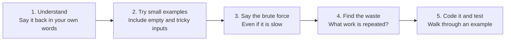

# DSA: Data Structures and Algorithms

This section walks through **15 popular LeetCode problems**. Every problem is explained the same way, so you always know where to look:

| Part | What you get |
| --- | --- |
| **The question** | The problem in simple words, with a link to the official page on LeetCode |
| **Think first** | The obvious (slow) way, and why it is not good enough |
| **The idea** | The trick, explained in plain words, with a diagram |
| **Dry run** | The idea executed step by step on a small example, so you can follow every change |
| **Java solution** | Working code, tested before it was put here |
| **Complexity** | How the time and memory grow |

:::note[About the problem statements]
The questions are written in my own words, with my own small examples. For the exact official wording, the full constraints, and more test cases, open the LeetCode link at the top of each problem.
:::

## How to attack any problem

Interviewers care about **how you think**, not only the final code. This routine works for almost every problem:

Step 4 is where the patterns below come from. Each pattern is a way to **stop repeating work**.

## The pattern map

When you read a question, look for these clues:

| Clue in the question | Pattern | Problems |
| --- | --- | --- |
| Longest or shortest stretch of neighbouring items | Sliding window | 3 |
| Count subarrays with a given sum | Prefix sum and hash map | 560 |
| Find pairs or triplets without duplicates | Sort and two pointers | 15 |
| Overlapping ranges | Sort and merge | 56 |
| Sorted (or nearly sorted) data, need log n | Binary search | 33 |
| Reverse or rewire links | Linked list pointers | 206 |
| Fast lookup plus "oldest first" order | Hash map and doubly linked list | 146 |
| Kth largest, top k | Heap | 215 |
| Next bigger or next smaller item | Monotonic stack | 739 |
| Ancestors and paths in a tree | Tree recursion | 236 |
| Connected regions in a grid | DFS or BFS | 200 |
| Order with dependencies, or "is there a cycle?" | Topological sort | 207 |
| Try every path, undo the choice | Backtracking | 79 |
| Fewest, most, or number of ways, with repeating subproblems | Dynamic programming | 322, 300 |

## A quick feel for Big-O

Big-O tells you how the work **grows** when the input grows. Here is a rough guide for what is fast enough when `n` is the input size:

| Complexity | Example | Fine for roughly |
| --- | --- | --- |
| O(1) | Read one array item, one hash map lookup | Any size |
| O(log n) | Binary search | Billions |
| O(n) | One pass over the data | Tens of millions |
| O(n log n) | Sorting | Millions |
| O(n²) | Two nested loops | About 10,000 |
| O(2^n) | Try every subset | About 20 to 25 |

## The five pages

The problems are grouped so each page builds on the one before:

1. [Arrays and Strings](./01-arrays-and-strings.md): problems 3, 560, 15, 56
2. [Searching, Linked Lists, and Design](./02-search-lists-design.md): problems 33, 206, 146
3. [Heaps and Stacks](./03-heaps-and-stacks.md): problems 215, 739
4. [Trees and Graphs](./04-trees-and-graphs.md): problems 236, 200, 207, 79
5. [Dynamic Programming](./05-dynamic-programming.md): problems 322, 300

Start with page 1. It uses the simplest tools (a loop, two pointers, and a hash map), and every later page reuses them.
