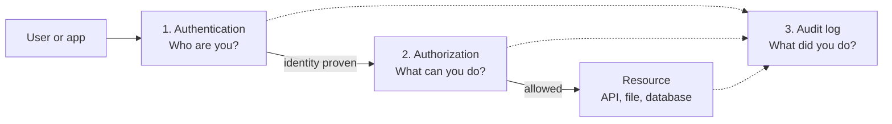
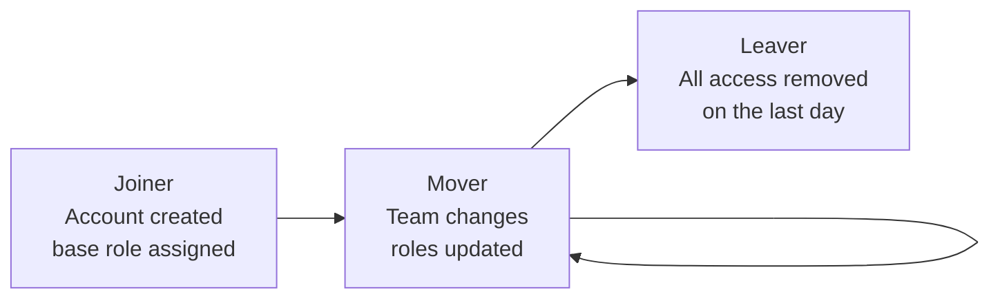
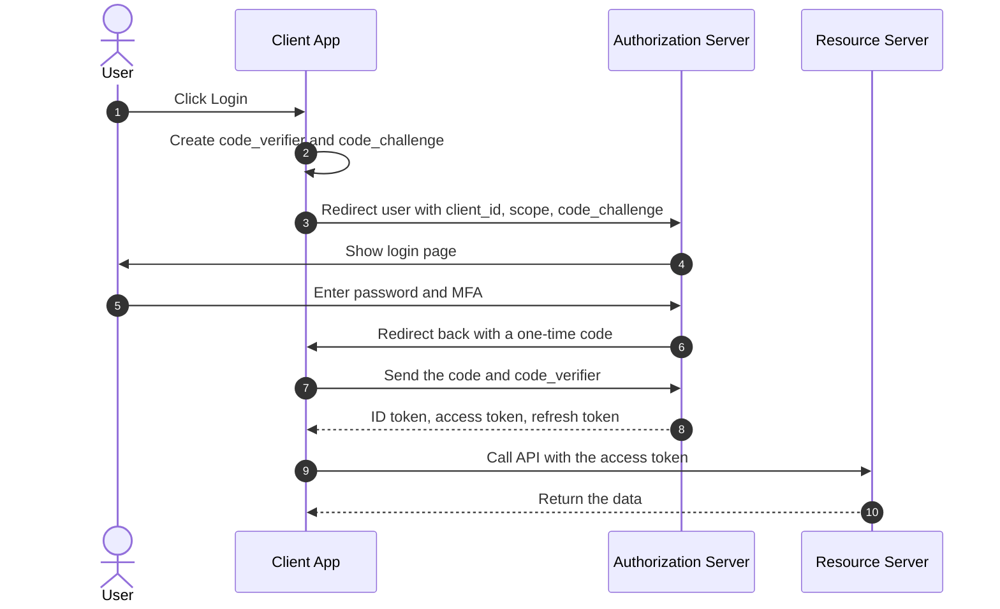
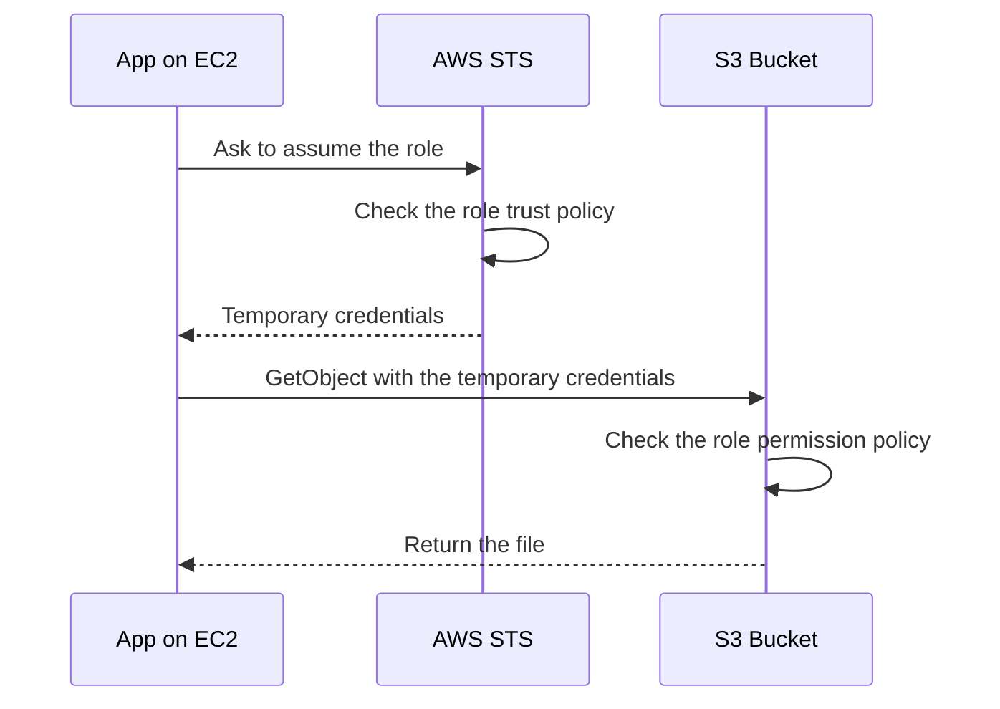
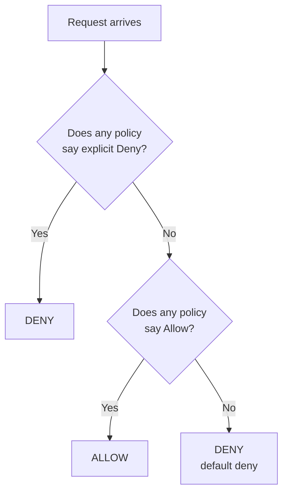

# IAM: Identity and Access Management

Think of an office building. At the door, a guard checks your **ID badge**. Your badge only opens **some** doors. And a **log** records which doors you opened.

IAM is the same idea for software. It makes sure **the right people and apps** can reach **the right things**, and nothing more.

---

## 1. The big picture: three questions

Every IAM system answers three questions, in this order:

| Question | Name | Building example |
| --- | --- | --- |
| Who are you? | **Authentication** (AuthN) | The guard checks your badge |
| What are you allowed to do? | **Authorization** (AuthZ) | Your badge opens only some doors |
| What did you do? | **Auditing** | The door log |



:::tip[The one sentence to remember]
Authentication proves **who** you are. Authorization decides **what** you can do. Never mix them up in an interview.
:::

---

## 2. The words you will hear

A few terms come up again and again. Learn these and the rest is easy.

| Term | Simple meaning |
| --- | --- |
| **Identity** | A person or an app that exists in the system (a user, a service) |
| **Credential** | The proof of identity: password, key, certificate, fingerprint |
| **Role** | A named bundle of permissions, like `Admin` or `Viewer` |
| **Permission** | One allowed action, like "read this file" |
| **Policy** | A written rule that grants or denies permissions |
| **Token** | A small piece of proof handed out after login, so you do not log in again |
| **IdP** (Identity Provider) | The system that checks identities and issues tokens (Keycloak, Okta, Entra ID, Auth0) |

---

## 3. Proving who you are (Authentication)

There are three kinds of proof. Strong systems combine them, which is called **MFA** (multi-factor authentication).

- **Something you know:** a password or PIN.
- **Something you have:** a phone app, a hardware key.
- **Something you are:** a fingerprint or face.

**SSO** (single sign-on) means you log in **once** at the IdP, and many apps trust that login. This is why you do not type your password again for each company tool.

### The life of an identity

IAM is not only about logging in. Accounts must be created, changed, and **removed**. Forgotten accounts of people who left are a favourite way for attackers to get in.



---

## 4. Tokens and JWT

After you log in, the IdP gives you a **token**. You send it with every request, so the API knows who you are without asking for a password again.

The most common token format is a **JWT** (JSON Web Token). It has three parts joined by dots:

```text
header.payload.signature
```

The **payload** carries facts about you, called *claims*:

```json
{
  "sub": "user-123",
  "iss": "https://idp.example.com",
  "aud": "orders-api",
  "exp": 1767225600,
  "roles": ["ORDER_MANAGER"]
}
```

| Claim | Meaning |
| --- | --- |
| `sub` | Who the token is about |
| `iss` | Who issued it |
| `aud` | Which API it is meant for |
| `exp` | When it expires |

An API must check **four things** before it trusts a JWT: the **signature** is valid, the token is **not expired**, the **issuer** is correct, and the **audience** is itself.

There are usually two tokens:

- **Access token:** short life (minutes). Sent to APIs.
- **Refresh token:** longer life. Used only to get a new access token. Keep it safer.

:::warning[A JWT is signed, not secret]
Anyone can read the payload. Never put passwords or private data inside it.
:::

---

## 5. OAuth 2.0 and OpenID Connect

This is the part interviewers love, so take it slowly.

- **OAuth 2.0** is about **authorization**: "let this app act for me, without giving it my password."
- **OpenID Connect (OIDC)** sits on top of OAuth 2.0 and adds **authentication**: "tell this app who I am." It adds an **ID token**.

The four players:

| Player | Example |
| --- | --- |
| Resource owner | You, the user |
| Client | The app that wants access |
| Authorization server | The IdP (Keycloak, Okta, Google) |
| Resource server | The API that holds the data |

### The main flow: Authorization Code with PKCE

This is the recommended flow for web apps, mobile apps, and single-page apps.



Why so many steps? The browser only ever sees a **one-time code**, never the real token. And **PKCE** (the verifier and challenge) proves that the app asking for the token is the same app that started the login. So a stolen code is useless.

### Which flow for which job?

| Grant type | Use it for |
| --- | --- |
| **Authorization Code + PKCE** | Users logging in (web, mobile, SPA) |
| **Client Credentials** | One service calling another, with no user |
| **Refresh Token** | Getting a new access token quietly |
| Implicit, Password | Old flows. No longer recommended |

---

## 6. Deciding what you can do (Authorization)

After we know who you are, we check what you may do. Three common models:

| Model | How it decides | Example |
| --- | --- | --- |
| **RBAC** (role-based) | By your role | Role `Manager` can approve orders |
| **ABAC** (attribute-based) | By facts about you, the resource, and the situation | Managers can approve orders under 10,000 in their own region, during work hours |
| **ACL** (access list) | A list on each resource | This file can be read by Asha and Ravi |

RBAC is simple and fits most apps. ABAC is more flexible but harder to manage.

:::tip[The golden rule: least privilege]
Give each identity **only** the access it needs, for **only** as long as it needs it. Most real breaches get worse because someone had far more access than the job required.
:::

---

## 7. A real example: AWS IAM

AWS IAM shows all these ideas in a concrete form.

| AWS word | Meaning |
| --- | --- |
| **User** | A person (or a legacy long-lived identity) |
| **Group** | A set of users that share policies |
| **Role** | An identity with **no password**, which is *assumed* for a short time |
| **Policy** | A JSON document with the rules |

A policy that lets someone read files from one bucket:

```json
{
  "Version": "2012-10-17",
  "Statement": [
    {
      "Effect": "Allow",
      "Action": ["s3:GetObject"],
      "Resource": "arn:aws:s3:::my-app-reports/*"
    }
  ]
}
```

### Apps should use roles, not keys

Do **not** put access keys in your code. Give the app a **role**. It receives **temporary** credentials that expire by themselves.



### How AWS decides: allow or deny?



Remember this order: **an explicit Deny always wins**. If nothing allows the action, it is denied by default.

---

## 8. IAM inside a Spring Boot app

This ties everything above to the code you already know. Your API becomes a **resource server** that trusts tokens from the IdP:

```java
@Bean
SecurityFilterChain api(HttpSecurity http) throws Exception {
    http
        .authorizeHttpRequests(auth -> auth.anyRequest().authenticated())
        .oauth2ResourceServer(oauth -> oauth.jwt(Customizer.withDefaults()));
    return http.build();
}
```

```properties
spring.security.oauth2.resourceserver.jwt.issuer-uri=https://idp.example.com/realms/demo
```

Spring then checks the signature, expiry, and issuer for you. For the full setup, see the JWT question in [Spring Boot Interview Questions](./spring-boot-interview.md).

---

## 9. Good habits checklist

- Turn on **MFA**, at least for admins.
- Use **short-lived** tokens and credentials.
- Use **roles**, not long-lived keys, for apps.
- Keep secrets in a vault, never in Git.
- **Review** access regularly and remove what is unused.
- Keep **audit logs** and watch them.

---

## 10. Interview questions

### 1. What is the difference between OAuth 2.0, OpenID Connect, and SAML?

**In short:** OAuth 2.0 is about **access**. OIDC adds **login** on top of OAuth. SAML is an older **login** standard.

OAuth 2.0 gives an app limited access to an API. OIDC adds an ID token so the app also learns who the user is. SAML does the same login job as OIDC but uses XML, and you mostly see it in older enterprise SSO.

### 2. Why use Authorization Code with PKCE, and not the Implicit flow?

**In short:** The Implicit flow puts the token in the browser URL, where it can leak. Code with PKCE never exposes the token that way.

With PKCE, a stolen one-time code cannot be exchanged without the secret verifier that only the real app holds. This is why Implicit is no longer recommended, even for single-page apps.

### 3. A JWT is stateless. So how do you revoke it?

**In short:** You cannot easily, so keep it **short-lived**.

Practical options: very short access tokens (5 to 15 minutes) with refresh tokens you **can** revoke, a small deny-list of revoked token IDs (`jti`) checked by the API, or opaque tokens that the API checks with the IdP (introspection). Each option trades some of the speed of stateless tokens for control.

### 4. Where should a single-page app store its tokens?

**In short:** Avoid `localStorage`. Prefer a backend that holds tokens in a secure cookie.

Any script on the page can read `localStorage`, so one XSS bug steals the tokens. A common safer design is **backend-for-frontend (BFF)**: the server keeps the tokens and gives the browser only an `HttpOnly`, `Secure`, `SameSite` cookie.

### 5. How do you secure calls between 10 microservices?

**In short:** Give each service its own identity, and use short-lived tokens or certificates.

- **Client Credentials** flow: each service gets a token for itself.
- **mTLS** (mutual TLS): both sides prove themselves with certificates, often handled by a service mesh.
- Pass the **user's identity** along (token exchange) when the downstream service needs to know who the real user is.
- Do not trust a call just because it comes from inside the network.

### 6. In AWS, an IAM policy says Allow but the request is denied. Why?

**In short:** Something else says **Deny**, or something limits the maximum.

An explicit Deny in any policy wins over every Allow. Other layers can also block it: a **Service Control Policy** from the organization, a **permission boundary** on the identity, a **session policy**, or the **resource's own policy**. Allow in one place does not override a limit in another.

### 7. IAM user vs IAM role: when do you use which?

**In short:** Use **roles** for apps and temporary access. Use people-based identities (ideally through SSO) for humans.

Roles have no long-term password or key, and their credentials expire, so a leak does far less damage. Long-lived user access keys are a common security finding.

### 8. RBAC or ABAC: how do you choose?

**In short:** Start with RBAC. Add ABAC when roles alone get messy.

If you find yourself creating roles like `Manager-North-Under10k`, you have a "role explosion". That is the sign to move some rules into attributes (region, amount, time) instead of making more roles.

---

:::info[Where to next]
IAM sits at the front of every system. To see how it connects to code, read [Spring Boot Interview Questions](./spring-boot-interview.md), and for the language side see [Java Interview Questions](./java-interview.md).
:::
