# OAuth 2.0 in Depth

The [IAM](./01-iam-basics.md) page gave a short tour of OAuth 2.0 and OpenID Connect. This page goes all the way: what OAuth is, every part of it, how the authorization server works inside, and above all **how it fits a real system**: frontend apps that call Java microservices, which also call each other.

We will use one picture all the way through: **a hotel**.

- At the **front desk**, you show your passport once. The desk gives you a **key card**.
- The key card opens **only your room and the gym** (not other rooms), and it **stops working at checkout**.
- Each **door lock** checks the card by itself. It doesn't call the front desk every time you open the door.

That is OAuth. The front desk is the **authorization server**, the key card is the **access token**, what the card opens is its **scope**, and the door locks are your **APIs**.

:::tip[The one idea]
OAuth lets an app get a **limited, short-lived key** (an access token) to call APIs, **instead of** holding the user's password. Who issues keys, what each key opens, and how long it lasts are all controlled in one place.
:::

---

## 1. The problem OAuth solves

Imagine a photo-printing app that wants to read your photos from your cloud drive. Before OAuth, the app asked for **your password** to the drive.

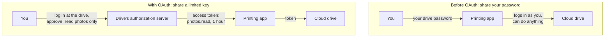

| | Sharing the password | OAuth |
| --- | --- | --- |
| The app sees your password | Yes | **Never** |
| What the app can do | Everything you can | Only what you approved (**scope**) |
| How long | Until you change your password | Minutes to hours (**expiry**) |
| Taking it back | Change your password everywhere | Revoke one app's access |

This is called **delegated authorization**: you let an app act for you, **in a limited way**.

### OAuth vs OpenID Connect

OAuth answers "**what may this app do?**" It doesn't tell the app who you are. **OpenID Connect (OIDC)** is a thin layer on top of OAuth that adds login. It adds an **ID token**, which tells the app who the user is.

| | OAuth 2.0 | OpenID Connect |
| --- | --- | --- |
| Question it answers | What may this app do? (authorization) | Who is the user? (authentication) |
| Main token | Access token | ID token, plus the access token |
| Token is read by | The **API** | The **app** (the client) |
| Turned on by | Scopes such as `orders.read` | The scope `openid` |

In practice you almost always use both together. "Log in with Google" is OIDC, and the token your app then uses to call APIs is OAuth.

---

## 2. The four roles

Every OAuth system has the same four roles.

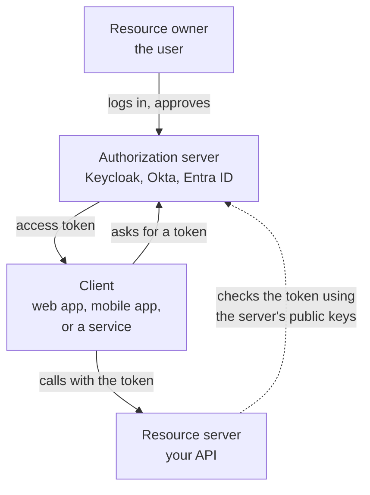

| Role | Meaning | Hotel picture | In our system |
| --- | --- | --- | --- |
| **Resource owner** | The person who owns the data and gives permission | The guest | The user of your app |
| **Client** | The app that wants to call the API **for** the user (or for itself) | Someone holding the key card | The React app, the mobile app, or a microservice calling another one |
| **Authorization server** | Checks who you are and **issues tokens** | The front desk | Keycloak, Okta, Entra ID, Auth0, or AWS Cognito |
| **Resource server** | The API that holds the data and **accepts tokens** | A door lock | Your Spring Boot microservices |

:::note[The client is the app, not the user]
"Client" in OAuth means an **application**, never a person. A microservice that calls another microservice is also a client.
:::

### Two kinds of client

| | Confidential client | Public client |
| --- | --- | --- |
| Can keep a secret? | **Yes**, it runs on a server | **No**, its code is on the user's device |
| Examples | A backend, a BFF (section 7), a microservice | A single-page app in the browser, a mobile app |
| Proves itself to the token endpoint with | A client secret, or better, a private key or certificate | **PKCE** only (section 5) |

Anyone can open a mobile app or a browser's developer tools and read a "secret" inside. So public clients have **no** secret, and the flows are designed with that in mind.

---

## 3. The pieces you will meet

Before the flows, here are the words they use.

| Piece | What it is |
| --- | --- |
| **client_id** | The app's public name at the authorization server, such as `shop-web` |
| **client secret** | A password for a **confidential** client. Never in frontend code |
| **Redirect URI** | Where the authorization server sends the user back after login. Must be **registered** and match exactly |
| **Scope** | What the app is asking for, such as `openid profile orders.read`. The token gets only what is allowed |
| **Consent** | The screen where the user approves the scopes. Often skipped for a company's own apps |
| **Authorization code** | A one-time code, valid for seconds, that the app swaps for tokens |
| **Access token** | The key card. Sent to APIs. Short-lived |
| **Refresh token** | Gets a new access token without logging in again. Longer-lived, and well protected |
| **ID token** | OIDC only. A JWT that tells the **app** who logged in. Never sent to APIs |
| **state** | A random value the app sends and checks on the way back, to block forged logins (CSRF) |
| **PKCE** | Proof Key for Code Exchange: proves that the app swapping the code is the one that started the login |

The authorization server exposes a few standard **endpoints**:

| Endpoint | Used for |
| --- | --- |
| `/authorize` | The browser is sent here to log in and approve |
| `/token` | The app swaps a code, refresh token, or client credentials for tokens |
| `/.well-known/openid-configuration` | The **discovery** document: lists all the other endpoints and settings |
| JWKS (`jwks_uri`) | The public keys that APIs use to check token signatures |
| `/userinfo` | OIDC: more details about the user |
| `/introspect` | An API asks "is this token still valid?" Used for opaque tokens |
| `/revoke` | Cancel a refresh or access token, for example on logout |

---

## 4. Tokens: the key cards

### Access token: what the API receives

An access token is either a **JWT** that the API checks by itself, or an **opaque** random string that the API must look up at the authorization server.

| | JWT access token | Opaque access token |
| --- | --- | --- |
| Looks like | `eyJhbGciOi...`, readable claims | A random string |
| How the API checks it | Verifies the signature with cached public keys. **No network call** | Calls `/introspect` on each request (or caches the answer) |
| Speed | Fast | A call per request, unless cached |
| Revoking it at once | Hard. It stays valid until it expires | Easy. The server just says "not valid" |
| Typical in | Microservices | Public APIs, very sensitive systems |

A typical JWT access token from Keycloak, trimmed:

```json
{
  "iss": "https://idp.example.com/realms/shop",
  "sub": "f3a9c2e1-user-42",
  "aud": "orders-service",
  "azp": "shop-web",
  "scope": "openid orders.read orders.write",
  "realm_access": { "roles": ["CUSTOMER"] },
  "exp": 1782001200,
  "iat": 1782000900
}
```

| Claim | Meaning |
| --- | --- |
| `iss` | Issuer: which authorization server made it |
| `sub` | Subject: the user (or the service, for client credentials) |
| `aud` | Audience: which API it is meant for. An API must **reject** tokens meant for someone else |
| `azp` | Authorized party: which client asked for it |
| `scope` | What the client may do |
| `exp`, `iat` | Expires at, issued at |

### Refresh token: staying logged in

Access tokens live **5 to 15 minutes**, so a stolen one is soon useless. When one expires, the client uses the **refresh token** to get a new one quietly, without asking the user to log in again.

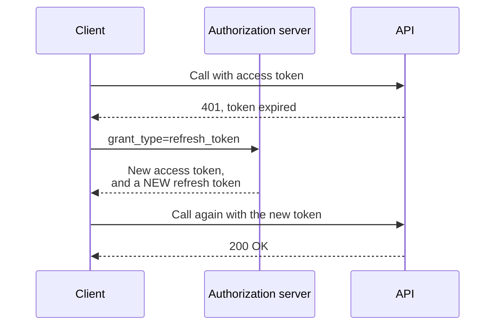

**Refresh token rotation:** each refresh token can be used **once**, and the server returns a new one. If an old refresh token is ever used again, someone has copied it. The server then cancels the whole chain, and the user must log in again.

### ID token: only for the app

The ID token says "Asha logged in at 10:02, with MFA". The **app** reads it to show "Hello, Asha". It is **not** a key for APIs: its audience is the app, not your services.

:::warning[Never send the ID token to an API]
APIs must accept only **access tokens** that name them in `aud`. An ID token sent to an API is a classic mistake. It is meant for a different reader, and it has no scopes.
:::

---

## 5. The grant types: how a client gets a token

A **grant type** is a way to get a token. Which one you use depends on **who** the client is and **whether a user is present**.

| Grant type | Client | User present? | Use it for |
| --- | --- | --- | --- |
| **Authorization Code + PKCE** | Web app, SPA, mobile app, BFF | Yes | All user logins |
| **Client Credentials** | A backend service | No | Service-to-service calls, batch jobs |
| **Refresh Token** | Any client that has one | No (already logged in) | Getting a new access token quietly |
| **Token Exchange** | A backend service | Indirectly | A service calling another **for the user** |
| **Device Code** | TV, CLI tool | Yes, on another device | Devices without a good browser |
| ~~Implicit~~, ~~Password~~ | | | **Removed.** Don't use them |

### 5.1 Authorization Code with PKCE: users logging in

This is the main flow, used for every user login.

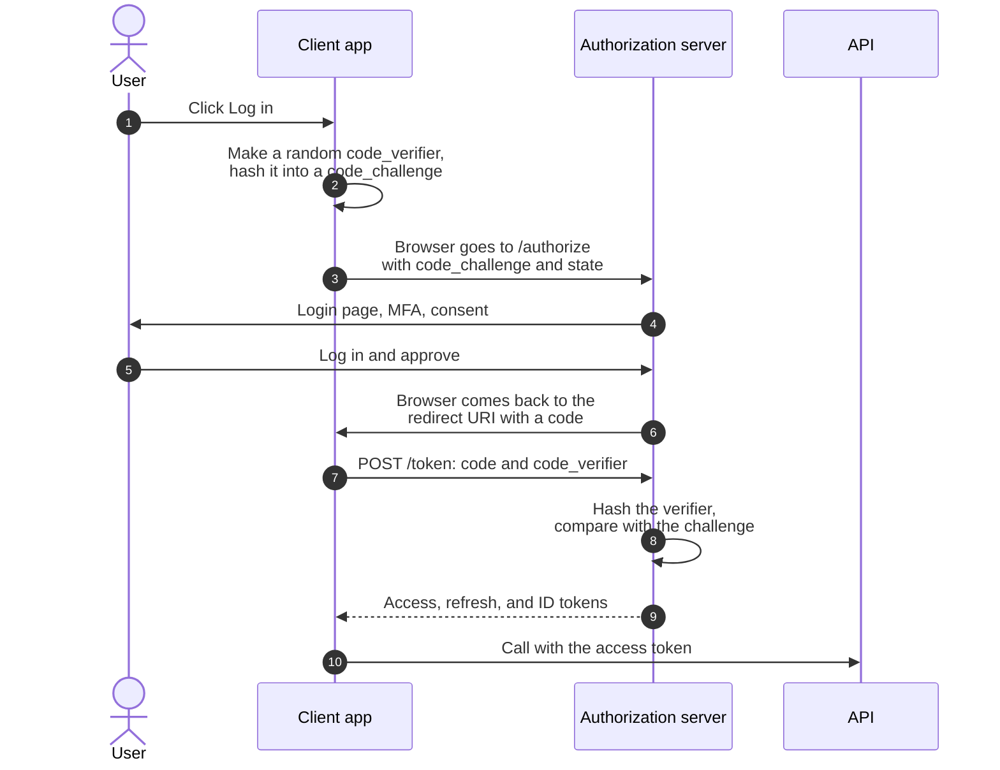

What the two requests look like:

```text
GET /authorize?response_type=code
    &client_id=shop-web
    &redirect_uri=https://shop.example.com/callback
    &scope=openid profile orders.read
    &state=k8Hq2x
    &code_challenge=E9Melhoa2OwvFrEMTJguCHaoeK1t8URWbuGJSstw-cM
    &code_challenge_method=S256
```

```text
POST /token
Content-Type: application/x-www-form-urlencoded

grant_type=authorization_code
&code=SplxlOBeZQQYbYS6WxSbIA
&redirect_uri=https://shop.example.com/callback
&client_id=shop-web
&code_verifier=dBjftJeZ4CVP-mB92K27uhbUJU1p1r_wW1gFWFOEjXk
```

**Why two steps (a code, then tokens)?** The code travels through the **browser**, which leaks things: history, logs, browser extensions. So the browser only ever carries a short-lived, one-time **code**. The real tokens come back over a **direct** server call.

**Why PKCE?** Suppose an attacker steals the code on its way back, for example through a malicious app on the phone that registered the same redirect link.

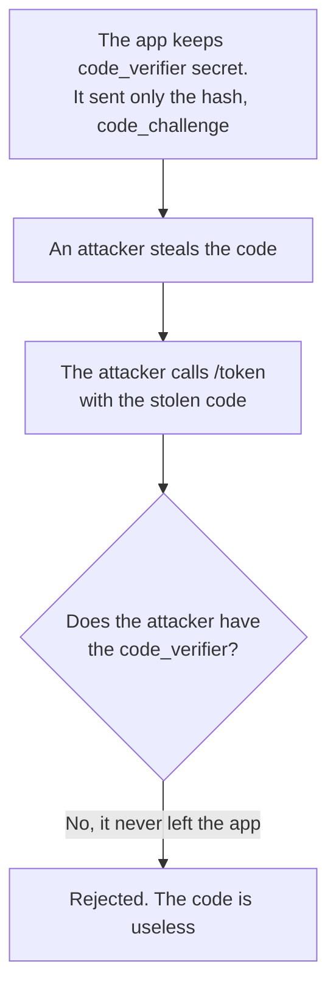

| Parameter | Protects against |
| --- | --- |
| `code_challenge` and `code_verifier` (PKCE) | A stolen code being used by someone else |
| `state` | An attacker tricking the user into finishing **the attacker's** login (CSRF) |
| `nonce` (OIDC) | An old ID token being replayed |
| Exact redirect URI match | Codes being sent to an attacker's site |

### 5.2 Client Credentials: a service calling a service, with no user

A nightly job in the **orders** service needs to call the **inventory** service. No user is involved, so the service logs in **as itself**.

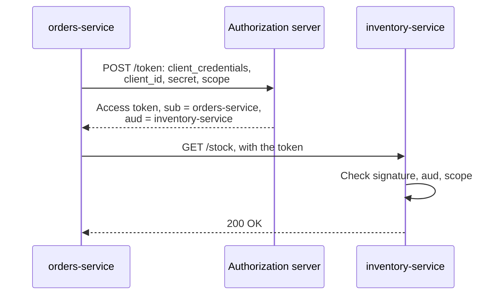

The token's `sub` is the **service**, not a user. The service caches the token and asks for a new one shortly before it expires. It doesn't ask once per request.

### 5.3 Token Exchange: a service calling a service, for a user

A user asks the **orders** service to place an order. Orders must call **payments**, and payments needs to know **which user** is paying. Orders shouldn't just forward the user's token, because that token's audience is `orders-service`, and payments must reject it.

**Token Exchange** (RFC 8693) solves this. Orders swaps the user's token for a **new** token meant for payments. It still names the user, but it has a narrower scope and the right audience.

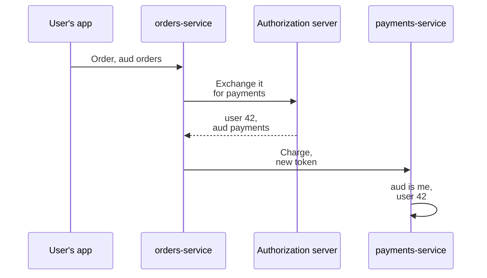

| Option | How | When |
| --- | --- | --- |
| **Token relay** | Forward the user's token as is | Simple setups. The token must list **every** service in `aud`, so it is too powerful |
| **Token exchange** | Swap it for a narrow token per service | The secure choice when user identity must travel |
| **Client credentials plus a user ID field** | The service calls as itself and passes the user ID as data | When the downstream service trusts the caller to have checked the user |

### 5.4 Device Code: TVs and command-line tools

A smart TV can't show a good login page. It shows "go to `example.com/device` and enter code **WDJB-MJHT**". You log in on your phone, and the TV, which keeps polling the token endpoint, receives its tokens. CLI tools such as cloud CLIs use the same flow.

### Old grants you should not use

| Grant | Why it was removed |
| --- | --- |
| **Implicit** | Returned the access token in the browser URL, where it leaked. Code + PKCE replaced it, even for SPAs |
| **Password** (Resource Owner Password Credentials) | The app collects the user's password, which is exactly what OAuth was made to avoid. It also can't do MFA or SSO properly |

The upcoming **OAuth 2.1** draft writes this down as the new baseline: PKCE for every client, no Implicit or Password grants, and exact redirect URI matching.

---

## 6. Inside the authorization server

The authorization server is the heart of the system. Here is what is inside one, such as Keycloak:

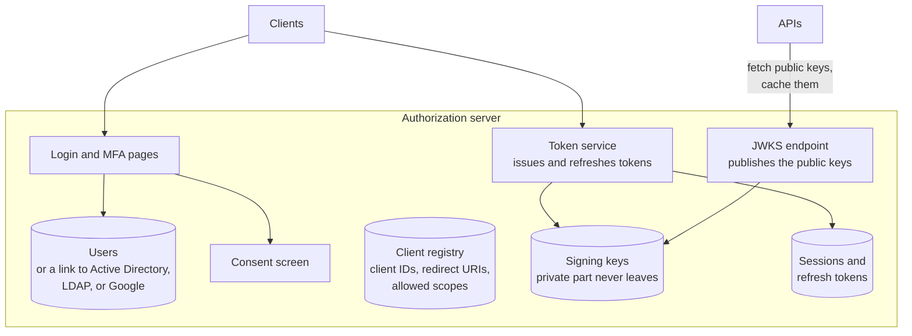

| Part | Job |
| --- | --- |
| **Login and MFA** | Checks who the user is. Can hand off to another identity provider ("log in with Google", or company Active Directory) |
| **Client registry** | Knows every app: its client ID, its redirect URIs, which grants and scopes it may use |
| **Token service** | Issues tokens, signs them with the **private** key, and handles refresh and rotation |
| **Signing keys** | The private key signs. The **public** key, published at JWKS, lets anyone verify |
| **Sessions** | Remembers that you logged in, which makes **SSO** work: the second app doesn't ask for your password again |

### How an API checks a token without calling the server

This is why JWTs scale so well in microservices:

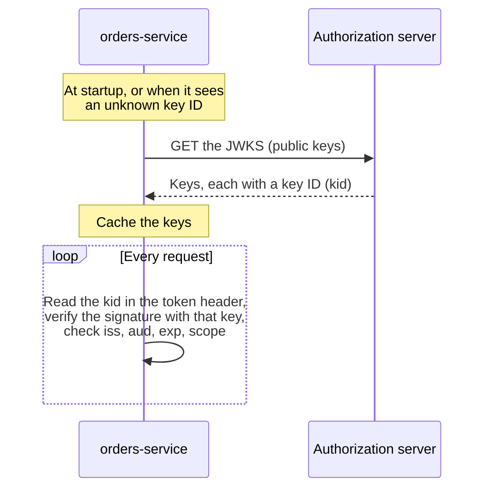

The authorization server can **rotate** its keys: it publishes the new key first, starts signing with it, and keeps the old key published until all old tokens have expired. APIs that see a new `kid` simply fetch the JWKS again.

:::note[If the authorization server goes down]
APIs keep accepting existing JWTs, because they check them with cached keys. But **new logins and refreshes fail**, so within minutes users start getting logged out. Run the authorization server highly available, with several instances and a replicated database.
:::

---

## 7. How it fits our architecture

Now the main event. A typical system:

- **Frontend apps:** a React web app (SPA) and a mobile app.
- **An API gateway** in front of the services.
- **Java microservices:** `orders-service`, `payments-service`, `inventory-service`.
- **One authorization server**, such as Keycloak, trusted by everything.

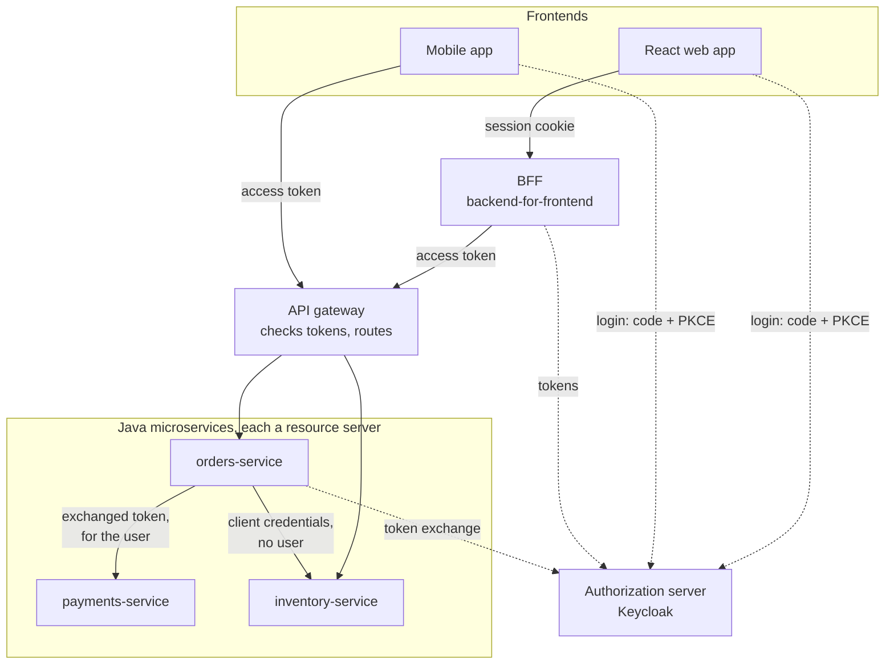

Let's go through each connection.

### 7.1 The web app: use a BFF

A single-page app runs entirely in the browser. Where should it keep its tokens? Any JavaScript on the page, including a malicious script injected through an XSS bug, can read `localStorage` or memory. So the safest design keeps tokens **off the browser entirely**.

A **BFF (backend-for-frontend)** is a small server-side part of the web app. It is a **confidential client**: it does the OAuth login, keeps the tokens on the server, and gives the browser only a session **cookie**.

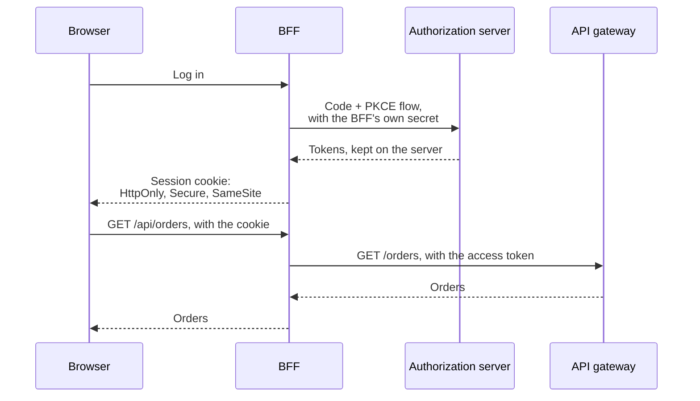

| | SPA holds the tokens | BFF holds the tokens |
| --- | --- | --- |
| Where the tokens live | In the browser | On the server |
| An XSS bug can steal tokens | **Yes** | No. JavaScript can't read an `HttpOnly` cookie |
| Client type | Public (PKCE only) | Confidential (PKCE plus a secret) |
| Refreshing tokens | In the browser | On the server, invisible to the user |
| Extra parts | None | A small server, and CSRF protection for the cookie |
| Recommended for | Low-risk apps | **Most business apps** |

In Spring, the BFF is a Spring Boot app using `oauth2Login()` and **Spring Cloud Gateway**'s `TokenRelay` filter, which adds the user's access token to calls it forwards.

### 7.2 The mobile app: Code + PKCE in the system browser

A mobile app is a **public client**, and it holds its own tokens:

- Open the login page in the **system browser** (Custom Tabs on Android, ASWebAuthenticationSession on iOS), never in an embedded web view. The app can't read your password there, and SSO with other apps works.
- Use **Code + PKCE**, with the redirect coming back to the app through an app link.
- Store the refresh token in the phone's secure storage: the **Keychain** on iOS, the **Keystore** on Android.

### 7.3 The API gateway: first check, not the only check

The gateway checks every token **before** traffic reaches the services: a valid signature, not expired, the right issuer. It rejects junk early, adds rate limits, and routes requests.

But each service **checks again**. If the gateway is the only check, any attacker who gets inside the network, or any misconfigured route, reaches the services with no check at all. This is the **zero trust** idea: never trust a call just because it comes from inside.

| Check | Gateway | Each service |
| --- | --- | --- |
| Signature, expiry, issuer | Yes | **Yes, again** |
| Audience is this service | Optional | **Yes** |
| Scope for this endpoint (`orders.write`) | Coarse, per route | **Yes, per endpoint** |
| Business rules ("is this order the user's own?") | No | **Yes**, only the service knows |

### 7.4 Service to service: two different cases

The most common source of confusion is that calls between services come in **two kinds**:

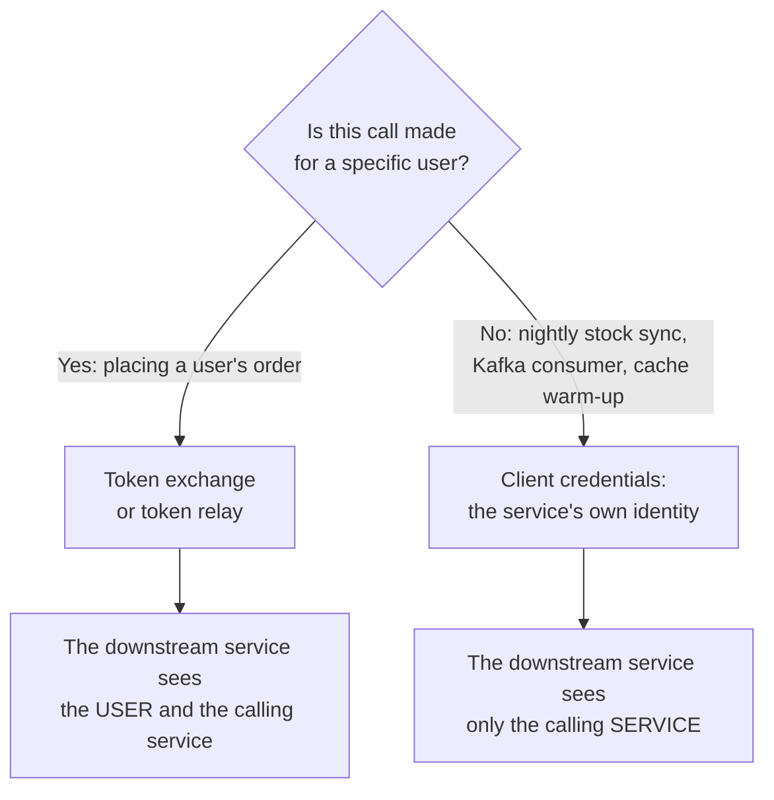

| | For a user | For the service itself |
| --- | --- | --- |
| Example | Orders charges a user's card through payments | Orders syncs stock from inventory every night |
| Grant | Token exchange (or relay) | Client credentials |
| `sub` in the token | The user | The calling service |
| Payments can check | "Is user 42 allowed to pay for this order?" | "Is orders-service allowed to call this?" |

Some teams also add **mTLS** (mutual TLS) between services, often through a service mesh. That proves **which machine** is calling, while the token proves **who** the call is for. The two work well together.

### 7.5 The whole journey

One user action, end to end:

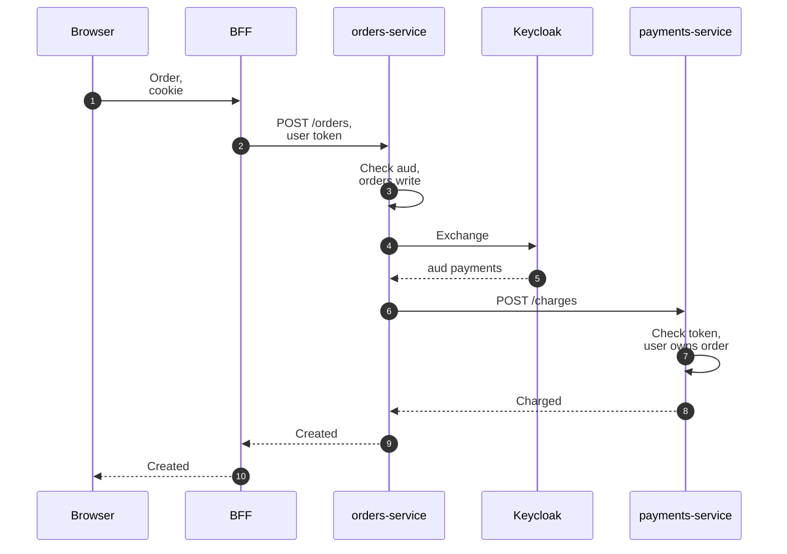

Every hop carries a token that names the user, is meant for exactly the next service, and has only the scope that step needs.

---

## 8. Scopes vs roles

These are easy to mix up:

- A **scope** limits what the **client app** may do for the user, such as `orders.read`.
- A **role** describes what the **user** may do in the business, such as `CUSTOMER` or `ADMIN`.

The real permission is **both**: the app must have the scope, **and** the user must have the role.

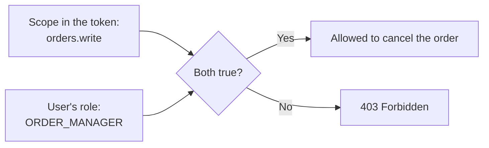

| | Scope | Role |
| --- | --- | --- |
| Describes | The **app's** permission | The **user's** permission |
| Example | A reporting app gets only `orders.read`, even for an admin user | Asha is an `ORDER_MANAGER` |
| Granted by | Client config and user consent | The identity admin |
| Spring Security name | `SCOPE_orders.read` | `ROLE_ORDER_MANAGER`, with a small converter for Keycloak's role claim |

---

## 9. In code: Spring Boot

### Each service: a resource server

```yaml
spring:
  security:
    oauth2:
      resourceserver:
        jwt:
          issuer-uri: https://idp.example.com/realms/shop   # finds the JWKS automatically
          audiences: orders-service                          # reject tokens meant for others
```

```java
@Bean
SecurityFilterChain api(HttpSecurity http) throws Exception {
    http
        .authorizeHttpRequests(auth -> auth
            .requestMatchers(HttpMethod.GET, "/orders/**").hasAuthority("SCOPE_orders.read")
            .requestMatchers(HttpMethod.POST, "/orders/**").hasAuthority("SCOPE_orders.write")
            .anyRequest().authenticated())
        .oauth2ResourceServer(oauth -> oauth.jwt(Customizer.withDefaults()));
    return http.build();
}
```

Spring downloads the public keys, then checks the signature, expiry, issuer, and audience on every request. The `scope` claim becomes `SCOPE_...` authorities automatically.

### A service calling another with client credentials

```yaml
spring:
  security:
    oauth2:
      client:
        registration:
          inventory:
            provider: keycloak
            client-id: orders-service
            client-secret: ${ORDERS_CLIENT_SECRET}    # from a vault, never in Git
            authorization-grant-type: client_credentials
            scope: inventory.read
        provider:
          keycloak:
            issuer-uri: https://idp.example.com/realms/shop
```

```java
// Works outside a web request too (scheduled jobs, Kafka consumers)
@Bean
OAuth2AuthorizedClientManager clientManager(ClientRegistrationRepository registrations,
                                            OAuth2AuthorizedClientService clients) {
    var manager = new AuthorizedClientServiceOAuth2AuthorizedClientManager(registrations, clients);
    manager.setAuthorizedClientProvider(
        OAuth2AuthorizedClientProviderBuilder.builder().clientCredentials().build());
    return manager;
}

@Bean
RestClient inventoryClient(RestClient.Builder builder, OAuth2AuthorizedClientManager manager) {
    var oauth = new OAuth2ClientHttpRequestInterceptor(manager);
    oauth.setClientRegistrationIdResolver(request -> "inventory");
    return builder
        .baseUrl("http://inventory-service")
        .requestInterceptor(oauth)   // gets, caches, and renews the token for you
        .build();
}
```

The interceptor fetches a token, caches it, adds the `Authorization: Bearer ...` header to every call, and renews the token before it expires. Your code just calls `inventoryClient.get()`.

---

## 10. Common mistakes and how to avoid them

| Mistake | What can go wrong | Fix |
| --- | --- | --- |
| Not checking `aud` | A token meant for one service is accepted by every other service | Each service accepts only tokens that name it |
| Tokens in `localStorage` | One XSS bug steals them | BFF with `HttpOnly` cookies |
| Sending the ID token to APIs | Wrong audience, no scopes | Use the access token |
| Loose redirect URIs (wildcards) | Codes sent to an attacker's page | Register exact URIs |
| No `state` or PKCE | Login CSRF, stolen codes | Always use both |
| Long-lived access tokens | A leaked token works for days | 5 to 15 minutes, plus refresh tokens |
| Forwarding the user's token everywhere | One stolen token opens every service | Token exchange, one audience per hop |
| Only the gateway checks tokens | Anything inside the network is trusted | Every service validates |
| Client secrets in frontend code | Anyone can read them | Public clients use PKCE, with no secret |

For extra protection, tokens can be **sender-constrained**: bound to a key the client holds (with **DPoP**) or to its TLS certificate (with mTLS). A stolen token is then useless without that key.

---

## 11. Interview questions

### 1. What is OAuth 2.0, in one minute?

**In short:** A standard that lets an app get a limited, short-lived access token to call APIs, instead of holding the user's password.

There are four roles: the user (resource owner), the app (client), the authorization server that issues tokens, and the API (resource server) that accepts them. The token carries scopes and an expiry, so access is limited and can be taken back. OIDC adds login on top with an ID token.

### 2. Why does the Authorization Code flow use a code first instead of returning the token directly?

**In short:** The code passes through the browser, which can leak it. The tokens come back over a direct, protected call.

The code is one-time and short-lived. With PKCE, it is also useless without the verifier that only the real app holds. This is why the Implicit flow, which put tokens in the URL, was retired.

### 3. Where should a React app keep its tokens?

**In short:** Ideally not in the browser at all. Use a BFF that keeps tokens on the server and gives the browser an `HttpOnly` cookie.

Any script on the page can read `localStorage` or memory, so an XSS bug becomes a token theft. If you must keep tokens in the SPA, keep access tokens in memory, keep them short-lived, and use refresh token rotation.

### 4. How do microservices call each other securely?

**In short:** Client credentials when the call is the service's own job. Token exchange when it is for a user. Every service validates the token's audience and scope.

Forwarding the user's token works, but it then has to be valid for every service, so it is too powerful. Token exchange gives each hop a narrow token with the right audience. mTLS can add proof of which workload is calling.

### 5. Is checking tokens at the API gateway enough?

**In short:** No. The gateway is a first filter. Each service must check the token again, including its audience and scopes.

Otherwise, anything that reaches a service directly, through a misconfigured route or from inside the network, is trusted without proof. Only the service can also apply business rules, such as "this order belongs to this user".

### 6. JWT or opaque access tokens?

**In short:** JWT for speed (checked locally), opaque for instant revocation (checked at the server).

JWTs suit microservices because each service verifies them with cached public keys and makes no network call. The cost is that a JWT stays valid until it expires, so keep it short-lived. Opaque tokens need an introspection call, but they can be cancelled at once.

### 7. What is the difference between a scope and a role?

**In short:** A scope limits what the **app** may do for the user. A role says what the **user** may do. A request needs both.

A reporting app might get only `orders.read`, even when an admin uses it. The API checks the scope and the user's role, and then its own business rules.

### 8. What happens to your system if the authorization server goes down?

**In short:** Existing JWTs keep working until they expire, but new logins and token refreshes fail.

APIs verify JWTs with cached public keys, so they don't notice at first. Within one access token lifetime, users start getting errors. That is why the authorization server runs with several instances, a replicated database, and close monitoring, like any other critical service.

---

:::info[Where to next]
Go back to [IAM](./01-iam-basics.md) for the wider picture: authentication, access control models, and AWS IAM. For the Spring side, see the security questions in [Spring Boot Interview Questions](../spring-boot-interview.md). To see how the gateway and services fit together at scale, see [System Design](../system-design/index.md).
:::
