# TLS and Certificates

The [OAuth](./02-oauth.md) page kept saying "add **mTLS** between services" and "bind the token to a **certificate**". Every token on that page also travels inside **TLS**. This page explains that layer from the ground up: keys, certificates, chains, the handshake, cipher suites, mTLS, and all those file types (PEM, PFX, P12, JKS) that confuse almost everyone.

We will use one picture all the way through: **passports at a border**.

- Your **passport** says who you are. It is issued by a **passport office**, and it has a **stamp** that is hard to fake.
- The border officer doesn't know you. They trust the passport because they **trust the government** that issued it.
- A passport alone proves nothing. Anyone can copy a photo of it. You also have to **be the person in it**: your face must match.

That is TLS. The passport is the **certificate**, the passport office is the **Certificate Authority (CA)**, the government everyone trusts is the **root CA**, and your face is the **private key**: the one thing a copy of the passport doesn't give you.

:::tip[The one idea]
TLS makes a connection **private** (nobody can read it), **tamper-proof** (nobody can change it), and **authenticated** (you know who is on the other end). Certificates are how the "who" part works. Everything else on this page is a detail of one of those three jobs.
:::

---

## 1. The map: all the words on one page

Come back to this table whenever a word confuses you. Each one is explained further down.

| Word | Full form - meaning | Passport picture |
| --- | --- | --- |
| **SSL** | Secure Sockets Layer - the old name for TLS. All SSL versions are broken and switched off, but people still say "SSL certificate" | The old passport design |
| **TLS** | Transport Layer Security - the protocol that encrypts a connection and proves the server's identity | The whole border check |
| **HTTPS** | HTTP Secure - plain HTTP sent inside a TLS connection | |
| **mTLS** | Mutual TLS - TLS where the **client also** shows a certificate | Both people at the desk show passports |
| **Public key** | The half of a key pair you can give to anyone | The photo in the passport |
| **Private key** | The half you never share. It proves you own the certificate | Your actual face |
| **Certificate** | A signed document that says "this public key belongs to this name". Format: **X.509** | The passport |
| **CA** | Certificate Authority - an organization that checks identities and signs certificates | The passport office |
| **Root certificate** | The CA certificate at the top. It signs itself and is trusted because it is pre-installed | The government |
| **Intermediate certificate** | A CA certificate signed by the root, used for daily signing | A regional passport office |
| **Leaf certificate** | The certificate of the actual server or client. Also called **end-entity** or **server certificate** | Your passport |
| **Chain** | Leaf, then intermediate(s), then root, each signed by the next | Passport, office, government |
| **Trust store** | The list of root certificates a client trusts | The list of governments the officer accepts |
| **CA bundle** | A file with several CA certificates in it, one after another | A folder of trusted seals |
| **Key store** | Where a server keeps its **own** private key and certificate | Your wallet |
| **CSR** | Certificate Signing Request - your public key and name, sent to a CA to be signed | The passport application form |
| **Self-signed** | A certificate signed by its own key, with no CA behind it | A passport you printed at home |
| **Handshake** | The first messages of a TLS connection, where both sides agree on keys and check certificates | The check at the desk |
| **Cipher suite** | The set of algorithms used for one connection | The rules of this border check |
| **SAN** | Subject Alternative Name - the list of host names a certificate is valid for | The name in the passport |
| **SNI** | Server Name Indication - the host name the client asks for in the handshake | "I am here to visit orders.example.com" |
| **PEM** | Privacy-Enhanced Mail - text format, the `-----BEGIN ...-----` files | A photocopy you can read |
| **DER** | Distinguished Encoding Rules - the same data in binary | The original, in machine format |
| **PKCS** | Public-Key Cryptography Standards - a family of numbered standards for keys and files | Official form numbers |
| **PFX / P12** | Personal Information Exchange / PKCS #12 - one password-protected file with a private key **and** its certificates | A locked wallet with passport and face ID |
| **JKS** | Java KeyStore - Java's old key store format, replaced by PKCS #12 | Java's own old wallet |
| **CRL / OCSP** | Certificate Revocation List / Online Certificate Status Protocol - ways to check if a certificate was cancelled | The list of stolen passports |

---

## 2. Why TLS exists: three problems

Data on a network passes through many machines you don't own: Wi-Fi routers, internet providers, load balancers, other pods. Without TLS, any of them could do three bad things.

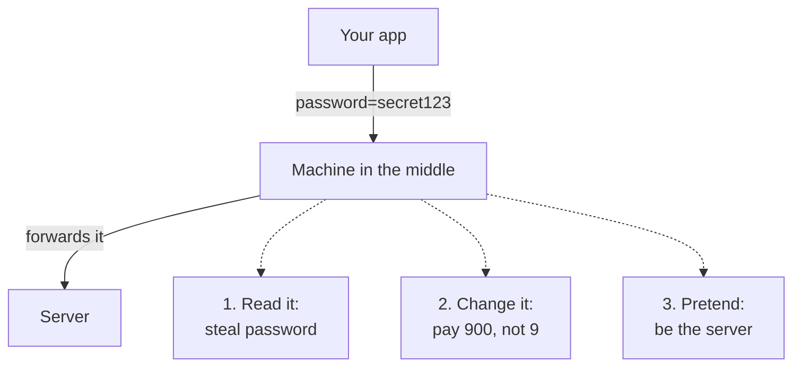

| Problem | TLS answer | Tool used |
| --- | --- | --- |
| Someone **reads** the data | **Encryption** (confidentiality) | Symmetric cipher, such as AES |
| Someone **changes** the data | **Integrity** checks | A tag on every message (AEAD, explained in section 9) |
| Someone **pretends** to be the server | **Authentication** | Certificate plus a signature from the private key |

:::warning[Encryption alone is not enough]
If you encrypt perfectly but talk to the **wrong server**, you just sent your secret, safely encrypted, to the attacker. That is why the identity check (certificates) matters as much as the encryption.
:::

---

## 3. Keys: the maths you need, without the maths

### Symmetric: one shared key

**Symmetric** encryption uses **the same key** to lock and unlock. It is very fast, so all real data in TLS is encrypted this way (usually **AES** or **ChaCha20**).

The problem: both sides need the same key, and you can't just send it over the network, because someone could read it.

### Asymmetric: a key pair

**Asymmetric** encryption uses a **pair** of keys made together:

- The **public key** can be given to anyone.
- The **private key** stays secret, on one machine only.
- What one key does, only the other key can check or undo.

| | Symmetric | Asymmetric |
| --- | --- | --- |
| Keys | One shared key | A public and private pair |
| Speed | Very fast | About 1000 times slower |
| Problem it has | How to share the key safely | Too slow for bulk data |
| Used in TLS for | Encrypting all the data | Agreeing on keys and proving identity |
| Examples | AES, ChaCha20 | RSA, ECDSA, Ed25519 (signing), ECDHE (key agreement) |

TLS uses **both**: asymmetric keys at the start to agree on a fresh symmetric key safely, then the fast symmetric key for everything after.

### Hash: a fingerprint of data

A **hash** (such as **SHA-256**, Secure Hash Algorithm) turns any data into a short fixed-size fingerprint. Change one letter of the input and the fingerprint changes completely. You can't go back from the fingerprint to the data.

### Digital signature: the stamp

A **signature** proves that data came from the owner of a private key and wasn't changed. It is the most important idea for certificates.

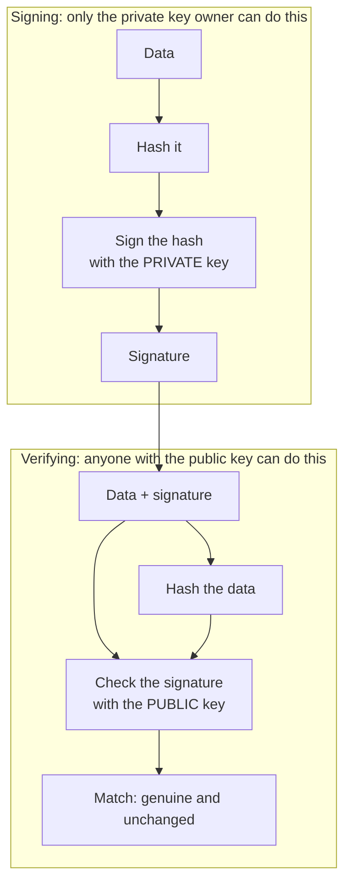

| Action | Key used | Who can do it |
| --- | --- | --- |
| **Sign** | Private key | Only the owner |
| **Verify a signature** | Public key | Anyone |
| **Encrypt to someone** | Their public key | Anyone |
| **Decrypt** | Private key | Only the owner |

:::note[RSA vs ECDSA vs Ed25519]
These are kinds of key pairs. **RSA** is the oldest and most common (use 2048 bits or more). **ECDSA** (Elliptic Curve Digital Signature Algorithm) gives the same security with much smaller keys, so handshakes are faster. **Ed25519** is a newer, simpler elliptic curve choice. For new server certificates, ECDSA P-256 or RSA 2048+ are both fine.
:::

### Key exchange: agreeing on a secret in public

How do two machines agree on a symmetric key when someone may be listening to every message? With **Diffie-Hellman** key exchange (in TLS, its elliptic curve form **ECDHE**: Elliptic Curve Diffie-Hellman Ephemeral).

The classic picture is mixing paint:

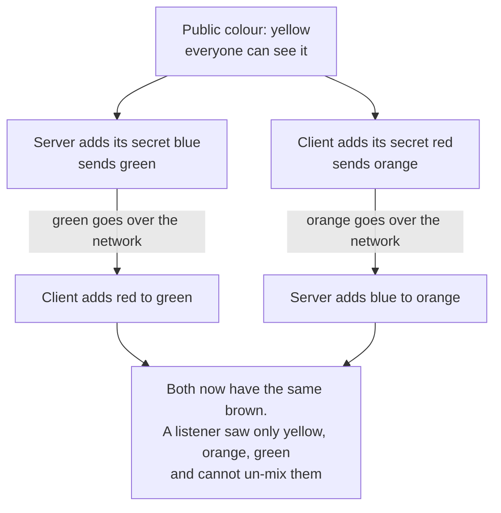

Each side keeps a **secret** and sends only a **mixed** value. Both end with the same secret, and a listener can't work it out. That shared secret becomes the symmetric key.

**Ephemeral** means the secrets are new for **every connection** and thrown away after. This gives **forward secrecy**: even if the server's private key is stolen next year, recorded old traffic still can't be decrypted, because the keys that protected it no longer exist anywhere.

:::info[The server's private key does not encrypt your data]
A very common belief is "the client encrypts the data with the server's public key". It doesn't. In modern TLS the key pair in the certificate is used **only to sign**: to prove "I really am this server". The data keys come from ECDHE. (Old TLS 1.2 had an "RSA key exchange" mode that did encrypt with the public key. It had no forward secrecy and TLS 1.3 removed it.)
:::

---

## 4. Certificates: the passport

A public key is just a long number. How do you know a public key really belongs to `orders.example.com` and not to an attacker? A **certificate** answers that. It is a small document that says **"this public key belongs to this name"**, signed by someone you trust.

The format is **X.509**, a standard from the ITU (International Telecommunication Union).

### What is inside

| Field | Example | Meaning |
| --- | --- | --- |
| Subject | `CN=orders.example.com` | Who the certificate is for. CN means Common Name |
| **Subject Alternative Name (SAN)** | `DNS:orders.example.com, DNS:api.example.com` | The host names (or IPs) it is valid for. **Clients check this**, not the CN |
| Issuer | `CN=Example Intermediate CA` | Who signed it |
| Validity | Not before, not after | Valid dates. After "not after" it is **expired** |
| Public key | EC P-256 key | The public half of the owner's key pair |
| Serial number | `04:A1:...` | Unique per CA, used for revocation |
| Key usage | Digital signature | What the key may be used for |
| Extended key usage | Server auth, client auth | Server certificate, client certificate, or both |
| Basic constraints | `CA:FALSE` | Whether this certificate may sign other certificates |
| **Signature** | | The issuer's signature over all the fields above |

:::warning[A certificate is public. The private key is the secret]
The certificate is sent to every client in every handshake, so it is not secret at all. Copying it is useless without the matching **private key**, just as a photo of a passport doesn't let you cross a border. **Protect the private key**. If it leaks, the certificate must be revoked and replaced.
:::

### Wildcard and multi-name certificates

- A **wildcard** certificate for `*.example.com` covers `a.example.com` and `b.example.com`, but **not** `example.com` or `x.y.example.com` (only one level).
- A **multi-name** (SAN) certificate lists several names in the SAN field.

### Look at one yourself

```bash
# Show the certificate a site sends, then print its fields
openssl s_client -connect example.com:443 -servername example.com < /dev/null 2>/dev/null \
  | openssl x509 -noout -subject -issuer -dates -ext subjectAltName
```

```text
subject=CN = example.com
issuer=C = US, O = DigiCert Inc, CN = DigiCert Global G3 TLS ECC SHA384 2020 CA1
notBefore=Jan 15 00:00:00 2026 GMT
notAfter=Jul 14 23:59:59 2026 GMT
X509v3 Subject Alternative Name:
    DNS:example.com, DNS:www.example.com
```

(Your output will show different dates and maybe a different CA.)

---

## 5. Who signs certificates: CAs and the chain of trust

### Root, intermediate, and leaf

A **Certificate Authority (CA)** checks that you really control a name, then signs your certificate. But who checks the CA? Another CA, and so on, up to a **root**.

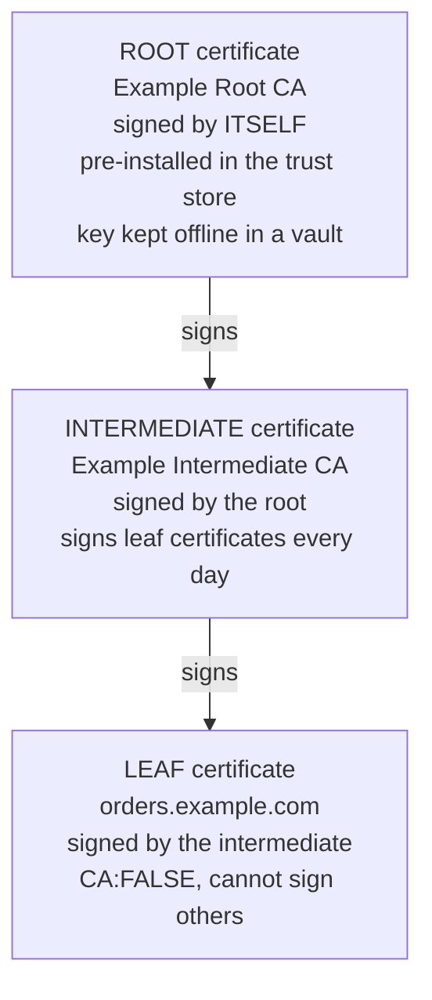

| | Root | Intermediate | Leaf |
| --- | --- | --- | --- |
| Signed by | **Itself** | The root (or another intermediate) | An intermediate |
| Can sign other certificates | Yes | Yes | **No** |
| Where it comes from | Pre-installed in the OS, browser, or JDK trust store | Sent by the server in the handshake | Sent by the server in the handshake |
| Typical lifetime | 20 to 25 years | 5 to 10 years | Days to months |
| Private key lives | Offline, in a hardware vault | In the CA's signing systems | On your server |
| Passport picture | The government | The regional office | Your passport |

**Why not let the root sign leaves directly?** Because the root key is too precious. If it leaks, every certificate under it must be distrusted and it must be removed from every device in the world. So the root key stays **offline** and is used only rarely, to sign intermediates. If an intermediate leaks, only that intermediate is cancelled.

:::note["Node certificate" is not a level in the chain]
There are only three roles in a chain: root, intermediate, leaf. People sometimes say **"node certificate"** to mean one of two things:

1. The **certificate of a machine or node** in a cluster, for example a Kubernetes kubelet, an Elasticsearch node, or a Kafka broker. That is a normal **leaf** certificate, just issued to a node.
2. Any certificate in the **middle of the chain** (a "node" of the tree). That is an **intermediate**.

If you hear it, ask which one is meant.
:::

### How a client checks a chain

The server sends its **leaf plus the intermediates**. It does not need to send the root: the client already has it.

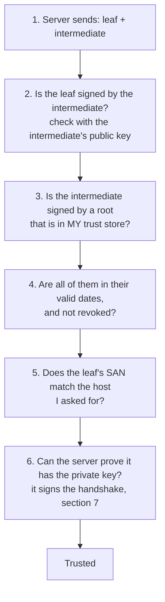

If any step fails, the connection is refused. This is exactly where most TLS errors come from (section 12).

### Trust store and CA bundle

The **trust store** is the list of root certificates a client trusts. Every platform ships one:

| Platform | Trust store |
| --- | --- |
| Windows | The Windows certificate store (`certmgr.msc`) |
| macOS | Keychain |
| Linux | A **CA bundle** file such as `/etc/ssl/certs/ca-certificates.crt` |
| Java | `$JAVA_HOME/lib/security/cacerts` (a PKCS #12 key store, password `changeit`) |
| Browsers | Their own lists (Firefox), or the OS list |

A **CA bundle** is simply **several CA certificates in one PEM file**, one after another. The phrase is used for two different things, so check which one is meant:

| "CA bundle" meaning | Contains | Used by |
| --- | --- | --- |
| **Trust bundle** | Root certificates you trust | **Clients**, to check servers |
| **Chain bundle** | The intermediate(s) for your leaf | **Servers**, to send along with the leaf |

When a CA gives you files like `cert.pem`, `chain.pem`, and `fullchain.pem`:

- `cert.pem` is your **leaf** only.
- `chain.pem` is the **intermediate(s)**, the chain bundle.
- `fullchain.pem` is **leaf + intermediates** in one file. This is usually what your server should use.

---

## 6. Getting a certificate: signing and self-signing

### Certificate signing, step by step

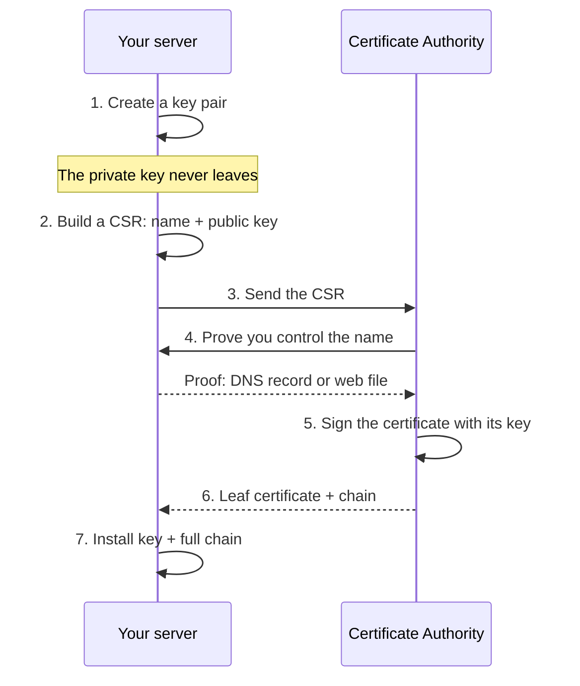

The key point: **the private key is made on your side and never sent anywhere**. The CA only sees the **CSR** (Certificate Signing Request), which has your public key and name, signed by your private key to prove you have it.

How hard the CA checks you depends on the **validation level**:

| Level | Full form - what the CA checks | Used for |
| --- | --- | --- |
| **DV** | Domain Validated - you control the domain name | Almost all websites and APIs. Fully automatic |
| **OV** | Organization Validated - the company also exists | Some business sites |
| **EV** | Extended Validation - a deep legal check | Rare now. Browsers no longer show it specially |

DV certificates are usually issued automatically with **ACME** (Automatic Certificate Management Environment), the protocol used by Let's Encrypt and by tools like **cert-manager** in Kubernetes. ACME proves control with an **HTTP-01** challenge (serve a file on the domain) or a **DNS-01** challenge (create a DNS record).

### Doing it by hand with OpenSSL

```bash
# 1. Create a private key (EC P-256)
openssl genpkey -algorithm EC -pkeyopt ec_paramgen_curve:P-256 -out server.key

# 2. Create a CSR for the name, including the SAN
openssl req -new -key server.key -out server.csr \
  -subj "/CN=orders.internal" \
  -addext "subjectAltName=DNS:orders.internal,DNS:orders"

# 3. (The CA does this) sign the CSR with the CA's key, valid 90 days
openssl x509 -req -in server.csr -CA ca.crt -CAkey ca.key -CAcreateserial \
  -days 90 -copy_extensions copy -out server.crt
```

### Self-signed certificates

A **self-signed** certificate is signed by **its own** private key. Issuer and subject are the same. Nobody vouches for it, so no client trusts it until you add it to the trust store by hand. A root certificate is technically self-signed too: the difference is that roots are **already** in everyone's trust store.

```bash
# One command: key + self-signed certificate for local development
openssl req -x509 -newkey rsa:2048 -noenc -keyout key.pem -out cert.pem \
  -days 365 -subj "/CN=localhost" -addext "subjectAltName=DNS:localhost"
```

| Option | Trusted by | Good for |
| --- | --- | --- |
| **Self-signed leaf** | No one, unless you add each one by hand | Local development, quick tests |
| **Private CA** (your own root + intermediate) | Only machines you give the root to | Internal services, mTLS between microservices |
| **Public CA** (Let's Encrypt, DigiCert, and so on) | Every browser and OS | Anything the public or partners reach |

:::warning[Never "fix" errors by turning off checks]
Code like a "trust all certificates" `TrustManager`, `curl -k`, or `verify=False` makes the error go away by switching off **authentication**. The connection is still encrypted, but to anyone, including an attacker. Add the right CA to the trust store instead.
:::

For internal services, a **private CA** beats many self-signed certificates: clients trust **one root**, and every service certificate signed under it is trusted automatically. Tools like cert-manager, HashiCorp Vault, AWS Private CA, or a service mesh run one for you.

---

## 7. The TLS handshake, step by step

The handshake is the first few messages of a connection. In **TLS 1.3** it takes **one round trip** before data flows.

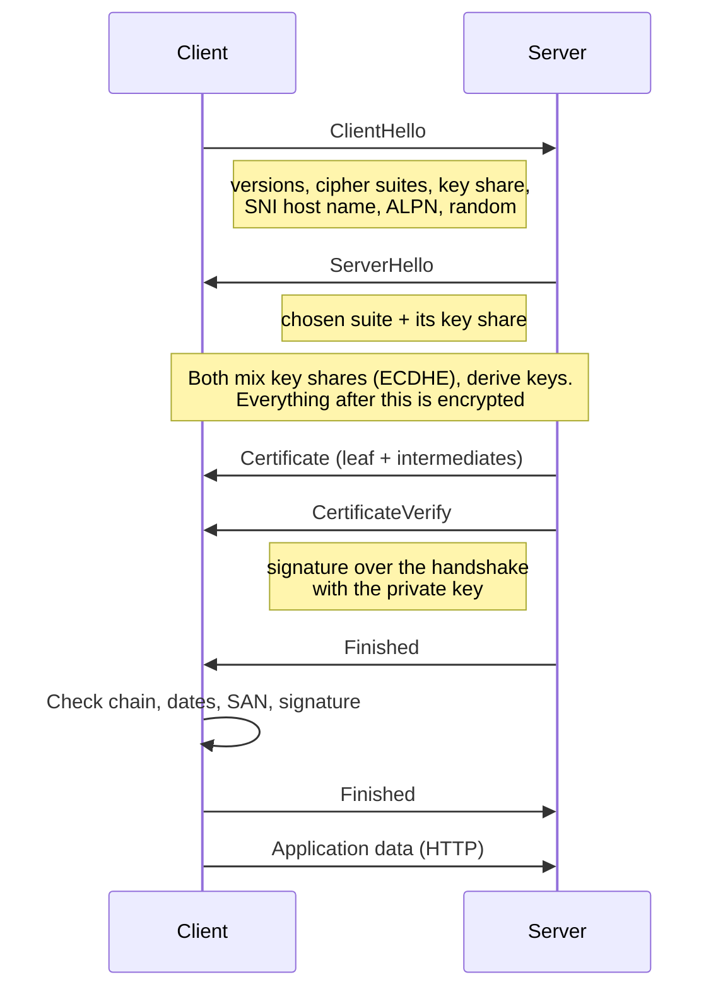

What each message does, in plain words:

| Message | What it carries | Why |
| --- | --- | --- |
| **ClientHello** | Supported TLS versions and cipher suites, a **key share** (the client's half of ECDHE), **SNI**, **ALPN**, a random number | "Here is what I can do, and my half of the secret" |
| **ServerHello** | The chosen version and cipher suite, the server's key share | Now both sides can compute the same secret |
| **Certificate** | Leaf + intermediates | "This is who I claim to be" |
| **CertificateVerify** | A **signature** over all handshake messages so far, made with the **private key** | "And I really own that certificate". This is the face matching the passport |
| **Finished** | A check value over the whole handshake | Proves nobody changed any handshake message |

Two small fields that matter a lot:

- **SNI** (Server Name Indication): one IP address often hosts many sites. SNI tells the server **which host name** the client wants, so it can pick the right certificate. Missing SNI is a common cause of "wrong certificate" errors with old clients.
- **ALPN** (Application-Layer Protocol Negotiation): agrees on the protocol inside, for example `h2` (HTTP/2) or `http/1.1`.

### TLS 1.2 vs TLS 1.3

| | TLS 1.2 (2008) | TLS 1.3 (2018) |
| --- | --- | --- |
| Round trips before data | 2 | **1** (0 when resuming, with care) |
| Certificate sent | In the clear | **Encrypted** |
| Key exchange | Several, including RSA (no forward secrecy) | **Only** ephemeral (EC)DHE, so forward secrecy always |
| Cipher suites | Hundreds, many weak | **Five**, all strong |
| Status | Still allowed, with strong suites only | **Preferred** |

SSL 2.0, SSL 3.0, TLS 1.0, and TLS 1.1 are all **broken or deprecated**. Turn them off.

### Faster repeat visits: session resumption

After a full handshake, the server can give the client a **session ticket**. Next time, the client shows the ticket and skips the certificate work. TLS 1.3 can even send data in the very first message (**0-RTT**, zero round trip time), but that early data can be **replayed** by an attacker, so only allow it for safe requests like GET.

---

## 8. mTLS: both sides show a passport

In normal TLS, **only the server** proves who it is. The client stays anonymous at the TLS level and proves itself later, with a password or a token.

In **mutual TLS (mTLS)**, the server **also asks the client for a certificate**. Now both sides are proven at the connection level.

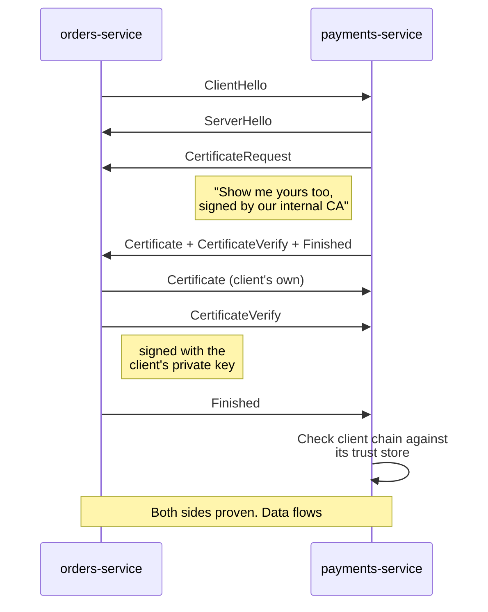

| | TLS (one-way) | mTLS |
| --- | --- | --- |
| Who shows a certificate | Server only | Server **and** client |
| Client proves itself with | Password, token, API key, later | Its certificate, during the handshake |
| Server needs | Key store | Key store **and** a trust store for client CAs |
| Client needs | Trust store | Trust store **and** its own key store |
| Typical use | Websites, public APIs | Service to service, partner (B2B) APIs, IoT devices, zero trust networks |

### mTLS in microservices

Managing certificates for hundreds of pods by hand is not possible. In practice:

- A **service mesh** (Istio, Linkerd) puts a sidecar proxy next to each pod. The proxies do mTLS **automatically**, with certificates issued by the mesh's own CA and rotated every few hours. Your Java code speaks plain HTTP to its local proxy.
- **SPIFFE** (Secure Production Identity Framework For Everyone) gives each workload an identity such as `spiffe://prod/ns/payments/sa/payments-service`, placed in the certificate's SAN. Policies can then say "only orders-service may call payments-service".

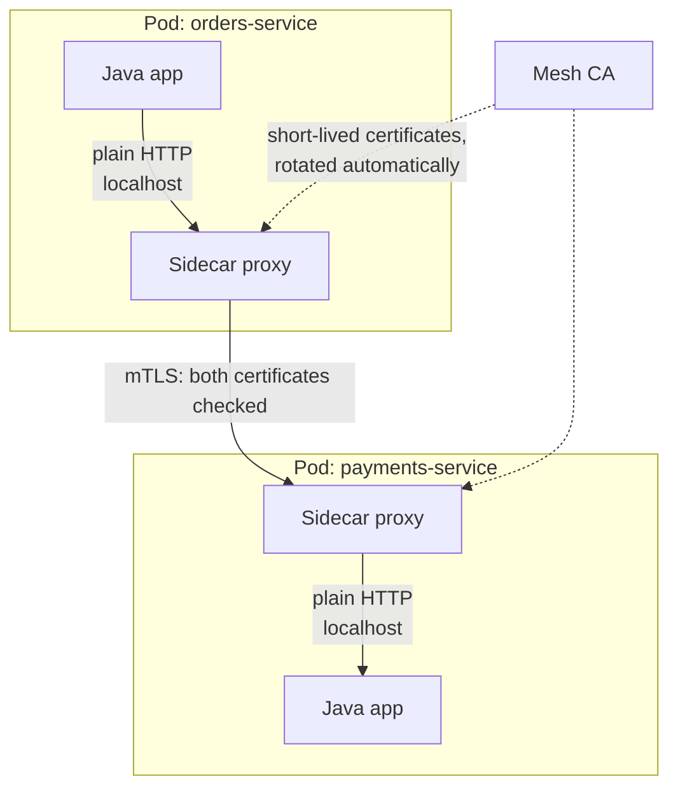

:::info[mTLS and OAuth answer different questions]
mTLS proves **which workload** is calling. An OAuth token proves **who the call is for** and what it may do (see [OAuth 2.0 in Depth](./02-oauth.md)). Strong systems use both. mTLS can also **bind** a token to a client certificate, so a stolen token is useless without the matching private key.
:::

---

## 9. Cipher suites

A **cipher suite** is a named set of algorithms for one connection. The client lists what it supports, and the server picks one.

### Reading a TLS 1.2 suite

A TLS 1.2 name packs in four choices:

```text
TLS _ ECDHE _ RSA _ WITH _ AES_128_GCM _ SHA256
      |       |            |             |
      |       |            |             +-- hash used to derive keys
      |       |            +-- bulk cipher: encrypts the data
      |       +-- authentication: type of key in the certificate
      +-- key exchange: how the shared secret is agreed
```

| Part | In the example | Job |
| --- | --- | --- |
| Key exchange | ECDHE | Agree on the secret (section 3) |
| Authentication | RSA | The certificate's key type, used to sign |
| Bulk cipher | AES_128_GCM | Encrypt and protect the data |
| Hash | SHA256 | Derive keys and check the handshake |

### TLS 1.3 suites are shorter

In TLS 1.3, key exchange is always ephemeral (EC)DHE and the certificate type is chosen separately, so a suite names only the cipher and hash:

| TLS 1.3 suite | Notes |
| --- | --- |
| `TLS_AES_128_GCM_SHA256` | The most common default |
| `TLS_AES_256_GCM_SHA384` | Larger key |
| `TLS_CHACHA20_POLY1305_SHA256` | Fast on phones and chips without AES hardware |

### What "GCM" and "AEAD" mean

**AEAD** (Authenticated Encryption with Associated Data) means the cipher **encrypts and adds a tamper check** in one step. If even one bit is changed on the way, the receiver detects it and drops the connection. **GCM** (Galois/Counter Mode) and **ChaCha20-Poly1305** are AEAD ciphers. TLS 1.3 allows only AEAD ciphers.

| Good choices | Avoid |
| --- | --- |
| TLS 1.3 suites, and TLS 1.2 with **ECDHE** + **AES-GCM** or **ChaCha20-Poly1305** | Anything with **RC4**, **3DES**, **DES**, **MD5**, **NULL**, **EXPORT**, **CBC** mode suites, or **static RSA** key exchange |

:::note[Post-quantum key exchange]
Large quantum computers could one day break today's ECDHE. To protect traffic recorded now, browsers and big providers already use a **hybrid** key exchange called **X25519MLKEM768**: classic ECDHE mixed with a post-quantum algorithm (ML-KEM). You may see it in browser security panels. It changes only the key exchange. Certificates still work the same way.
:::

---

## 10. File formats: PEM, DER, PFX, P12, JKS, and the PKCS numbers

This is where most confusion lives, because **the file extension often doesn't tell you what is inside**. Keep two separate questions in mind:

1. **What is inside?** A certificate, a private key, a chain, a CSR, or a mix.
2. **How is it written?** Text (PEM) or binary (DER), and in which container.

### Encoding: PEM vs DER

All of these objects are first defined in **ASN.1** (Abstract Syntax Notation One), a way of describing data structures. **DER** writes that structure as **binary**. **PEM** takes the DER bytes, converts them to **Base64 text**, and wraps them in header lines.

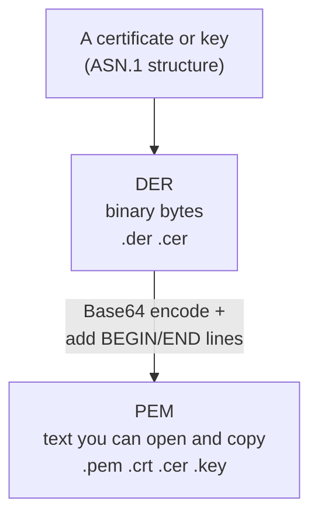

```text
-----BEGIN CERTIFICATE-----
MIIDdzCCAl+gAwIBAgIEbF2mFjANBgkqhkiG9w0BAQsFADBsMRAwDgYDVQQGEwdV
... more Base64 lines ...
-----END CERTIFICATE-----
```

A PEM file can hold **several** objects one after another: that is how a chain file or CA bundle is made. **The header line tells you what each block is**, which is more reliable than the file extension.

:::warning[Base64 is not encryption]
A PEM private key is just Base64. Anyone who opens the file can use the key, unless the header says `ENCRYPTED PRIVATE KEY`. Treat `.key` and `.pem` files with keys as secrets.
:::

### The PKCS family

**PKCS** (Public-Key Cryptography Standards) is a set of numbered standards first published by RSA Security. You only need five of them:

| Standard | What it defines | PEM header you will see | Typical extension |
| --- | --- | --- | --- |
| **PKCS #1** | RSA keys only, older layout | `BEGIN RSA PRIVATE KEY` | `.key`, `.pem` |
| **PKCS #8** | **Any** private key (RSA, EC, and so on), optionally password-encrypted. The modern default | `BEGIN PRIVATE KEY` or `BEGIN ENCRYPTED PRIVATE KEY` | `.key`, `.pem` |
| **PKCS #7** | A bundle of **certificates only**, no keys | `BEGIN PKCS7` | `.p7b`, `.p7c` |
| **PKCS #10** | A **CSR** | `BEGIN CERTIFICATE REQUEST` | `.csr` |
| **PKCS #12** | One **password-protected** file holding a **private key + its certificate + the chain** | (binary, no PEM form) | `.p12`, `.pfx` |

Two other headers you will meet: `BEGIN CERTIFICATE` is a plain **X.509** certificate, and `BEGIN EC PRIVATE KEY` is an elliptic curve key in the older **SEC1** layout.

### PFX vs P12

They are **the same thing** for practical purposes. **PFX** (Personal Information Exchange) was Microsoft's format, and **PKCS #12** grew out of it. Windows and IIS tend to say `.pfx`, Java and Linux tools tend to say `.p12`. If a tool wants one, rename the other and it usually works.

### JKS vs PKCS #12 in Java

| | JKS | PKCS #12 |
| --- | --- | --- |
| Full form | Java KeyStore | Public-Key Cryptography Standards #12 |
| Readable by | Java only | Java, OpenSSL, Windows, browsers, everything |
| Java default since | Old default | **Java 9** |
| Use it | Only for old systems | **Yes, for everything new** |

### The extension cheat sheet

| Extension | Usually contains | Encoding |
| --- | --- | --- |
| `.pem` | Anything: certificate, chain, key | Text |
| `.crt` | A certificate (or chain) | Usually text, sometimes binary |
| `.cer` | A certificate | Binary on Windows, text elsewhere. Check |
| `.der` | A certificate or key | Binary |
| `.key` | A private key | Usually text |
| `.csr` | A signing request | Text |
| `.p7b` | Certificates only (chain) | Text or binary |
| `.p12` / `.pfx` | Key + certificate + chain, password-protected | Binary |
| `.jks` | Java key store | Binary |

:::tip[How to find out what a file really is]
Open it in a text editor. If you see `-----BEGIN ...-----`, it is PEM and the header names the content. If it is unreadable binary, try `openssl x509 -inform der -in file -noout -text` (a DER certificate) or `openssl pkcs12 -in file -info -noout` (a PKCS #12 file).
:::

### Converting between formats

```bash
# DER certificate -> PEM
openssl x509 -inform der -in cert.cer -out cert.pem

# PEM key + certificate + chain -> one PKCS #12 file (asks for a password)
openssl pkcs12 -export -inkey server.key -in server.crt -certfile chain.pem \
  -name server -out server.p12

# PKCS #12 -> PEM: certificates only, then the key only
openssl pkcs12 -in server.p12 -nokeys -out certs.pem
openssl pkcs12 -in server.p12 -nocerts -noenc -out server.key

# PKCS #7 chain -> PEM certificates
openssl pkcs7 -print_certs -in chain.p7b -out chain.pem

# Old PKCS #1 RSA key -> modern PKCS #8
openssl pkcs8 -topk8 -noenc -in rsa.key -out pkcs8.key

# JKS -> PKCS #12
keytool -importkeystore -srckeystore old.jks -destkeystore new.p12 -deststoretype PKCS12
```

---

## 11. Key store vs trust store, in Java and Spring Boot

Java names the two stores clearly, and the names map straight onto the passport picture:

| | Key store | Trust store |
| --- | --- | --- |
| Holds | **My own** private key + my certificate chain | **Other people's** CA certificates I trust |
| Passport picture | My wallet with my passport | The officer's list of trusted governments |
| Secret? | **Yes**, it has a private key | No, only public certificates |
| A TLS **server** needs | Yes | Only for mTLS (to check clients) |
| A TLS **client** needs | Only for mTLS (to show its own certificate) | Yes |
| Java default | None | `cacerts` in the JDK |

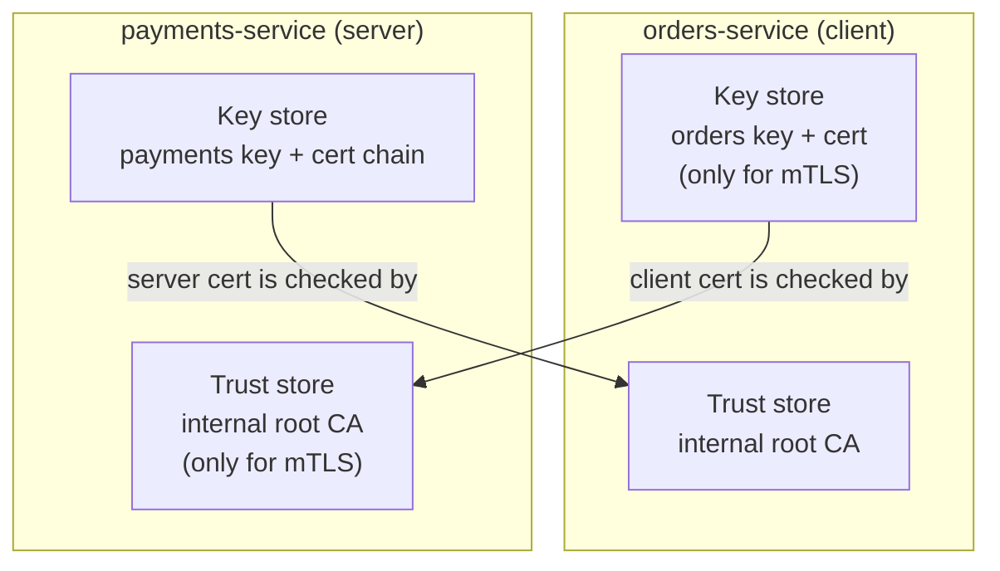

### Spring Boot: SSL bundles

Spring Boot 3.1 and later use **SSL bundles**: one named place to describe keys and trust, in PEM or key store form, used by both the server and the HTTP clients.

```yaml
spring:
  ssl:
    bundle:
      pem:
        payments:                       # the bundle name
          keystore:                     # my identity
            certificate: "file:/etc/tls/fullchain.pem"
            private-key: "file:/etc/tls/server.key"
          truststore:                   # who I trust (client CAs, for mTLS)
            certificate: "file:/etc/tls/internal-root-ca.pem"
          reload-on-update: true        # pick up renewed certificates

server:
  port: 8443
  ssl:
    bundle: payments
    client-auth: need                   # require a client certificate = mTLS
```

The calling service uses a bundle for its own client certificate and trust:

```java
@Bean
RestClient paymentsClient(RestClient.Builder builder, RestClientSsl ssl) {
    return builder
        .baseUrl("https://payments.internal:8443")
        .apply(ssl.fromBundle("orders-client"))   // key store + trust store for mTLS
        .build();
}
```

Adding a company root CA to the JDK trust store, the classic fix for `PKIX path building failed`:

```bash
keytool -importcert -alias corp-root -file corp-root.pem \
  -keystore "$JAVA_HOME/lib/security/cacerts" -storepass changeit
```

:::tip[Prefer your own trust store over editing cacerts]
Editing the JDK's `cacerts` is lost on every JDK upgrade and new container image. Ship a trust store with the app (or an SSL bundle), or add the CA to the base image in one shared place.
:::

---

## 12. Revocation, expiry, and staying safe

### Cancelling a certificate before it expires

If a private key leaks, the CA **revokes** the certificate. Clients can find out in two ways:

| Method | Full form - how it works | Downside |
| --- | --- | --- |
| **CRL** | Certificate Revocation List - the CA publishes a list of cancelled serial numbers | Lists get big and are only updated now and then |
| **OCSP** | Online Certificate Status Protocol - the client asks the CA about one certificate | Slow, and tells the CA which sites you visit |
| **OCSP stapling** | The server fetches the OCSP answer and attaches ("staples") it to the handshake | Fixes both problems, if the server supports it |

In practice, revocation checks are often soft or skipped, so the real defence has become **short lifetimes**: a stolen key is useful only until the certificate expires. Some CAs, Let's Encrypt among them, have stopped running OCSP and rely on CRLs and short lifetimes instead.

### Lifetimes are getting shorter

Public certificates once lasted years. The CA/Browser Forum (the group of CAs and browser makers that sets the rules) has voted to cut the maximum step by step: **200 days from March 2026**, 100 days from March 2027, and **47 days from March 2029**. Let's Encrypt certificates already last 90 days. Inside a service mesh, certificates often last **hours**.

:::warning[Expired certificates cause real outages]
Many big outages were "a certificate expired and nobody noticed". With short lifetimes, **renewal must be automatic**: ACME, cert-manager, or your mesh. Also **monitor expiry dates** and alert well in advance, and make sure apps **reload** renewed certificates without a restart.
:::

### Other safety features you will hear about

| Term | Full form - meaning |
| --- | --- |
| **HSTS** | HTTP Strict Transport Security - a response header telling browsers "only ever use HTTPS for this site", so they never try plain HTTP |
| **CT** | Certificate Transparency - every public certificate must be logged in public logs. You can watch them to spot certificates issued for your domain that you didn't ask for |
| **CAA** | Certification Authority Authorization - a DNS record listing which CAs may issue certificates for your domain |
| **Pinning** | The app accepts only one specific certificate or key. Strong, but a missed key change breaks the app. Mostly avoided today, except in some mobile apps |

---

## 13. Where TLS ends in a real system

TLS protects one **hop** at a time. In a system with load balancers and microservices, you choose where each TLS connection **ends** (is "terminated").

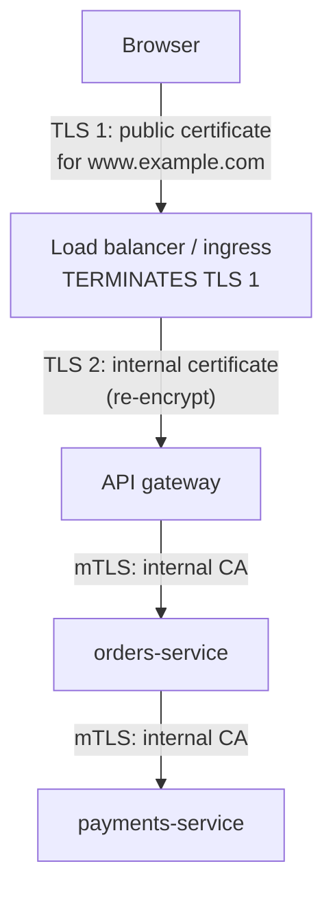

| Mode | How it works | Trade-off |
| --- | --- | --- |
| **Termination** (offload) | The load balancer decrypts and sends **plain HTTP** inside | Simple, fast, but traffic inside is readable |
| **Re-encryption** (bridging) | The load balancer decrypts, inspects, and opens a **new TLS** connection to the backend | Encrypted everywhere, two sets of certificates |
| **Passthrough** | The load balancer forwards the encrypted bytes without opening them. The backend terminates TLS | End to end, but the load balancer can't route by path or add headers |

**Zero trust** networks don't trust the inside network either, so they encrypt every hop, usually with mTLS through a mesh. In Kubernetes, **cert-manager** issues and renews certificates for Ingress and services from Let's Encrypt or a private CA, and stores them as Secrets (see [Kubernetes](../kubernetes.md)).

---

## 14. When it goes wrong: common errors

| Error you see | What it really means | Fix |
| --- | --- | --- |
| `PKIX path building failed` / `unable to find valid certification path` (Java) | The client doesn't trust the root of the server's chain, or the server didn't send its intermediate | Add the right root CA to the client's trust store. Make the server send `fullchain.pem` |
| `unable to get local issuer certificate` (OpenSSL, curl) | Same: missing intermediate or unknown root | Same as above |
| `certificate has expired` | Past the "not after" date | Renew, automate renewal, check the clock on the machine too |
| `Hostname mismatch` / `No subject alternative names matching` | The host you called is not in the certificate's **SAN** | Call the right name, or reissue with that name in the SAN |
| `self-signed certificate in certificate chain` | A corporate proxy or a private CA is in the path and not trusted | Add that CA to the trust store. Don't disable checks |
| `handshake_failure` / `no cipher suites in common` | Client and server share no TLS version or cipher suite | Enable TLS 1.2+ and modern suites on both sides |
| `bad_certificate` / `certificate_required` (mTLS) | The server wanted a client certificate and got none or an untrusted one | Configure the client key store. Make the server trust the client's CA |
| `key does not match certificate` | The private key is not the pair of this certificate | Use the key that made the CSR |

The two commands that solve most problems:

```bash
# What chain does the server send, and does it verify?
openssl s_client -connect orders.example.com:443 -servername orders.example.com -showcerts

# Does this key belong to this certificate? (the two outputs must match)
openssl x509 -noout -pubkey -in server.crt | openssl sha256
openssl pkey -pubout -in server.key | openssl sha256
```

In Java, start the app with `-Djavax.net.debug=ssl:handshake` to print every handshake step.

---

## 15. Interview questions

### 1. What happens during a TLS handshake?

**In short:** Client and server agree on a version and cipher suite, create a shared secret with ECDHE, and the server proves its identity with a certificate and a signature from its private key.

In TLS 1.3: the ClientHello carries supported suites, a key share, and SNI. The ServerHello picks a suite and sends its key share. Both derive the same keys, so the rest is encrypted. The server sends its certificate chain and a CertificateVerify signature, the client checks the chain, dates, and host name, and both send Finished. Data starts after one round trip.

### 2. What is the difference between TLS and mTLS? When would you use mTLS?

**In short:** In TLS only the server shows a certificate. In mTLS the client does too, so both sides are proven during the handshake.

mTLS suits service-to-service calls, partner APIs, and devices, where the caller is a machine you control. Browsers rarely use it because managing a certificate for every user is hard. In microservices it is usually done by a service mesh with short-lived certificates, and combined with OAuth tokens for user-level permission.

### 3. Explain root, intermediate, and leaf certificates. Why have intermediates?

**In short:** The root signs the intermediate, the intermediate signs the leaf, and clients trust the chain because the root is already in their trust store.

The root key is kept offline because losing it would break trust in every certificate below it. Intermediates do the daily signing, so a leaked intermediate can be revoked without replacing the root on every device. The leaf belongs to the server and can't sign other certificates.

### 4. How does a client know a certificate is genuine?

**In short:** It checks each signature up the chain to a trusted root, then the dates, revocation, and host name, and finally that the server owns the private key.

A certificate is public, so having it proves nothing. The CertificateVerify message is a signature over the handshake made with the private key, which only the real server can produce.

### 5. Why does TLS use both asymmetric and symmetric cryptography?

**In short:** Asymmetric solves the key-sharing problem and proves identity. Symmetric is fast enough for the actual data.

ECDHE (asymmetric) lets both sides agree on a secret over an open network, and the certificate key signs the handshake. The derived symmetric key, used with AES-GCM or ChaCha20-Poly1305, then encrypts and protects every byte of data.

### 6. What is forward secrecy?

**In short:** Stealing the server's private key later doesn't let anyone decrypt traffic recorded earlier.

Each connection uses fresh, temporary ECDHE keys that are thrown away afterwards. The certificate key only signs. TLS 1.3 requires this, and TLS 1.2 gets it only with ECDHE or DHE suites.

### 7. PEM vs DER vs PFX: what is the difference? And key store vs trust store?

**In short:** DER is binary, PEM is the same data as Base64 text with BEGIN/END lines, and PFX/PKCS #12 is a password-protected bundle of a private key and its certificate chain.

A key store holds **your own** private key and certificate. A trust store holds the **CA certificates you trust**. A server always needs a key store, a client always needs a trust store, and mTLS needs both on both sides.

### 8. A Java service fails with "PKIX path building failed". How do you fix it?

**In short:** The JVM doesn't trust the server's chain. Find which CA is missing and add it to the trust store, never disable verification.

Run `openssl s_client -showcerts` to see the chain. If the server sends only its leaf, fix the server to send the full chain. If the root is a private or corporate CA, add it to the app's trust store or SSL bundle. Check the host name and dates too.

### 9. Are self-signed certificates OK in production?

**In short:** Not one-off self-signed leaves. Use a private CA for internal traffic and a public CA for anything external.

Self-signed leaves have to be trusted one by one, can't be revoked, and teach people to click past warnings. A private CA gives one root to trust, automatic issuing, and short lifetimes. Public users need certificates from a public CA that their devices already trust.

### 10. How do you avoid outages from expired certificates?

**In short:** Automate issuing and renewal, monitor expiry dates, and make apps reload certificates without a restart.

Use ACME with cert-manager or a mesh CA, alert when any certificate is within a few weeks of expiry, and keep lifetimes short so renewal is routine and tested. Public certificate lifetimes are shrinking to 47 days by 2029, so manual renewal won't keep up.

---

:::info[Where to next]
Go back to [OAuth 2.0 in Depth](./02-oauth.md) to see how tokens and mTLS work together between services, or to [IAM Basics](./01-iam-basics.md) for the wider picture of identity. To see where certificates live in a cluster (Secrets, Ingress), see [Kubernetes](../kubernetes.md).
:::
