# Kubernetes

Say you built a Spring Boot app, and it runs fine with `java -jar app.jar` on one server. Then real life arrives:

- Traffic grows, and you need **10 copies** of the app, not one.
- A server dies at 2 AM, and someone has to **restart** everything.
- You want to release a new version **without downtime**.
- Every copy needs the right settings and secrets.

Doing all this by hand, on many servers, is slow and risky. **Kubernetes** (often written *K8s*) is the system that does it for you. You tell it **what you want** ("run 3 copies of this app"), and it works nonstop to make that true.

:::tip[The one idea behind Kubernetes]
You describe the **wanted state**. Kubernetes keeps comparing it with the **real state**, and fixes any difference. If a copy crashes, the real state has 2 copies but you wanted 3, so Kubernetes starts one more. This loop never stops.
:::

To keep the many new words easy to follow, we will use one picture all the way through: **a shipping port**. Containers are the boxes, ships carry them, and a port office decides what goes where. Keep this picture in mind.

---

## 1. The map: all the words on one page

Kubernetes has many words, and they confuse people because they answer **two different questions**:

- **Where does my app run?** Cluster, node, pod, container. This is the **hardware side**: things inside things.
- **Who keeps my app running?** Deployment, ReplicaSet. This is the **management side**: things that create and watch other things.

### The building blocks, from small to big

Start with the hardware side. Here are the words in order, **smallest to biggest**. Each one lives inside the next.

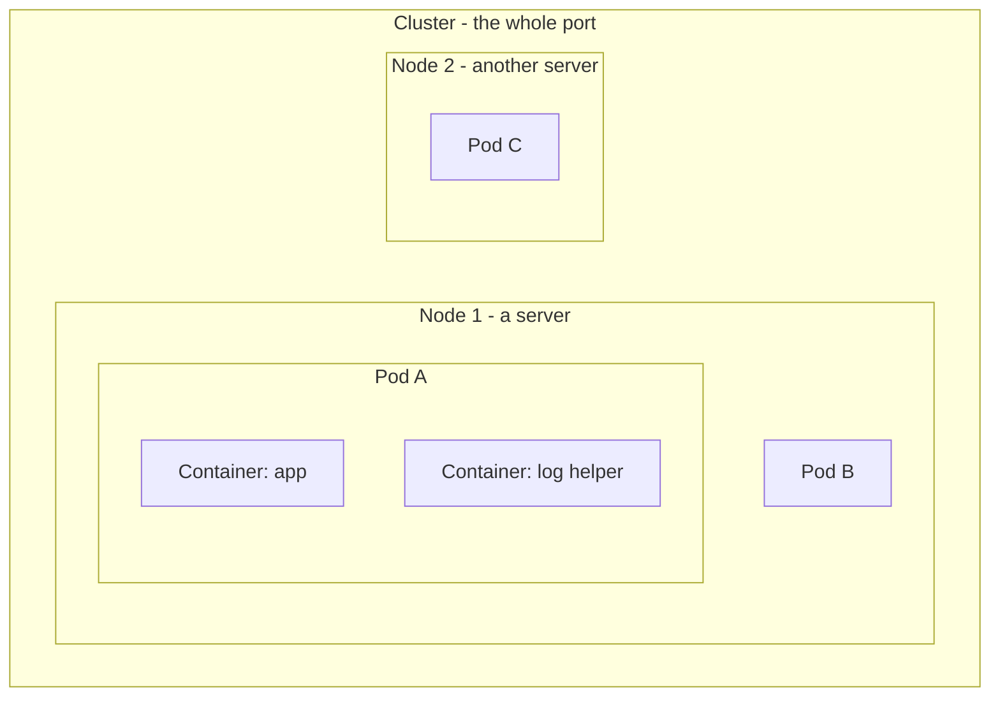

| Term | What it is | Port picture | Count |
| --- | --- | --- | --- |
| **Container** | Your app in a sealed box | One shipping box | Many per pod (usually 1) |
| **Pod** | The smallest thing Kubernetes runs. One or more containers that travel together | A small group of boxes strapped together | Many per node |
| **Node** | One machine (a server or a cloud VM) that runs pods | One ship | Many per cluster |
| **Cluster** | A group of nodes, managed together as one unit | The whole port | One or a few per company |

### The full map: who creates what

Now add the management side. A Deployment and a ReplicaSet don't hold anything inside them. They **create and watch** pods.

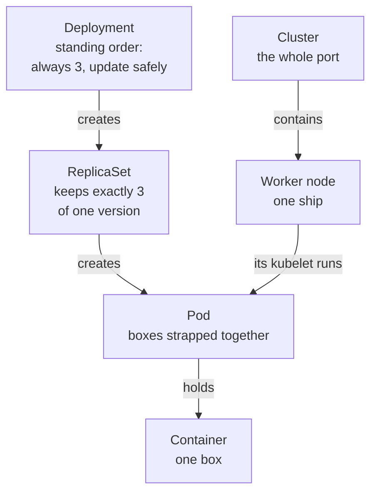

The left column is the **management side** and the right column is the **hardware side**. Follow either one down and you reach the same pod.

The two sides meet at the **pod**. A ReplicaSet creates pods, and each pod is then placed on a worker node, where the **kubelet** starts its containers.

| Word | One line | Port picture | Section |
| --- | --- | --- | --- |
| **Container** | Your app packed with everything it needs | One shipping box | 2 |
| **Pod** | The smallest thing Kubernetes runs: one or more containers that share a network address | A few boxes strapped together | 3 |
| **Node** | One machine, a server or cloud VM, in the cluster | One ship | 4 |
| **Worker node** | A node that runs your pods | A cargo ship | 4 |
| **kubelet** | The agent on every node that starts and watches the pods | The ship's captain | 5 |
| **Cluster** | The control plane plus all the worker nodes, managed as one | The whole port | 6 |
| **Namespace** | A named area inside a cluster, to keep teams and apps apart | A separate dock with its own sign | 7 |
| **Workload** | Your app as it runs on Kubernetes, managed by a workload resource | A cargo contract | 8 |
| **ReplicaSet** | Keeps an exact number of identical pods running | A clerk who counts boxes and replaces lost ones | 9 |
| **Deployment** | Manages ReplicaSets to give you scaling, updates, and rollbacks | The standing order the clerks follow | 10 |

Read the sections in order. Each one uses only words that were explained before it.

---

## 2. Container: the box

A **container** is your app packed together with everything it needs (Java, libraries, settings) into one sealed box. It runs the same on your laptop, a test server, or the cloud. Just like a shipping container looks the same to every crane, whatever is inside.

You describe the box in a `Dockerfile`:

```dockerfile
FROM eclipse-temurin:21-jre
COPY target/orders-app.jar /app/app.jar
EXPOSE 8080
ENTRYPOINT ["java", "-jar", "/app/app.jar"]
```

Building this gives you an **image**. Running the image gives you a **container**.

| | Image | Container |
| --- | --- | --- |
| What it is | The packed, read-only recipe | A running copy made from the image |
| Analogy | The blueprint of the box | One real box, on the move |
| How many | One | Many can run from the same image |
| Changes | Never (build a new version instead) | Lives and dies, so do not store data in it |

You may ask: why not use virtual machines? Containers are lighter, because they share the server's operating system kernel instead of carrying a whole OS each.

| | Virtual machine | Container |
| --- | --- | --- |
| Contains | Full operating system | Only the app and its libraries |
| Size | Gigabytes | Megabytes |
| Start time | Minutes | Seconds or less |
| Isolation | Strong (separate OS) | Good (shared kernel) |
| Best for | Running different operating systems | Packing and scaling apps |

Containers solve "it works on my machine". But they bring a new problem: **if you have 200 containers on 20 servers, who runs them, restarts them, and connects them?** That is the job of Kubernetes.

---

## 3. Pod: the smallest unit Kubernetes runs

Kubernetes does **not** run containers directly. It runs **pods**, and a pod holds one or more containers. Most pods hold exactly **one** container: your app.

Why the extra layer? Because sometimes two containers must work as a team:

- Container 1 is your Spring Boot app.
- Container 2 is a small helper that ships its logs to a log system. A helper like this is called a **sidecar**.

They must share the same network and the same files. A pod gives them exactly that.

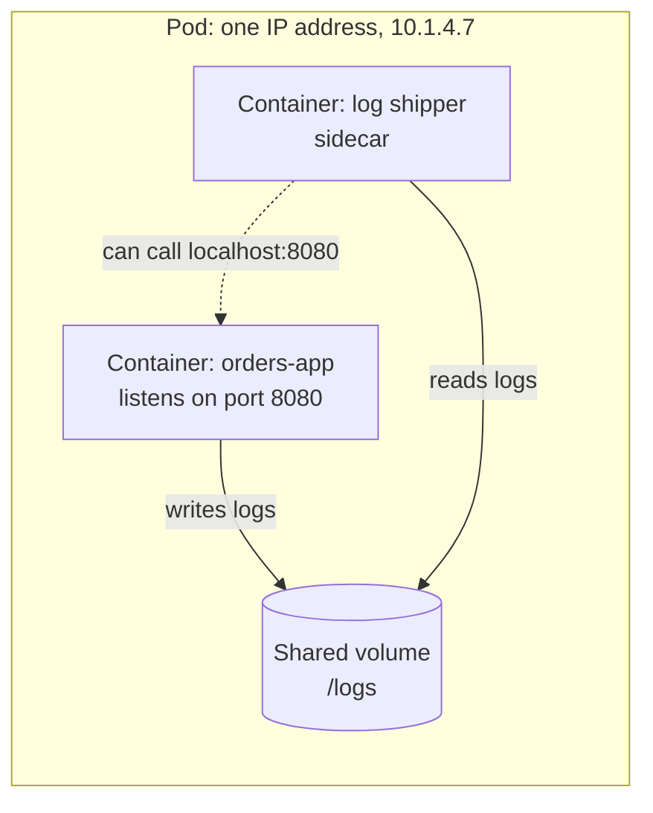

A pod is written as a small YAML file. You will rarely write this one by hand (section 8 explains why), but it shows what a pod is:

```yaml
apiVersion: v1
kind: Pod
metadata:
  name: orders-app
  labels:
    app: orders-app        # a tag other objects use to find this pod
spec:
  containers:
    - name: orders-app
      image: myrepo/orders-app:1.0.0
      ports:
        - containerPort: 8080
```

| | Container | Pod |
| --- | --- | --- |
| Who creates it | The container runtime on the node | Kubernetes |
| Has its own IP address | No | **Yes**, one IP shared by all its containers |
| Containers talk through | Their pod's network | `localhost` (they are neighbours) |
| Shares storage | No | Can share volumes |
| Scaled and replaced by Kubernetes | Not directly | **Yes**, this is the unit it manages |

### Pods are temporary, and they never move

A pod lives on **one node** for its whole life. It is **never moved** to another node. If its node dies, or the pod is deleted, a **new** pod with a new name and a new IP is created somewhere else, as a replacement.

A pod goes through these phases:

| Phase | Meaning |
| --- | --- |
| `Pending` | Accepted, but not running yet: waiting for a node, or pulling the image |
| `Running` | Placed on a node, and at least one container is running |
| `Succeeded` | All containers finished without error and won't restart (typical for one-off jobs) |
| `Failed` | All containers stopped, and at least one failed |
| `Unknown` | The node can't be reached, so nobody knows the state |

Two different things bring your app back after a crash, and the difference matters:

| What died | Who fixes it | How |
| --- | --- | --- |
| A **container** inside a pod | The **kubelet** on that node (section 5) | Restarts the container in the **same** pod, on the same node |
| The whole **pod** (deleted, or its node died) | A **controller**, such as a ReplicaSet (section 9) | Creates a **new** pod, which may go to a different node |

:::warning[Never depend on a pod]
Never depend on a pod's IP, and never keep important data only inside a pod. Section 12 shows how clients find pods anyway, and section 13 covers data that must survive.
:::

---

## 4. Node and worker node: the machines

A **node** is one machine in the cluster: a physical server or, more often, a cloud VM. Nodes come in two roles:

| | Worker node | Control plane node |
| --- | --- | --- |
| Job | Runs **your pods** | Runs the **brain** of the cluster (section 6) |
| Port picture | A cargo ship | The port office |
| How many | From a few to thousands | Usually 3, for safety |
| Do your apps run here? | Yes | No, normally kept for system parts only |
| On EKS, GKE, AKS | You manage and pay for them | The cloud provider runs them, hidden from you |

When people just say "node", they usually mean a **worker node**.

### What is on a worker node?

Every worker node runs the same three Kubernetes parts, plus your pods:

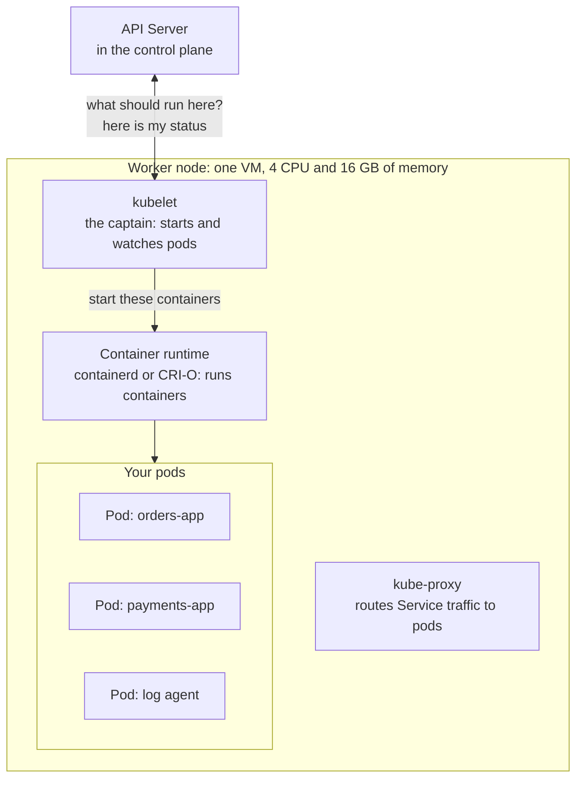

| Part | Its job on the node |
| --- | --- |
| **kubelet** | The node's agent. Talks to the control plane and makes sure the right pods run here |
| **Container runtime** | The engine that actually pulls images and runs containers. Kubernetes talks to it through a standard plug, the **CRI** (Container Runtime Interface) |
| **kube-proxy** | Sets up network rules so traffic sent to a Service reaches a healthy pod |

### Capacity: how many pods fit on a node?

Each node reports how much CPU and memory it has. Each pod says how much it needs (its **requests**, see section 14). The scheduler only places a pod on a node with enough room left, just as you can only load a ship up to its limit. When nodes fill up, you add more nodes, by hand or with a **cluster autoscaler**.

---

## 5. kubelet: the captain on every node

The **kubelet** is a small program that runs on **every node** as a normal system service, not inside a pod. It is the only part of Kubernetes that actually makes things happen on that machine. Everything else just writes wishes into the API Server.

Think of the ship's captain: the port office writes "your ship carries these 5 boxes" in the shared logbook. The captain reads it, loads the boxes, checks them during the trip, and reports back.

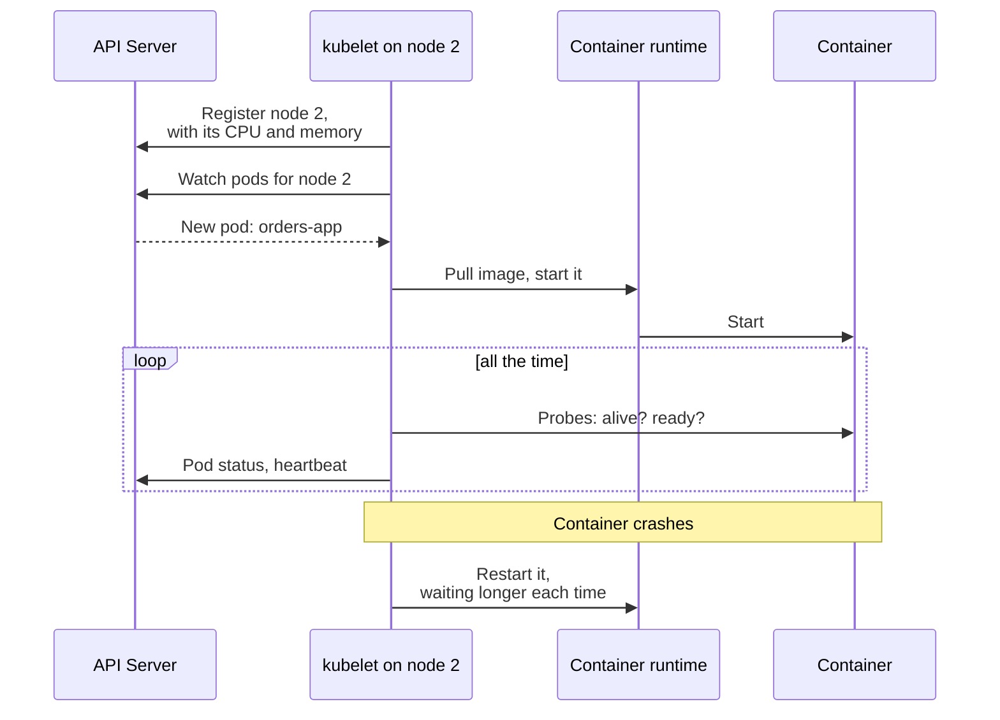

The kubelet's jobs:

| Job | What it means |
| --- | --- |
| **Register the node** | When the node starts, the kubelet adds it to the cluster |
| **Run the pods assigned here** | Watches the API Server for pods placed on its node, and asks the container runtime to start them |
| **Set up what pods need** | Mounts volumes, and passes in settings and secrets |
| **Run the health probes** | Calls your liveness, readiness, and startup checks (section 14) |
| **Restart crashed containers** | Restarts them in place. After each crash it waits longer (10 s, 20 s, 40 s, and so on, up to 5 minutes). That waiting state is the famous `CrashLoopBackOff` |
| **Report status** | Sends pod status and regular node **heartbeats** to the control plane |

:::note[What the kubelet does NOT do]
It doesn't decide **where** pods go (the scheduler does), and it doesn't create replacement pods when a pod is lost (controllers do). It also ignores any container that Kubernetes didn't create, for example one you started by hand with Docker on that machine.
:::

The heartbeats are how the cluster knows a node is alive. Each node has a small **Lease** object in the `kube-node-lease` namespace that its kubelet keeps renewing. If the renewals stop, the control plane knows something is wrong with that node. Section 11 follows exactly what happens then.

---

## 6. Cluster: the brain and the hands

A **cluster** is the whole system: the **control plane** (the brain) plus all the **worker nodes** (the hands), managed together as one. You talk to the cluster, never to a single node.

A cluster has two kinds of machines. This is the second big idea to understand.

- **Control plane:** the **brain**. It decides what should run and where. (The port manager's office.)
- **Worker nodes:** the **hands**. They actually run your pods. (The ships and cranes.)

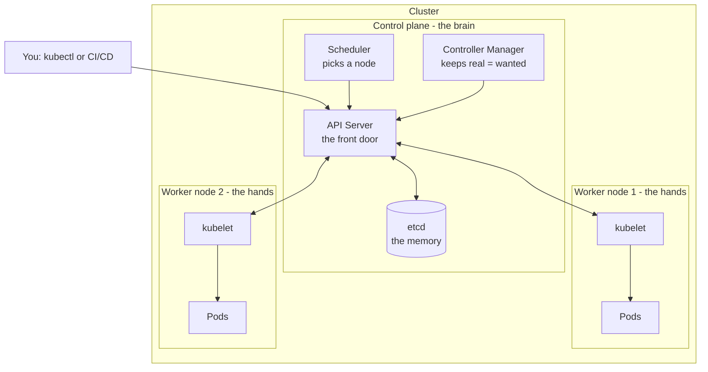

| Part | Where | Its job, in plain words |
| --- | --- | --- |
| **API Server** | Control plane | The only front door. Every command and every part talks through it |
| **etcd** | Control plane | The database that remembers the wanted state of the whole cluster |
| **Scheduler** | Control plane | Decides which node a new pod should go to, based on free CPU, memory, and your rules |
| **Controller Manager** | Control plane | Runs the **controllers**: loops that compare wanted and real state, and fix differences. The ReplicaSet and Deployment controllers live here |
| **kubelet** | Every node | Runs and watches the pods on its node (section 5) |
| **Container runtime** | Every node | Actually runs the containers |
| **kube-proxy** | Every node | Routes Service traffic to the right pod |

Why usually **3** control plane nodes? etcd keeps its data correct by **majority vote**, so 3 nodes keep working if 1 fails. The same idea is explained in [Distributed Systems Fundamentals](./system-design/02-distributed-systems.md#6-leader-election-and-consensus-raft).

:::note[Managed Kubernetes]
On AWS (EKS), Google Cloud (GKE), and Azure (AKS), the provider runs the control plane for you. You only manage, and pay for, the worker nodes.
:::

| | Cluster | Node |
| --- | --- | --- |
| It is | The whole system | One machine in it |
| You talk to it? | Yes, through the API Server | No, the kubelet talks to it for you |
| If it fails | Everything is down | Its pods are replaced on other nodes |
| How many | One or a few per company | Many per cluster |

---

## 7. Namespace: areas inside the cluster

A **namespace** splits one cluster into named areas, such as `dev`, `test`, and `payments`. Think of separate docks in one port, each with its own sign and its own rules.

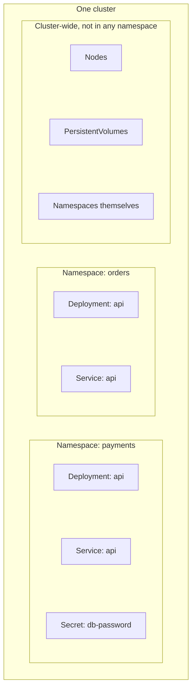

Both namespaces have a Deployment called `api`, and that is fine: **names only need to be unique inside a namespace**.

What a namespace gives you:

- **Names:** each team can use simple names without clashing.
- **Access rules:** with RBAC (section 15), you can let a team manage only its own namespace.
- **Limits:** a **ResourceQuota** caps how much CPU, memory, or how many pods one namespace can use.

Every cluster starts with four namespaces:

| Namespace | What it is for |
| --- | --- |
| `default` | Where things go if you don't name a namespace |
| `kube-system` | Kubernetes' own parts, such as DNS and kube-proxy |
| `kube-public` | A few things readable by everyone, rarely used |
| `kube-node-lease` | The heartbeat Lease of every node (section 5) |

| Lives in a namespace | Cluster-wide |
| --- | --- |
| Pods, Deployments, ReplicaSets, Services, ConfigMaps, Secrets, PersistentVolumeClaims | Nodes, PersistentVolumes, StorageClasses, Namespaces |

To call a Service in another namespace, add the namespace to the name: `api.payments` or, in full, `api.payments.svc.cluster.local`.

:::warning[A namespace is not a wall]
By default, pods in **any** namespace can talk to pods in **every other** namespace. Namespaces split names and permissions, not the network. To block traffic, add a **NetworkPolicy**. For strong separation, such as production vs test, use separate clusters.
:::

| | Namespace | Cluster |
| --- | --- | --- |
| It is | A **logical** split inside a cluster | A **physical** group of machines |
| Isolation | Soft (shared machines and network) | Strong (separate machines) |
| Use it for | Teams, apps, environments | Big boundaries (prod vs non-prod) |

---

## 8. Workload: your app, run by a manager

A **workload** is simply **an application running on Kubernetes**: your orders API, a nightly report job, a database. A workload always runs inside pods.

But you almost never create those pods yourself. A bare pod has no manager: if it crashes badly or its node dies, **nobody brings it back**. Instead, you create a **workload resource**: an object that creates pods from a **pod template** and keeps watching them for you.

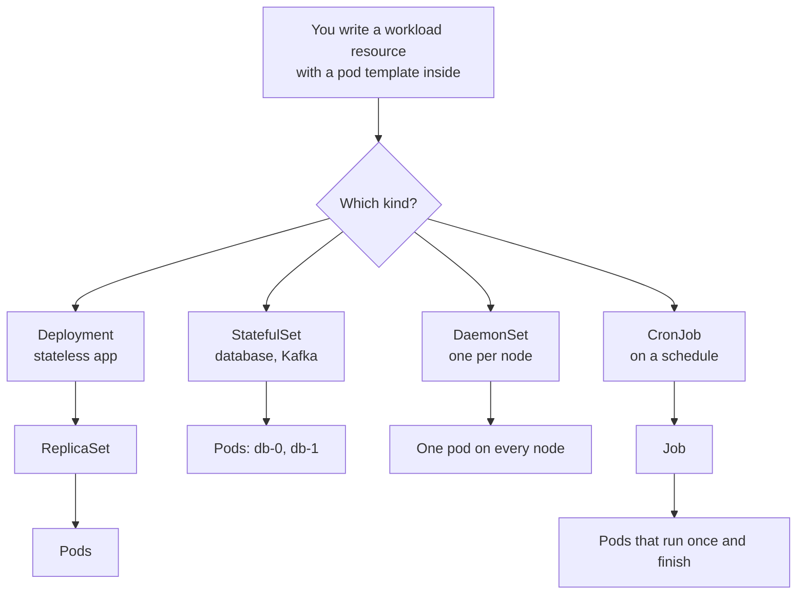

| Workload resource | Use it for | Key behaviour |
| --- | --- | --- |
| **Deployment** | Normal stateless apps, like REST APIs | Identical, replaceable pods, with rolling updates. Your default choice |
| **ReplicaSet** | Rarely used directly. Deployments create it for you | Keeps exactly N identical pods |
| **StatefulSet** | Databases, Kafka, anything needing a stable identity | Pods get fixed names (`db-0`, `db-1`) and their own storage that follows them |
| **DaemonSet** | One helper on **every node** (log or monitoring agent) | Exactly one pod per node, added automatically to new nodes |
| **Job** | A task that runs once and finishes | Runs pods to completion, and retries on failure |
| **CronJob** | A task on a schedule | Creates a Job at each scheduled time |

The two most important ones, ReplicaSet and Deployment, get their own sections next.

---

## 9. ReplicaSet: keep exactly N pods

A **ReplicaSet** has one job: **make sure exactly N identical pods are running**. It is one of the controllers from section 6, running the wanted-vs-real loop.

It finds its pods by **label**. Its **selector** says "the pods with label `app=orders-app` are mine", and its **template** is the blueprint for making new ones.

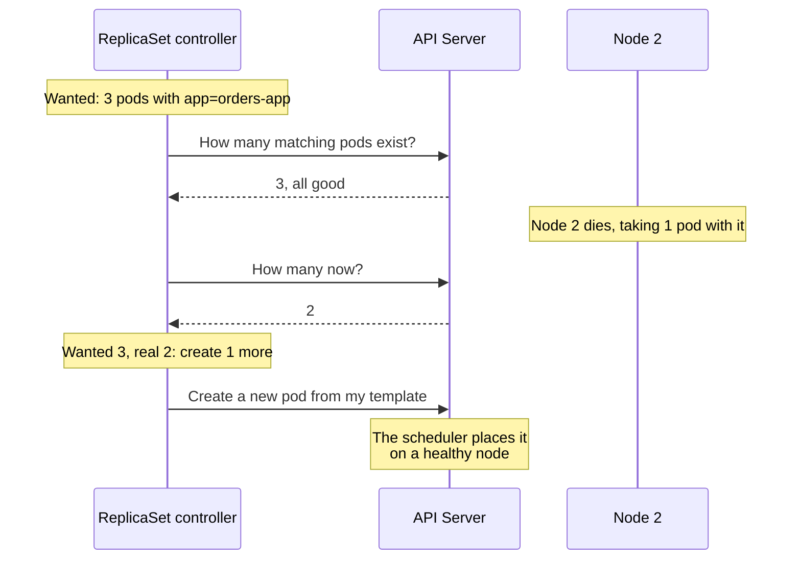

It works in both directions. If a pod is lost, it creates one. If there are **too many** (for example, you start a bare pod with the same label), it **deletes** the extra.

| | Pod alone | ReplicaSet |
| --- | --- | --- |
| Survives its node dying | No | Yes, a new pod is created elsewhere |
| Keeps a count | No | Yes, always N |
| Scaling | Create pods by hand | Change one number |
| Updating to a new version | Delete and recreate by hand | **Can't do it safely**. That is the Deployment's job |

:::warning[Why you don't create ReplicaSets yourself]
A ReplicaSet only counts. If you change the image in its template, it doesn't touch running pods: they keep the old version until they happen to die. There is no rolling update and no rollback. The Kubernetes docs recommend using a **Deployment**, which manages ReplicaSets for you.
:::

---

## 10. Keeping the right number alive: Deployment, with updates and rollbacks on top

A **Deployment** is what you actually write for a normal app. You describe the pod and the number of copies, and it creates and manages **ReplicaSets** to make that happen.

```yaml
apiVersion: apps/v1
kind: Deployment
metadata:
  name: orders-app
  namespace: orders
spec:
  replicas: 3                  # I want 3 copies
  selector:
    matchLabels:
      app: orders-app          # the pods that belong to me
  strategy:
    type: RollingUpdate        # the default
    rollingUpdate:
      maxSurge: 1              # at most 1 extra pod during an update
      maxUnavailable: 0        # never go below 3 ready pods
  template:                    # the pod blueprint
    metadata:
      labels:
        app: orders-app
    spec:
      containers:
        - name: orders-app
          image: myrepo/orders-app:1.0.0
          ports:
            - containerPort: 8080
```

### The chain, with real names

Run `kubectl get deployments,replicasets,pods` and you will see the whole chain. The names tell you who created whom:

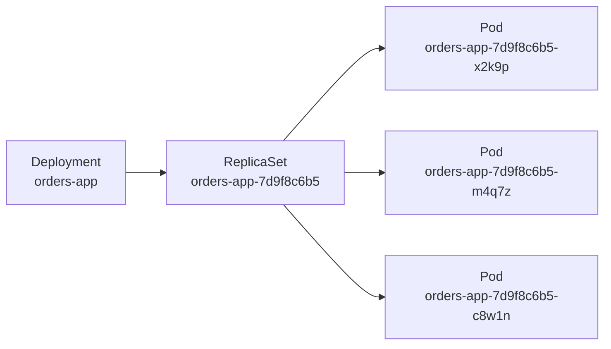

The middle part (`7d9f8c6b5`) is a hash of the pod template, called the `pod-template-hash`. Each version of the template gives a new hash, so each version gets its **own** ReplicaSet.

### Rolling update: how a new version goes out

When you change the image to `1.1.0`, the Deployment creates a **new** ReplicaSet and moves pods across, step by step:

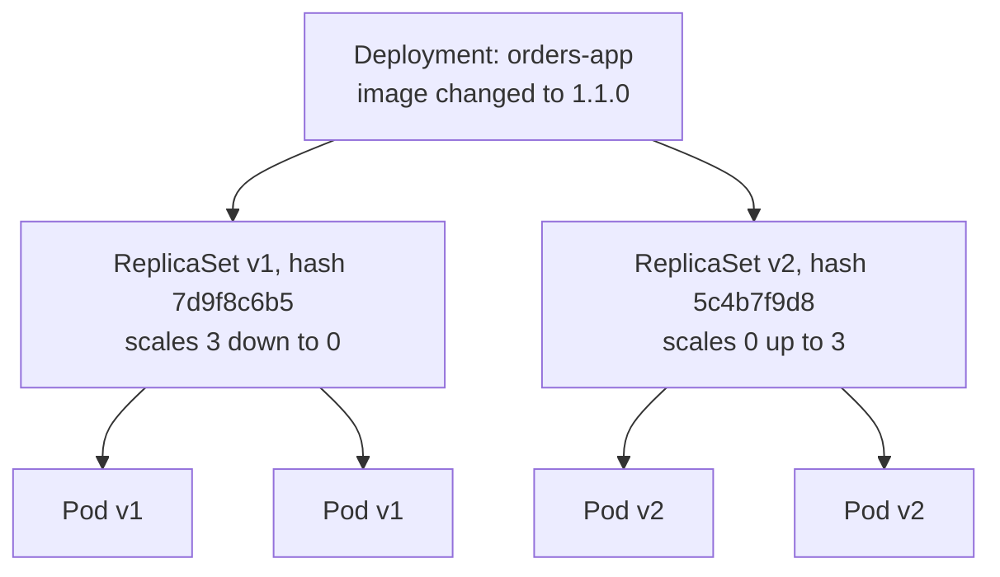

1. The new ReplicaSet starts **one** new pod (version 2).
2. The Deployment waits until that pod says "I am ready" (its readiness probe, section 14).
3. Only then does the old ReplicaSet stop **one** old pod.
4. It repeats until the new ReplicaSet has 3 pods and the old one has 0.

Two settings control the speed:

| Setting | Meaning | Default |
| --- | --- | --- |
| `maxSurge` | How many **extra** pods may exist during the update | 25% (rounded up) |
| `maxUnavailable` | How many pods may be **missing** during the update | 25% (rounded down) |

With 3 replicas, the defaults work out to 1 extra and 0 missing, exactly the steps above. The other strategy, **Recreate**, stops all old pods first and then starts new ones. It causes downtime, but it is useful when two versions must never run together.

### Rollback: why old ReplicaSets are kept

The old ReplicaSet isn't deleted. It is kept with **0 pods**, together with its template. Going back is just scaling the old one up again:

```bash
kubectl rollout history deployment/orders-app     # list the versions
kubectl rollout undo deployment/orders-app        # back to the previous one
```

By default, a Deployment keeps the last **10** old ReplicaSets (`revisionHistoryLimit`).

**Scaling** works the same way. Change `replicas`, and the Deployment passes the new number to the current ReplicaSet. Or let Kubernetes do it by itself with the **Horizontal Pod Autoscaler (HPA)**, which adds pods when CPU (or another metric) is high and removes them when it is low.

| | Deployment | ReplicaSet | Pod |
| --- | --- | --- | --- |
| Job | Versions, rolling updates, rollbacks | Keep exactly N pods of **one** version | Run the containers |
| Created by | You | The Deployment | The ReplicaSet |
| How many per app | One | One per version (old ones kept with 0 pods) | N |
| You edit it? | **Yes** | No | No |

---

## 11. Putting it together: what happens when you deploy?

Now every part has a name, so we can follow one command from start to finish. You run:

```bash
kubectl apply -f deployment.yaml
```

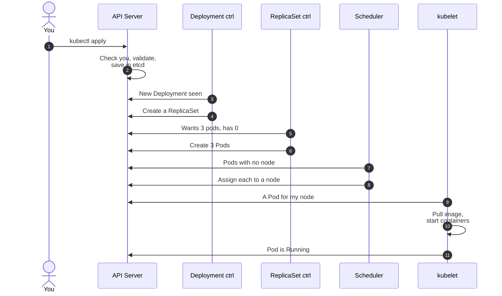

Notice two things:

1. **Nobody gives orders directly to a node.** Each part watches the API Server for work it cares about, does its small job, and writes the result back. That is the control loop idea from the start of this page.
2. Because the wanted state is **saved**, Kubernetes can recover by itself, as the next example shows.

### And what happens when a worker node dies?

This example uses every word on this page, so it is the best test of whether the ideas fit together:

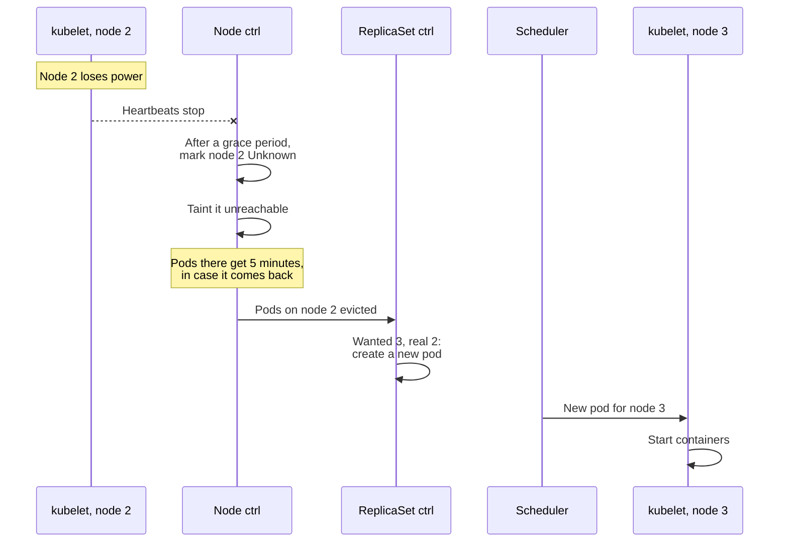

1. The **kubelet** on node 2 stops sending heartbeats.
2. The **node controller** marks the node as not healthy, and new pods stop going there.
3. By default, pods on the dead node are kept for **5 minutes**, in case it was only a short network blip. Then they are evicted.
4. The **ReplicaSet** sees 2 pods instead of 3 and creates a **new** pod. The old pod is not moved.
5. The **scheduler** places it on a healthy **worker node**, and that node's **kubelet** starts it.

Those 5 minutes are why you run 3 or more replicas across zones (section 12): the other pods carry the traffic while the replacement is on its way.

---

## 12. Where does it all run? Zones and regions, and finding pods

### Zones and regions

So far we talked about things **inside** Kubernetes. Now zoom out to the real world. Servers sit in data centers, and the cloud provider (AWS, Google Cloud, Azure) groups those data centers in two levels:

- A **region** is a big area, like **ap-south-1 (Mumbai)**.
- A **zone** (also called an availability zone) is one separate data center, or a group of them, inside a region. Each zone has its own power, cooling, and network.

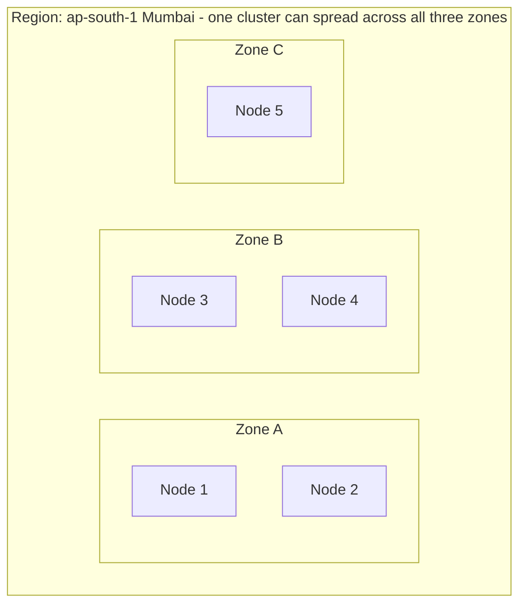

Why does this matter? Imagine **Zone A loses power**. If all your pods were in Zone A, your app is down. If your pods are spread across A, B, and C, the app keeps running on B and C, and the ReplicaSet creates replacements there.

| | Node | Zone | Region |
| --- | --- | --- | --- |
| What it is | One server | One data center (group) | A whole geographic area |
| Who makes it | You (or the cloud) | The cloud provider | The cloud provider |
| Is it a Kubernetes thing? | **Yes** | No, but nodes are labelled with it | No, but nodes are labelled with it |
| What fails with it | One machine | A power or network failure | Very rare, a whole area |
| Port picture | One ship | One port city | A country |
| Protects you from | Nothing alone | Data center failure | Regional disaster |

Kubernetes itself does not create zones or regions. It just reads a **label** on each node that says which zone it is in. You can then tell Kubernetes: "spread my 3 pods across different zones" (this uses `topologySpreadConstraints` or pod anti-affinity).

:::info[A common design]
One cluster, in one region, with nodes in **three zones**. For protection against a whole region failing, companies run **two clusters in two regions** and send traffic to both.
:::

### Services and Ingress: how clients find the pods

Pods come and go, and their IPs change. So how does another app call your app? Through a **Service**.

A Service gives your pods **one stable address and name**. It finds them by **label**, the same way a ReplicaSet does, and spreads the requests across all the **ready** pods behind it (load balancing).

```yaml
apiVersion: v1
kind: Service
metadata:
  name: orders-service
  namespace: orders
spec:
  selector:
    app: orders-app          # send traffic to pods with this label
  ports:
    - port: 80
      targetPort: 8080
```

Now any pod in the same namespace can call `http://orders-service`. From another namespace, use `orders-service.orders`, or the full name `orders-service.orders.svc.cluster.local`. It does not matter which pods are alive right now.

An **Ingress** is the door from the outside world. It reads the web address and routes it to the right Service.

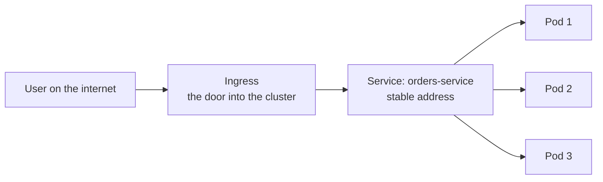

| Service type | Reachable from | Typical use |
| --- | --- | --- |
| **ClusterIP** (default) | Inside the cluster only | Service-to-service calls |
| **NodePort** | Outside, on a port of every node | Quick tests, rarely production |
| **LoadBalancer** | Outside, through a cloud load balancer | Exposing one service publicly |

An Ingress is cheaper than many load balancers, because **one** entry point can route to **many** services by path or host name. It needs an *ingress controller* installed in the cluster to do the work. The newer **Gateway API** is the modern way to do the same job.

---

## 13. Settings, secrets, and storage

Your image should stay the same in every environment. Only the settings change. Kubernetes keeps settings **outside** the image.

| | ConfigMap | Secret |
| --- | --- | --- |
| Holds | Normal settings (URLs, flags) | Passwords, API keys, certificates |
| Stored as | Plain text | Base64 (this is **not** encryption) |
| Example | `SERVER_PORT=8080` | `DB_PASSWORD=...` |
| Extra care | None | Limit who can read it, turn on encryption at rest |

You pass both into the pod as environment variables:

```yaml
envFrom:
  - configMapRef:
      name: orders-config
  - secretRef:
      name: orders-secrets
```

This fits Spring Boot nicely. Remember the property order from the Spring Boot page: **environment variables beat `application.yml`**. A variable named `SPRING_DATASOURCE_URL` overrides `spring.datasource.url`, with no code change.

:::warning[Secrets are not safe by default]
Anyone who can read the Secret object can decode it. For stronger safety, use an external secrets tool or vault, and give access only to those who need it.
:::

**Storage** needs a special mention, because a pod's own disk disappears when the pod does. For data that must stay, a pod asks for a **PersistentVolumeClaim (PVC)**, which is like saying "I need 10 GB of disk that survives restarts". Kubernetes connects it to real storage (a cloud disk, for example). PVCs live in a namespace, while the real disks they point to (**PersistentVolumes**) are cluster-wide.

---

## 14. Staying healthy: probes and resources

Kubernetes can only fix what it can see. Probes are how your app tells Kubernetes how it feels. The **kubelet** on the pod's node runs them.

| Probe | Question it asks | If it fails |
| --- | --- | --- |
| **Startup** | "Have you finished starting?" | Keeps waiting, then restarts if it takes too long |
| **Liveness** | "Are you alive or stuck?" | The kubelet **restarts** the container |
| **Readiness** | "Can you take traffic right now?" | The pod is **removed from the Service** (no restart) |

Spring Boot gives you both endpoints through Actuator (see the Actuator question on the Spring Boot page):

```yaml
readinessProbe:
  httpGet:
    path: /actuator/health/readiness
    port: 8080
livenessProbe:
  httpGet:
    path: /actuator/health/liveness
    port: 8080
  initialDelaySeconds: 30
```

:::warning[A classic mistake]
Do not make the **liveness** probe check the database or other services. If the database is slow, every pod fails liveness and restarts at once, which makes things worse. Liveness should only say "this process is stuck". Put outside checks in **readiness**.
:::

**Resources** tell the scheduler how big your pod is, and set limits.

| | Request | Limit |
| --- | --- | --- |
| Meaning | "I need at least this much" | "Never let me use more than this" |
| Used by | The **scheduler**, to pick a node with room | The **node**, to stop one pod hurting others |
| If CPU goes over | Nothing | The pod is **slowed down** (throttled) |
| If memory goes over | Nothing | The container is **killed** (`OOMKilled`) |

```yaml
resources:
  requests:
    cpu: "250m"        # a quarter of one CPU core
    memory: "512Mi"
  limits:
    memory: "768Mi"
```

For Java, remember that the heap is only **part** of the memory. Metaspace, threads, and native memory need space too. Leave room, and set the heap as a share of the limit, for example `-XX:MaxRAMPercentage=70`. If the limit is too close to the heap size, the pod gets `OOMKilled` even though your code has no leak.

---

## 15. Who is allowed to do what: RBAC

This links directly to the IAM page. Kubernetes uses **RBAC** (role-based access control) for people and for apps.

- A **Role** lists allowed actions **inside one namespace**, such as "can read pods in namespace `dev`". A **ClusterRole** does the same for the whole cluster.
- A **RoleBinding** gives that Role to a user, group, or **ServiceAccount**.
- A **ServiceAccount** is the **identity of a pod**. It is how your app proves who it is when it talks to the cluster, and cloud providers can link it to a cloud IAM role.

The same rule applies here as on the IAM page: give **least privilege**, and nothing extra.

---

## 16. Everyday commands

| Command | What it does |
| --- | --- |
| `kubectl get nodes -o wide` | List nodes, their status, and their IPs |
| `kubectl get pods -n orders -o wide` | List pods in a namespace, with their node and IP |
| `kubectl get deploy,rs,pods -n orders` | See the whole Deployment, ReplicaSet, and Pod chain |
| `kubectl describe pod NAME` | Show details and recent events (the first place to look) |
| `kubectl logs NAME` | Show a pod's logs (add `-f` to follow, `--previous` for the last crash) |
| `kubectl exec -it NAME -- sh` | Open a shell inside the pod |
| `kubectl apply -f file.yaml` | Create or update things from a file |
| `kubectl rollout status deployment/NAME` | Watch a rolling update |
| `kubectl rollout undo deployment/NAME` | Go back to the last version |
| `kubectl scale deployment/NAME --replicas=5` | Change the number of pods |
| `kubectl drain NODE --ignore-daemonsets` | Move pods off a node before maintenance. `kubectl cordon NODE` only stops new pods |

---

## 17. When something goes wrong

Start with `kubectl describe pod NAME`, and read the **Events** at the bottom. Then match the status:

| Status | What it usually means | What to check |
| --- | --- | --- |
| `Pending` | No node has enough room, or no node fits the rules | Resource requests, node capacity, events |
| `ImagePullBackOff` | It cannot download the image | Image name and tag, registry login |
| `CrashLoopBackOff` | The app starts, crashes, and the kubelet keeps restarting it, waiting longer each time | `kubectl logs --previous`, wrong settings, failed liveness probe |
| `OOMKilled` | The container used more memory than its limit | Memory limit vs JVM heap, memory leaks |
| Running but `0/1` ready | The readiness probe is failing | Probe path and port, app startup time, dependencies |
| Node `NotReady` | The kubelet on that node stopped reporting | The node's health, its network, and the kubelet service on it |

---

## 18. Interview questions

### 1. What is Kubernetes, and what problem does it solve?

**In short:** It runs and manages containers across many machines, so you describe the wanted state and it keeps the real state matching.

It handles starting and restarting containers, scaling up and down, rolling updates, service discovery, and load balancing. The key idea is the **control loop**: compare wanted state with real state, and fix any difference.

### 2. Explain container, pod, node, and cluster, and how they differ.

**In short:** A container sits in a pod, a pod runs on a worker node, and the nodes plus the control plane form a cluster.

Use the port picture: a container is a box, a pod is a few boxes strapped together, a node is the ship that carries pods, and the cluster is the whole port with its office. Kubernetes manages **pods**, not bare containers, and one pod shares one IP address.

### 3. Deployment vs ReplicaSet vs Pod?

**In short:** The Deployment manages versions, the ReplicaSet keeps the count, and the pods run the app.

You write the Deployment. It creates one ReplicaSet per version of the pod template. Each ReplicaSet keeps exactly N pods of that version. A rolling update scales the new ReplicaSet up and the old one down, and a rollback scales the old one back up. You never edit the ReplicaSet or the pods directly.

### 4. What does the kubelet do?

**In short:** It is the agent on every node that runs the pods assigned to that node and reports their health.

It registers the node, watches the API Server for pods placed on it, asks the container runtime to start them, runs the probes, restarts crashed containers, and sends status and heartbeats. It doesn't choose where pods go (the scheduler does) or create replacement pods (controllers do).

### 5. A worker node dies. What happens to its pods?

**In short:** They are replaced, not moved. A new pod is created on a healthy node.

The kubelet's heartbeats stop, and the node controller marks the node unhealthy. After a default wait of 5 minutes, the pods are evicted. The ReplicaSet sees too few pods and creates new ones, which the scheduler places on healthy nodes. Bare pods, with no ReplicaSet behind them, are simply gone. That is why you always use a workload resource.

### 6. Is a namespace a security boundary?

**In short:** Partly. It separates names, permissions, and quotas, but not the network.

RBAC Roles and ResourceQuotas work per namespace. But pods can reach pods in other namespaces unless you add NetworkPolicies, and all namespaces share the same nodes. For strong isolation, use separate clusters.

### 7. What is the difference between a region and a zone, and how do you survive a zone failure?

**In short:** A region is a geographic area. A zone is one separate data center inside it. Spread your pods across zones.

Run nodes in at least three zones, keep **3 or more replicas**, and tell Kubernetes to spread pods using `topologySpreadConstraints`. Add a PodDisruptionBudget so updates and node drains never remove too many pods at once. Remember that regions and zones are cloud concepts. Kubernetes only reads them from node labels.

### 8. What happens when you run `kubectl apply`?

**In short:** The API Server saves the wanted state, controllers create the ReplicaSet and pods, the scheduler picks nodes, and the kubelets start the containers.

Walk through the sequence diagram in section 11. Say the key point: **each component watches the API Server and does its own small job**, and nothing talks to nodes directly.

### 9. Liveness vs readiness: what goes wrong if you mix them up?

**In short:** Liveness **restarts** the container. Readiness only **stops traffic** to it.

If your liveness probe checks the database and the database slows down, all pods restart together, and a small problem becomes an outage. Keep liveness about "this process is stuck", and put dependency checks in readiness.

### 10. A pod is in `CrashLoopBackOff`. How do you debug it?

**In short:** Read the events, then the logs of the **previous** run.

1. `kubectl describe pod NAME` and read the Events.
2. `kubectl logs NAME --previous` to see why the last run died.
3. Check settings and secrets, memory limits (`OOMKilled`?), and whether the liveness probe is too strict or starts too early.
4. If needed, run the same image with a shell and test by hand.

### 11. Requests vs limits: why does a Java pod get `OOMKilled` with no memory leak?

**In short:** The JVM uses more than the heap, and the container limit counts **all** of it.

Heap, metaspace, thread stacks, and native buffers all count toward the limit. Set the heap as a share of the limit (`-XX:MaxRAMPercentage`), leave headroom, and watch real memory use in your metrics. Requests are for **scheduling**, limits are for **enforcement**.

### 12. How do you get zero-downtime deployments?

**In short:** Rolling updates, a good readiness probe, and graceful shutdown.

- Use a Deployment with a rolling update strategy, for example `maxUnavailable: 0`.
- Add a **readiness probe**, so new pods get traffic only when ready.
- Turn on graceful shutdown in Spring Boot (`server.shutdown=graceful`), so running requests finish.
- Use a short `preStop` delay so the pod leaves the Service before it stops, and a PodDisruptionBudget to keep enough pods alive.

---

:::info[Where to next]
Kubernetes is where your apps actually run. Revisit [Spring Boot Interview Questions](./spring-boot-interview.md) for the probes, graceful shutdown, and config ideas used here, and the [IAM](./iam/01-iam-basics.md) page for how access control and identities connect to RBAC and ServiceAccounts. To design the systems that run on top of it, see [System Design](./system-design/index.md).
:::

:::note[Looking for the earlier version?]
The original, shorter version of this page is kept here: [Kubernetes (Original Version)](./kubernetes-original.md).
:::
