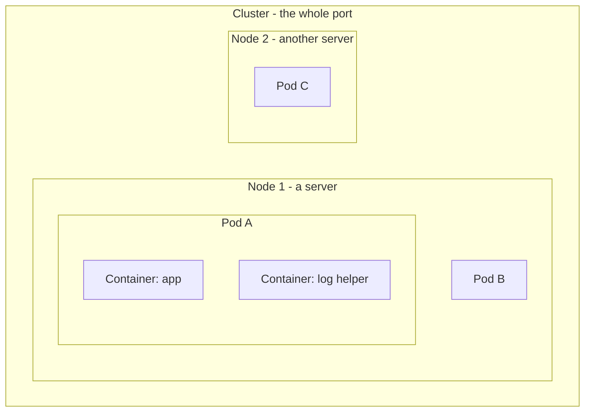
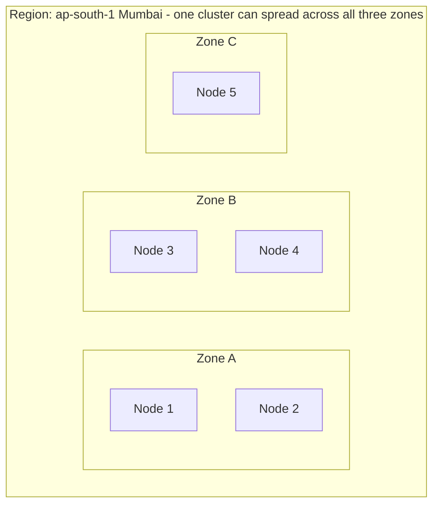
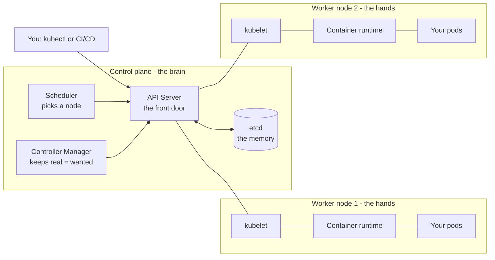
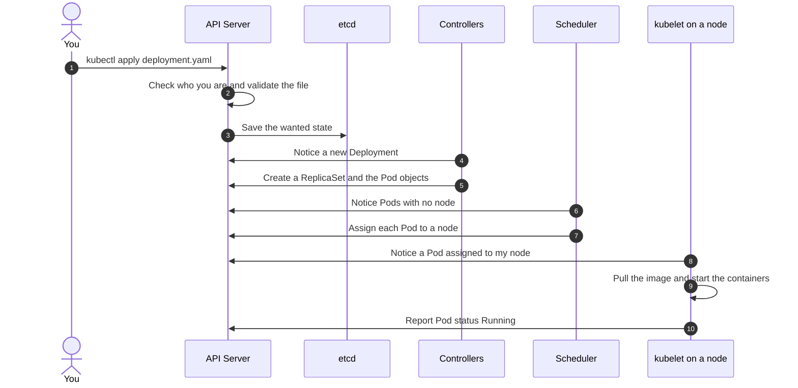
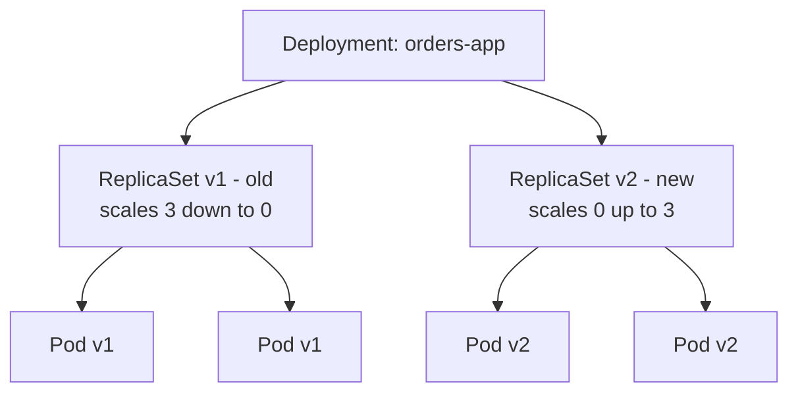
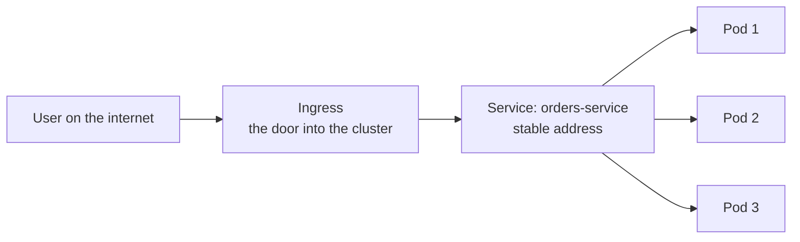

# Kubernetes

Say you built a Spring Boot app, and it runs fine with `java -jar app.jar` on one server. Then real life arrives:

- Traffic grows, and you need **10 copies** of the app, not one.
- A server dies at 2 AM, and someone has to **restart** everything.
- You want to release a new version **without downtime**.
- Every copy needs the right settings and secrets.

Doing all this by hand, on many servers, is slow and risky. **Kubernetes** (often written *K8s*) is the system that does it for you. You tell it **what you want** ("run 3 copies of this app"), and it works nonstop to make that true.

:::tip[The one idea behind Kubernetes]
You describe the **wanted state**. Kubernetes keeps comparing it with the **real state**, and fixes any difference. If a copy crashes, the real state has 2 copies but you wanted 3, so Kubernetes starts one more. This loop never stops.
:::

To keep the many new words easy to follow, we will use one picture all the way through: **a shipping port**. Containers are the boxes, ships carry them, and a port manager decides what goes where. Keep this picture in mind.

---

## 1. First, what is a container?

A **container** is your app packed together with everything it needs (Java, libraries, settings) into one sealed box. It runs the same on your laptop, a test server, or the cloud. Just like a shipping container looks the same to every crane, whatever is inside.

You describe the box in a `Dockerfile`:

```dockerfile
FROM eclipse-temurin:21-jre
COPY target/orders-app.jar /app/app.jar
EXPOSE 8080
ENTRYPOINT ["java", "-jar", "/app/app.jar"]
```

Building this gives you an **image**. Running the image gives you a **container**.

| | Image | Container |
| --- | --- | --- |
| What it is | The packed, read-only recipe | A running copy made from the image |
| Analogy | The blueprint of the box | One real box, on the move |
| How many | One | Many can run from the same image |
| Changes | Never (build a new version instead) | Lives and dies, so do not store data in it |

You may ask: why not use virtual machines? Containers are lighter, because they share the server's operating system kernel instead of carrying a whole OS each.

| | Virtual machine | Container |
| --- | --- | --- |
| Contains | Full operating system | Only the app and its libraries |
| Size | Gigabytes | Megabytes |
| Start time | Minutes | Seconds or less |
| Isolation | Strong (separate OS) | Good (shared kernel) |
| Best for | Running different operating systems | Packing and scaling apps |

Containers solve "it works on my machine". But they bring a new problem: **if you have 200 containers on 20 servers, who runs them, restarts them, and connects them?** That is the job of Kubernetes.

---

## 2. The building blocks, from small to big

Now the words that confuse everyone. Here they are in order, **smallest to biggest**. Each one lives inside the next.



| Term | What it is | Port picture | Count |
| --- | --- | --- | --- |
| **Container** | Your app in a sealed box | One shipping box | Many per pod (usually 1) |
| **Pod** | The smallest thing Kubernetes runs. One or more containers that travel together | A small group of boxes strapped together | Many per node |
| **Node** | One machine (a server or a cloud VM) that runs pods | One ship or truck | Many per cluster |
| **Cluster** | A group of nodes, managed together as one unit | The whole port | One or a few per company |

### Pod vs container: why have both?

This is the most common confusion, so let us slow down.

Kubernetes does **not** run containers directly. It runs **pods**, and a pod holds your containers. Why the extra layer? Because sometimes two containers must work as a team:

- Container 1 is your Spring Boot app.
- Container 2 is a small helper that ships its logs to a log system (this is called a **sidecar**).

They must share the same network and the same files. A pod gives them exactly that.

| | Container | Pod |
| --- | --- | --- |
| Who creates it | Docker or the container runtime | Kubernetes |
| Has its own IP address | No | **Yes**, one IP shared by all its containers |
| Containers talk through | Their pod's network | `localhost` (they are neighbours) |
| Shares storage | No | Can share volumes |
| Scaled and restarted by Kubernetes | Not directly | **Yes**, this is the unit it manages |

:::warning[Pods are temporary]
A pod can be killed and replaced at any time, and the new one gets a **new IP address**. Never depend on a pod's IP, and never keep important data inside a pod. Section 7 shows how clients find pods anyway.
:::

### Namespace: rooms inside the cluster

A **namespace** splits one cluster into separate areas, such as `dev`, `test`, and `payments`. Names only need to be unique inside a namespace, and you can set access rules and limits for each one. Think of it as separate docks in one port.

| | Namespace | Cluster |
| --- | --- | --- |
| It is | A **logical** split inside a cluster | A **physical** group of machines |
| Isolation | Soft (shared machines) | Strong (separate machines) |
| Use it for | Teams, apps, environments | Big boundaries (prod vs non-prod) |

---

## 3. Where does it all run? Nodes, zones, and regions

So far we talked about things **inside** Kubernetes. Now zoom out to the real world. Servers sit in data centers, and the cloud provider (AWS, Google Cloud, Azure) groups those data centers in two levels:

- A **region** is a big area, like **ap-south-1 (Mumbai)**.
- A **zone** (also called an availability zone) is one separate data center, or a group of them, inside a region. Each zone has its own power, cooling, and network.



Why does this matter? Imagine **Zone A loses power**. If all your pods were in Zone A, your app is down. If your pods are spread across A, B, and C, the app keeps running on B and C, and Kubernetes starts replacements.

| | Node | Zone | Region |
| --- | --- | --- | --- |
| What it is | One server | One data center (group) | A whole geographic area |
| Who makes it | You (or the cloud) | The cloud provider | The cloud provider |
| Is it a Kubernetes thing? | **Yes** | No, but nodes are labelled with it | No, but nodes are labelled with it |
| What fails with it | One machine | A power or network failure | Very rare, a whole area |
| Port picture | One ship | One port city | A country |
| Protects you from | Nothing alone | Data center failure | Regional disaster |

Kubernetes itself does not create zones or regions. It just reads a **label** on each node that says which zone it is in. You can then tell Kubernetes: "spread my 3 pods across different zones" (this uses `topologySpreadConstraints` or pod anti-affinity).

:::info[A common design]
One cluster, in one region, with nodes in **three zones**. For protection against a whole region failing, companies run **two clusters in two regions** and send traffic to both.
:::

---

## 4. Inside the cluster: the brain and the hands

A cluster has two kinds of machines. This is the second big idea to understand.

- **Control plane:** the **brain**. It decides what should run and where. (The port manager's office.)
- **Worker nodes:** the **hands**. They actually run your pods. (The ships and cranes.)



Each part has one clear job:

| Part | Where | Its job, in plain words |
| --- | --- | --- |
| **API Server** | Control plane | The only front door. Every command and every part talks through it |
| **etcd** | Control plane | The database that remembers the wanted state of the whole cluster |
| **Scheduler** | Control plane | Decides which node a new pod should go to, based on free CPU, memory, and your rules |
| **Controller Manager** | Control plane | Runs the loops that compare wanted and real state, and fix differences |
| **kubelet** | Each worker node | The node's agent. Starts the pod's containers and reports their health |
| **Container runtime** | Each worker node | Actually runs the containers (containerd or CRI-O) |
| **kube-proxy** | Each worker node | Helps network traffic reach the right pod |

:::note[Managed Kubernetes]
On AWS (EKS), Google Cloud (GKE), and Azure (AKS), the provider runs the control plane for you. You only manage, and pay for, the worker nodes.
:::

---

## 5. What really happens when you deploy?

Now we can follow one command from start to finish. You run:

```bash
kubectl apply -f deployment.yaml
```



Notice two things:

1. **Nobody gives orders directly to a node.** Each part watches the API Server for work it cares about, does its small job, and writes the result back. That is the control loop idea from the start of this page.
2. Because the wanted state is **saved**, Kubernetes can recover by itself. If a node dies, the controllers see "wanted 3, real 2" and start the cycle again.

---

## 6. Keeping the right number alive: Deployments

You almost never create a pod by hand. If you do and it dies, nobody brings it back. Instead you create a **Deployment**. It says: "keep 3 copies of this pod running, always."

```yaml
apiVersion: apps/v1
kind: Deployment
metadata:
  name: orders-app
spec:
  replicas: 3                  # I want 3 copies
  selector:
    matchLabels:
      app: orders-app
  template:                    # the pod blueprint
    metadata:
      labels:
        app: orders-app
    spec:
      containers:
        - name: orders-app
          image: myrepo/orders-app:1.0.0
          ports:
            - containerPort: 8080
```

A Deployment does not manage pods directly. It uses a middle layer called a **ReplicaSet**, which counts the pods. This is what makes **zero-downtime updates** possible:



When you change the image to `1.1.0`, Kubernetes does a **rolling update**:

1. It starts **one** new pod (version 2).
2. It waits until that pod says "I am ready" (see the probes in section 9).
3. Only then does it stop **one** old pod.
4. It repeats until all pods are new.

Users always have some working pods, so they never see downtime. If the new version is bad, one command goes back: `kubectl rollout undo deployment/orders-app`.

**Scaling** works the same way. Change `replicas`, or let Kubernetes do it by itself with the **Horizontal Pod Autoscaler (HPA)**. It adds pods when CPU (or another metric) is high, and removes them when it is low.

### Deployment is not the only kind of workload

| Kind | Use it for | Key behaviour |
| --- | --- | --- |
| **Deployment** | Normal stateless apps, like REST APIs | Pods are identical and replaceable |
| **StatefulSet** | Databases, Kafka, anything needing a stable identity | Pods get fixed names (`db-0`, `db-1`) and their own storage |
| **DaemonSet** | One helper on **every node** (log or monitoring agent) | Exactly one pod per node |
| **Job** | A task that runs once and finishes | Runs to completion, then stops |
| **CronJob** | A task on a schedule | Creates a Job at each scheduled time |

---

## 7. How do clients find the pods? Services and Ingress

Remember the warning: pods come and go, and their IPs change. So how does another app call your app? Through a **Service**.

A Service gives your pods **one stable address and name**. It also spreads the requests across all the healthy pods behind it (load balancing).

```yaml
apiVersion: v1
kind: Service
metadata:
  name: orders-service
spec:
  selector:
    app: orders-app          # send traffic to pods with this label
  ports:
    - port: 80
      targetPort: 8080
```

Now any pod in the cluster can call `http://orders-service` (the full name is `orders-service.default.svc.cluster.local`, in the form service, namespace, svc, cluster domain). It does not matter which pods are alive right now.

An **Ingress** is the door from the outside world. It reads the web address and routes it to the right Service.



| Service type | Reachable from | Typical use |
| --- | --- | --- |
| **ClusterIP** (default) | Inside the cluster only | Service-to-service calls |
| **NodePort** | Outside, on a port of every node | Quick tests, rarely production |
| **LoadBalancer** | Outside, through a cloud load balancer | Exposing one service publicly |

An Ingress is cheaper than many load balancers, because **one** entry point can route to **many** services by path or host name. It needs an *ingress controller* installed in the cluster to do the work. The newer **Gateway API** is the modern way to do the same job.

---

## 8. Settings, secrets, and storage

Your image should stay the same in every environment. Only the settings change. Kubernetes keeps settings **outside** the image.

| | ConfigMap | Secret |
| --- | --- | --- |
| Holds | Normal settings (URLs, flags) | Passwords, API keys, certificates |
| Stored as | Plain text | Base64 (this is **not** encryption) |
| Example | `SERVER_PORT=8080` | `DB_PASSWORD=...` |
| Extra care | None | Limit who can read it, turn on encryption at rest |

You pass both into the pod as environment variables:

```yaml
envFrom:
  - configMapRef:
      name: orders-config
  - secretRef:
      name: orders-secrets
```

This fits Spring Boot nicely. Remember the property order from the Spring Boot page: **environment variables beat `application.yml`**. A variable named `SPRING_DATASOURCE_URL` overrides `spring.datasource.url`, with no code change.

:::warning[Secrets are not safe by default]
Anyone who can read the Secret object can decode it. For stronger safety, use an external secrets tool or vault, and give access only to those who need it.
:::

**Storage** needs a special mention, because a pod's own disk disappears when the pod does. For data that must stay, a pod asks for a **PersistentVolumeClaim (PVC)**, which is like saying "I need 10 GB of disk that survives restarts". Kubernetes connects it to real storage (a cloud disk, for example).

---

## 9. Staying healthy: probes and resources

Kubernetes can only fix what it can see. Probes are how your app tells Kubernetes how it feels.

| Probe | Question it asks | If it fails |
| --- | --- | --- |
| **Startup** | "Have you finished starting?" | Keeps waiting, then restarts if it takes too long |
| **Liveness** | "Are you alive or stuck?" | The container is **restarted** |
| **Readiness** | "Can you take traffic right now?" | The pod is **removed from the Service** (no restart) |

Spring Boot gives you both endpoints through Actuator (see the Actuator question on the Spring Boot page):

```yaml
readinessProbe:
  httpGet:
    path: /actuator/health/readiness
    port: 8080
livenessProbe:
  httpGet:
    path: /actuator/health/liveness
    port: 8080
  initialDelaySeconds: 30
```

:::warning[A classic mistake]
Do not make the **liveness** probe check the database or other services. If the database is slow, every pod fails liveness and restarts at once, which makes things worse. Liveness should only say "this process is stuck". Put outside checks in **readiness**.
:::

**Resources** tell the scheduler how big your pod is, and set limits.

| | Request | Limit |
| --- | --- | --- |
| Meaning | "I need at least this much" | "Never let me use more than this" |
| Used by | The **scheduler**, to pick a node with room | The **node**, to stop one pod hurting others |
| If CPU goes over | Nothing | The pod is **slowed down** (throttled) |
| If memory goes over | Nothing | The container is **killed** (`OOMKilled`) |

```yaml
resources:
  requests:
    cpu: "250m"        # a quarter of one CPU core
    memory: "512Mi"
  limits:
    memory: "768Mi"
```

For Java, remember that the heap is only **part** of the memory. Metaspace, threads, and native memory need space too. Leave room, and set the heap as a share of the limit, for example `-XX:MaxRAMPercentage=70`. If the limit is too close to the heap size, the pod gets `OOMKilled` even though your code has no leak.

---

## 10. Who is allowed to do what: RBAC

This links directly to the IAM page. Kubernetes uses **RBAC** (role-based access control) for people and for apps.

- A **Role** lists allowed actions, such as "can read pods in namespace `dev`".
- A **RoleBinding** gives that Role to a user, group, or **ServiceAccount**.
- A **ServiceAccount** is the **identity of a pod**. It is how your app proves who it is when it talks to the cluster, and cloud providers can link it to a cloud IAM role.

The same rule applies here as on the IAM page: give **least privilege**, and nothing extra.

---

## 11. Everyday commands

| Command | What it does |
| --- | --- |
| `kubectl get pods -o wide` | List pods, with their node and IP |
| `kubectl describe pod NAME` | Show details and recent events (the first place to look) |
| `kubectl logs NAME` | Show a pod's logs (add `-f` to follow, `--previous` for the last crash) |
| `kubectl exec -it NAME -- sh` | Open a shell inside the pod |
| `kubectl apply -f file.yaml` | Create or update things from a file |
| `kubectl rollout status deployment/NAME` | Watch a rolling update |
| `kubectl rollout undo deployment/NAME` | Go back to the last version |
| `kubectl scale deployment/NAME --replicas=5` | Change the number of pods |

---

## 12. When something goes wrong

Start with `kubectl describe pod NAME`, and read the **Events** at the bottom. Then match the status:

| Status | What it usually means | What to check |
| --- | --- | --- |
| `Pending` | No node has enough room, or no node fits the rules | Resource requests, node capacity, events |
| `ImagePullBackOff` | It cannot download the image | Image name and tag, registry login |
| `CrashLoopBackOff` | The app starts, crashes, and restarts again and again | `kubectl logs --previous`, wrong settings, failed liveness probe |
| `OOMKilled` | The container used more memory than its limit | Memory limit vs JVM heap, memory leaks |
| Running but `0/1` ready | The readiness probe is failing | Probe path and port, app startup time, dependencies |

---

## 13. Interview questions

### 1. What is Kubernetes, and what problem does it solve?

**In short:** It runs and manages containers across many machines, so you describe the wanted state and it keeps the real state matching.

It handles starting and restarting containers, scaling up and down, rolling updates, service discovery, and load balancing. The key idea is the **control loop**: compare wanted state with real state, and fix any difference.

### 2. Explain pod, container, node, and cluster, and how they differ.

**In short:** A container sits in a pod, a pod runs on a node, and nodes together form a cluster.

Use the port picture: a container is a box, a pod is a few boxes strapped together, a node is the ship that carries pods, and the cluster is the whole port. Kubernetes manages **pods**, not bare containers, and one pod shares one IP address.

### 3. What is the difference between a region and a zone, and how do you survive a zone failure?

**In short:** A region is a geographic area. A zone is one separate data center inside it. Spread your pods across zones.

Run nodes in at least three zones, keep **3 or more replicas**, and tell Kubernetes to spread pods using `topologySpreadConstraints`. Add a PodDisruptionBudget so updates and node drains never remove too many pods at once. Remember that regions and zones are cloud concepts. Kubernetes only reads them from node labels.

### 4. What happens when you run `kubectl apply`?

**In short:** The API Server saves the wanted state, controllers create the pods, the scheduler picks nodes, and the kubelets start the containers.

Walk through the sequence diagram in section 5. Say the key point: **each component watches the API Server and does its own small job**, and nothing talks to nodes directly.

### 5. Liveness vs readiness: what goes wrong if you mix them up?

**In short:** Liveness **restarts** the container. Readiness only **stops traffic** to it.

If your liveness probe checks the database and the database slows down, all pods restart together, and a small problem becomes an outage. Keep liveness about "this process is stuck", and put dependency checks in readiness.

### 6. A pod is in `CrashLoopBackOff`. How do you debug it?

**In short:** Read the events, then the logs of the **previous** run.

1. `kubectl describe pod NAME` and read the Events.
2. `kubectl logs NAME --previous` to see why the last run died.
3. Check settings and secrets, memory limits (`OOMKilled`?), and whether the liveness probe is too strict or starts too early.
4. If needed, run the same image with a shell and test by hand.

### 7. Requests vs limits: why does a Java pod get `OOMKilled` with no memory leak?

**In short:** The JVM uses more than the heap, and the container limit counts **all** of it.

Heap, metaspace, thread stacks, and native buffers all count toward the limit. Set the heap as a share of the limit (`-XX:MaxRAMPercentage`), leave headroom, and watch real memory use in your metrics. Requests are for **scheduling**, limits are for **enforcement**.

### 8. How do you get zero-downtime deployments?

**In short:** Rolling updates, a good readiness probe, and graceful shutdown.

- Use a Deployment with a rolling update strategy.
- Add a **readiness probe**, so new pods get traffic only when ready.
- Turn on graceful shutdown in Spring Boot (`server.shutdown=graceful`), so running requests finish.
- Use a short `preStop` delay so the pod leaves the Service before it stops, and a PodDisruptionBudget to keep enough pods alive.

---

:::info[Where to next]
Kubernetes is where your apps actually run. Revisit [Spring Boot Interview Questions](./spring-boot-interview.md) for the probes, graceful shutdown, and config ideas used here, and the [IAM](./iam.md) page for how access control and identities connect to RBAC and ServiceAccounts.
:::
