# System Design Q&A: How Would You...

The [System Design](../system-design/index.md) course taught the building blocks and six full designs. Interviews also ask **shorter, sharper questions**: "How would you handle a traffic spike?", "How would you migrate this database without downtime?". They test whether you can pick the right tool and explain the trade-off in two minutes.

This page has 18 of them, in four groups. Each answer starts with the line you can say out loud, then explains why. Links point back to the course where an idea is covered in depth.

:::tip[A shape for every answer]
1. **Clarify:** what exactly breaks, and at what scale?
2. **Answer:** the main idea in one sentence.
3. **Explain:** how it works, usually with a small diagram on the whiteboard.
4. **Trade-off:** what it costs, and when you would choose something else.

Interviewers care most about step 4. Saying "this costs us X, and I accept it because Y" is what separates senior answers.
:::

| Group | Questions |
| --- | --- |
| A. Scaling and performance | 1 to 5 |
| B. Data | 6 to 10 |
| C. Reliability | 11 to 14 |
| D. Correctness | 15 to 18 |

---

## A. Scaling and performance

### 1. How would you handle a 10x traffic spike for a flash sale?

**In short:** Prepare before it starts, absorb the spike with a queue or waiting room, serve everything you can from cache, and protect the core with rate limits.

A sale starts at a known time, so you don't have to react. You can prepare.

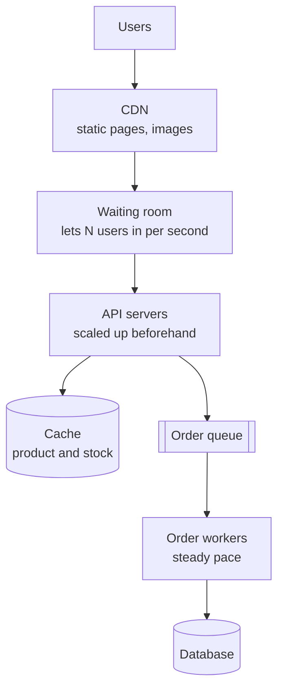

| Step | What it does |
| --- | --- |
| **Scale up early** | Autoscaling reacts in minutes, and the spike arrives in seconds. Add servers an hour before |
| **CDN and cache** | Product pages are the same for everyone. Serve them from the edge and keep the database for orders |
| **Waiting room** | Users get a place in a virtual queue and are let in at a rate the system can take |
| **Queue the orders** | Accept the order quickly, then process it at a steady pace. Tell the user "order received" |
| **Rate limits** | Per user and per IP, to stop bots. See the [rate limiter](../system-design/05-rate-limiter.md) |
| **Turn off extras** | Recommendations and reviews can go read-only or off for an hour |

**Trade-off:** users wait, either in the waiting room or for an order email. That is much better than the site going down for everyone.

### 2. The p99 latency of an API jumped from 200 ms to 2 seconds. How would you find the cause?

**In short:** Narrow it down with data: when did it start, which requests are slow, and which step inside those requests takes the time.

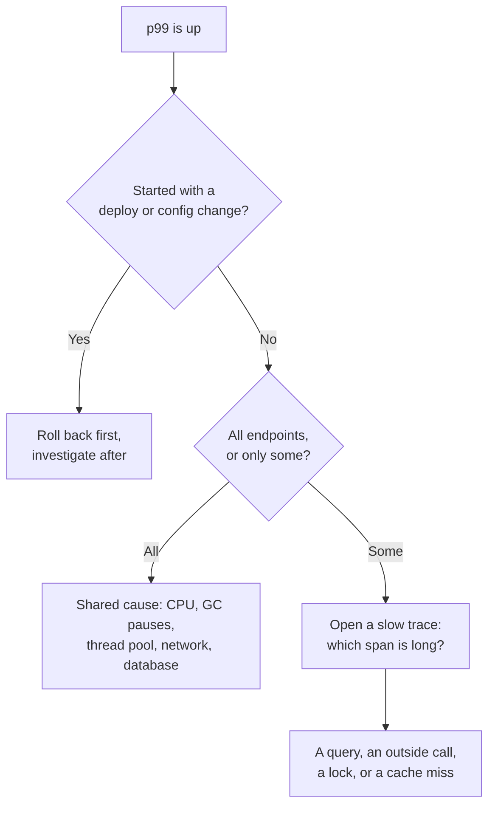

| Common cause | How you see it |
| --- | --- |
| A slow database query (a missing index, a new query plan) | Slow query log, the database span in the trace |
| Connection pool or thread pool exhausted | Pool metrics: threads waiting, time to get a connection |
| Long garbage collection pauses | GC logs, pauses that line up with the spikes |
| A slow outside service | Its span in the trace, and its own dashboard |
| Cache hit rate dropped | Cache metrics. More misses means more database calls |
| A "noisy neighbour" on the same host | Host CPU steal, or other pods on the same node |

**Why p99 and not the average?** The average hides the slowest 1% of requests. A user who loads a page that makes 50 calls almost always hits one of those slow ones.

### 3. One key is far hotter than all the others. How would you handle it?

**In short:** Spread the hot key over many copies, or keep it in a small local cache on each server.

A celebrity's profile, or a product on the home page, can get 100 times the traffic of other keys. All of it lands on **one** cache server or **one** shard, and that one server melts while the others are idle.

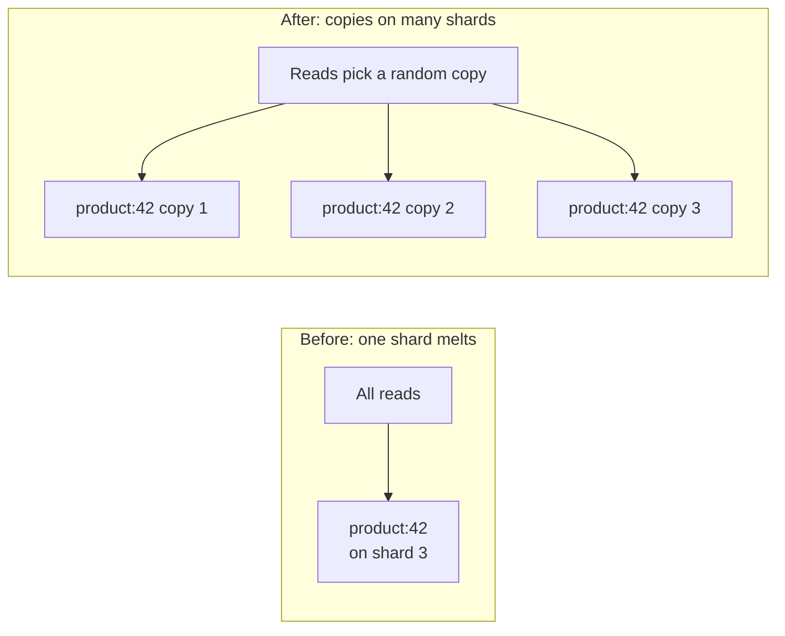

| Fix | How | Cost |
| --- | --- | --- |
| **Local cache** | Each app server keeps the hot key in memory for a few seconds | Data can be a few seconds old |
| **Key copies** | Store `product:42#1` to `#N` on different shards. Readers pick one at random | Writes must update N copies |
| **Split writes** | For a hot counter, write to N sub-counters and add them up when reading | Reads do more work |

Find hot keys with monitoring (top keys per shard), because they are usually a surprise.

### 4. A popular cache entry expires and 5,000 requests hit the database at once. How would you prevent it?

**In short:** Let only one request rebuild the value while the others wait or get the old one, and spread out the expiry times.

This is a **cache stampede**, also called a thundering herd.

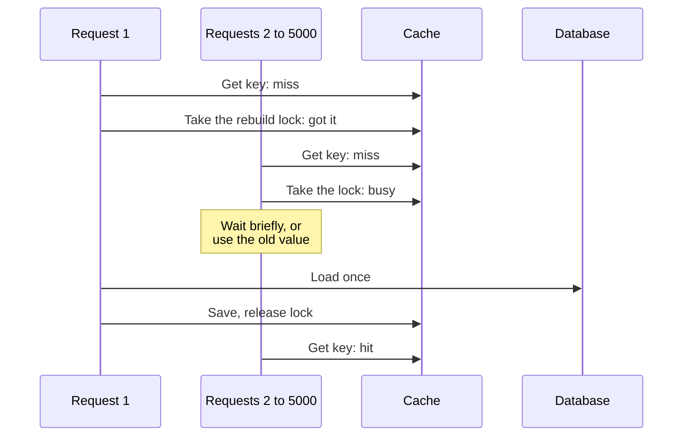

| Technique | Idea |
| --- | --- |
| **Lock, or single-flight** | Only one caller rebuilds. Others wait for its result |
| **Serve stale** | Keep the old value a little longer and return it while one caller refreshes |
| **Refresh early** | Rebuild the value in the background shortly before it expires |
| **Jitter on TTLs** | Expire after "10 minutes plus or minus 1 minute", so keys don't all expire together |

More on caching in [Building Blocks](../system-design/01-building-blocks.md#2-caching).

### 5. How would you paginate through millions of rows?

**In short:** Use a cursor (keyset pagination), not offsets.

`OFFSET 1000000 LIMIT 20` makes the database read and throw away a million rows for every page. Worse, if a new row arrives while the user scrolls, items shift and the user sees duplicates or misses one.

| | Offset | Cursor (keyset) |
| --- | --- | --- |
| Query | `LIMIT 20 OFFSET 1000000` | `WHERE id < 98765 ORDER BY id DESC LIMIT 20` |
| Speed on deep pages | Gets slower and slower | Always fast, using the index |
| New rows while scrolling | Duplicates or missed items | Stable |
| Jump to page 500 | Possible | Not possible, only next and previous |

The API returns an opaque `next_cursor` (often the last ID, encoded). The client sends it back to get the next page. The [news feed](../system-design/07-news-feed.md) works this way.

---

## B. Data

### 6. How would you migrate to a new database, or a new schema, with zero downtime?

**In short:** Expand, migrate, contract: run old and new side by side, copy the data, check it matches, move reads, then move writes, and only then remove the old one.

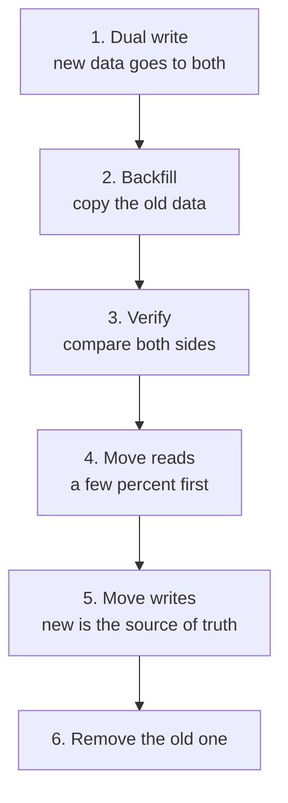

- **Dual write** is safest through **change data capture** (CDC) or an [outbox](../system-design/03-distributed-transactions.md#4-transactional-outbox), not two separate writes in the code, which can fail halfway.
- **Verify** by comparing counts and checksums, and by "shadow reads": read from both and log any differences.
- Every step can be **rolled back**, until the last one.

For a column rename, the same idea is: add the new column, write both, backfill, switch reads, stop writing the old one, drop it. Each step is its own deploy, so old and new code versions always work at the same time.

### 7. A table has grown too big for one database. How would you shard it?

**In short:** Pick a shard key that spreads the load evenly and keeps each request on one shard, then route by that key.

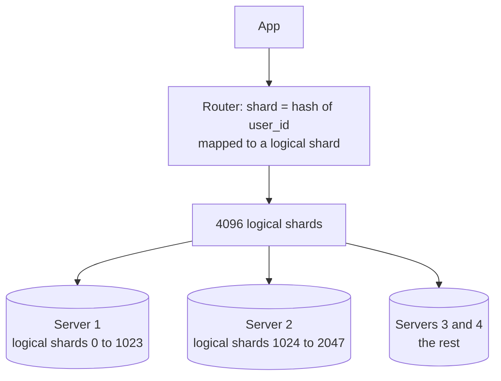

| Choosing the key | Good | Bad |
| --- | --- | --- |
| Spreads load evenly | `user_id` (hashed) | `country`, where one country is half the users |
| Keeps a request on one shard | All of a user's orders by `user_id` | Orders by `order_id` when you always query by user |
| Doesn't create hot spots over time | A hash | A timestamp: all new writes hit the newest shard |

**Plan for resharding from day one:** create many **logical** shards (for example 4096) mapped to a few physical servers. Growing then means moving whole logical shards to new servers, not rehashing every row. See [sharding](../system-design/01-building-blocks.md#6-sharding-partitioning) and [consistent hashing](../system-design/01-building-blocks.md#7-consistent-hashing).

**The cost:** queries across shards (reports, "all orders yesterday") become hard. Send those to a separate analytics store.

### 8. How would you keep a search index in sync with the main database?

**In short:** Stream every change from the database to the index through change data capture and a queue, and keep a way to rebuild the index from scratch.

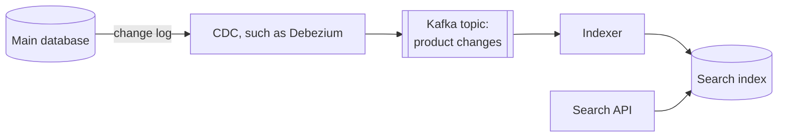

- Don't write to the database and the index from the app. If the second write fails, they disagree forever.
- The change log has every change in order, so the index **catches up** after any outage.
- The search index will be a second or two behind. Say so, and design the UI to accept it.
- **Full rebuild:** build a new index alongside the old one, then switch an alias to it in one step. This is how you change the index mapping without downtime.

### 9. How would you count views or likes for billions of events?

**In short:** Don't update one row per event. Batch the counts, split hot counters, and use approximate counting where exact numbers don't matter.

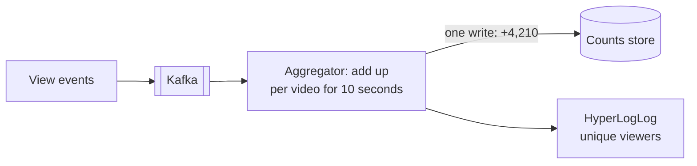

| Need | Technique |
| --- | --- |
| Total views, a little delay is fine | Batch in a stream processor, write sums every few seconds |
| A very hot counter | Split it into N sub-counters and add them up on read |
| **Unique** viewers | **HyperLogLog**: counts unique items with about 1% error in a few kilobytes. Redis has it built in |
| Money, or anything legal | Exact counts from the event log, never approximate |

Users don't notice if a like count is 2 seconds late. They do notice if the page is slow because every like locks a database row.

### 10. How would you delete one user's data from every system (for GDPR)?

**In short:** Publish one "delete user" event, have every service that stores personal data handle it, and track each service's confirmation until all are done.

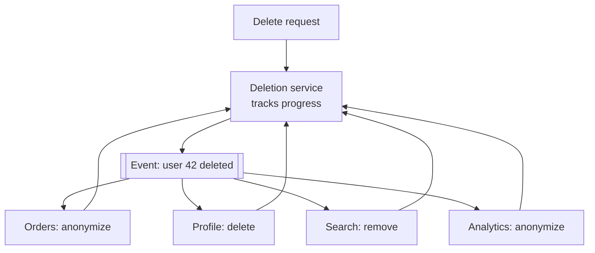

- Keep a **data map**: which services store personal data. New services must register.
- Some data must be kept by law (invoices). **Anonymize** it instead of deleting it.
- Backups: either expire them in a fixed time, or use **crypto-shredding**: encrypt each user's data with their own key and delete the key.
- The deletion service retries and reports. "All 14 services confirmed" is the proof you need.

---

## C. Reliability

### 11. How would you stop one slow dependency from taking down your whole service?

**In short:** Timeouts, a circuit breaker, separate resource pools (bulkheads), and a fallback answer.

Without protection, a slow dependency holds your threads. Requests pile up, all threads are stuck waiting, and now **your** service is down too. This is a **cascading failure**.

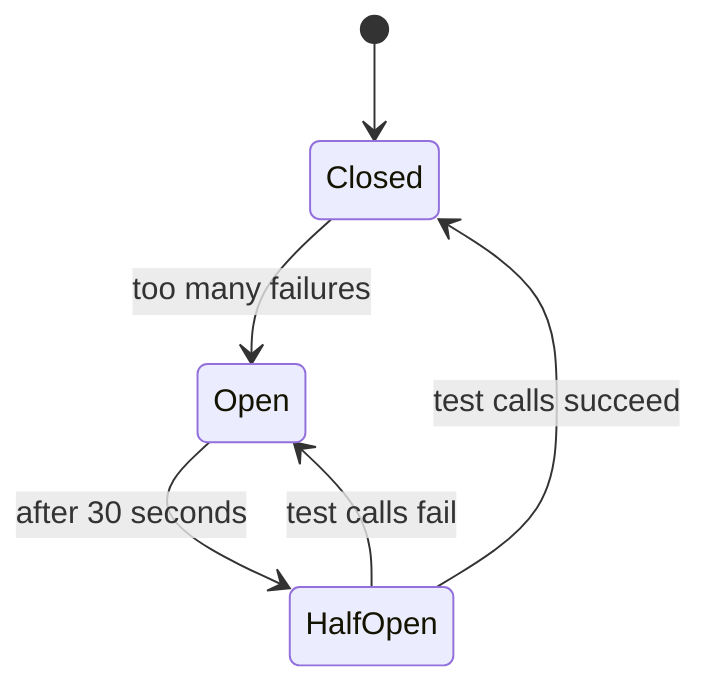

| Tool | What it does |
| --- | --- |
| **Timeout** | Never wait forever. Set a timeout on every outside call, shorter than your own caller's timeout |
| **Circuit breaker** | After many failures, stop calling for a while (**open**) and fail fast. Then try a few calls (**half-open**) |
| **Bulkhead** | A separate thread or connection pool per dependency, so one can't use up all the threads |
| **Fallback** | A cached answer, a default, or a smaller page: "recommendations unavailable" |

In Spring Boot, Resilience4j provides all four.

### 12. How would you add retries without making an outage worse?

**In short:** Retry only safe operations, with exponential backoff and jitter, a small retry limit, and an idempotency key.

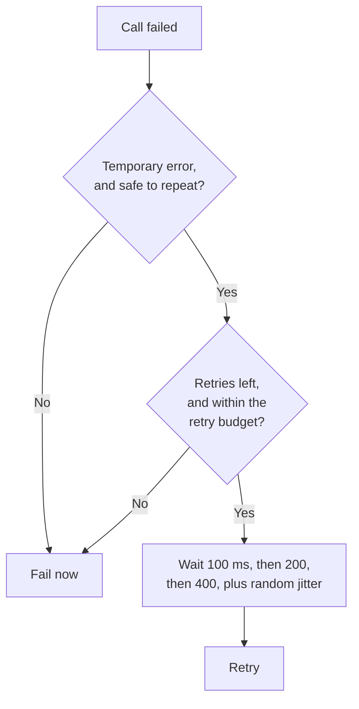

- **Retry storms:** if 5 layers each retry 3 times, one user request can become 3 × 3 × 3 × 3 × 3 = 243 calls at the bottom. Retry at **one** layer only.
- **Retry budget:** allow retries up to, say, 10% of normal traffic. During an outage, retries stop instead of tripling the load.
- **Jitter** spreads the retries out, so thousands of clients don't retry at the same moment.
- A retry of a payment must not charge twice. That needs an **idempotency key** (question 15).

### 13. How would you keep a service running if a whole cloud region goes down?

**In short:** Run in two regions, replicate the data between them, and be able to move traffic. How fast and how much data you can lose decides between active-passive and active-active.

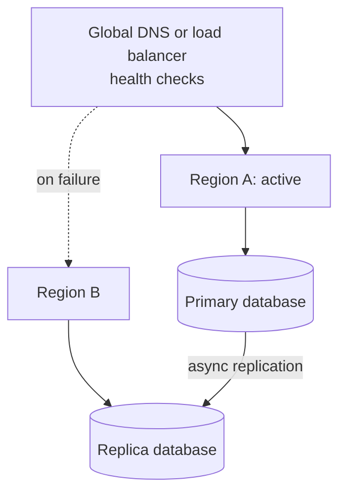

Two numbers drive the design:

- **RPO** (recovery point objective): how much data you can lose. With async replication, the last few seconds.
- **RTO** (recovery time objective): how long you can be down.

| | Backup and restore | Active-passive | Active-active |
| --- | --- | --- | --- |
| Second region | Nothing running | Running, but idle or read-only | Takes live traffic |
| RTO | Hours | Minutes | Seconds |
| RPO | Hours | Seconds | Seconds, or zero with sync writes |
| Hard part | Slow recovery | Practising the failover | Write conflicts between regions |
| Cost | Low | Medium | High |

**Test the failover regularly.** A failover that has never been run is a guess, not a plan.

### 14. How would you roll out a risky change safely?

**In short:** Ship it hidden behind a feature flag, turn it on for a small share of users, watch the metrics, and roll back automatically if they get worse.

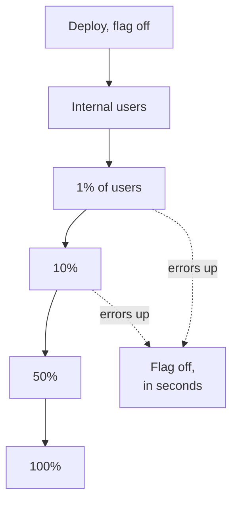

- **Deploy is not release.** The code goes out switched off. Turning it on is a separate, instant step.
- A **canary** sends a small share of traffic to the new version and compares error rate and latency with the old one.
- Decide the "stop" thresholds **before** the rollout, not while looking at the graphs.
- Database changes must work with both versions at once. Use expand and contract (question 6).

---

## D. Correctness

### 15. How would you make a payment API safe to retry?

**In short:** The client sends a unique idempotency key with each request. The server stores the key with the result and returns the same result for any repeat.

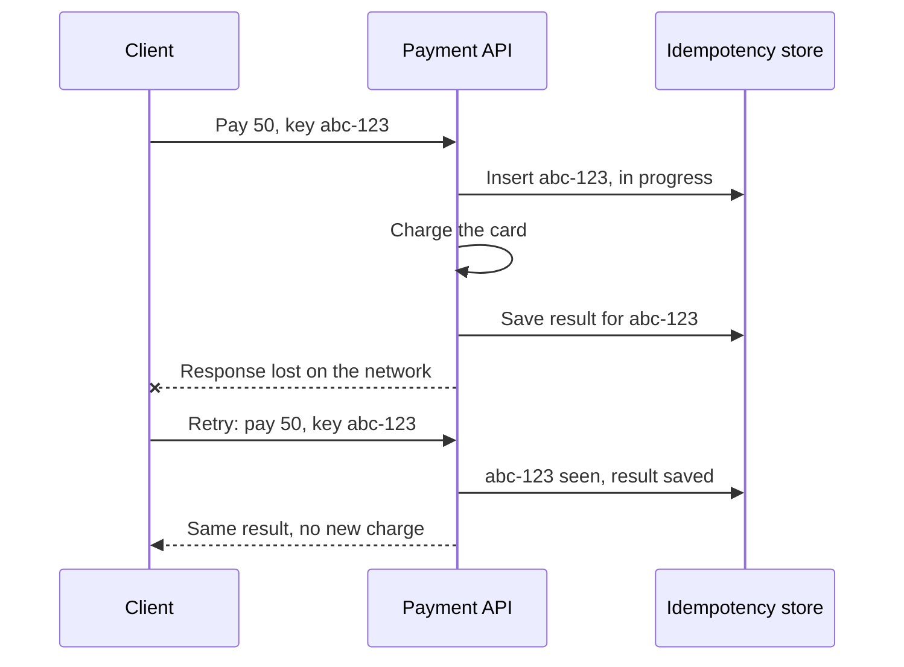

- Insert the key **atomically** (a unique constraint), so two parallel retries can't both pass.
- Store a hash of the request too. The same key with a **different** body is an error.
- If a request with the key is still **in progress**, the repeat gets "try again shortly", not a second charge.
- Keep keys for a limited time, for example 24 hours.

The same idea for consumers of a queue is in [idempotent consumers](../system-design/03-distributed-transactions.md#5-idempotent-consumers-and-exactly-once).

### 16. How would you generate unique IDs across hundreds of servers?

**In short:** Use IDs that each server can make on its own without coordinating, and that are roughly sorted by time, such as UUIDv7 or Snowflake IDs.

| Option | Size | Sorted by time | Coordination | Notes |
| --- | --- | --- | --- | --- |
| Database auto-increment | 64-bit | Yes | One database | A bottleneck, and leaks your volume |
| UUIDv4 | 128-bit | No | None | Random order hurts database index performance |
| **UUIDv7** | 128-bit | **Yes** | None | Standard since 2024 (RFC 9562). A good default |
| **Snowflake** | 64-bit | **Yes** | A unique worker ID per server | 41 bits of time, 10 of machine, 12 of sequence |
| Ranges from a central service | 64-bit | Roughly | Rarely, one call per block of 1000 | Short, readable IDs |

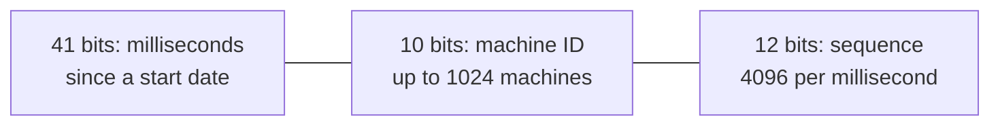

Time-sorted IDs keep new rows at the end of the index, which keeps inserts fast. For time across machines, see [logical clocks](../system-design/02-distributed-systems.md#5-time-and-ordering-logical-clocks).

### 17. How would you process events in order while still using many consumers?

**In short:** You only need order **per entity**. Partition events by entity ID, so each entity's events go to one partition and one consumer, in order.

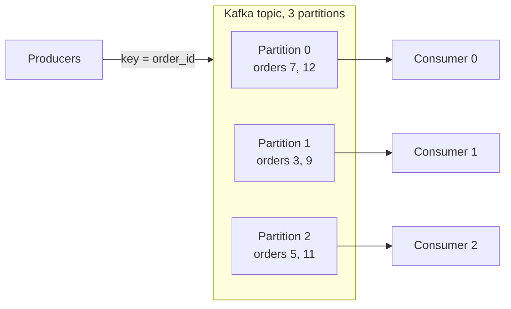

- All events for order 7 land in partition 0, in order. Different orders run in parallel.
- **Global** order across all events means one partition and one consumer, so it doesn't scale. Almost no business needs it.
- Watch out for retries that reorder events. Include a version number, and have consumers ignore anything older than what they have already seen.
- More partitions means more parallel consumers, but adding partitions later moves keys, so plan the count early.

### 18. How would you handle a request that takes 10 minutes, such as a big report?

**In short:** Make it asynchronous: accept the request, return a job ID at once, do the work in the background, and let the client poll or get notified.

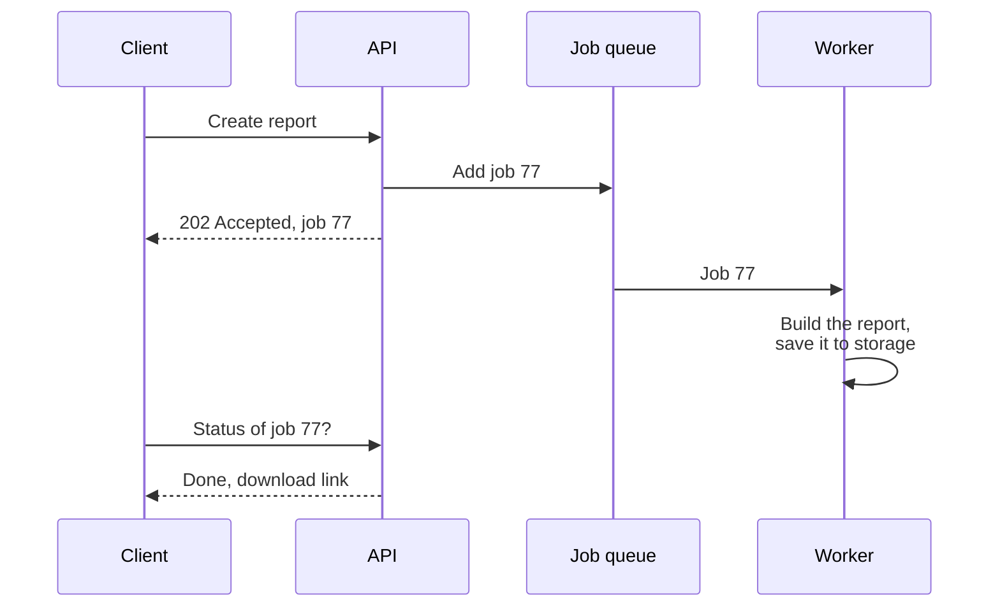

- HTTP connections, load balancers, and users all give up long before 10 minutes.
- The job's status (queued, running, done, failed) lives in a database, so any API server can answer.
- Notify by **webhook**, email, or a push to the browser instead of polling, if you can.
- Workers must handle a job being delivered twice. Make the work idempotent.

---

:::info[Next page]
These questions each focus on one problem. [Complex Designs](./02-complex-designs.md) puts many of them together in six harder end-to-end designs: payments, ride matching, ticket booking, collaborative editing, a job scheduler, and search autocomplete.
:::
