# System Design Q&A: Complex Designs

The [previous page](./01-how-would-you.md) answered one problem at a time. Senior interviews give you a whole system and 45 minutes. These six designs are the ones that come up often **and** have a genuinely hard core: money that must never be wrong, things that move, thousands of people fighting over one seat, or many people typing into the same sentence.

Each design is compact. It covers the requirements, the big picture, the key decisions, **the hard part** (where the interview is really decided), and follow-up questions.

| # | Design | The hard part |
| --- | --- | --- |
| 1 | Payment system | Never lose or double-count money, even when a provider times out |
| 2 | Ride matching | Millions of moving locations, and never giving one driver two rides |
| 3 | Ticket booking | 2 million people want 50,000 seats at 10:00 |
| 4 | Collaborative editor | Two people edit the same sentence at the same moment |
| 5 | Job scheduler | Run millions of jobs at the right time, even when machines die |
| 6 | Search autocomplete | Answer on every keystroke in milliseconds |

:::tip[Spend your time on the hard part]
Don't spend 30 minutes on load balancers and databases that every design has. Cover the big picture in about 10 minutes, then say "the hard part here is..." and go deep. That sentence shows the interviewer you see what matters.
:::

---

## 1. Design a payment system

**The question:** users pay merchants by card. You call an outside **payment provider** (a PSP, such as Stripe or Adyen) to move the money.

**In short:** an idempotent payment API, a state machine for every payment, a double-entry ledger as the source of truth, and daily reconciliation against the provider.

| Must do | Must be |
| --- | --- |
| Take payments, refunds, and payouts to merchants | **Correct above all**: never charge twice, never lose a payment |
| Show the status of every payment | Auditable: every change to money is recorded forever |
| Handle the provider's webhooks | Available, but correctness wins over speed |

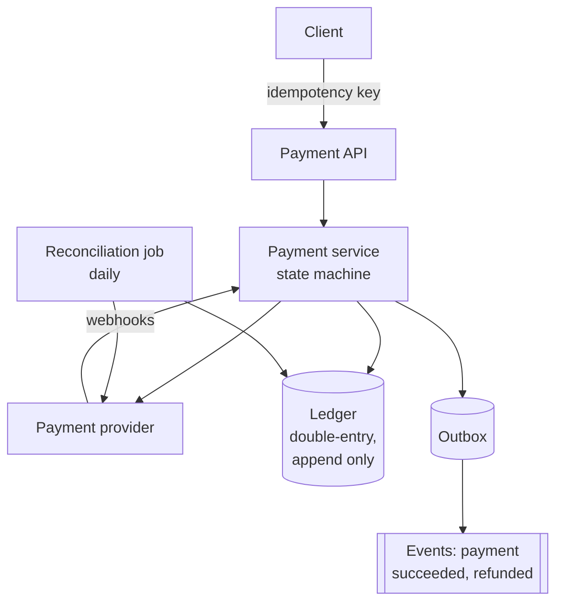

| Decision | Choice | Why |
| --- | --- | --- |
| Retries | An **idempotency key** on every request | A retry must never charge twice. See [question 15](./01-how-would-you.md#15-how-would-you-make-a-payment-api-safe-to-retry) |
| Money type | Whole numbers in the smallest unit (cents, paise), plus the currency | Floating point can't represent 0.10 exactly |
| Source of truth | A **double-entry ledger** | Every movement is balanced, so errors show up |
| Database | Relational, with strong transactions | Money needs ACID, not eventual consistency |
| Events to other services | [Transactional outbox](../system-design/03-distributed-transactions.md#4-transactional-outbox) | The event is sent only if the database change committed |

**Double-entry ledger:** every movement is written as entries that **add up to zero**. Balances are never edited, only computed from entries.

| Entry | Account | Debit | Credit |
| --- | --- | --- | --- |
| User pays 100 | Customer funds | 100 | |
| | Merchant payable | | 97 |
| | Platform fees | | 3 |

A refund is **new** entries in the opposite direction. Nothing is ever updated or deleted, so the history is a complete audit trail.

### The hard part: the provider times out

You send "charge 100" to the provider and the connection times out. Did the charge happen? You don't know.

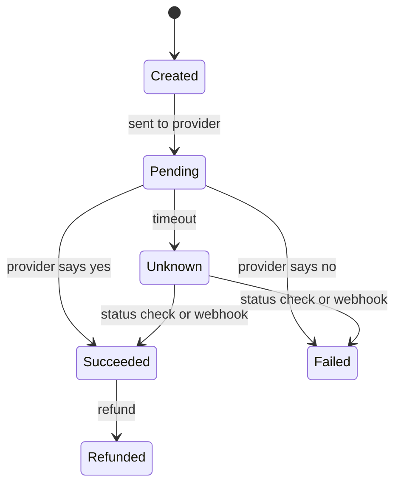

- **Never** mark it failed and retry with a new request. That's how people get charged twice.
- Pass **your** idempotency key to the provider. Retrying with the same key is safe, because the provider returns the first result.
- Keep the payment in `Unknown`, and let a background job **ask the provider** for the status. The provider's webhook may also arrive first.
- **Reconciliation** every day: compare the provider's settlement report line by line with your ledger. Any difference becomes an alert for a person.

### Follow-ups

**How would you scale the ledger?** **In short:** shard by account, and split very busy accounts. A big merchant gets many sub-accounts that receive entries in parallel, and are added up for the balance.

**Why not just a `balance` column?** **In short:** updates lose history and hide bugs. With entries, you can always prove how a balance was reached, and the books must always balance.

---

## 2. Design ride matching for a ride-hailing app

**The question:** riders request a ride, and the system finds a nearby driver, quickly and fairly.

**In short:** keep live driver locations in an in-memory geo index split by map cells, find candidates in nearby cells, rank them by real driving time, and lock a driver atomically before offering the ride.

**Rough scale:** 1 million drivers online, each sending its location every 4 seconds, is **250,000 location updates a second**. Most are overwritten seconds later, so they shouldn't go to a normal database.

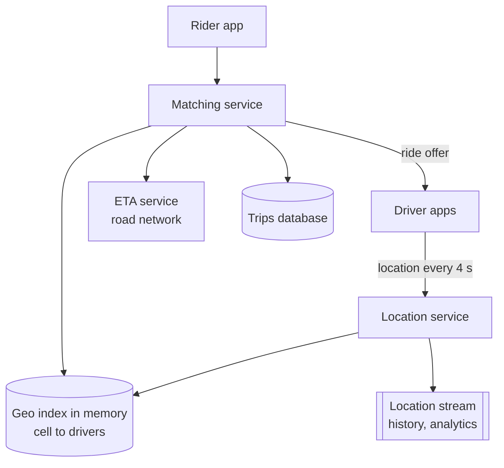

**Finding nearby drivers.** Divide the map into cells, using **geohash** or **H3** (hexagons). Each cell holds the drivers currently in it. Finding drivers near a rider means looking in the rider's cell and the ring of cells around it, and widening the ring if there are too few.

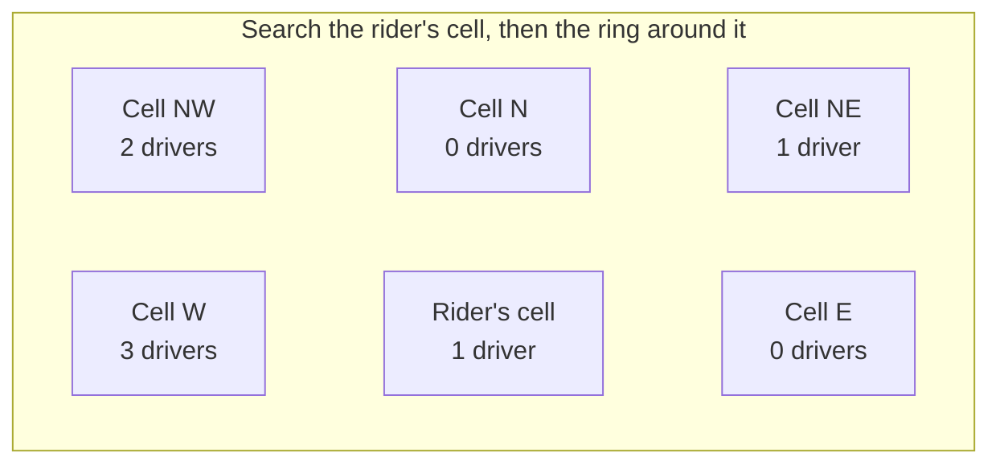

| Decision | Choice | Why |
| --- | --- | --- |
| Live locations | In memory (such as Redis GEO), sharded by city or cell | Hundreds of thousands of writes a second, and only the latest matters |
| Ranking | **Driving time** (ETA), not straight-line distance | A driver 500 m away across a river may be 15 minutes away |
| Location history | A stream into cheap storage | For analytics, disputes, and ETA models, not for matching |
| Sharding | By city or region | Rides almost never cross cities, so each shard is independent |

### The hard part: never give one driver two rides

Two matching servers handle two riders at the same moment, and both pick driver 7.

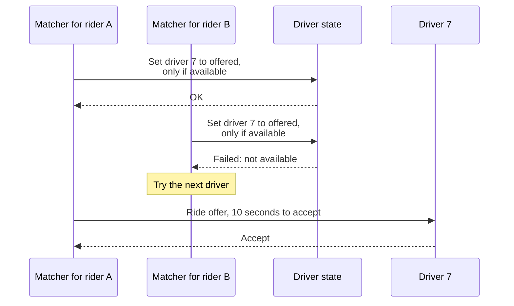

- The driver's state changes with an **atomic conditional update**: "set to offered **only if** it is available". Only one can win.
- The offer has a **timeout**. If the driver doesn't accept in 10 seconds, the state goes back to available and the matcher tries the next one.
- The trip itself is a state machine stored durably: requested, matched, driver arriving, in progress, completed, paid.

### Follow-ups

**How does surge pricing work?** **In short:** for each cell, compare open requests with free drivers every minute. When demand is much higher, raise the price multiplier for new requests in that cell, which brings in more drivers and evens out demand.

**The driver's phone goes offline mid-trip?** **In short:** the trip keeps going on the server. The app sends locations it stored while offline when it reconnects, and the fare is computed from the route once the trip ends.

---

## 3. Design ticket booking for a huge on-sale

**The question:** a famous artist's concert goes on sale at 10:00. 2 million people try to buy 50,000 seats.

**In short:** a waiting room to admit users at a safe rate, a seat map served from cache, a **short hold** on seats using an atomic conditional update, and payment within the hold time.

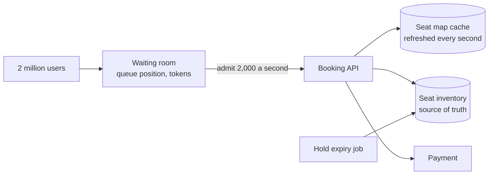

### The hard part: holding a seat fairly

A seat moves through three states:

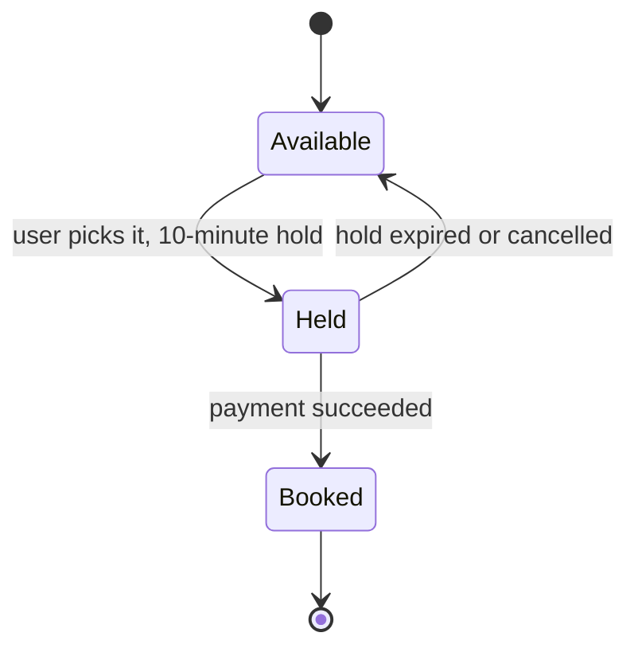

Holding a seat is **one atomic statement**:

```sql
UPDATE seats
SET status = 'HELD', held_by = :user, hold_until = now() + interval '10 minutes'
WHERE seat_id = :seat AND status = 'AVAILABLE';
```

If it changes 1 row, the user got the seat. If it changes 0 rows, someone else was faster: show "seat taken" and suggest others. No locks are held while the user thinks, and two users can never both succeed. The same idea is in [the double-booking question](../system-design/03-distributed-transactions.md#4-two-users-try-to-book-the-last-seat-at-the-same-moment-how-do-you-stop-a-double-booking).

| Problem | Solution |
| --- | --- |
| 2 million requests at 10:00 | The **waiting room** gives each user a queue position, then a signed token that lets them in. The booking API only accepts requests with a valid token |
| Everyone loads the seat map | Serve it from cache, refreshed every second. It may be slightly stale, and the hold step is what is exact |
| All seats of one event are in one place | Split the inventory by section, so different sections are on different partitions |
| Users who never pay | The hold expires after 10 minutes, and the seat goes back on sale |
| Bots | Waiting room tokens, rate limits per account and card, and a limit of tickets per person |

### Follow-ups

**Payment succeeds just after the hold expired, and the seat is sold again?** **In short:** extend the hold while payment is in progress, so it can't expire mid-payment. If a conflict still happens, refund automatically and apologise. Never sell one seat twice.

**What about standing tickets with no seat numbers?** **In short:** it becomes an atomic counter: "reduce the remaining count by 2, only if at least 2 remain". It's the same conditional-update idea, on one row per ticket type.

---

## 4. Design a collaborative document editor

**The question:** many people edit the same document at once and see each other's typing live, like a shared online doc.

**In short:** each document is handled by one collaboration server. Clients send small edit operations over WebSockets, conflicts are resolved with operational transformation (OT) or CRDTs, and the document is stored as snapshots plus a log of operations.

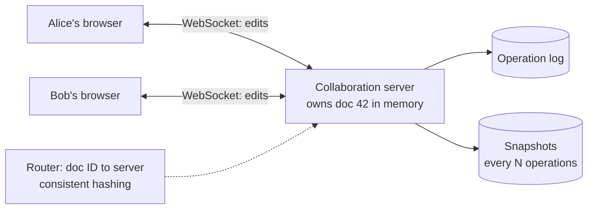

| Decision | Choice | Why |
| --- | --- | --- |
| What is sent | Small **operations** ("insert 'x' at 15"), not the whole document | Tiny messages, and every change is recorded |
| Routing | All editors of one doc connect to the **same** server, chosen by doc ID | One place puts the operations in order |
| Storage | Operation log, plus a snapshot every few hundred operations | Loading means the latest snapshot plus the operations after it |
| Cursors and presence | Sent live, never stored | Temporary, and only interesting right now |
| History | Already there: replay the log to any point | Version history for free |

### The hard part: two edits at the same moment

The text is `cat`. Alice inserts `s` at the end (position 3) to make `cats`. At the same moment, Bob inserts `a ` at the start (position 0) to make `a cat`. If each side simply applies the other's edit as sent, Alice's "insert at 3" lands in the wrong place on Bob's screen: `a csat`.

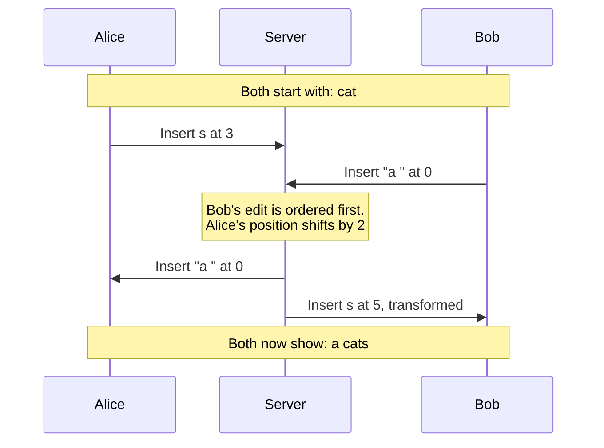

There are two main ways to fix this:

| | Operational transformation (OT) | CRDT |
| --- | --- | --- |
| Idea | The server orders operations and **transforms** each one against the ones before it | Each character gets a unique ID, so edits merge the same way in any order |
| Needs a central server | Yes | No. Works peer to peer and offline |
| Offline editing | Hard | Natural |
| Cost | Tricky transform rules | More metadata per character |
| Used by | Many classic online editors | Newer editors and libraries such as Yjs and Automerge |

More on CRDTs in [Distributed Systems](../system-design/02-distributed-systems.md#7-conflict-resolution-and-crdts).

### Follow-ups

**The server holding a document crashes?** **In short:** the router picks another server, which loads the last snapshot plus the log. Clients reconnect and resend any edits the server hadn't confirmed.

**A document with 500 people typing?** **In short:** batch operations every 50 to 100 ms, send cursors less often, and make most viewers read-only. One server handles one document, so a single huge document is the limit.

---

## 5. Design a distributed job scheduler

**The question:** other services say "run this job at time T", or "every day at 2 AM". There are millions of jobs a day, and jobs must run even if machines die.

**In short:** store jobs indexed by next run time, have scheduler nodes claim due jobs with a lease, push them to a queue for workers, and make jobs idempotent, because "at least once" is the guarantee.

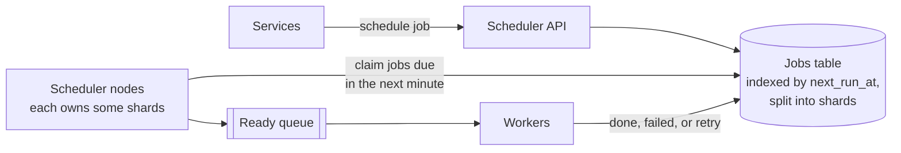

| Decision | Choice | Why |
| --- | --- | --- |
| Storage | A jobs table with an index on `next_run_at` | "What is due now?" is one fast index scan |
| Scaling the schedulers | Split jobs into shards, and give each scheduler node a set of shards | No two nodes scan the same jobs |
| Recurring jobs | After a run, compute the next time from the cron expression and save it | One row per recurring job, not one per run |
| Failures | Retries with backoff, then a dead-letter state | The same pattern as the [notification system](../system-design/08-notification-system.md) |

### The hard part: a worker dies in the middle of a job

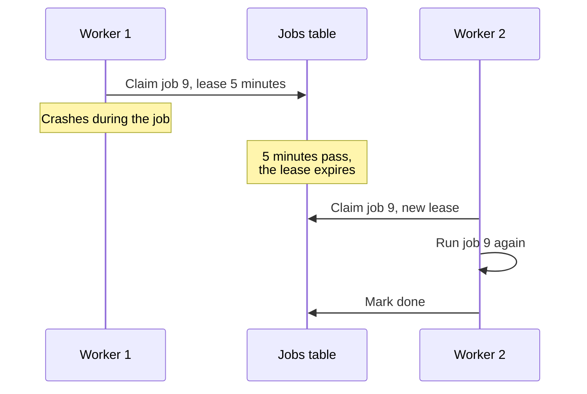

- A job is **claimed** with a lease, not deleted. If the worker dies, the lease expires and another worker takes the job.
- In PostgreSQL, `SELECT ... FOR UPDATE SKIP LOCKED` lets many workers claim different due jobs at once without blocking each other.
- So a job can run **twice** (the first worker may have finished but crashed before saying so). Jobs must be **idempotent**, or use a [fencing token](../system-design/03-distributed-transactions.md#6-distributed-locks-and-fencing-tokens) so a stale worker's writes are rejected.

### Follow-ups

**A million jobs are all scheduled for midnight?** **In short:** the queue absorbs the burst and workers drain it at their pace. Where exact time doesn't matter, add a little random jitter when jobs are scheduled.

**How precise is the timing?** **In short:** within a few seconds, which is normal. For millisecond precision, schedulers hold the next few seconds of jobs in memory in a **timing wheel** (time buckets), but most systems don't need it.

---

## 6. Design search autocomplete

**The question:** as the user types, show the 10 most popular searches that start with the typed text, in well under 100 ms.

**In short:** an offline pipeline counts popular queries and builds a trie where every node already stores its top 10. Serving is just a prefix lookup in memory, with heavy caching.

**Rough scale:** 10 million searches a day of about 20 characters each, with a request on many keystrokes, is **thousands of lookups a second** at peak. Each one must be very fast, because the user is still typing.

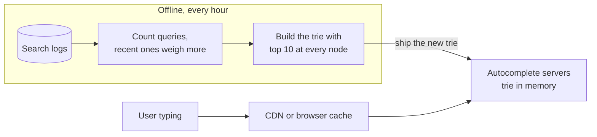

### The hard part: fast enough on every keystroke

Searching all completions of "ja" at request time would mean walking a huge subtree. Instead, each trie node **stores its answer ahead of time**:

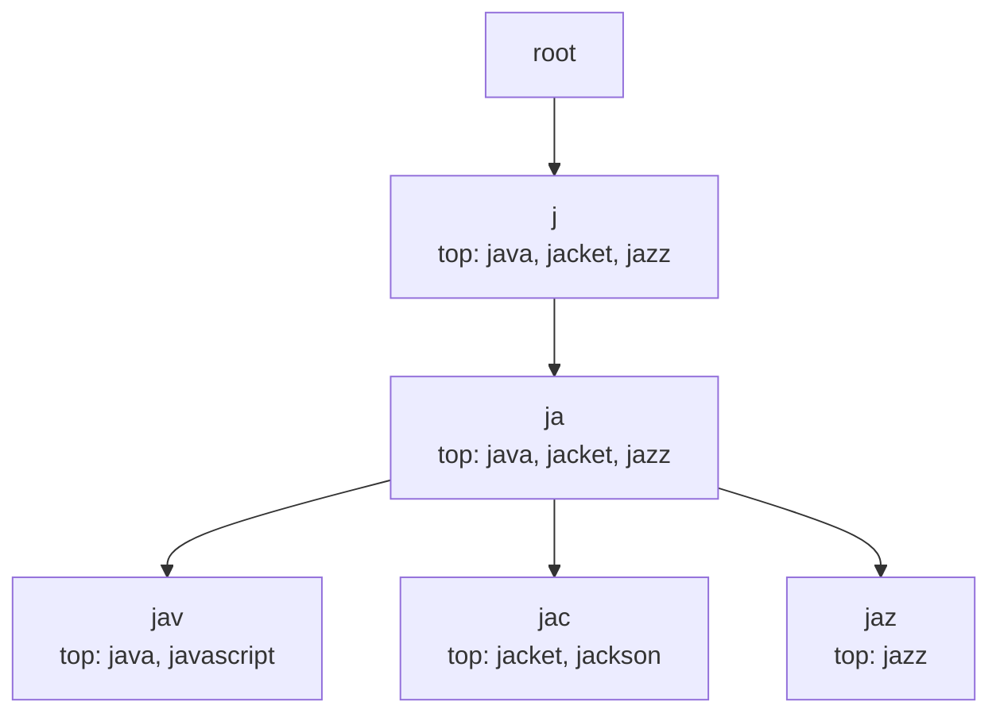

| Decision | Choice | Why |
| --- | --- | --- |
| Lookup | Walk the prefix and read the stored top 10 | Time depends only on the prefix length, not on how many queries exist |
| Freshness | Rebuild every hour, plus a small live layer for trending terms | Popularity changes slowly, except for news |
| Size | Split the trie by first letters across servers, or copy it fully if it fits in memory | Copies are simpler and faster when it fits |
| Fewer requests | The client waits about 100 ms after typing stops, and caches answers | Many keystrokes never reach the server |
| Caching | Short prefixes ("a", "ja") are the same for everyone, so cache them at the CDN | The busiest prefixes cost nothing |
| Safety | Filter offensive and unsafe completions before building | Suggestions look like recommendations |

### Follow-ups

**How do you handle typos?** **In short:** also look up prefixes within one or two edits of what was typed (fuzzy matching), and rank them lower than exact matches.

**How do you personalize suggestions?** **In short:** mix the global top 10 with the user's own recent searches on the server or in the app. The shared trie stays the same for everyone, which keeps it cacheable.

---

:::info[Where to next]
You have now seen the building blocks used in six course designs and six harder ones. Go back to [Building Blocks](../system-design/01-building-blocks.md) and [Distributed Systems](../system-design/02-distributed-systems.md) whenever an answer feels shaky. For running these systems in production, see [Kubernetes](../kubernetes.md), and for keeping them patched, [Vulnerability Remediation](../vulnerability-remediation/01-automated-remediation.md).
:::
