# Building Blocks

Every big system is built from the same few parts. Learn them once and every design later in this course is just a new arrangement of them.

We start from one server and grow it step by step. Each block solves a problem the last step created.

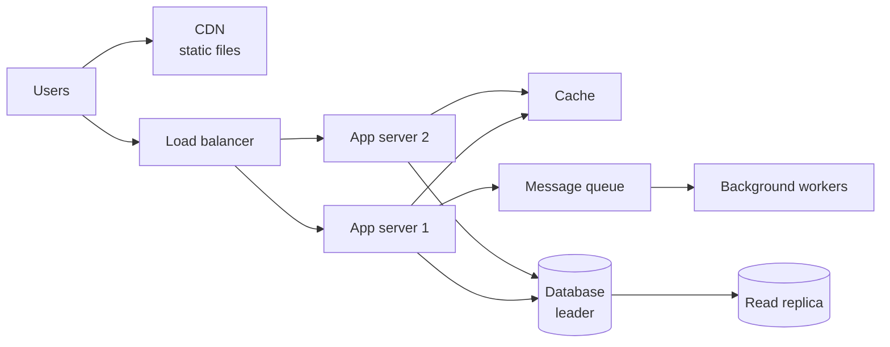

| Block | Problem it solves |
| --- | --- |
| Load balancer | One server is not enough, or it might die |
| Cache | The database is too slow for repeated reads |
| CDN | Users far away wait too long for files |
| Replication | One database copy can't handle all reads, or might be lost |
| Sharding | The data is too big for one database |
| Consistent hashing | Adding a server should not reshuffle all the data |
| Message queue | Slow work should not block the user |
| CAP theorem | When the network breaks, you must pick consistency or availability |

---

## 1. Load balancer

**The problem:** one server can only handle so many requests, and if it dies, the whole site dies.

**The idea:** run several identical servers and put a **load balancer** in front. It spreads requests across them and stops sending to any server that fails its health check.

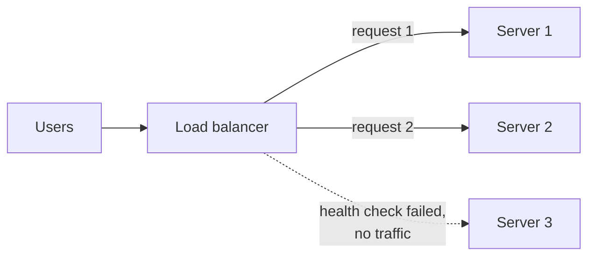

| Algorithm | How it picks a server | Good for |
| --- | --- | --- |
| Round robin | Takes turns: 1, 2, 3, 1, 2, 3 | Servers of the same size and similar requests |
| Least connections | The server with the fewest open requests | Requests that take very different times |
| Hash of user or IP | The same user always goes to the same server | When a server keeps per-user data in memory |

:::tip[Keep servers stateless]
If a server keeps no user data in its own memory, any server can handle any request. Keep sessions in a shared cache or in a token such as a JWT. You can then add or remove servers freely. This is called **horizontal scaling**.
:::

---

## 2. Caching

**The problem:** the same data is read again and again, and each database read takes milliseconds.

**The idea:** keep hot data in memory (in a cache such as Redis). A memory read takes about 100 nanoseconds, while a database query takes milliseconds.

The most common pattern is **cache-aside**: the app checks the cache first, and only goes to the database on a miss.

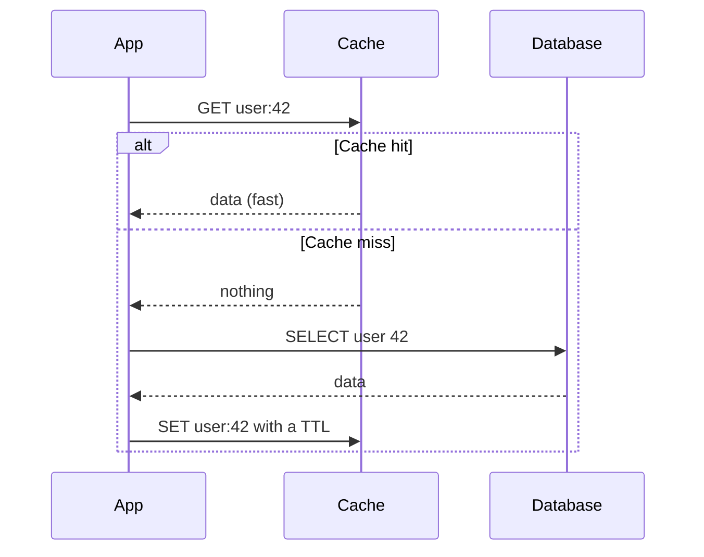

| Strategy | How writes work | Trade-off |
| --- | --- | --- |
| Cache-aside | Write to the DB, then delete the cache entry | Simple and common. The first read after a change is slow |
| Write-through | Write to the cache and the DB together | Cache is always fresh. Every write is slower |
| Write-back | Write to the cache only, then save to the DB later | Very fast writes. Data is lost if the cache dies first |

Two more words you will hear:

- **TTL (time to live):** each entry expires after a set time, so stale data cleans itself up.
- **Eviction:** when memory is full, the cache must remove something to make room. Which item it removes is the **eviction policy**, explained next.

### Eviction policies

TTL and eviction are different things. TTL removes an entry because it is **too old**. Eviction removes one because the cache is **full**. The policy decides which entry loses its place:

| Policy | Removes | Good for | Weakness |
| --- | --- | --- | --- |
| **LRU** (least recently used) | The item not used for the longest time | Most apps. Recent items tend to be used again | One big scan of old data can push out all the hot items |
| **LFU** (least frequently used) | The item used the fewest times | Stable favourites, such as top products | An item popular last week keeps its high count and won't leave |
| **FIFO** (first in, first out) | The oldest item added, however often it is used | Very simple caches | Throws out hot items just because they are old |
| **Random** | Any item, picked at random | When tracking usage costs too much | Sometimes removes a hot item |
| **MRU** (most recently used) | The item used most recently | Repeated scans, where the item just read won't be needed again soon | Wrong for normal traffic |
| **TTL-first** | The item closest to expiring | Data that has clear expiry times | Ignores how popular items are |

**Example:** a cache holds 3 items. The reads are `B, A, A, A, C, B`, and then a new item `D` arrives. Each policy removes a different item:

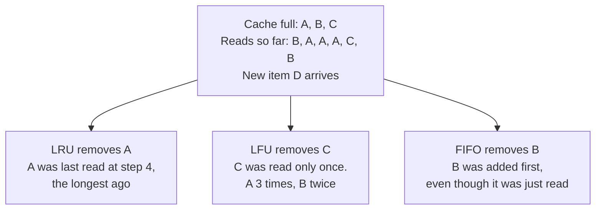

LRU uses the same structure as LeetCode 146 in the [DSA section](../dsa/02-search-lists-design.md): a hash map with a doubly linked list. In Redis, you choose the policy with the `maxmemory-policy` setting. `allkeys-lru` and `allkeys-lfu` are the common choices. The `volatile-*` versions only evict keys that have a TTL, and `noeviction` rejects writes when memory is full.

:::tip[Modern caches mix the ideas]
Real libraries combine recency and frequency to get the best of both. Caffeine, the most popular Java cache, uses **W-TinyLFU**. A new item first enters a small LRU area, and it only gets into the main cache if it has been used more often than the item it would replace. This stops one-off reads from pushing out items that are used all the time.
:::

:::warning[Common trap]
"There are only two hard things in computer science: cache invalidation and naming things." Always say how the cache gets updated when the data changes, or how long you accept stale data.
:::

---

## 3. CDN (content delivery network)

**The problem:** a user in Mumbai downloads images from a server in Virginia. Every request crosses the planet, which takes about 150 ms each way.

**The idea:** a CDN keeps copies of static files (images, video, JavaScript, CSS) on **edge servers** around the world. Users download from the nearest one. On a miss, the edge fetches the file once from your **origin** (often object storage such as Amazon S3) and keeps it.

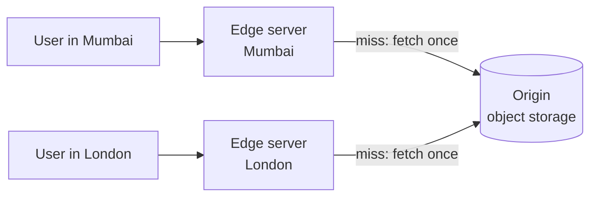

Use a CDN for anything large and the same for every user. Don't use it for personal data that changes on every request.

---

## 4. Databases: SQL or NoSQL?

**The problem:** you need to store data, and the choice affects everything later.

| | SQL (PostgreSQL, MySQL) | NoSQL (Cassandra, DynamoDB, MongoDB) |
| --- | --- | --- |
| Data shape | Tables with a fixed schema | Key-value, document, or wide-column |
| Relationships | Joins across tables | Usually none, so you store data together |
| Transactions | Strong (ACID) | Often limited to one item or one partition |
| Scaling | Mostly vertical, plus read replicas | Built to spread across many machines |
| Pick it when | Data is related and correctness matters, such as orders or payments | You have huge volume and simple access by key, such as messages or events |

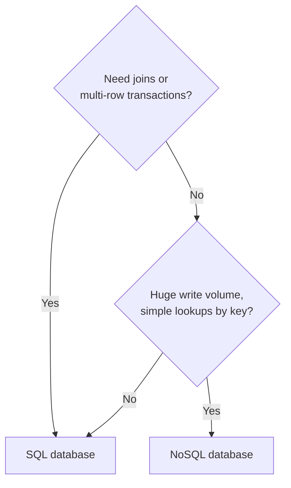

:::note
"Start with SQL unless you have a reason not to" is a safe default in interviews. Then name the reason when you switch.
:::

---

## 5. Replication

**The problem:** one database can't serve all the reads, and if its disk dies, the data is gone.

**The idea:** keep copies. In **leader-follower** replication, all writes go to the leader. It copies the changes to followers, and reads can go to any follower.

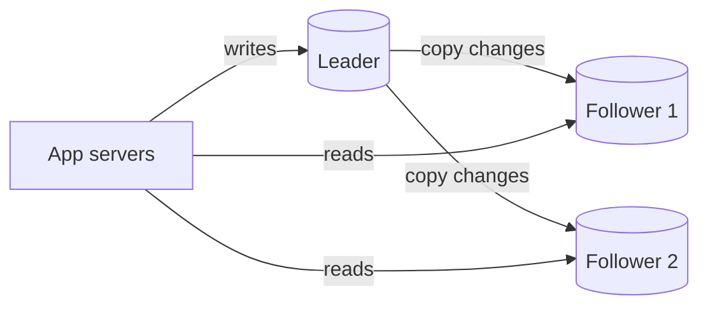

| | Synchronous copy | Asynchronous copy |
| --- | --- | --- |
| Leader waits for followers? | Yes | No |
| Write speed | Slower | Faster |
| Risk | A slow follower slows every write | Followers can be a little behind (**replication lag**) |

If the leader dies, a follower is **promoted** to be the new leader. With async copies, the last few writes may be lost. How the cluster safely picks that new leader is covered in [leader election](./02-distributed-systems.md#6-leader-election-and-consensus-raft). Leaderless databases use [quorums](./02-distributed-systems.md#4-quorums-how-many-copies-must-answer) instead.

:::warning[Read-your-own-writes]
A user updates their profile, refreshes, and sees the old one, because the read went to a follower that is behind. A common fix is to read from the leader for a few seconds after that user writes.
:::

---

## 6. Sharding (partitioning)

**The problem:** the data or the write traffic is too big for one database machine, even the largest one.

**The idea:** split the data into pieces called **shards**, each on its own machine. A **shard key** decides where each row lives.

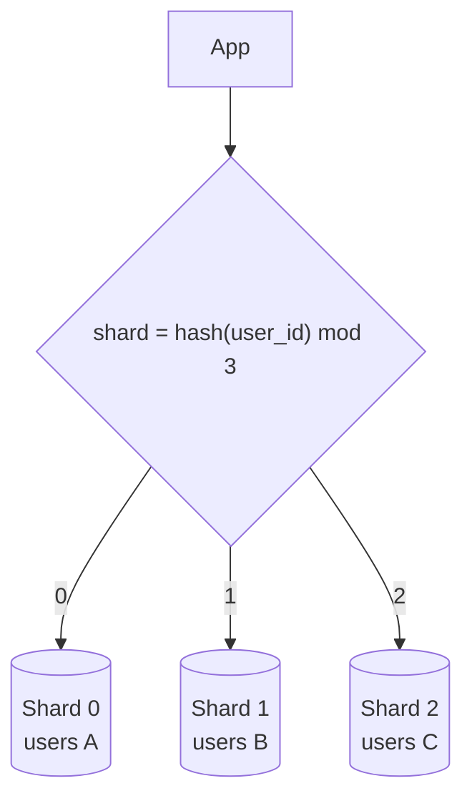

| Shard by | Example | Watch out for |
| --- | --- | --- |
| Hash of a key | `hash(user_id) mod N` | Spreads data evenly, but range queries hit every shard |
| Range | Users A to H on shard 1 | Easy range queries, but some shards get hot |
| Location or tenant | All EU users on EU shards | Uneven sizes, but good for data laws |

:::warning[Hot shards]
A good shard key spreads the load evenly. If you shard tweets by user, a celebrity's shard gets crushed. Joins and transactions across shards are also hard, so pick a key that keeps related data together.
:::

---

## 7. Consistent hashing

**The problem:** with `hash(key) mod N`, changing N from 3 to 4 servers moves **almost every key**. For a cache, that means everything misses at once.

**The idea:** put servers and keys on a **ring** of hash values. Each key belongs to the next server clockwise. When a server is added or removed, only the keys next to it move, which is about `1/N` of them.

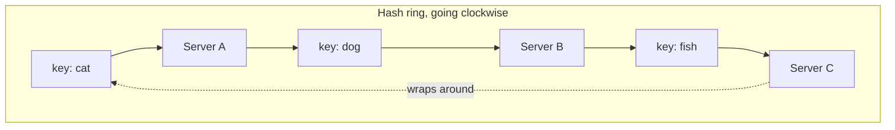

Here `dog` belongs to Server B, the next server clockwise. If Server B is removed, only `dog` moves, to Server C. `cat` and `fish` stay where they are.

**Virtual nodes:** each real server is placed on the ring many times, for example 100 points each. This spreads the keys evenly and shares a dead server's load among all the others. Cassandra, DynamoDB, and many caches use this.

---

## 8. Message queue

**The problem:** some work is slow, like sending email or resizing images. If the user waits for it, the request is slow, and a spike of traffic can overload the slow part.

**The idea:** the app puts a message on a **queue** and replies at once. **Workers** take messages off the queue and do the work in the background.

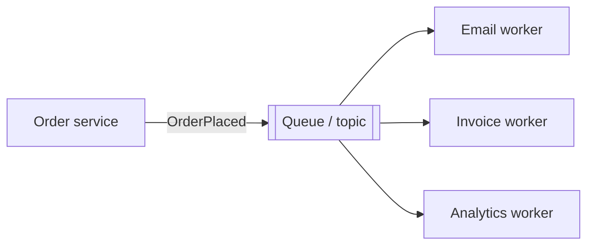

What a queue gives you:

- **Decoupling:** the order service doesn't know or care who listens.
- **Buffering:** a spike fills the queue, and workers drain it at their own pace.
- **Retries:** if a worker fails, the message stays and is tried again.

| | Queue (RabbitMQ, SQS) | Log or stream (Kafka) |
| --- | --- | --- |
| After it is read | The message is deleted | The message stays for a set time |
| Many readers | One worker gets each message | Every consumer group reads everything |
| Replay old messages | No | Yes |

:::tip[At-least-once delivery]
Most queues may deliver the same message twice. Make workers **idempotent**, meaning doing the job twice has the same effect as once. For example, store a processed message ID and skip repeats.
:::

---

## 9. CAP theorem

**The problem:** your data is copied across machines, and the network between them breaks. This is called a **partition**. What should the system do?

**The idea:** during a partition, you must choose one of these:

- **Consistency (C):** refuse requests rather than return possibly old data.
- **Availability (A):** keep answering, even if some answers are a bit old.

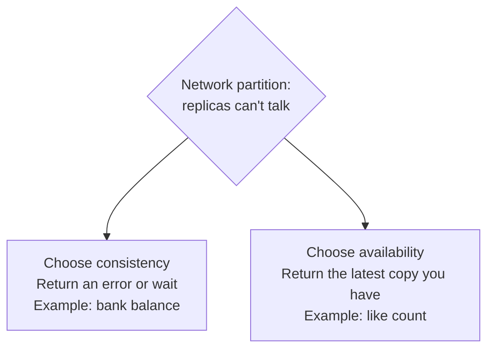

| Pick | When being wrong is worse than being down | When being down is worse than being a bit stale |
| --- | --- | --- |
| Examples | Payments, stock levels, bookings | Social feeds, view counts, product reviews |

**Eventual consistency** means that once the network heals, all copies catch up and agree. Most large systems use it for most data, and strong consistency only where it really matters. The full range of options in between is covered in [consistency models](./02-distributed-systems.md#3-consistency-models-and-pacelc).

---

## Interview questions

### 1. How would you scale a web app from 1 user to 1 million?

**In short:** Grow step by step, fixing the bottleneck each time.

Start with one server. Split the database onto its own machine. Make app servers stateless and add a load balancer. Add a cache for hot reads and a CDN for static files. Add read replicas when reads grow, and queues for slow work. Shard the database only when writes or data size outgrow one machine.

### 2. Vertical vs horizontal scaling?

**In short:** Vertical means a bigger machine. Horizontal means more machines.

Vertical is simple but has a hard ceiling and is still a single point of failure. Horizontal has no real ceiling and survives failures, but needs stateless services, load balancing, and care with data. Most teams scale databases vertically as long as they can, and app servers horizontally from day one.

### 3. The cache and the database disagree. How do you keep them in sync?

**In short:** Write to the database first, then delete the cache entry, and keep a TTL as a safety net.

Deleting is safer than updating the cache, because two racing updates can leave the wrong value. The TTL limits how long any mistake can live. For data that must never be stale, skip the cache or use write-through.

### 4. What happens when a cache server dies?

**In short:** Its keys miss and the database takes the load. Plan so that doesn't topple the database.

Consistent hashing keeps the other servers' keys in place. Protect the database from a **stampede** (many requests missing the same key at once) by letting only one request rebuild a key while others wait, and by adding random spread to TTLs so keys don't all expire together.

---

:::info[Next page]
You now have the parts. Spreading data across machines raises hard questions: what if a node dies, who is in charge, which copy is right? [Distributed Systems Fundamentals](./02-distributed-systems.md) answers them before we start designing.
:::
