# Distributed Systems Fundamentals

[Building Blocks](./01-building-blocks.md) spread data across many machines through replication and sharding. That fixes scale, but it creates a new kind of problem: **the machines must agree**, even though messages get lost, clocks disagree, and servers die mid-task.

This page covers the ideas underneath every database, queue, and cache you will use. Interviewers ask about them when they want to know if you understand **why** a system behaves the way it does.

| Problem | Technique |
| --- | --- |
| Is that server dead or just slow? | Heartbeats and gossip |
| How fresh must a read be? | Consistency models and PACELC |
| How many copies must answer? | Quorums |
| Which event happened first? | Logical clocks |
| Who is in charge? | Leader election and consensus (Raft) |
| Two copies were changed at once | Conflict resolution and CRDTs |
| Cheap checks across huge data | Bloom filters and Merkle trees |

---

## 1. Partial failure: the root of everything

On one machine, a function call either works or crashes. Across a network there is a **third outcome: you don't know**.

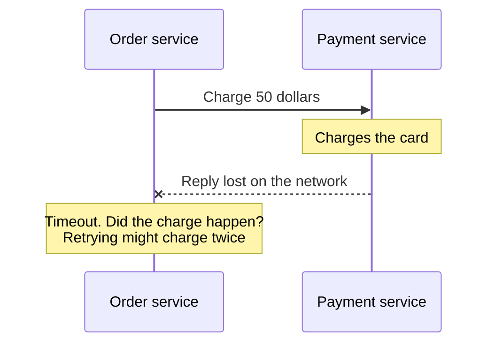

A timeout can mean the request was lost, the server is slow, the server crashed before acting, or it acted and the **reply** was lost. You can't tell these apart. This is why distributed systems lean on **retries plus idempotency** (doing it twice equals doing it once), which you saw in [Building Blocks](./01-building-blocks.md).

:::warning[Common wrong assumptions]
The network is reliable, delay is zero, and clocks are in sync. All three are false, and most distributed bugs come from code that assumes one of them.
:::

---

## 2. Failure detection: heartbeats and gossip

**The problem:** in a cluster of 500 nodes, how does everyone learn that node 17 died?

**The idea:** each node sends a small **heartbeat**. If none arrives for a while, the node is **suspected** dead. In large clusters, nodes **gossip**: every second each node tells a few random others what it knows. News spreads like a rumour and reaches everyone in a few rounds, with no central server.

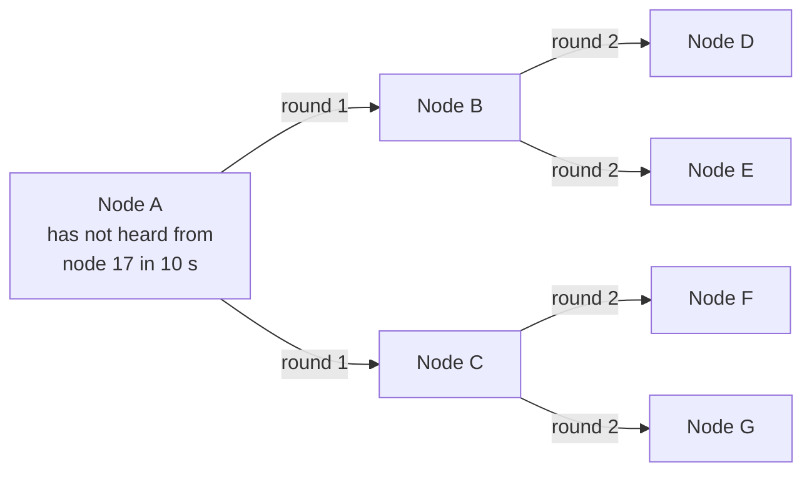

Each round roughly doubles the number of nodes that know, so even 1,000 nodes learn in about 10 rounds. Cassandra and Consul use gossip.

| Timeout setting | Effect |
| --- | --- |
| Short | Finds failures fast, but marks slow nodes as dead by mistake |
| Long | Fewer false alarms, but traffic goes to a dead node for longer |

---

## 3. Consistency models and PACELC

**The problem:** the [CAP theorem](./01-building-blocks.md#9-cap-theorem) only talks about network breaks. Day to day, the real question is "how fresh must this read be, and how much delay will I pay for it?"

**Consistency models** are promises about what a read can return, from strict to loose:

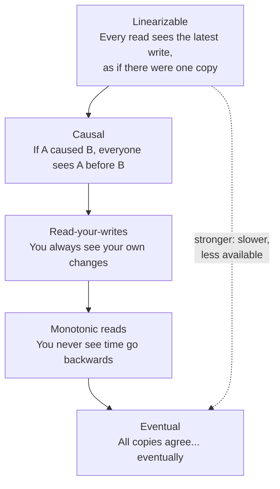

| Model | Real example | Cost |
| --- | --- | --- |
| Linearizable | Bank balance, seat booking, leader election | Every read and write talks to a majority or a leader |
| Causal | A reply never appears before the comment it answers | Track what each write depends on |
| Read-your-writes | You edit your profile and see the edit | Route your reads to the leader for a short time |
| Monotonic reads | Refreshing never shows an older version | Stick each user to one replica |
| Eventual | Like counts, view counts | Cheapest and fastest |

**PACELC** extends CAP with the everyday case: if there is a **P**artition, choose **A** or **C**. **E**lse, when things are normal, choose **L**atency or **C**onsistency.

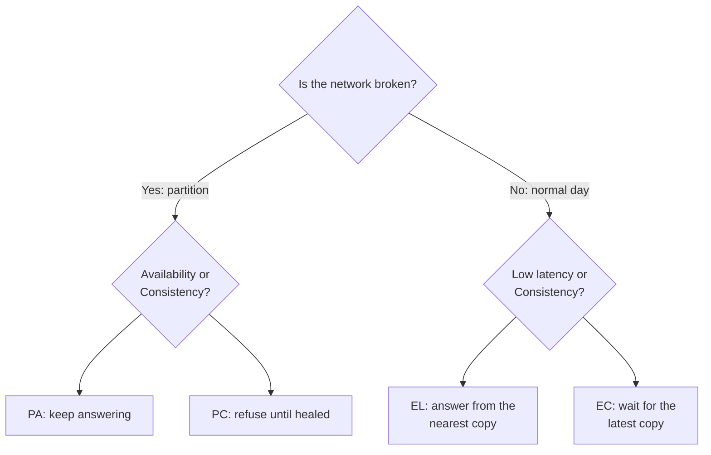

Cassandra and DynamoDB are **PA/EL** by default: always fast and available. A classic SQL database with synchronous replicas, or Spanner, is **PC/EC**.

---

## 4. Quorums: how many copies must answer

**The problem:** with no single leader (Cassandra, DynamoDB), a write goes to several copies. How many must confirm it before we call it done?

**The idea:** keep **N** copies. A write succeeds when **W** copies confirm. A read asks **R** copies and takes the newest answer. If **R + W > N**, the read set and the write set **always overlap** by at least one copy, so a read always sees the latest write.

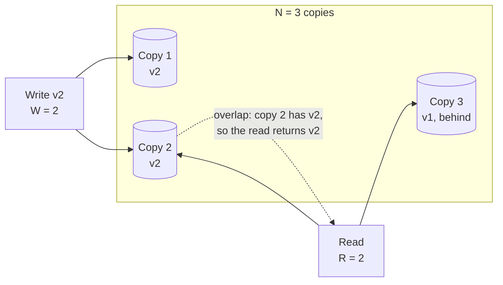

| Setting with N = 3 | Behaviour |
| --- | --- |
| W = 2, R = 2 | Balanced, sees the latest write. The common default |
| W = 3, R = 1 | Fast reads, but a write fails if any copy is down |
| W = 1, R = 3 | Fast writes, slow reads |
| W = 1, R = 1 | Fastest, but reads may be stale (eventual) |

Stale copies catch up in two ways: **read repair** (the reader spots an old copy and fixes it) and **anti-entropy** (a background job compares copies using Merkle trees, see section 8).

---

## 5. Time and ordering: logical clocks

**The problem:** server clocks drift apart by milliseconds or more. If server A stamps a write 10:00:00.005 and server B stamps a later write 10:00:00.003, sorting by time puts them in the **wrong order**.

**The idea: Lamport clocks.** Forget real time. Each server keeps a counter:

1. Before each event or send, add 1.
2. On receiving a message, set the counter to `max(mine, received) + 1`.

If event A caused event B, A always gets a smaller number.

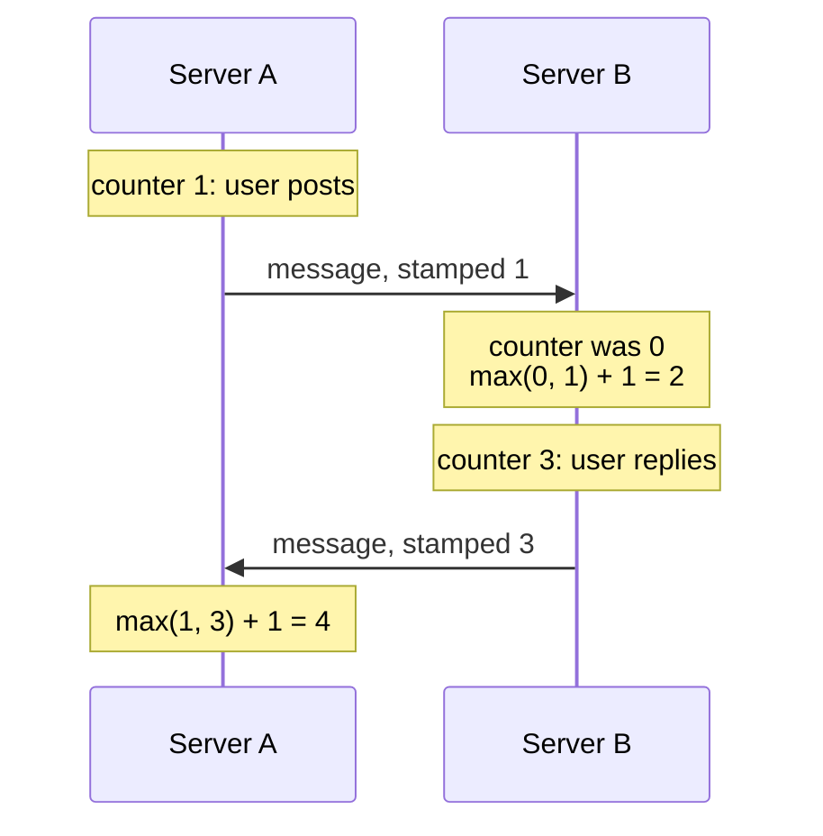

**Vector clocks** go one step further. Each server keeps a counter **per server**, such as `A:2, B:1`. Comparing two vectors tells you whether one event came before the other, or whether they were **concurrent**: made at the same time without knowing about each other. Concurrent writes are exactly the ones that need conflict resolution (section 7).

| Clock | Tells you | Used for |
| --- | --- | --- |
| Wall clock | Rough real time | Logs, TTLs. Never for ordering across servers |
| Lamport clock | A safe total order | Ordering events and messages |
| Vector clock | Before, after, or concurrent | Finding conflicting writes |
| Hybrid logical clock | Real-time-like and safe | Databases such as CockroachDB |

---

## 6. Leader election and consensus (Raft)

**The problem:** many systems need **exactly one** leader, such as the database primary, the Kafka controller, or the scheduler. If two nodes both think they are leader (**split brain**), they accept conflicting writes.

**The idea: consensus by majority vote.** In **Raft**, each node is a follower, a candidate, or the leader. The leader sends heartbeats. If a follower hears nothing for a random timeout (around 150 to 300 ms), it becomes a candidate, starts a new **term** (an election number), and asks for votes. A node that gets votes from a **majority** becomes leader.

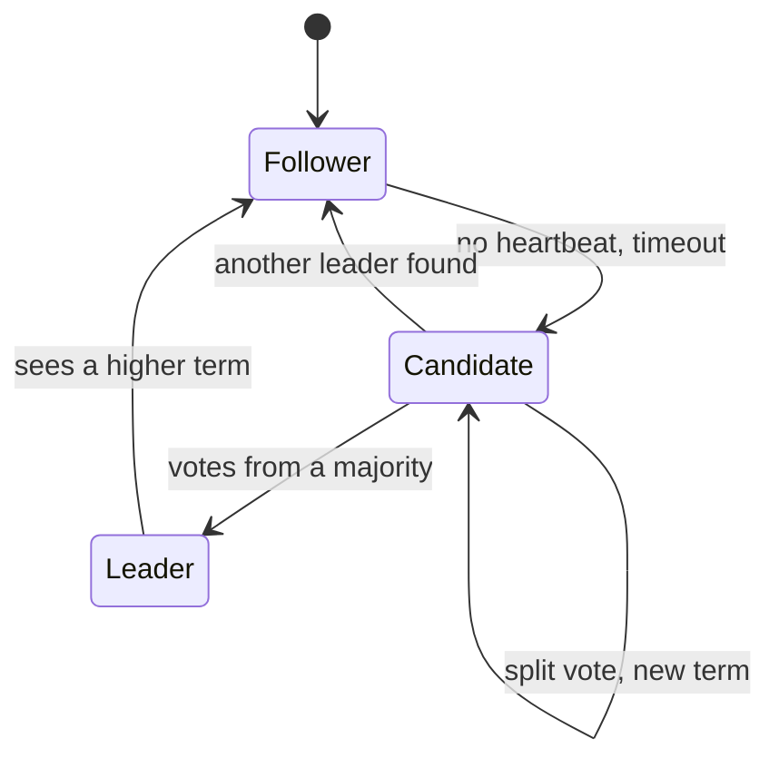

Once elected, the leader copies every change to followers. A change is **committed** only when a majority has stored it:

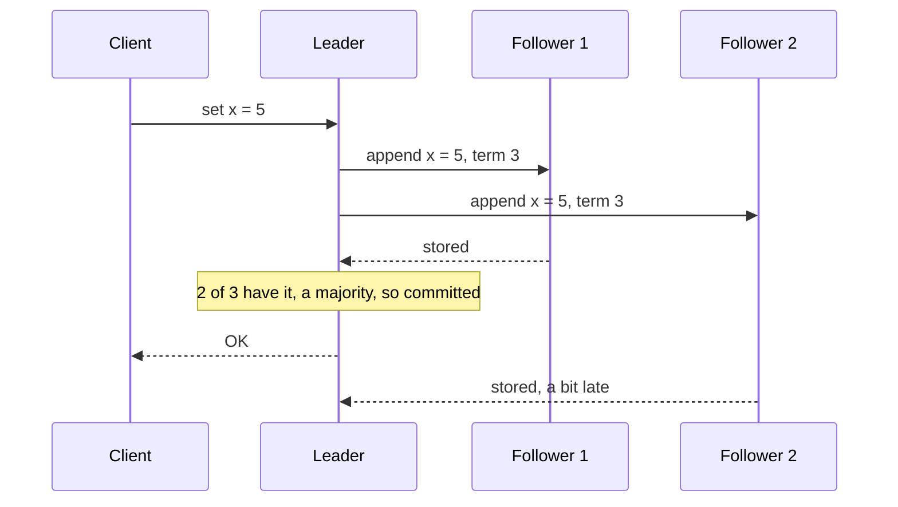

**Why a majority?** Any two majorities share at least one node. So two leaders can never both win the same term, and a new leader always has every committed change. A 5-node cluster survives 2 failures. A side of a network split without a majority simply stops accepting writes, which is the **C** choice in CAP.

| Cluster size | Majority | Failures it survives |
| --- | --- | --- |
| 3 | 2 | 1 |
| 5 | 3 | 2 |
| 4 | 3 | 1, so even sizes add cost without adding safety |

You rarely write Raft yourself. You use **etcd** (behind Kubernetes, see [Kubernetes](../kubernetes.md)), **ZooKeeper**, or **Consul**, which run consensus for you and offer leader election and locks on top.

---

## 7. Conflict resolution and CRDTs

**The problem:** in systems that choose availability, two users can edit the same item on different copies at the same time. When the copies sync, which value wins?

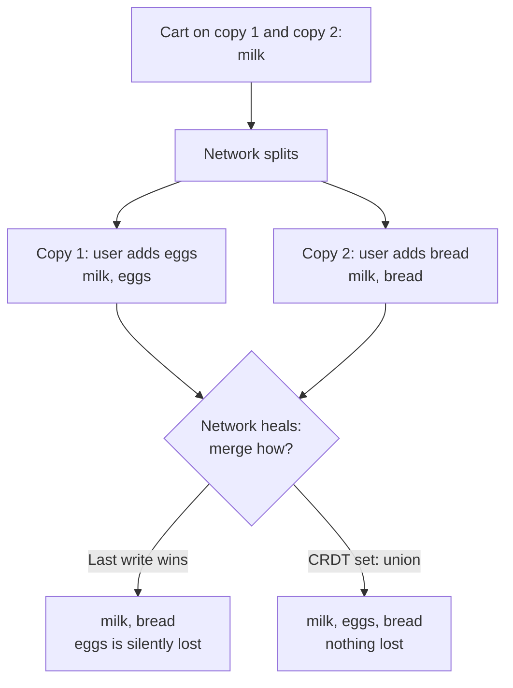

| Strategy | How it works | Trade-off |
| --- | --- | --- |
| Last write wins (LWW) | Keep the value with the latest timestamp | Simple, but silently drops one write |
| Keep both, app merges | Store both versions (siblings) and let the app or user choose | Nothing lost, more work for the app |
| CRDT | A data type designed so merging in any order gives the same result | Automatic and safe, but only for certain types |

**CRDTs** (conflict-free replicated data types) are a toolbox of such types. A **counter** keeps one count per copy and adds them up. A **set** merges by union. They power shared editing, offline-first apps, and the like counts in many systems.

---

## 8. Helper structures: Bloom filters and Merkle trees

Two small data structures show up all over distributed systems.

**Bloom filter: "is this key definitely not here?"** It is a bit array plus a few hash functions. To add a key, set the bits that its hashes point to. To check a key, look at those bits: if any is 0, the key is **definitely absent**. If all are 1, it is **probably present**.

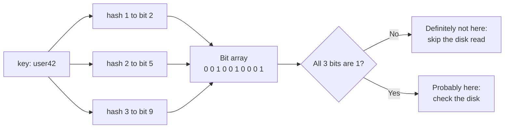

Databases like Cassandra keep one per data file, so a lookup skips files that can't contain the key. A few MB of memory saves thousands of disk reads. Web crawlers use them for "have I seen this URL?".

**Merkle tree: "where do two copies differ?"** Hash each block of data, then hash pairs of hashes, up to one **root hash**. Two copies compare roots. If they match, everything matches. If not, go down only the branches that differ.

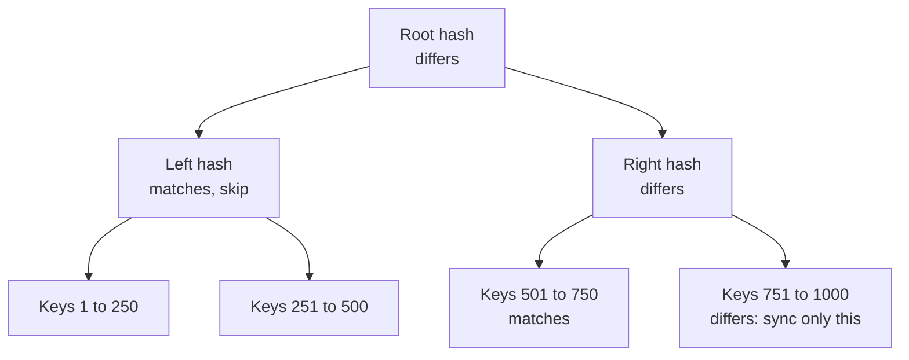

Two replicas with millions of keys find the few differences by exchanging a handful of hashes, not all the data. Git uses the same idea.

---

## Interview questions

### 1. Why does a 3-node cluster survive 1 failure, and why not use 4 nodes?

**In short:** Writes need a majority. 3 nodes need 2, so 1 can fail. 4 nodes need 3, so still only 1 can fail.

The extra node adds cost and network traffic without adding fault tolerance. That is why consensus clusters use odd sizes: 3, 5, or 7.

### 2. Can you just use timestamps to order events across servers?

**In short:** No. Clocks drift, so a later event can get an earlier timestamp.

Use a single sequencer (one leader hands out increasing numbers), Lamport clocks for a safe order, or vector clocks to detect concurrent writes. If wall time is required, use hybrid logical clocks, or specialized clocks like Google's TrueTime, which knows its own error bound.

### 3. With R = 2 and W = 2 out of N = 3, can a read ever return old data?

**In short:** In the normal case no, because the read and write sets overlap. In edge cases, yes.

If a write reaches only 1 copy and then fails, or **sloppy quorums** write to stand-in nodes during a failure, the guarantee weakens. Quorums give "usually strong" reads, not full linearizability. For that, use consensus.

### 4. What is split brain and how do you prevent it?

**In short:** Two nodes both act as leader and accept conflicting writes. Prevent it with majority voting and fencing.

Only a node with votes from a majority can lead, and only one majority can exist. Leaders also carry a term number, so others reject commands from an old leader. The same idea, as **fencing tokens**, protects distributed locks on the [next page](./03-distributed-transactions.md).

---

:::info[Next page]
These ideas keep **one** piece of data correct across copies. In [Transactions Across Services](./03-distributed-transactions.md) the problem grows: one business action must change data owned by **several** services.
:::
