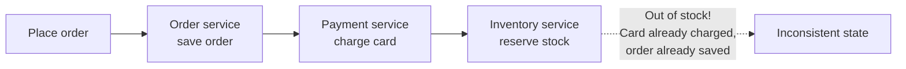
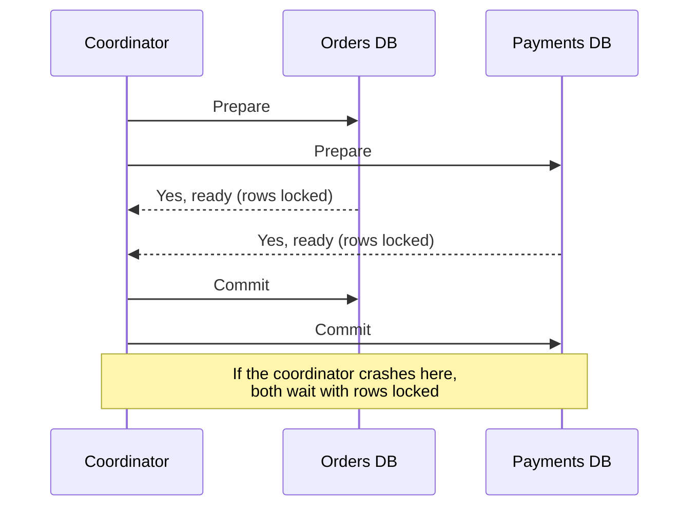
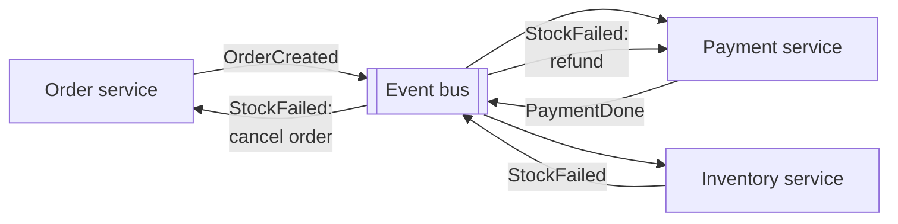
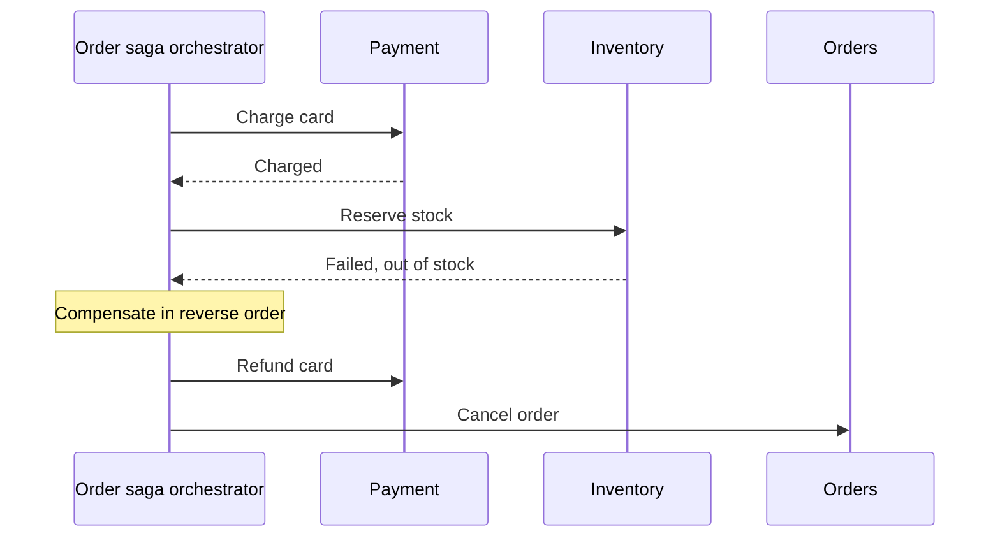
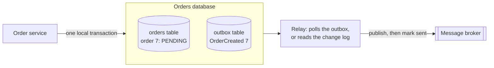
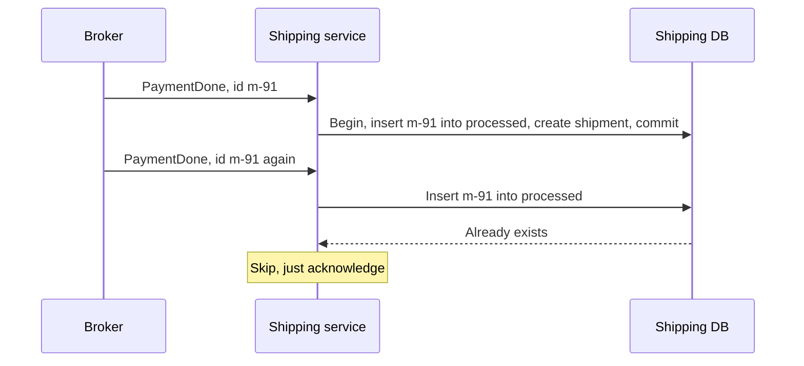
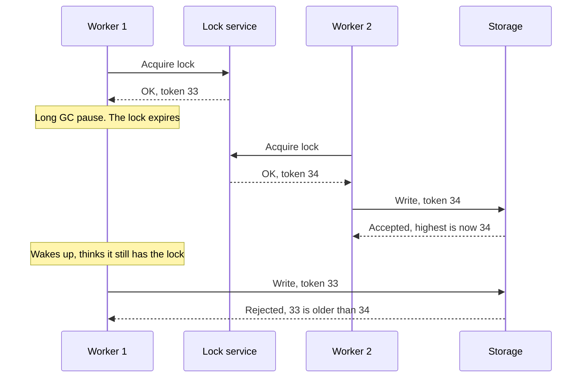

# Transactions Across Services

The [last page](./02-distributed-systems.md) kept one piece of data correct across its copies. Now the harder, everyday problem: **one business action changes data in several services**, and each service owns its own database.

In a single database, a transaction is all-or-nothing (**ACID**): either the order is saved *and* the stock is reduced, or neither happens. With separate services and databases, there is no shared transaction. This page shows the patterns that bring that safety back.

| Problem | Technique |
| --- | --- |
| Make several databases commit together | Two-phase commit (2PC) |
| Long business flows across services | Saga, by choreography or orchestration |
| Save to the DB and publish an event, safely | Transactional outbox |
| The same message arrives twice | Idempotent consumers, and exactly-once processing |
| Only one worker may do this at a time | Distributed locks with fencing tokens |

---

## 1. The problem

Placing an order touches three services:

Each step committed in its own database. When step 3 fails, steps 1 and 2 are already done. We need either a way to commit all of them together, or a way to **undo** what was done.

---

## 2. Two-phase commit (2PC)

**The idea:** a **coordinator** asks every participant to get ready, and only commits if **all** say yes.

1. **Prepare:** "Can you commit?" Each participant locks its rows, saves the change to disk without making it final, and votes yes or no.
2. **Commit:** if all voted yes, the coordinator tells everyone to commit. If anyone voted no, everyone rolls back.

| Good | Bad |
| --- | --- |
| True all-or-nothing across databases | **Blocking:** if the coordinator dies after prepare, participants hold locks until it returns |
| Simple to reason about | Slow: several network round trips while rows are locked |
| | Every participant must support it (XA). Most NoSQL stores, queues, and outside APIs don't |

2PC fits a few databases inside one company network, with short transactions. For microservices, the usual answer is a **saga**.

---

## 3. Saga

**The idea:** split the big transaction into a chain of **local transactions**, one per service. Each one commits on its own. If a later step fails, run **compensating actions** that undo the earlier steps in reverse order.

| Step | Action | Compensation (the undo) |
| --- | --- | --- |
| 1 | Create order as PENDING | Mark order CANCELLED |
| 2 | Charge card | Refund card |
| 3 | Reserve stock | Release stock |
| 4 | Mark order CONFIRMED | None needed, this is the last step |

Compensations are new actions, not a rollback. A refund is a new record, and the original charge stays in history. That's why sagas give **eventual** consistency: for a moment, the card is charged but the order isn't confirmed. The `PENDING` status tells the user and other services that the order isn't final yet.

There are two ways to run a saga.

### Choreography: services react to events

Each service listens for events and publishes its own. Nobody is in charge.

### Orchestration: one coordinator gives orders

An **orchestrator** knows the whole flow. It tells each service what to do and runs the compensations when a step fails.

| | Choreography | Orchestration |
| --- | --- | --- |
| Who knows the flow | Nobody. It is spread across services | The orchestrator |
| Coupling | Low. Services only know events | Services are called by the orchestrator |
| Easy to follow and debug | Hard once there are more than 3 or 4 steps | Easy, because the flow is in one place |
| Pick it when | Short, simple flows | Long flows, many failure paths |

Tools such as **Temporal** or **AWS Step Functions** run orchestrated sagas for you. They save progress after every step, so a crash resumes where it stopped.

---

## 4. Transactional outbox

**The problem:** a service must save to its database **and** publish an event. These are two systems, so this is a **dual write**:

- Save, then crash before publishing: the event is lost, and the saga stalls.
- Publish, then the save fails: other services act on an order that doesn't exist.

**The idea:** write the event into an **outbox table in the same database, in the same transaction** as the business change. Both are saved, or neither is. A separate **relay** reads the outbox and publishes to the broker.

The relay may crash after publishing but before marking the row sent, so it may publish **twice**. The outbox gives **at-least-once** delivery, and consumers must handle duplicates (next section). Reading the database's change log instead of polling is called **change data capture** (CDC). Debezium is a common tool for it.

:::tip[In Spring Boot]
Save the entity and the outbox row inside the same `@Transactional` method. Don't publish to Kafka inside the transaction, since the publish isn't rolled back if the commit fails. See [Spring Boot Interview Questions](../spring-boot-interview.md) for how transactions work there.
:::

---

## 5. Idempotent consumers and exactly-once

**The problem:** brokers, outboxes, and retries all deliver **at least once**. A "PaymentDone" event processed twice ships the order twice.

**The idea:** make the consumer **idempotent**. Record every processed message ID in the consumer's own database, **in the same transaction** as the work. A repeat finds the ID and is skipped.

**What about "exactly-once"?** It isn't really about delivering once, since the network can't promise that. It means **the effect happens once**:

| Layer | How you get the effect once |
| --- | --- |
| Producer to broker | Idempotent producer: the broker drops retried duplicates (Kafka does this with sequence numbers) |
| Inside Kafka (read, process, write back to Kafka) | Kafka transactions: the output and the consumer offset commit together |
| Out to a database or an API | An idempotent consumer, as above, or a unique key such as an upsert |

:::note
"Exactly-once delivery is impossible, but exactly-once processing is not." The rule of thumb: **at-least-once delivery plus idempotent processing**.
:::

---

## 6. Distributed locks and fencing tokens

**The problem:** only one worker may do a job at a time, for example the nightly billing run, or editing one booking. With many servers, a lock in memory isn't enough.

**The idea:** take the lock in a shared store. With Redis, use "set this key only if it doesn't exist, with a TTL". The TTL frees the lock if the holder crashes.

**The danger:** the holder pauses, for example during a long garbage collection. Its lock expires, and another worker takes it. Then the first worker wakes up and writes, **still believing it holds the lock**.

**The fix: fencing tokens.** Each time the lock is granted, the lock service hands out a number that only goes up. The storage remembers the highest token it has seen and **rejects writes with an older token**.

| Lock built on | Safety | Notes |
| --- | --- | --- |
| A single Redis key with a TTL | Good for efficiency, such as avoiding duplicate work | Can fail on failover or pauses. Add fencing if correctness matters |
| etcd or ZooKeeper (consensus) | Strong | Give a revision number you can use as a fencing token |
| A database row lock, or a version column | Strong, inside one database | Often the simplest correct choice |

:::tip[Avoid the lock if you can]
Often you don't need a distributed lock at all. A unique constraint, a conditional update (`UPDATE ... WHERE version = 7`), or sending all work for one key to one partition gives the same safety, with fewer moving parts.
:::

---

## Interview questions

### 1. 2PC or saga for an e-commerce checkout?

**In short:** Saga. The services have separate databases and outside APIs, and 2PC would hold locks across all of them.

Payment providers don't support 2PC, and a blocked coordinator would freeze checkout. A saga with compensations (refund, release stock) and a `PENDING` order status is the standard design. Use orchestration, since checkout has many failure paths.

### 2. What if a compensating action itself fails?

**In short:** Retry it until it succeeds. Compensations must be idempotent and must never give up quietly.

Keep retrying with backoff. The orchestrator saves its progress, so retries survive crashes. If a compensation keeps failing (for example, the refund API is down for hours), put it on a dead-letter queue and alert a person. Design compensations so they can always succeed eventually.

### 3. How do you publish an event only if the database commit succeeded?

**In short:** The transactional outbox.

Write the event into an outbox table in the same local transaction, then let a relay or CDC publish it. Delivery is at-least-once, so consumers deduplicate by event ID.

### 4. Two users try to book the last seat at the same moment. How do you stop a double booking?

**In short:** Let the database decide, using a conditional update or a unique constraint. Don't check and then write in two steps.

`UPDATE seats SET holder = 'u1' WHERE id = 42 AND holder IS NULL` succeeds for exactly one user, and the other sees 0 rows changed. For a hold during payment, store the holder with an expiry time and confirm on payment. A separate distributed lock is rarely needed.

---

:::info[Next page]
You now have the parts and the theory behind them. The rest of the course puts them to work, starting with a small, read-heavy design: the [URL Shortener](./04-url-shortener.md).
:::
