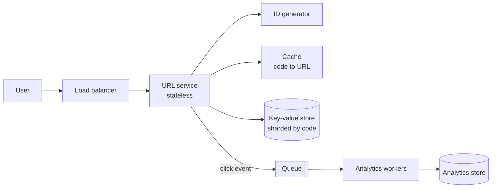
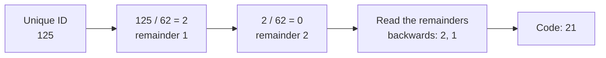
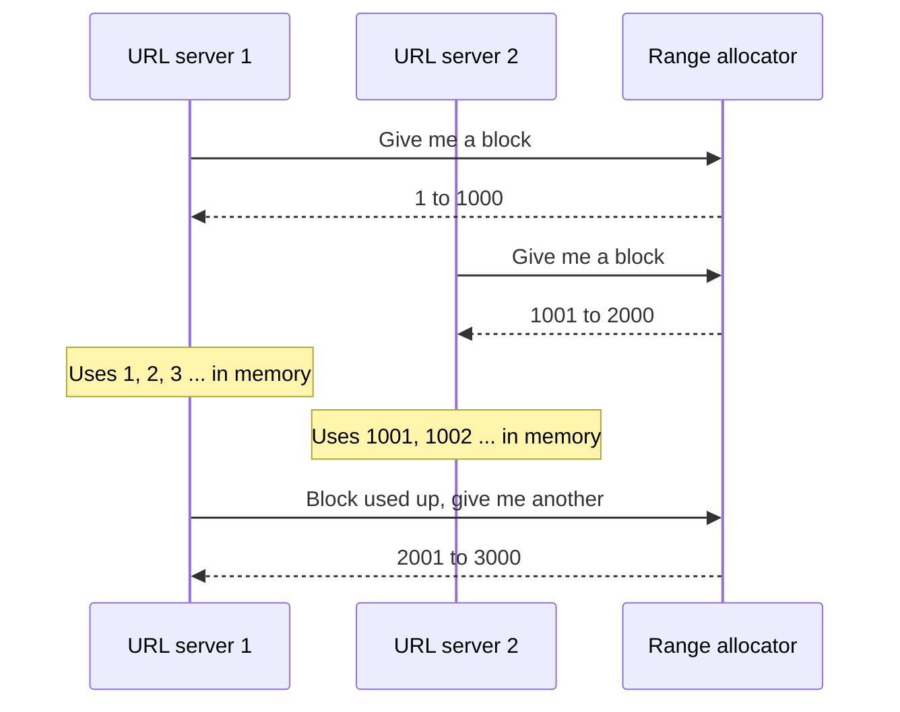
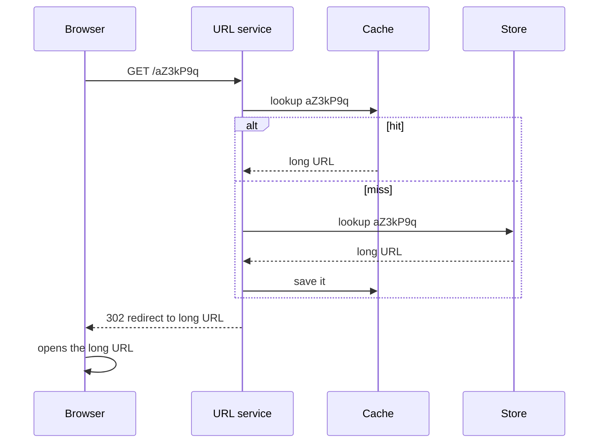
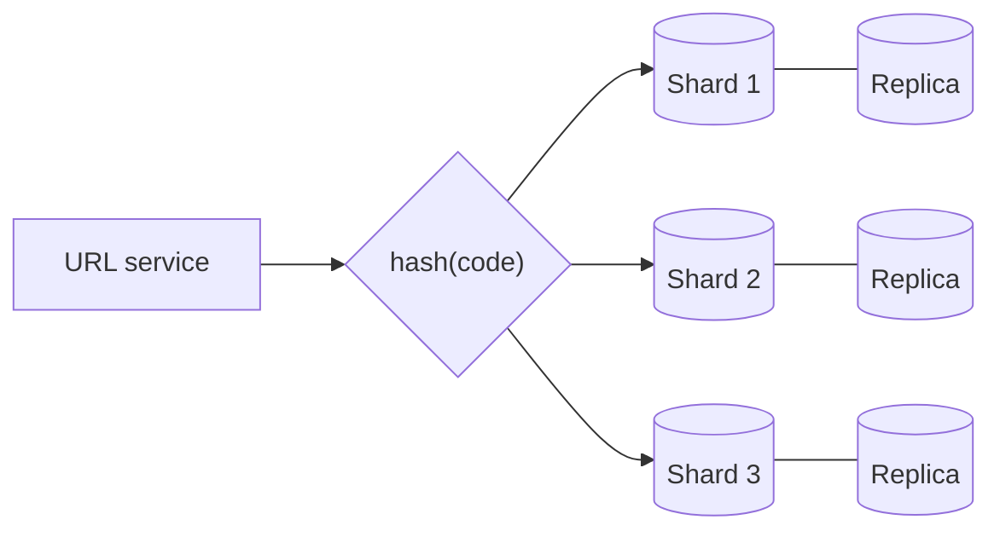
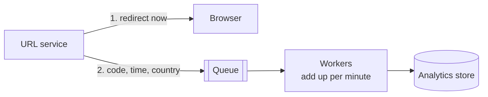

# URL Shortener

This is the first design because it is small but touches almost every building block from the [last page](./01-building-blocks.md). You turn a long link into a short one like `sho.rt/aZ3kP9q`, and anyone who opens the short link is sent to the long one.

## What we build

| Functional | Non-functional |
| --- | --- |
| Create a short link from a long URL | Redirects must be fast (under about 50 ms) |
| Open a short link and get redirected | Always available, since a broken link hurts everyone who shared it |
| Optional: custom alias and expiry date | Short codes must be unique and hard to guess |
| Optional: click counts | Read-heavy: about 100 reads for every write |

**Rough scale:** 100 million new links a month is about **40 writes per second**. With 100 reads per write, that is about **4,000 redirects per second**. Over 5 years that is 6 billion links. At about 500 bytes each, that is **3 TB**, which is small.

**API:**

- `POST /api/urls` with the long URL, which returns the short code
- `GET /aZ3kP9q`, which returns a redirect to the long URL

## The big picture

## Components

| Component | Job |
| --- | --- |
| Load balancer | Spreads traffic across URL service servers |
| URL service | Creates codes and handles redirects. Keeps no state, so it is easy to scale |
| ID generator | Hands out unique numbers, which become short codes |
| Cache | Keeps hot links in memory. Most clicks go to a few popular links |
| Key-value store | Stores each code with its long URL, owner, and expiry |
| Queue and analytics workers | Count clicks in the background, so redirects stay fast |

## Techniques

### 1. Turning a number into a short code (base62)

**The idea:** give every new link a unique number, then write that number in **base62**. Base62 uses the characters `0-9`, `a-z`, and `A-Z`, which are all safe in a URL.

Seven characters give 62 to the power of 7, about **3.5 trillion** codes. That is far more than our 6 billion.

Why not hash the long URL (for example MD5) and keep the first 7 characters? You can, but two URLs may share the same 7 characters (a **collision**). You then have to check the database and retry on every create. A unique counter never collides.

| Approach | Collisions | Guessable | Notes |
| --- | --- | --- | --- |
| Base62 of a counter | Never | Yes, codes go up in order | Shuffle the bits or add a secret offset to hide the order |
| Hash of the URL | Possible, needs a check | No | The same URL always gives the same code, which can be a feature |
| Random 7 characters | Possible, needs a check | No | Simple. Collisions are rare at this size |

### 2. Unique IDs across many servers

**The problem:** one counter in one database is a bottleneck and a single point of failure.

**The idea:** a central **range allocator** hands each server a **block** of IDs, for example 1,000 at a time. Each server counts through its block in memory with no network call, and asks for a new block when it runs out.

If a server crashes, the rest of its block is skipped. That leaves a few gaps, which is fine. Another common option is a **Snowflake-style ID**: a 64-bit number made from the timestamp, a machine ID, and a sequence number. Each machine can create IDs on its own.

### 3. Fast redirects with a cache

**The idea:** redirects are 99% of traffic and a small set of links gets most clicks. Put a cache in front of the store using **cache-aside**.

| Redirect code | Browser behaviour | Pick it when |
| --- | --- | --- |
| 301 (permanent) | Remembers it and skips your server next time | You want the least load and don't need click counts |
| 302 (temporary) | Asks your server every time | You want to count every click, or change the target later |

### 4. Storage and sharding

**The idea:** the data is a simple lookup by code with no joins, so a **key-value store** fits well. Shard it by the hash of the code, so links spread evenly and each redirect touches one shard.

Each row holds the code, the long URL, the creator, the created date, and the expiry. Expired links can be removed by a nightly cleanup job, or checked lazily when someone opens them.

### 5. Click analytics without slowing redirects

**The idea:** don't write to an analytics database during the redirect. Put a small **click event** on a queue and return the redirect right away. Workers read events in batches and add them up.

If analytics breaks, redirects still work. That is the main win of decoupling.

---

## Interview questions

### 1. How do you stop people guessing other short links?

**In short:** Don't hand out codes in order.

Shuffle the counter's bits with a reversible function, add a secret offset, or use random codes with a collision check. For private links, add an access check, since a short code alone is not security.

### 2. The same long URL is shortened twice. Same code or new code?

**In short:** Either can work, but say which and why.

Same code saves space. Store a lookup from the URL's hash to its code and check it before creating. New code per request lets each user have their own click counts and expiry. Most real products create a new code per user.

### 3. How do you handle custom aliases like `sho.rt/my-sale`?

**In short:** Store them in the same table and insert only if the code is free.

Use a conditional insert ("insert only if this key doesn't exist") so two people can't claim the same alias at once. Keep custom aliases out of the base62 range, for example by requiring a minimum length or a dash, so they never clash with generated codes.

### 4. A link goes viral and gets 1 million clicks a minute. What breaks?

**In short:** Nothing, if the cache is doing its job.

One hot key lives in the cache, and redirects never reach the store. Keep a small cache inside each server too, so even the cache cluster isn't hit for that one key. The analytics queue soaks up the burst of click events.

---

:::info[Next page]
A viral link or a bad bot can flood any service. In [Rate Limiter](./05-rate-limiter.md) we build the guard that sits in front of systems like this one.
:::
