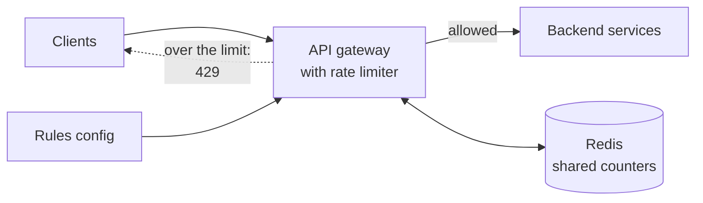
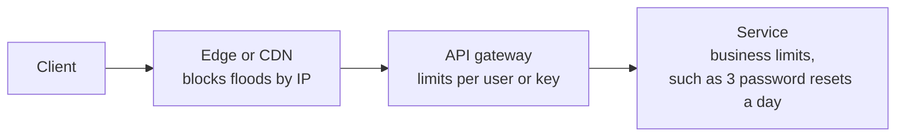
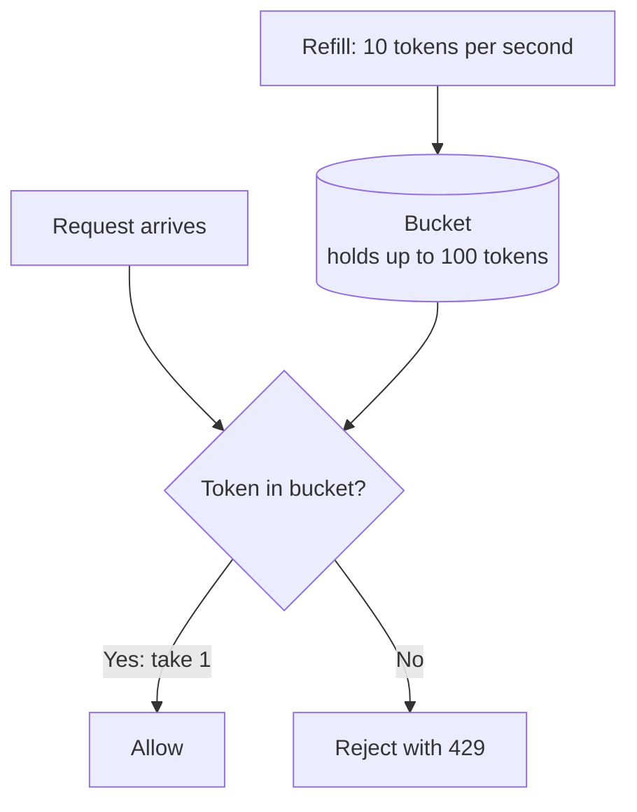
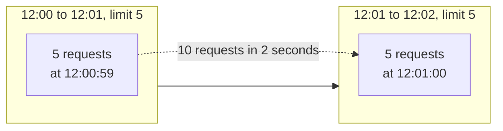
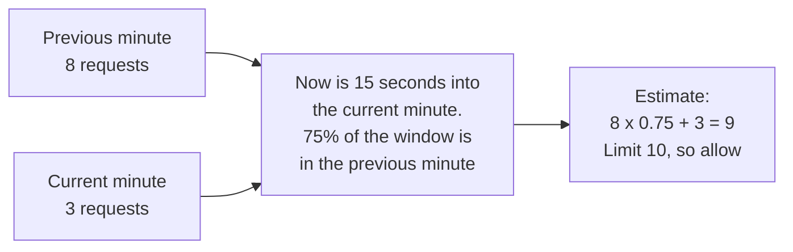
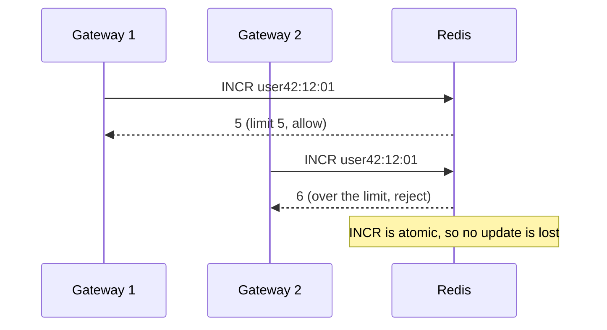
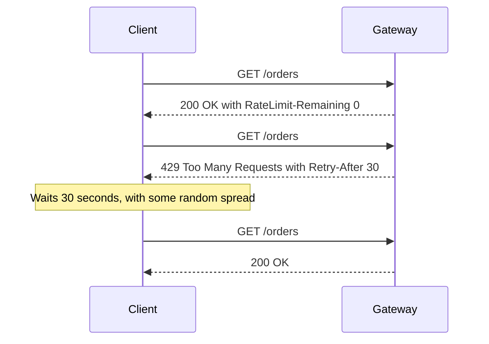

# Rate Limiter

The [URL shortener](./04-url-shortener.md) showed how fast a single viral link can bring traffic. A **rate limiter** decides how many requests each client may make in a period of time, such as "100 requests per minute per user". Anything above that is rejected.

It protects your servers from overload, stops abuse such as password guessing and scraping, and keeps costs under control.

## What we build

| Functional | Non-functional |
| --- | --- |
| Limit requests per user, API key, or IP | Adds almost no delay, under about 1 ms |
| Different rules per endpoint, such as login being stricter | Works across many servers, with one shared count per user |
| Tell the client it was limited, and when to retry | If the limiter breaks, the API should keep working |

**Example rules:**

| Who | Endpoint | Limit |
| --- | --- | --- |
| Per IP | `POST /login` | 5 per minute |
| Per API key | All endpoints | 1,000 per minute |
| Per user | `POST /messages` | 20 per second |

## The big picture

## Components

| Component | Job |
| --- | --- |
| API gateway or middleware | Checks every request before it reaches your services |
| Rules config | Stores the limits per endpoint and per client type. Loaded into memory and refreshed often |
| Redis | Holds the counters, so all gateway servers share one count per user |
| Backend services | Only see requests that passed the check |

## Techniques

### 1. Where to put the limiter

**The idea:** check as early as possible, so rejected requests cost almost nothing.

| Place | Pros | Cons |
| --- | --- | --- |
| On the client | No server cost | Easy to bypass, so never trust it alone |
| Edge or CDN | Stops attacks before they reach you | Knows only the IP, not the user |
| API gateway | One place for all services, knows the user | Another hop, and all teams share its rules |
| Inside each service | Can use business rules | Every team builds it again |

Most systems use the gateway for general limits and add a few business limits inside services.

### 2. Token bucket

The most popular algorithm, and the one many large APIs use.

**The idea:** each user has a bucket that holds up to N tokens. Tokens are added at a steady rate. Each request takes one token. No token means the request is rejected.

You don't need a timer to add tokens. Store the token count and the last refill time. On each request, work out how many tokens to add since then, add them up to the max, then take one.

| Setting | Meaning |
| --- | --- |
| Bucket size | The biggest burst allowed at once |
| Refill rate | The average rate allowed over time |

**Why it's popular:** it allows short bursts (a page that loads 10 things at once) but still limits the average. It needs only 2 numbers per user.

**Leaky bucket** is a close cousin. Requests go into a queue that drains at a fixed rate. It gives a perfectly smooth output, but bursts have to wait.

### 3. Fixed window counter

**The idea:** count requests per user in fixed time blocks, such as each calendar minute. Reset to zero when a new minute starts.

It is very simple: one counter per user per minute, which expires on its own.

:::warning[The edge problem]
A user can send 5 requests at the end of one window and 5 at the start of the next. That is **double the limit** in 2 seconds, as the diagram shows.
:::

### 4. Sliding window

**The idea:** look back over the **last 60 seconds** from right now, instead of the current calendar minute.

There are two versions:

- **Sliding log:** store the timestamp of every request and count the ones in the last 60 seconds. It is exact but uses memory for every request.
- **Sliding counter:** keep the fixed-window counts for this minute and the last one, and estimate.

The sliding counter fixes the edge problem with only two numbers per user. It is a good default.

| Algorithm | Memory per user | Allows bursts | Accuracy |
| --- | --- | --- | --- |
| Token bucket | 2 numbers | Yes, up to the bucket size | Good |
| Leaky bucket | A queue | No, output is smooth | Good |
| Fixed window | 1 counter | Up to 2 times the limit at window edges | Rough |
| Sliding log | Every timestamp | No | Exact |
| Sliding counter | 2 counters | A little | Very close |

### 5. Shared counters across many servers

**The problem:** with 10 gateway servers each keeping its own count, a user gets 10 times the limit. And if two servers read "4", both add 1, and both write "5", one request is lost. This is a **race condition**.

**The idea:** keep counters in one shared, fast store such as Redis, and update them with **atomic** operations, so the read and the write happen as one step.

For a token bucket, the read, refill, and take steps run together as one **Lua script** inside Redis, so they are also atomic. Set a TTL on every key so idle users don't use memory forever.

:::tip[Fail open or fail closed?]
If Redis is down, most systems **fail open**: they let requests through so the product keeps working. For login or payment endpoints, failing closed (rejecting) may be safer. Say which you choose and why.
:::

### 6. Telling the client

**The idea:** reject with HTTP **429 Too Many Requests**, and tell the client its status so well-behaved clients can slow down.

| Header | Meaning |
| --- | --- |
| `RateLimit-Limit` | The limit for this window |
| `RateLimit-Remaining` | How many requests are left |
| `Retry-After` | Seconds to wait before trying again |

---

## Interview questions

### 1. Which algorithm would you pick and why?

**In short:** Token bucket for most APIs, because it allows normal bursts and is cheap.

Use a sliding window counter if you need a tighter "no more than N in any 60 seconds" rule. Use fixed window only when simplicity matters most and edge bursts are acceptable.

### 2. Calling Redis on every request adds delay. Can you avoid it?

**In short:** Yes, if you can accept slightly loose limits.

Each server can keep counts in memory and sync with Redis every few hundred milliseconds, or take a small "lease" of tokens from Redis at a time. This trades exactness for speed. For most limits, being off by a few requests is fine.

### 3. How do you rate limit users in different regions?

**In short:** Keep counters local to each region and accept a looser global limit.

A single global Redis would add cross-continent delay to every request. Usually each region enforces its own share. If a strict global limit is needed, sync counts between regions in the background.

### 4. How is rate limiting different from load shedding?

**In short:** Rate limiting is per client and about fairness. Load shedding is for the whole system and about survival.

Rate limiting stops one user from taking too much. Load shedding drops low-priority traffic when the whole system is overloaded, even from users who are within their limits.

---

:::info[Next page]
Rate limits protect request-and-response APIs. In [Chat System](./06-chat-system.md) the connection stays open and messages flow both ways, which needs new techniques.
:::
