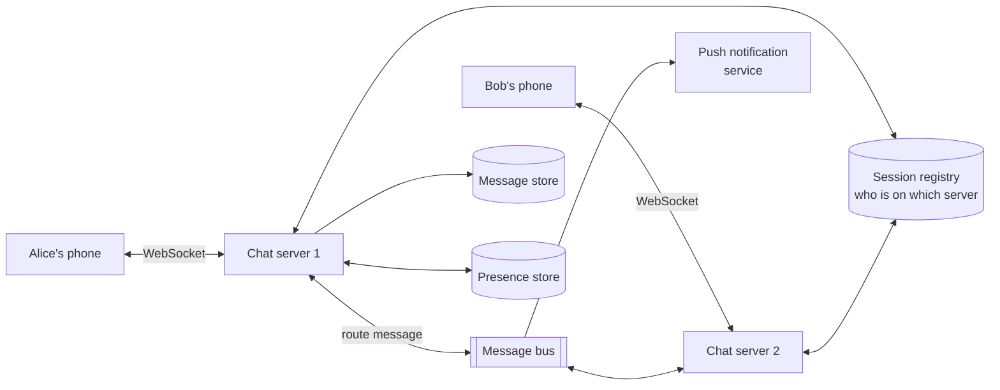
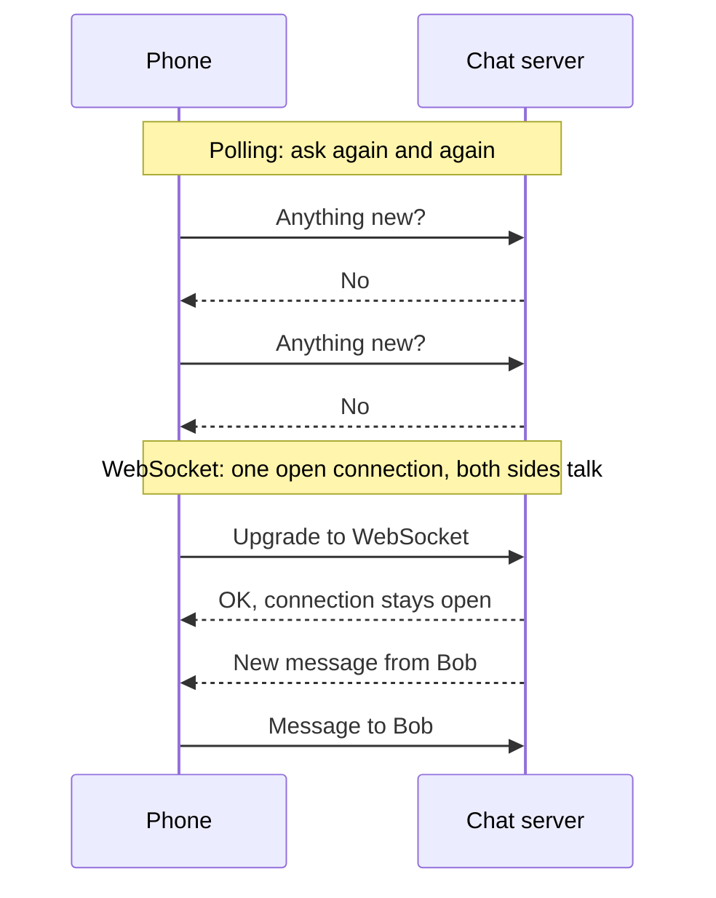
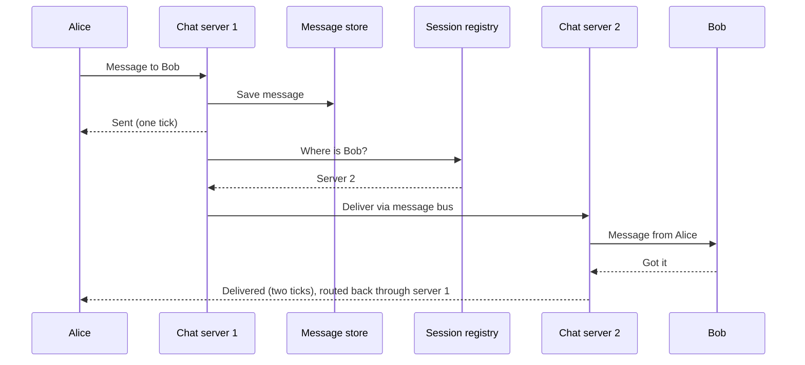
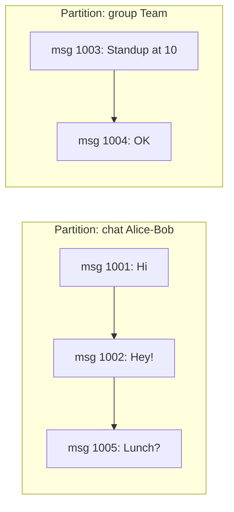
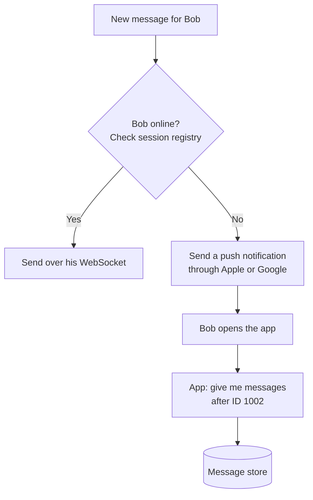
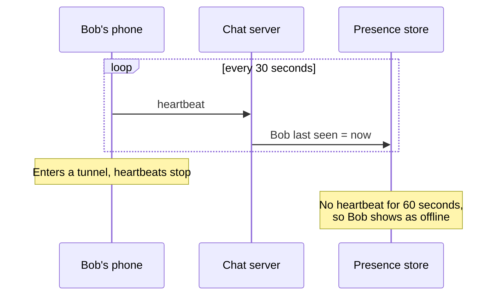
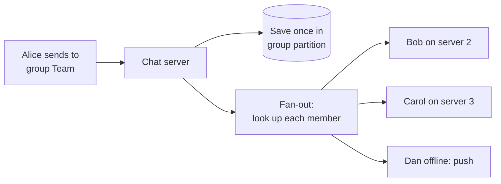
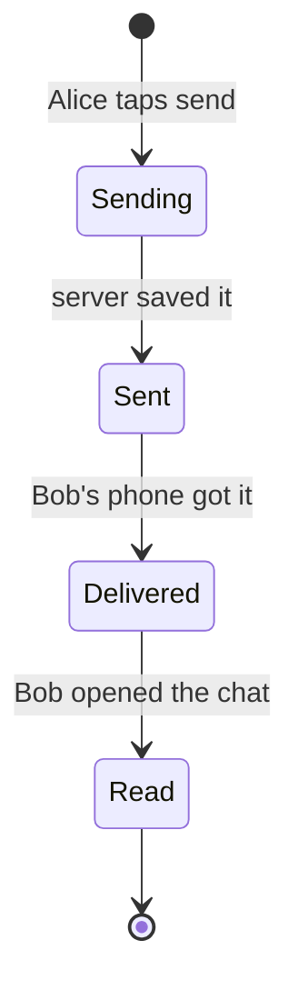

# Chat System

So far every design used **request and response**: the client asks and the server answers. Chat breaks that pattern. When your friend sends you a message, **the server has to reach you** without you asking. That one change shapes this whole design.

## What we build

| Functional | Non-functional |
| --- | --- |
| One-to-one chat | Messages arrive in under about 200 ms when both users are online |
| Group chat, up to a few hundred members | No message is ever lost |
| Online and last-seen status | Messages appear in the same order for everyone in a chat |
| Sent, delivered, and read ticks | Works on flaky mobile networks |
| Messages reach users who were offline | Scales to millions of open connections at once |

**Rough scale:** 50 million daily users, each sending 40 messages a day, is 2 billion messages a day. That averages **about 23,000 messages per second** and peaks at several times that. At about 100 bytes per message, that is 200 GB a day.

## The big picture

## Components

| Component | Job |
| --- | --- |
| Chat servers | Hold open WebSocket connections and send and receive messages. Each holds tens of thousands of connections |
| Session registry | A fast store (such as Redis) that maps each user to the chat server they are connected to |
| Message bus | Carries messages between chat servers, because the sender and receiver are often on different servers |
| Message store | Saves every message so it can be loaded later and isn't lost |
| Push notification service | Wakes up offline phones through the Apple and Google push services |
| Presence store | Tracks who is online and when they were last seen |
| API servers (not drawn) | Normal HTTP for login, profiles, contacts, and loading old messages |

## Techniques

### 1. Real-time connection with WebSockets

**The problem:** HTTP only lets the client start a conversation. How does the server push a new message?

| Option | How it works | Verdict |
| --- | --- | --- |
| Short polling | Asks every few seconds | Wasteful and slow. Most answers are "nothing new" |
| Long polling | Asks, and the server holds the request until something arrives | Better, but there is reconnect overhead after every message |
| Server-sent events | Server pushes over an open HTTP stream, one way only | Good for feeds and live scores, not two-way chat |
| WebSocket | One open, two-way connection | The standard choice for chat |

Connections are **stateful**: Alice is tied to the server holding her socket. The load balancer must keep a connection on one server, and phones must reconnect to any server if theirs dies.

### 2. Routing a message between servers

**The problem:** Alice is connected to server 1 and Bob to server 2. How does Alice's message reach Bob?

**The idea:** when a user connects, the server writes "Bob is on server 2" in the **session registry**. To deliver a message, look up the receiver, then send it through the **message bus** to the right server.

Save first, deliver second. If anything fails after the save, the message isn't lost. Bob gets it when he next syncs.

### 3. Storing messages in order

**The idea:** chat data is huge, always growing, and mostly read as "the latest messages in this chat". A **wide-column store** such as Cassandra fits well:

- **Partition key:** `conversation_id`, so all messages of a chat sit together on one shard.
- **Sort key:** `message_id`, so messages come back already in order.

**How do we get the order right?** Phone clocks are wrong all the time, so never sort by the phone's time. Give each message an ID from the server that **grows over time**, such as a Snowflake-style ID (timestamp, machine, sequence), or a counter per conversation. Order inside a chat is what matters. Order across chats doesn't. Why clocks can't be trusted, and what to use instead, is covered in [logical clocks](./02-distributed-systems.md#5-time-and-ordering-logical-clocks).

To load history, ask "the 50 messages before ID 1005". This is cursor pagination, which we use again in the [news feed](./07-news-feed.md).

### 4. Delivering to offline users

**The idea:** every message is saved first. Each phone remembers the **last message ID** it has seen. When it reconnects, it asks for everything newer. While it is offline, a push notification tells the user something is waiting.

The same sync step also fixes missed messages from a dropped connection. The phone always catches up from its last known ID.

### 5. Presence: online and last seen

**The problem:** we can't tell when a phone goes into a tunnel. The connection may stay "open" for minutes.

**The idea:** **heartbeats**. The app sends a tiny "I'm here" every 30 seconds. The presence store saves the time of the last heartbeat. A user is online if the last one was recent.

Presence changes are sent only to **friends who are online and looking**, and are often batched. Telling every contact about every change would create a flood of messages for users with large contact lists.

### 6. Group chat fan-out

**The idea:** one message to a group becomes one delivery **per member**. Store the message **once** in the group's partition, then fan out a small delivery to each member's chat server.

This is why chat apps cap group sizes. A message to a 100,000-member group would mean 100,000 deliveries. Very large groups work more like a [news feed](./07-news-feed.md), where members pull messages instead.

### 7. Sent, delivered, and read ticks

**The idea:** each message moves through a few states. Each change is a small event sent back to the sender.

For groups, store the state per member and show "read" only when everyone has read it. To keep traffic low, the phone sends one "read up to message 1005" instead of one receipt per message.

---

## Interview questions

### 1. A chat server crashes. What happens to its 50,000 users?

**In short:** Their phones reconnect to other servers and sync from their last message ID.

Messages already saved are safe. The session registry entries for the dead server expire or are cleaned up, and new entries point to the new servers. Add random delays to reconnects so 50,000 phones don't hit the system in the same second.

### 2. How do you avoid duplicate messages when the phone retries?

**In short:** The phone gives each message a unique client ID, and the server ignores repeats.

On a weak network the phone may send, get no reply, and send again. The server checks the client ID and returns the already-saved message instead of saving it twice.

### 3. How would you add end-to-end encryption?

**In short:** Encrypt on the sender's phone with the receiver's public key, so the server only sees scrambled data.

The server still routes and stores messages but can't read them. Phones exchange public keys through a key server. Server-side features such as search then have to run on the phone, which is the trade-off.

### 4. Where do photos and videos go?

**In short:** In object storage, not in the message store.

The phone uploads the file directly to object storage using a short-lived upload link, then sends a normal message holding just the file's link. Receivers download through a CDN. We use the same direct-upload trick in [Video Streaming](./09-video-streaming.md).

---

:::info[Next page]
Group chat showed what fan-out costs. In [News Feed](./07-news-feed.md) fan-out is the main problem: one post may need to reach millions of followers.
:::
