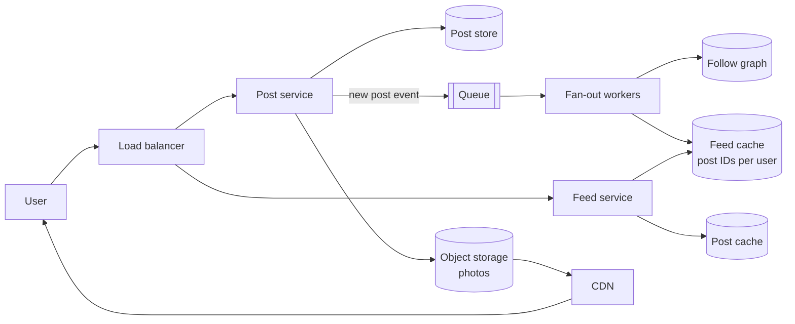
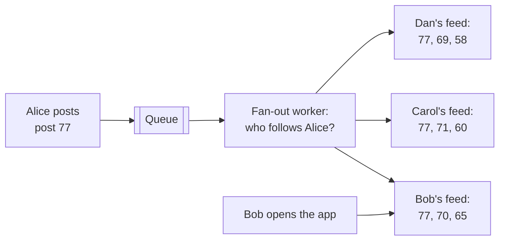
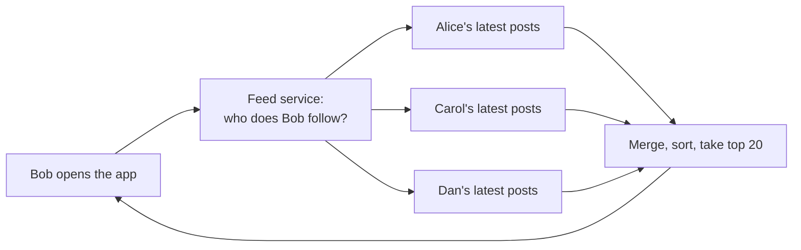
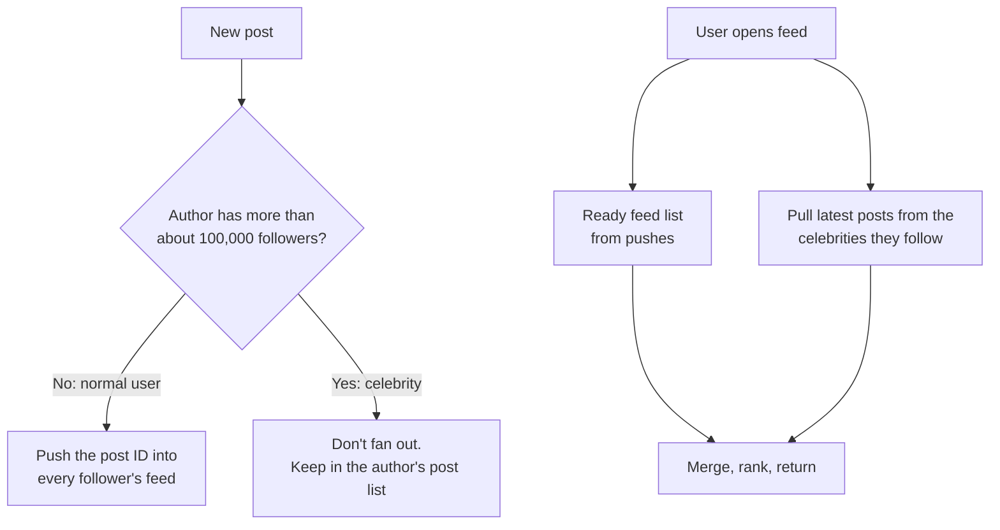
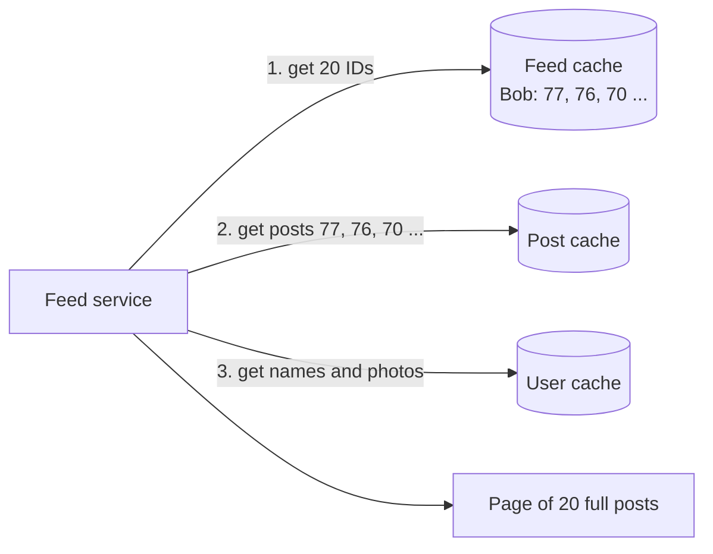
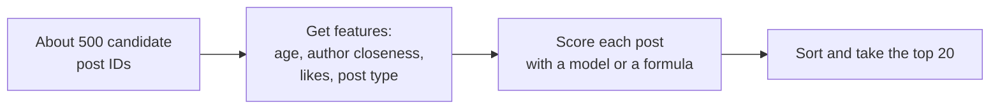
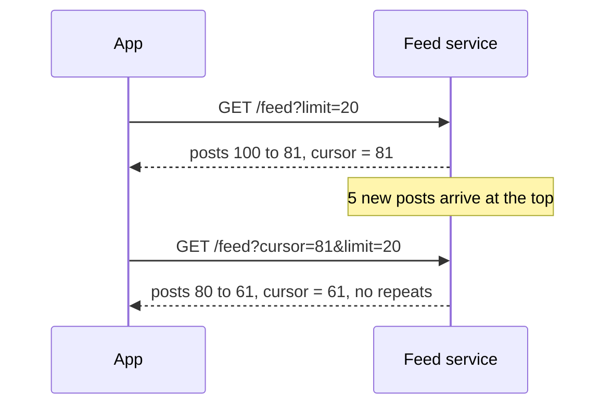
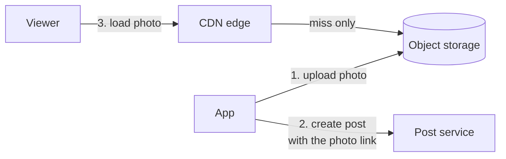

# News Feed

In the [chat system](./06-chat-system.md), a group message went to a few hundred people. In a news feed, one post may need to reach **millions of followers**, and everyone expects their home page to load in a fraction of a second. The core question of this design is **when** to do that work: when the post is written, or when the feed is read.

## What we build

| Functional | Non-functional |
| --- | --- |
| Publish a post with text and photos | The feed loads in under about 200 ms |
| See a home feed of posts from people you follow | Very read-heavy: people scroll far more than they post |
| Scroll down to load older posts | A new post can take a few seconds to show up. That is fine |
| Like and comment | Always available |

**Rough scale:** 200 million daily users, each opening the feed 10 times a day, is 2 billion feed reads a day. That is about **23,000 reads per second**. With 1 post per user every 2 days, that is about **1,200 posts per second**.

**API:**

- `POST /posts` publishes a post
- `GET /feed?cursor=X&limit=20` returns the next page of the home feed

## The big picture

## Components

| Component | Job |
| --- | --- |
| Post service | Saves new posts and sends a "new post" event |
| Post store and post cache | Hold the post contents. The cache keeps hot posts in memory |
| Follow graph | Who follows whom. Asked "who follows user X?" and "who does user Y follow?" |
| Queue and fan-out workers | Push new post IDs into followers' feeds in the background |
| Feed cache | For each user, a list of the latest post IDs for their feed |
| Feed service | Reads the feed cache, fills in post details, ranks, and returns a page |
| Object storage and CDN | Store and serve photos and videos |

## Techniques

### 1. Fan-out on write (push)

**The idea:** when someone posts, add the post ID to **every follower's feed list** right away. Reading the feed is then a single, fast lookup.

- **Good:** reads are very fast, since the feed is ready and waiting.
- **Bad:** a user with 50 million followers means 50 million writes for one post. That is slow and wasteful, especially for followers who never log in.

### 2. Fan-out on read (pull)

**The idea:** do nothing when someone posts. When a user opens their feed, fetch the latest posts from **everyone they follow** and merge them.

- **Good:** posting is cheap, and no work is spent on inactive users.
- **Bad:** reading is slow. Following 500 people means 500 lookups on every refresh.

### 3. The hybrid: push for most, pull for celebrities

**The idea:** use push for normal users, who have few followers. Use pull for celebrities, who have millions. When building a feed, take the ready list and merge in recent posts from the few celebrities the user follows.

| | Push | Pull | Hybrid |
| --- | --- | --- | --- |
| Write cost | High | Low | Medium |
| Read speed | Fastest | Slow | Fast |
| Celebrity posts | Very expensive | Fine | Fine |
| Used by | Small networks | Rarely alone | Most large social apps |

Another saving: skip pushes to users who haven't logged in for weeks, and build their feed by pulling when they come back.

### 4. Feed cache: store IDs, not posts

**The idea:** each user's feed in the cache is a short list of **post IDs only**, such as the latest 500. Post contents live once in the post cache. Building a page means fetching 20 IDs, then fetching those 20 posts in one batch.

Why IDs? A post can appear in 10 million feeds. Storing it once means an edit or delete is one change, and memory stays small. Like counts are kept separately and updated in batches, because they change all the time.

### 5. Ranking

**The idea:** instead of newest first, score each candidate post and show the best ones first.

A simple formula is enough in an interview: engagement divided by age, with a boost for close friends. Real systems use a machine learning model, but the shape is the same: **get candidates, score, sort**.

### 6. Cursor pagination

**The problem:** with "page 2 = items 21 to 40", if 5 new posts arrive while you scroll, page 2 repeats 5 posts you already saw.

**The idea:** the server returns a **cursor**, which means "the last item you saw". The next request asks for items after that cursor, so new posts at the top don't shift anything.

| | Offset pagination | Cursor pagination |
| --- | --- | --- |
| Request | `?page=3` | `?cursor=81` |
| New items while scrolling | Repeats or skips items | Stable |
| Deep pages | Slow, because the DB skips many rows | Fast, because it jumps to the cursor |
| Jump to page 50 | Yes | No, which is fine for infinite scroll |

### 7. Photos and videos

**The idea:** media never goes through your app servers or databases. The app uploads it to **object storage**, the post stores only the file's link, and users download it through a **CDN**.

Store a few sizes of each image, such as a thumbnail and full size, so phones don't download more than they need.

---

## Interview questions

### 1. Push or pull?

**In short:** Hybrid. Push for normal users, pull for celebrities.

Push makes reads fast, and reads outnumber writes many times over. Pull avoids the massive write cost of celebrity posts. Pick the follower limit for switching based on your measured write capacity.

### 2. A user deletes a post. How does it leave millions of feeds?

**In short:** Don't remove it from every feed. Mark it deleted and filter it out when reading.

Since feeds store only IDs, the feed service skips any ID whose post is marked deleted or missing. Stale IDs fall off the end of the feed lists over time.

### 3. A user follows someone new. When do their posts appear?

**In short:** On the next feed load, by pulling that person's recent posts once.

Either run a small background job that adds the new person's recent post IDs to the follower's feed list, or merge them in when the feed is next read. New posts from then on arrive through the normal fan-out.

### 4. How do you show "3 new posts" at the top while the user is reading?

**In short:** Poll lightly, or push a small signal, and load the posts only when they tap.

The app checks every minute or so for posts newer than the top one it has, or receives a small hint over an open connection. It shows a banner, and loads the posts only when the user taps it. This avoids moving content under their finger.

---

:::info[Next page]
Feeds wait for users to come and look. In [Notification System](./08-notification-system.md) we go the other way and reach out to users by push, SMS, and email, reliably and without spamming them.
:::
