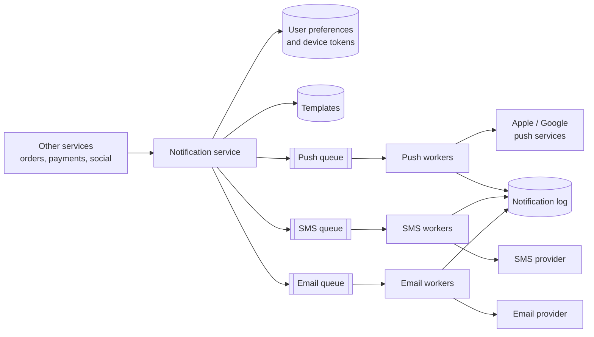
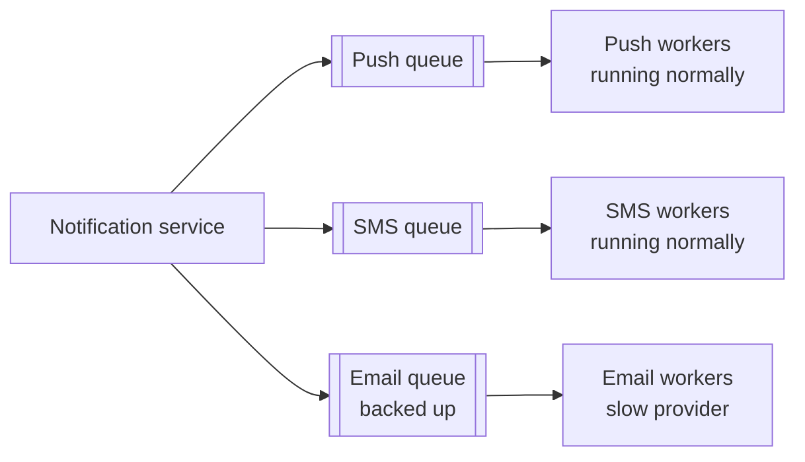
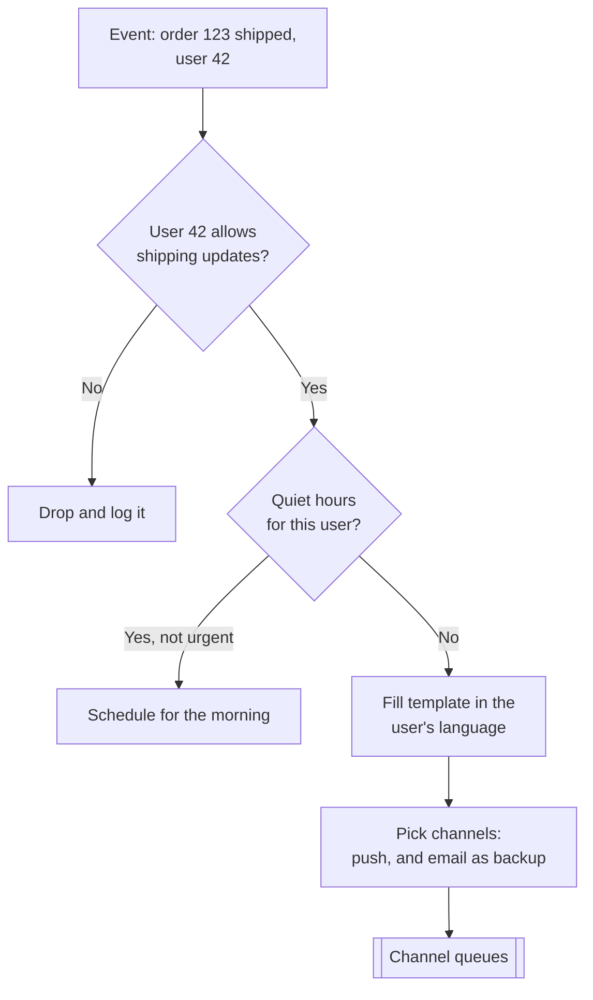
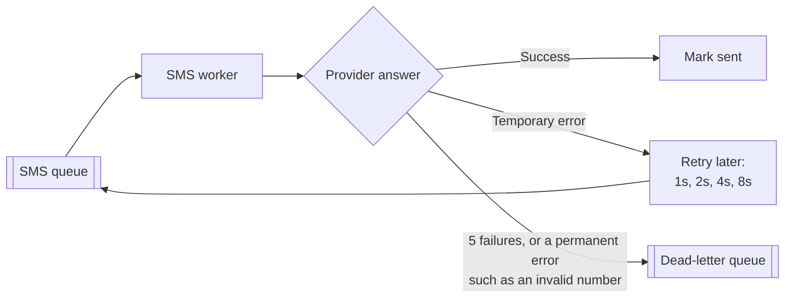
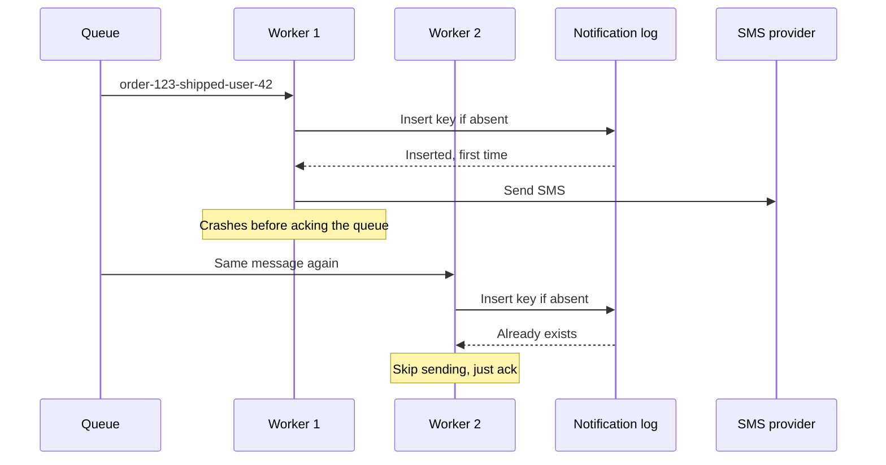
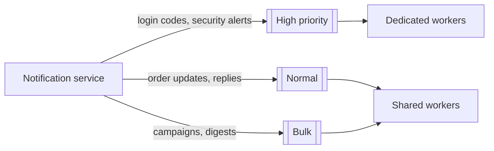
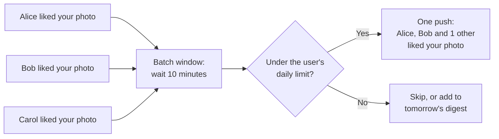
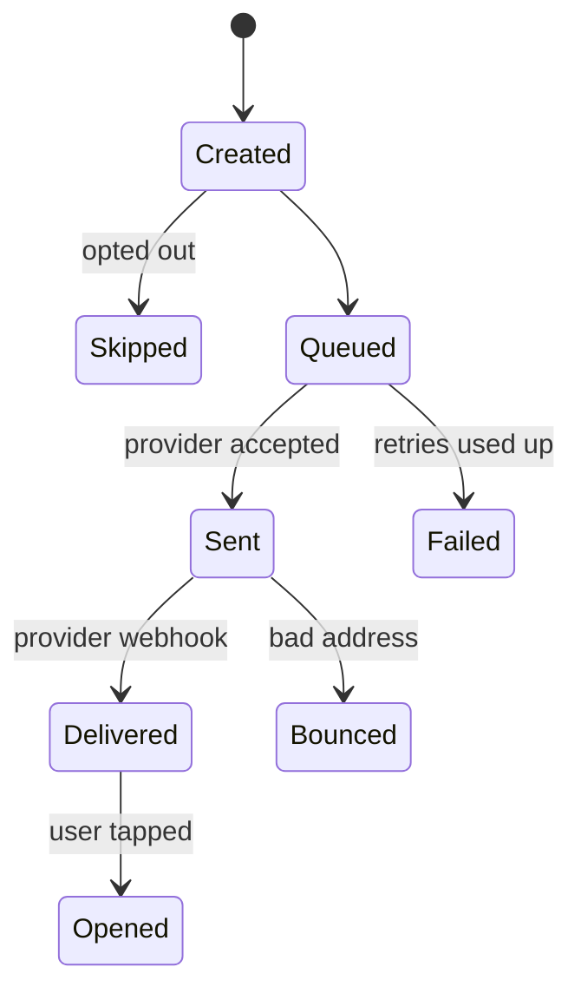

# Notification System

The [news feed](./07-news-feed.md) waits for users to open the app. A **notification system** reaches out to them: phone push, SMS, and email. Almost every product needs one: order shipped, payment failed, someone replied to you.

The hard part isn't sending one message. It's sending **millions reliably**, through outside providers that are slow or sometimes down, **never twice**, and **never to someone who opted out**.

## What we build

| Functional | Non-functional |
| --- | --- |
| Send push, SMS, and email | No notification is lost, even if a provider is down |
| Triggered by other services, such as "order shipped" | No duplicates. Paying for 2 SMS or annoying the user both hurt |
| Respect each user's preferences and opt-outs | Urgent messages (login codes) arrive in seconds |
| Scheduled and bulk sends, such as a campaign to 10 million users | A big campaign must not delay urgent messages |
| Track delivered, opened, and failed | Scales with traffic spikes |

**Rough scale:** 10 million push, 1 million SMS, and 5 million emails a day. That averages about 200 per second, but campaigns create **spikes of thousands per second**. Queues are made for exactly this.

## The big picture

## Components

| Component | Job |
| --- | --- |
| Notification service | One API for all teams. Checks preferences, fills in templates, and puts messages on the right queue |
| User preferences | Which channels each user allows, quiet hours, and opt-outs per category |
| Device tokens and contacts | Push tokens per phone, verified phone numbers, and email addresses |
| Templates | The message text with blanks, such as `Your order {orderId} has shipped`, in each language |
| One queue per channel | Buffers spikes and keeps a slow channel from blocking the others |
| Channel workers | Call the outside providers, handle their errors, and retry |
| Notification log | A record of every notification and its status, used for deduplication, tracking, and support |

## Techniques

### 1. One queue per channel

**The problem:** the email provider gets slow. If all channels share one queue, push and SMS get stuck behind thousands of waiting emails.

**The idea:** separate queues and workers for each channel. Each one scales and fails on its own.

Each worker group can be sized for its provider. SMS is expensive and rate-limited, while push is cheap and fast.

### 2. Preferences and templates before sending

**The idea:** every request passes the same checks **before** it reaches a queue. That way no team can forget to respect an opt-out.

Calling teams only send an event such as "order shipped for user 42". The notification service owns the rules about wording, channels, and timing. Changing a message then needs no deploy in any other team.

### 3. Retries with backoff, and a dead-letter queue

**The problem:** providers fail all the time with timeouts, "try later" errors, and short outages.

**The idea:** retry with **exponential backoff**: wait 1 second, then 2, then 4, then 8, plus a little random spread so all workers don't retry at the same moment. After a few tries, move the message to a **dead-letter queue** so a person or a later job can look at it.

| Error type | Example | What to do |
| --- | --- | --- |
| Temporary | Timeout, 503, rate-limited by the provider | Retry with backoff |
| Permanent | Invalid phone number, push token expired | Don't retry. Clean up the bad token or number |
| Provider outage | Many failures in a row | Stop calling for a while (a **circuit breaker**), or switch to a backup provider |

### 4. No duplicates: idempotency keys

**The problem:** a worker sends the SMS, then crashes before marking the message done. The queue gives the message to another worker, and the user gets 2 SMS. Queues deliver **at least once**, so this will happen.

**The idea:** every notification gets a unique **idempotency key**, such as `order-123-shipped-user-42`. Before sending, a worker records the key with an atomic "insert if absent". If the key is already there, skip the send.

There is still a small gap: the crash could happen after the key is saved but before the send. Many systems record the key as "sending", then "sent", and pass the same key to providers that support it, so the provider also ignores repeats. This is the at-least-once plus idempotency rule from [exactly-once processing](./03-distributed-transactions.md#5-idempotent-consumers-and-exactly-once).

### 5. Priorities: urgent before bulk

**The problem:** a marketing campaign puts 10 million emails on the queue. A user's login code arrives behind them and takes an hour.

**The idea:** separate queues, or separate workers, per **priority**. Urgent queues always get their own capacity.

Bulk sends are also **spread over time**. A campaign to 10 million users drips out over an hour instead of all at once, which protects the providers and your own systems.

### 6. Rate limits per user

**The idea:** even valid notifications become spam in large numbers. Limit how many each user gets, for example at most 3 marketing pushes a day, using the counters from the [rate limiter](./05-rate-limiter.md). Group many small events into one message.

### 7. Tracking delivery

**The idea:** every state change is written to the notification log: created, queued, sent, delivered, opened, failed. Providers report delivery and bounces later through **webhooks**.

This answers support questions such as "did we send the reset email?", feeds dashboards, and automatically removes bad emails and expired push tokens.

---

## Interview questions

### 1. How do you guarantee a notification is sent exactly once?

**In short:** You can't fully guarantee it, but at-least-once delivery plus idempotency keys gets very close.

Queues may deliver twice, so workers check an idempotency key before sending. Pass the same key to providers that support deduplication. Accept that in a rare crash window, a duplicate is better than a lost message for things like security alerts.

### 2. A push provider is down for 20 minutes. What happens?

**In short:** Messages wait in the queue, a circuit breaker stops pointless calls, and they drain when the provider recovers.

Nothing is lost, because the queue holds the messages. Urgent messages can fall back to another channel, such as SMS for a login code. When the provider returns, workers drain the backlog at a controlled rate, so they don't hammer it.

### 3. How do you send a campaign to 50 million users?

**In short:** As a batch job that streams users in chunks into the bulk queue, spread over time.

Don't load 50 million users into memory. A scheduler pages through the audience, checks preferences, and puts messages on the low-priority queue at a steady rate. Urgent traffic keeps its own workers, so it is never delayed.

### 4. How do you handle time zones and quiet hours?

**In short:** Store each user's time zone and schedule non-urgent messages for their local daytime.

A scheduled-send store holds messages with a "send at" time. A job moves due messages onto the queues. Security and login messages skip quiet hours.

---

:::info[Next page]
The last design moves the heaviest data of all. In [Video Streaming](./09-video-streaming.md) we upload, process, and deliver huge video files to viewers worldwide.
:::
