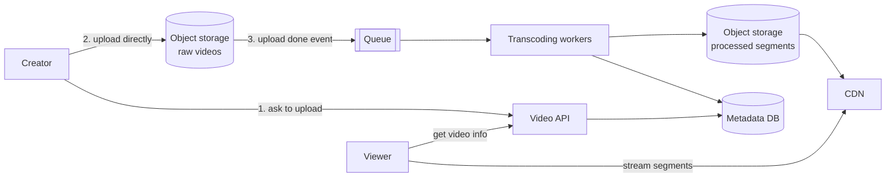
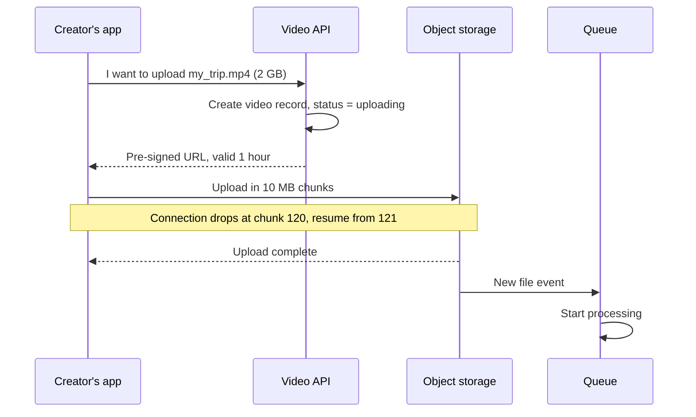
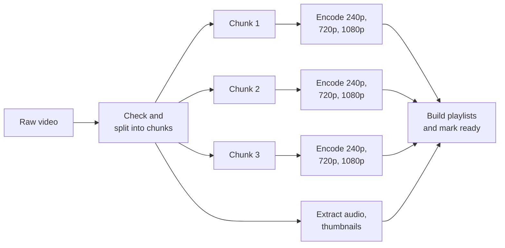
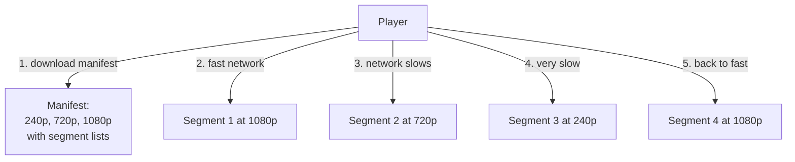
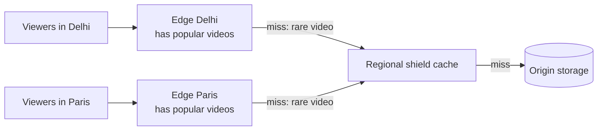
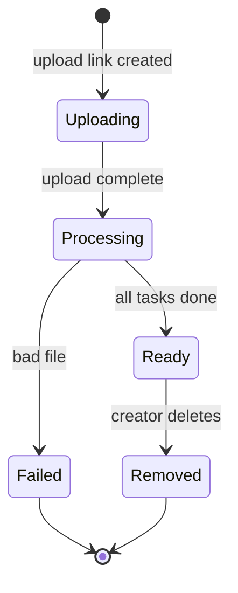
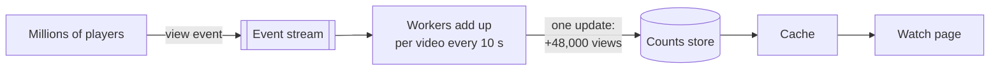

# Video Streaming

Every earlier design moved small pieces of data: a link, a message, a post. Video is different. One upload can be **several gigabytes**, it has to be converted into many formats, and it has to play smoothly on a phone on a train and on a 4K TV. Most of this design is about **moving and processing big files cheaply**.

## What we build

| Functional | Non-functional |
| --- | --- |
| Upload a video | Playback starts in about 2 seconds, with very little buffering |
| Watch on any device and network speed | Uploads of several GB survive a dropped connection |
| See title, description, and view count | Bandwidth is the biggest cost, so keep it low |
| Search and recommendations (mention only) | Uploads can take minutes to process. Viewing must always be fast |

**Rough scale:** 500,000 uploads a day at an average of 500 MB is **250 TB of new raw video a day**, before making the extra versions. Viewing is far bigger: 100 million views a day at about 300 MB each is **30 PB of traffic a day**. That is why the CDN is the most important part of this design.

## The big picture

## Components

| Component | Job |
| --- | --- |
| Video API | Upload links, video details, likes, and view counts. Never touches the video bytes |
| Object storage (raw) | Holds the original uploaded files |
| Queue | Starts processing when an upload finishes and buffers bursts of uploads |
| Transcoding workers | Convert each video into many sizes and formats, in parallel |
| Object storage (processed) | Holds the small video segments and playlist files that players download |
| Metadata DB and cache | Title, owner, status, and the list of available qualities. Read very often |
| CDN | Serves the video segments to viewers from nearby edge servers |

## Techniques

### 1. Direct upload with a pre-signed URL

**The problem:** pushing gigabytes through your API servers ties them up for minutes and wastes their bandwidth.

**The idea:** the API gives the app a **pre-signed URL**: a short-lived link that allows uploading one file straight to object storage. The video bytes never touch your servers. Large files are sent in **chunks** (multipart upload), so a dropped connection only re-sends the missing chunk.

This is the same trick used for photos in the [news feed](./07-news-feed.md) and attachments in [chat](./06-chat-system.md).

### 2. Transcoding pipeline in parallel

**The problem:** the uploaded file is in one format and one size. Viewers need many qualities (240p up to 4K) and formats for different devices. Processing a 1-hour 4K video on one machine takes hours.

**The idea:** **split** the video into short chunks, transcode all chunks **in parallel** on many workers, then join the results. The steps form a **DAG** (a graph of tasks where some steps wait for others).

Workers take tasks from a queue, so you add workers when uploads spike. If one worker dies, only its chunk is redone. When all tasks finish, the video status changes to **ready** and the creator is notified, using the [notification system](./08-notification-system.md).

:::tip[Save money on unpopular videos]
Most videos get very few views. Many platforms encode only a couple of common qualities at first, and create the rest only after a video becomes popular.
:::

### 3. Adaptive bitrate streaming (HLS and DASH)

**The problem:** network speed changes all the time. A fixed quality either buffers on a slow network or looks bad on a fast one.

**The idea:** each quality is cut into small **segments** of about 2 to 6 seconds. A **manifest** (playlist) file lists every quality and its segments. The player downloads segments one by one and **picks the quality for each next segment** based on how fast the last ones arrived.

| Term | Meaning |
| --- | --- |
| HLS / DASH | The two standard formats for this, Apple's and the open standard |
| Segment | A few seconds of video at one quality, a normal small file |
| Manifest | The playlist that tells the player which segments exist |
| Bitrate | Data per second. Higher means better quality and more data |

Because segments are ordinary small files over HTTP, **any CDN can cache them**. No special streaming server is needed.

### 4. Delivery through a CDN

**The idea:** popular videos are watched by millions, so their segments should sit on CDN edges near viewers. Only a miss goes back to the origin storage.

| Video type | Where it is served from |
| --- | --- |
| Viral, new, trending | Pushed to edges ahead of time. Almost every request is a hit |
| Long tail (old, rarely watched) | Fetched from origin on demand, with a regional **shield** cache so the origin isn't hit by every edge |

Very large platforms also place their own cache servers inside internet providers' networks, so popular videos never cross the wider internet.

### 5. Metadata and status

**The idea:** the video files live in object storage. Everything else (title, owner, status, durations, available qualities) lives in a normal database with a cache in front, because the watch page reads it on every view.

The metadata is relational and modest in size. Millions of videos with a few KB each fit well in SQL with read replicas, sharded by video ID if it grows.

### 6. View counts at scale

**The problem:** a viral video gets 50,000 views per second. Updating one database row for each view would lock that row and fall over.

**The idea:** players send view events to a **queue**. Workers count them in memory for a few seconds, then write **one combined update** per video. The count shown is a few seconds behind, which is fine.

The same stream feeds analytics and recommendations. This is the same "record now, count later" idea as the click analytics in the [URL shortener](./04-url-shortener.md).

---

## Interview questions

### 1. Why not stream the video file as one big download?

**In short:** Because the quality couldn't change, seeking would be slow, and CDNs cache small files much better.

With segments, the player adapts to the network, jumps to any point by loading the right segment, and only downloads what is actually watched. Most viewers don't finish videos, so this also saves a lot of bandwidth.

### 2. How do you keep transcoding costs down?

**In short:** Encode less, and encode smarter.

Make fewer qualities for videos that are unlikely to be popular and add more if views grow. Use cheaper spare cloud capacity for batch transcoding, since it can be retried. Use better compression, such as newer codecs, for popular videos where the bandwidth savings repay the extra compute.

### 3. How do you stop people downloading paid videos?

**In short:** Signed, expiring segment URLs, plus encryption with DRM for premium content.

The API gives the player a short-lived signed link or cookie, so links can't be shared for long. Segments are encrypted, and only licensed players receive the key from a license server. Nothing is fully copy-proof, but this blocks casual piracy.

### 4. How would you support live streaming?

**In short:** The same segment idea, but with a constant pipeline and very short segments.

The streamer sends a continuous feed to an ingest server. It is transcoded on the fly into short segments of 1 to 2 seconds, and the manifest keeps updating with new segments. CDNs serve them as usual. The trade-off is delay vs smoothness: shorter segments mean less delay but more requests and more buffering risk.

---

:::info[Where to next]
You have now seen the same building blocks reused in six designs. Go back to [Building Blocks](./01-building-blocks.md) and try to point at where each one appeared. Then practise with the [System Design Q&A](../system-design-questions/01-how-would-you.md): short "how would you" questions and six harder designs. For running these services in production, see [Kubernetes](../kubernetes.md). For securing them, see [IAM](../iam.md).
:::
