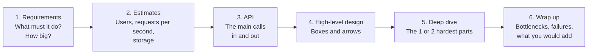

# System Design

Coding interviews ask "can you solve this problem?". System design interviews ask a bigger question: **"Can you build something that works for millions of people, keeps working when parts of it break, and does not cost a fortune?"**

There is no single right answer. The interviewer wants to see you **make choices and explain the trade-offs**. This course gives you the parts to choose from and shows how they fit together in six classic designs.

:::tip[The one idea behind system design]
Every design choice trades one good thing for another: speed vs cost, consistency vs availability, simple vs flexible. Saying **"I pick X because of Y, and the cost is Z"** is the most important habit in these interviews.
:::

## How this course works

1. **[Building Blocks](./01-building-blocks.md)**: the parts every design uses, such as load balancers, caches, databases, queues and CDNs. Read this first.
2. **[Distributed Systems](./02-distributed-systems.md) and [Transactions Across Services](./03-distributed-transactions.md)**: the theory underneath, covering how machines agree, stay consistent, and keep multi-service actions correct.
3. **Six designs**: each design page has the same layout, so you always know where to look.

| Part | What you get |
| --- | --- |
| **What we build** | The requirements and a rough sense of scale |
| **The big picture** | One diagram of the whole system |
| **Components** | A table of every part and its job |
| **Techniques** | The key ideas that make the design work, each with its own diagram |
| **Interview questions** | Follow-up questions interviewers like to ask |

## How to run a system design interview

You have about 45 minutes. Use a fixed routine so you don't get lost:

| Step | Time | What to say |
| --- | --- | --- |
| Requirements | 5 min | "Users can do A and B. We don't need C for now. It must be fast and always available." |
| Estimates | 5 min | "100 million users, about 1,000 writes and 50,000 reads per second, so it's read-heavy." |
| API | 5 min | "`POST /urls` creates one, `GET /code` redirects." |
| High-level design | 10 min | Draw the client, the load balancer, the services, the cache, and the database. |
| Deep dive | 15 min | Pick the hardest part, such as ID generation or fan-out, and go deep. |
| Wrap up | 5 min | Single points of failure, monitoring, and what changes at 10 times the traffic. |

:::warning[Common trap]
Don't jump to drawing boxes. Ten minutes on the wrong problem costs more than two minutes of questions at the start.
:::

## Numbers worth remembering

Estimates don't need to be exact. They tell you **which part will break first**.

| Fact | Rough number |
| --- | --- |
| Seconds in a day | About 100,000 (86,400) |
| 1 million requests a day | About 12 per second |
| Read from memory | About 100 nanoseconds |
| Read from SSD | About 100 microseconds (1,000 times slower than memory) |
| Round trip inside one data center | About 0.5 milliseconds |
| Round trip across continents | About 150 milliseconds |
| One server with a cache like Redis | About 100,000 simple operations per second |
| One SQL database server | A few thousand to tens of thousands of queries per second, depending on the query |

**Quick example:** 10 million users, each posts 2 times a day, gives 20 million posts a day. That is about **230 writes per second**. If each post is 1 KB, that is 20 GB a day, or about 7 TB a year.

## The pages

1. [Building Blocks](./01-building-blocks.md): load balancers, caching, CDN, databases, replication, sharding, consistent hashing, queues, and CAP
2. [Distributed Systems](./02-distributed-systems.md): failure detection, consistency models, PACELC, quorums, logical clocks, Raft consensus, CRDTs, Bloom filters, and Merkle trees
3. [Transactions Across Services](./03-distributed-transactions.md): two-phase commit, sagas, the transactional outbox, exactly-once processing, and distributed locks with fencing tokens
4. [URL Shortener](./04-url-shortener.md): unique IDs, base62 codes, and read-heavy caching
5. [Rate Limiter](./05-rate-limiter.md): token bucket, sliding windows, and counters shared across servers
6. [Chat System](./06-chat-system.md): WebSockets, message routing, ordering, presence, and offline delivery
7. [News Feed](./07-news-feed.md): fan-out on write vs read, feed caches, and cursor pagination
8. [Notification System](./08-notification-system.md): per-channel queues, retries, deduplication, and user preferences
9. [Video Streaming](./09-video-streaming.md): direct uploads, transcoding pipelines, adaptive bitrate, and CDNs

The designs reuse each other's ideas. The rate limiter appears again in notifications, and the CDN in news feed and video. Read them in order the first time.
