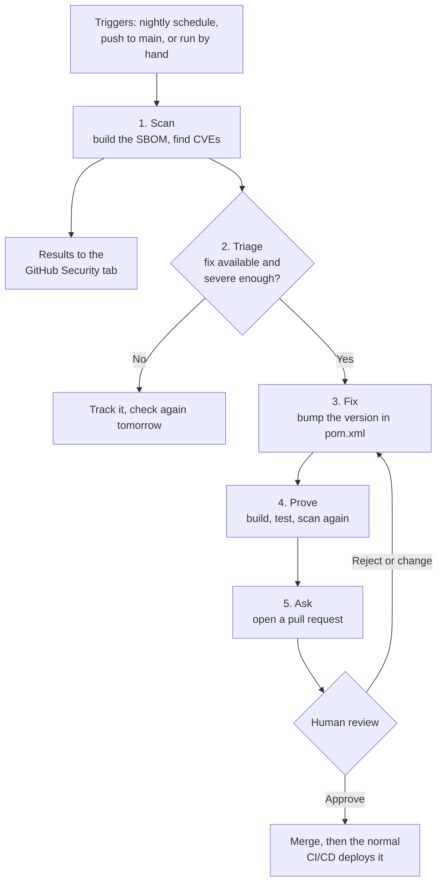
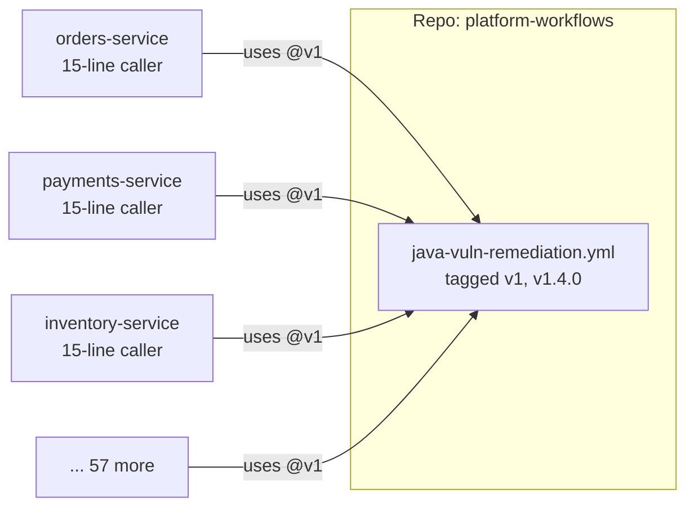
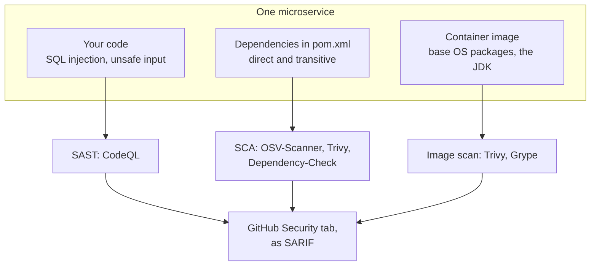
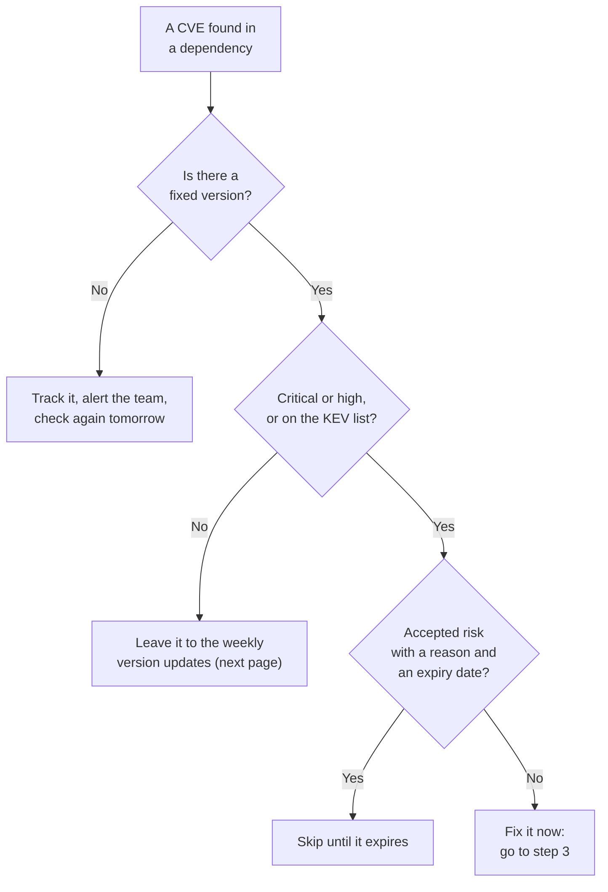
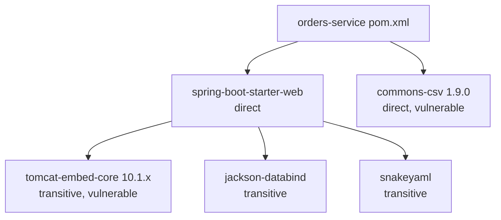
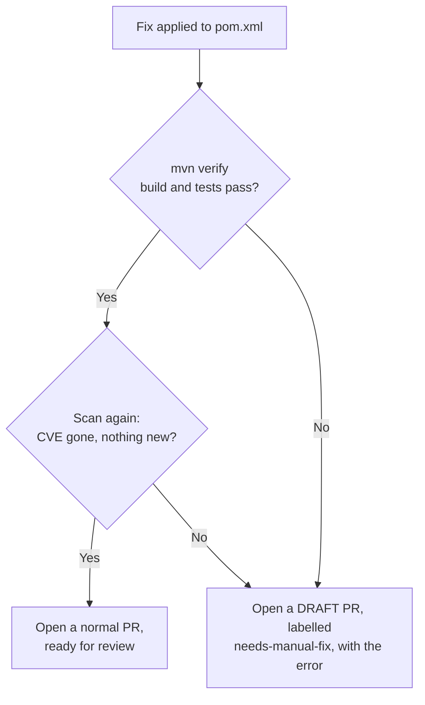
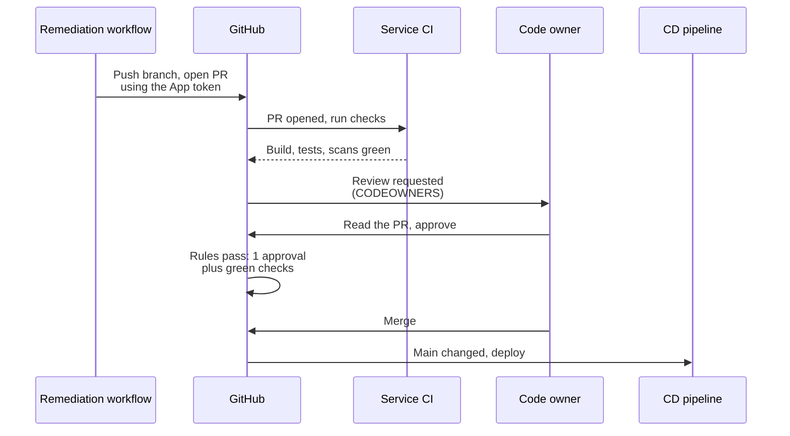
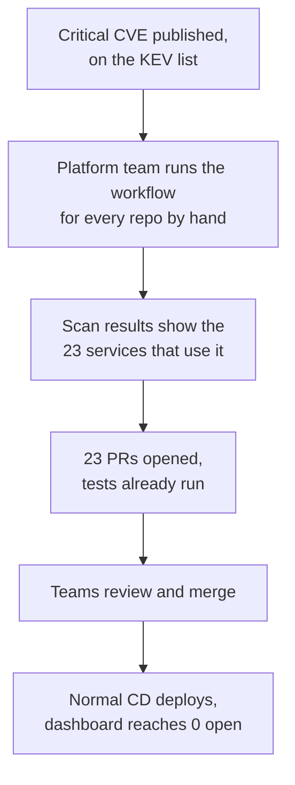

# Automated Vulnerability Remediation

The [System Design](../system-design/index.md) pages and the [Kubernetes](../kubernetes.md) page showed how to build and run many services. This section is about **keeping them safe** once they exist.

Picture a normal Friday. A new critical vulnerability is published in a popular Java library, like **Log4Shell** in December 2021. Your company has **60 Java microservices**. Which of them use that library, even indirectly? Which version? Who fixes each one, and how fast?

Done by hand, this takes weeks: someone searches every repo, opens tickets, and each team finds time to bump a version. Meanwhile attackers scan the internet within hours.

:::tip[The one idea]
**Machines find and fix. Humans approve.** A pipeline scans every service, picks the vulnerabilities that have a fix, applies the fix, proves the build still passes, and opens a pull request. A person reviews and merges it. Nothing reaches production without that approval.
:::

---

## 1. The words you need

| Word | Full form | Meaning |
| --- | --- | --- |
| **CVE** | Common Vulnerabilities and Exposures | A public ID for one known vulnerability, such as `CVE-2021-44228` (Log4Shell) |
| **Advisory** | — | The record that says which package versions are affected and which version **fixes** it. GitHub, OSV (Open Source Vulnerabilities), and NVD (National Vulnerability Database) publish these |
| **CVSS** | Common Vulnerability Scoring System | A severity score from 0 to 10. 9 and above is critical |
| **EPSS** | Exploit Prediction Scoring System | The chance (0 to 1) that a CVE will be exploited in the next 30 days |
| **KEV** | Known Exploited Vulnerabilities | The list from CISA (Cybersecurity and Infrastructure Security Agency, USA) of CVEs that are **known to be exploited** right now. Anything on it is urgent |
| **SCA** | Software Composition Analysis | Scanning your **dependencies** for known CVEs. This page is mostly about SCA |
| **SAST** | Static Application Security Testing | Static analysis of **your own code**, for example with CodeQL |
| **SBOM** | Software Bill of Materials | The full list of every library in your build, with versions |
| **Direct dependency** | — | A library you list in your `pom.xml` |
| **Transitive dependency** | — | A library pulled in by one of your libraries. Most CVEs hide here |
| **SARIF** | Static Analysis Results Interchange Format | A standard JSON format for scan results. GitHub shows SARIF files in the repo's **Security** tab |

---

## 2. The big picture

The whole pipeline is five steps: **scan, triage, fix, prove, ask**.



Each step is small on its own. The value comes from running all of them, **the same way, in every service**, every night.

---

## 3. One reusable workflow, called by every service

**The problem:** 60 services means 60 copies of the same pipeline. Copies drift apart, and fixing a bug in the pipeline means 60 pull requests.

**The idea:** write the pipeline **once**, as a **reusable workflow** in a central repo. Each service adds a tiny file of about 15 lines that calls it. A reusable workflow is a normal GitHub Actions workflow that starts with `on: workflow_call`, so other workflows can call it like a function, with inputs and secrets.



| Lives in the central workflow | Lives in each service |
| --- | --- |
| The steps: build, SBOM, scan, fix, test, open PR | When to run (schedule, branches) |
| Pinned tool versions | Inputs: Java version, reviewer team, severity level |
| The PR format, labels, and branch name | Its own tests, which the fix must pass |
| Security settings (permissions, pinned actions) | CODEOWNERS, who must approve |

The platform team releases the workflow with **version tags**, just like a library. Services call `@v1`. A fix to the pipeline moves the `v1` tag, and every service gets it on the next run with no PR. A breaking change becomes `v2`, and teams move when ready.

---

## 4. Step 1: Scan

A Java service has three layers to scan:



**Scan what you actually ship.** The most accurate input is an **SBOM** made from the real build, for example with the CycloneDX Maven plugin. It lists every library, including transitive ones, exactly as Maven resolved them.

| Tool | Scans | Notes |
| --- | --- | --- |
| **OSV-Scanner** (Google) | Dependencies, SBOMs | Uses the open OSV database. Can also **fix** Maven projects (step 3) |
| **Trivy** (Aqua) | Dependencies, SBOMs, container images, config files | One tool for most layers. Outputs SARIF |
| **OWASP Dependency-Check** | Dependencies | Long-standing Maven and Gradle plugin. Needs an NVD API key |
| **Grype** (Anchore) | Images, SBOMs | Often paired with Syft, which makes the SBOM |
| **CodeQL** (GitHub) | Your own code | SAST, not SCA. GitHub's **Copilot Autofix** can suggest code fixes for its alerts |
| **Snyk, Mend, and others** | Most layers | Commercial. Good dashboards and fix advice |

All results go to the repo's **Security tab** as SARIF, so developers see them in one place.

---

## 5. Step 2: Triage, deciding what deserves a PR

**The problem:** a first scan often finds 50 or more CVEs per service. Fifty pull requests a night would be ignored by everyone, which is worse than none.

**The idea:** a short set of rules decides what gets an automatic fix.



| Signal | Why it matters |
| --- | --- |
| **Fix available** | Without a fixed version, automation can't help. A person must decide (upgrade a framework, mitigate, or accept) |
| **Severity (CVSS)** | A simple first filter, for example high and critical only |
| **KEV and EPSS** | Real attack data. A medium CVE that is being exploited beats a critical one nobody uses |
| **Reachability** | Is the vulnerable code actually called? Some commercial tools check this. It cuts noise a lot |
| **Accepted risk** | Some findings don't apply to you. Record them in an ignore file with a **reason and an expiry date**, never forever |

Teams usually agree on a **fix deadline** per severity, for example critical within 7 days and high within 30. The pipeline makes those deadlines easy to meet.

:::warning[Ignore files need expiry dates]
"Ignore this CVE" with no end date quietly becomes "ignore this forever". Make the pipeline fail when an ignore entry has expired, so someone looks at it again.
:::

---

## 6. Step 3: Fix, the Maven way

Fixing a CVE means moving to a **fixed version** of the library. How you do that depends on where the library comes from.



| Where the library comes from | How to fix it |
| --- | --- |
| **Direct dependency** | Bump its version in `pom.xml`, or the property that holds the version |
| **Transitive, inside Spring Boot** | If you use `spring-boot-starter-parent`, override Spring Boot's version **property**, such as `tomcat.version`. Better still, bump Spring Boot itself if a patch release has the fix |
| **Transitive, from another library** | Pin the fixed version in the `dependencyManagement` section. Maven then uses it everywhere in the tree |

```xml
<properties>
    <!-- Direct dependency: just bump it -->
    <commons-csv.version>1.10.0</commons-csv.version>
    <!-- Transitive inside Spring Boot: override Boot's managed version -->
    <tomcat.version>10.1.48</tomcat.version>
</properties>

<dependencyManagement>
    <dependencies>
        <!-- Transitive from another library: force the fixed version -->
        <dependency>
            <groupId>org.yaml</groupId>
            <artifactId>snakeyaml</artifactId>
            <version>2.2</version>
        </dependency>
    </dependencies>
</dependencyManagement>
```

The version numbers above only show the shape. A real fix uses the version named in the advisory.

To see **who pulls in** a transitive library, run `mvn dependency:tree -Dincludes=org.yaml:snakeyaml`.

**Doing it automatically:** OSV-Scanner has a `fix` command that does exactly this for Maven. With the **override** strategy, it bumps vulnerable direct dependencies and adds overrides in `dependencyManagement` for transitive ones:

```bash
osv-scanner fix --strategy=override -M pom.xml --min-severity=7 --no-introduce
```

| Flag | Meaning |
| --- | --- |
| `--strategy=override` | Bump direct dependencies and override transitive ones in `dependencyManagement` |
| `--min-severity=7` | Only fix CVEs with a CVSS score of 7 or more (high and critical) |
| `--no-introduce` | Skip any upgrade that would bring in a **new** vulnerability |
| `--upgrade-config=minor` | Never jump a major version automatically |
| `--ignore-vulns=ID1,ID2` | Skip accepted risks |

:::note[Experimental, so the pipeline proves every change]
OSV-Scanner marks guided remediation as **experimental**, and it has known limits with Maven profiles and with properties used in group or artifact IDs. That is fine here, because step 4 builds and tests every change, and a human reviews it. For Gradle projects, the same idea uses a `constraints` block, or you can let Dependabot or Renovate make the change.
:::

---

## 7. Step 4: Prove the fix works

**The problem:** a version bump can break the build or change behaviour. A PR that is broken on arrival wastes the reviewer's time and teaches people to ignore the bot.

**The idea:** the pipeline proves the fix **before** asking anyone. It builds, runs the tests, and scans again to confirm the CVE is gone.



A failing fix still becomes a PR, as a **draft**. The bump is done, and a developer only has to fix the code that broke, which is much faster than starting from zero.

:::warning[The GITHUB_TOKEN trap]
A pull request opened with the workflow's built-in `GITHUB_TOKEN` does **not** start your normal CI workflows on that PR. GitHub does this on purpose, to stop workflows from triggering each other forever. On current GitHub the runs may appear but wait for someone to approve them. Either way, the PR would show no green checks, and reviewers can't trust it.

The fix is to open the PR with a token from a **GitHub App** made for this bot, created in the workflow with `actions/create-github-app-token`. Then CI runs on the PR as normal. A personal access token also works, but it is tied to one person and is harder to control.
:::

---

## 8. Step 5: Open the PR and ask a human

The PR is how the bot hands over to a person, so it must make review easy.



**What a good bot PR contains:**

| Part | Example |
| --- | --- |
| Clear title | `fix(deps): patch 2 high CVEs in tomcat-embed-core, snakeyaml` |
| Table of fixes | CVE, severity, package, old version, new version, link to the advisory |
| Proof | "Build and 214 tests passed. Re-scan found 0 remaining high or critical CVEs" |
| Labels | `security`, `automated`, and `needs-manual-fix` when the build failed |
| Reviewers | The owning team, from CODEOWNERS or an input of the workflow |

**Rules that make human approval real.** Set these with branch protection or a **repository ruleset** on `main`:

- Require **at least one approval**, from a **code owner**.
- Require the CI **status checks** to pass.
- Don't let the bot approve its own PR. The App gets permission to open PRs, not to approve or merge them.

**One PR per service, updated in place.** The workflow always uses the same branch name, such as `security/auto-remediation`. If the PR is still open tomorrow and a new CVE appears, the same PR is updated instead of opening a second one. When nothing needs fixing, no PR is opened.

---

## 9. The reusable workflow

Here is the central workflow, in the repo `my-org/platform-workflows`. It has two jobs: **scan** (always), and **fix** (opens the PR).

```yaml
# my-org/platform-workflows/.github/workflows/java-vuln-remediation.yml
name: Java vulnerability remediation

on:
  workflow_call:
    inputs:
      java-version:
        type: string
        default: "21"
      min-cvss:
        type: string
        default: "7"                # 7 or more = high and critical
      reviewer-team:
        type: string
        required: true              # for example: orders-team
      open-pr:
        type: boolean
        default: true               # false = scan only, for pull request checks
    secrets:
      REMEDIATION_APP_ID:
        required: true
      REMEDIATION_APP_KEY:
        required: true

permissions:
  contents: read                    # nothing more unless a job asks for it

env:
  OSV_VERSION: v2.x.y               # pin an exact release
  OSV_SHA256: "<sha256 of that release binary>"

jobs:
  scan:
    runs-on: ubuntu-latest
    permissions:
      contents: read
      security-events: write        # upload results to the Security tab
    steps:
      - uses: actions/checkout@v6
      - uses: actions/setup-java@v5
        with:
          distribution: temurin
          java-version: ${{ inputs.java-version }}
          cache: maven

      - name: Build and create the SBOM
        run: mvn -B -DskipTests package org.cyclonedx:cyclonedx-maven-plugin:makeAggregateBom

      - name: Scan the SBOM
        uses: aquasecurity/trivy-action@v0.35.0   # pin a commit SHA in real use
        with:
          scan-type: sbom
          scan-ref: target/bom.json
          format: sarif
          output: trivy.sarif

      - name: Show results in the Security tab
        uses: github/codeql-action/upload-sarif@v4
        with:
          sarif_file: trivy.sarif

  fix:
    needs: scan
    if: inputs.open-pr
    runs-on: ubuntu-latest
    steps:
      - name: Get a token for the remediation GitHub App
        id: app
        uses: actions/create-github-app-token@v2
        with:
          app-id: ${{ secrets.REMEDIATION_APP_ID }}
          private-key: ${{ secrets.REMEDIATION_APP_KEY }}

      - uses: actions/checkout@v6
      - uses: actions/setup-java@v5
        with:
          distribution: temurin
          java-version: ${{ inputs.java-version }}
          cache: maven

      - name: Install OSV-Scanner (pinned and checksum-verified)
        run: |
          curl -sSfL -o osv-scanner \
            "https://github.com/google/osv-scanner/releases/download/${OSV_VERSION}/osv-scanner_linux_amd64"
          echo "${OSV_SHA256}  osv-scanner" | sha256sum -c -
          chmod +x osv-scanner

      - name: Apply fixes to pom.xml
        run: |
          ./osv-scanner fix --strategy=override -M pom.xml \
            --min-severity=${{ inputs.min-cvss }} --no-introduce \
            --upgrade-config=minor > fix-report.txt
          rm osv-scanner

      - name: Prove the fix (build and test)
        id: verify
        continue-on-error: true     # a failed build still opens a draft PR
        run: mvn -B verify

      - name: Open or update the pull request
        uses: peter-evans/create-pull-request@v8
        with:
          token: ${{ steps.app.outputs.token }}
          branch: security/auto-remediation
          commit-message: "fix(deps): patch vulnerable dependencies"
          title: "fix(deps): patch vulnerable dependencies"
          body-path: fix-report.txt
          labels: security, automated
          team-reviewers: ${{ inputs.reviewer-team }}
          draft: ${{ steps.verify.outcome == 'failure' }}
          delete-branch: true
```

Some notes on the choices:

- **Two jobs, two permission sets.** Only `scan` can write security results. Only `fix` holds the App token. Each gets the least it needs.
- **Trivy for scanning, OSV-Scanner for fixing.** You could use one tool for both. Trivy also covers container images, and OSV-Scanner can edit `pom.xml`.
- If no fix applies, `pom.xml` doesn't change, and `create-pull-request` opens nothing.
- A real version would also write a richer PR body (a table of CVEs, from the scanner's JSON output) and add the `needs-manual-fix` label when the build failed.

### The caller, in each service

```yaml
# orders-service/.github/workflows/security-remediation.yml
name: Security remediation

on:
  schedule:
    - cron: "0 2 * * 1-5"           # 2 AM UTC, Monday to Friday
  workflow_dispatch:                # a "run now" button, for urgent CVEs

jobs:
  remediate:
    uses: my-org/platform-workflows/.github/workflows/java-vuln-remediation.yml@v1
    with:
      java-version: "21"
      reviewer-team: orders-team
    secrets: inherit                # passes the org-level App secrets
    permissions:
      contents: read
      security-events: write
```

The same workflow also works as a **pull request check**: call it on `pull_request` with `open-pr: false`. It then only scans, so a developer who adds a vulnerable library finds out before merging.

---

## 10. Securing the pipeline itself

A bot that can push code to 60 repos is a valuable target. Treat it like production.

| Risk | Protection |
| --- | --- |
| A popular action is hijacked | **Pin actions to a full commit SHA**, not a tag. In March 2026 attackers force-pushed almost every tag of `aquasecurity/trivy-action` to malicious code, and workflows that used tags ran it. A SHA can't be moved |
| A downloaded tool is tampered with | Pin exact versions and check the checksum, as the workflow above does |
| The token can do too much | Use a GitHub App with only **contents** and **pull requests** write, installed only on the service repos. Tokens last an hour |
| The bot merges its own work | Rules require a code owner's approval. The App can't approve |
| Secrets leak to untrusted code | Never run this workflow on `pull_request_target` with code from forks |
| Workflow permissions too wide | Set `permissions: contents: read` at the top, and widen it only per job |

The pinned actions also need updates. Dependabot or Renovate can bump the SHAs for you, which is part of the [next page](./02-version-and-patch-updates.md).

---

## 11. Rolling it out across all services

| Stage | What to do |
| --- | --- |
| **Pilot** | Turn it on for 3 friendly teams, with high and critical only. Tune the PR format and the noise |
| **Rollout** | Add the caller file to every repo with a script, opened as one PR per repo. Or require the workflow for all repos with an organization **ruleset** |
| **Measure** | Track open CVEs by severity, **mean time to remediate**, and the merge rate of bot PRs. A low merge rate means the PRs are noisy or broken |
| **Tighten** | Lower the severity level, add image scanning, and fail PR checks on new criticals |

**The big day: a Log4Shell-style emergency.**



Without automation, the first step alone (finding who is affected) takes days. With it, the whole company can be patched in hours, and every change was still approved by a person.

---

## 12. Build it, or use Dependabot or Renovate?

GitHub's **Dependabot security updates** already open PRs for vulnerable dependencies, and **Renovate** can do the same. So why build anything?

| | Dependabot security updates | Renovate | Custom reusable workflow (this page) |
| --- | --- | --- | --- |
| Setup | A setting, plus a small config file | One config, shared presets for the whole org | You build and maintain it |
| Finds CVEs from | GitHub Advisory Database | Its vulnerability data sources | Any scanner you choose |
| Container image scanning | No, only base image version bumps | No, only version bumps | Yes, Trivy or Grype |
| Your own triage rules (KEV, expiry, reachability) | Limited | Limited | Fully yours |
| Same PR format and reports everywhere | Fixed format | Configurable | Fully yours |
| Cost | Free on GitHub | Free (open source) | Your team's time |

**A good answer in practice:** turn on Dependabot or Renovate for the everyday PRs, and add the reusable workflow for what they don't do: org-wide scanning, image scanning, your own triage rules, one report, and PR checks. Many companies run both.

---

## Interview questions

### 1. How would you automatically fix vulnerable dependencies across 60 Java microservices?

**In short:** One reusable GitHub Actions workflow that scans, triages, fixes, tests, and opens a PR in every service, with human approval before merge.

Each service calls the central workflow on a nightly schedule. It builds an SBOM, scans it, and keeps only CVEs that have a fix and are severe enough. It bumps direct dependencies, overrides transitive ones in `dependencyManagement`, runs the build and tests, then opens a single PR with a GitHub App token. Branch rules require a code owner's approval and green checks.

### 2. Why does a PR opened by your workflow show no CI checks?

**In short:** It was opened with `GITHUB_TOKEN`, and events from that token don't trigger normal workflow runs.

GitHub blocks it to prevent workflows from triggering each other in a loop. Open the PR with a GitHub App installation token instead (or a personal access token), so CI runs on the PR like any other.

### 3. The CVE is in a transitive dependency. How do you fix it in Maven?

**In short:** Upgrade the library that brings it in, or pin the fixed version in `dependencyManagement`.

Find the parent with `mvn dependency:tree -Dincludes=group:artifact`. If a newer version of the parent includes the fix, upgrade that. Otherwise pin the fixed version in `dependencyManagement`. With Spring Boot's starter parent, override its version property, such as `tomcat.version`. Then run the tests, because you are now using a version the parent library wasn't tested with.

### 4. The scanner finds 400 CVEs. How do you avoid drowning the teams?

**In short:** Triage first: only fixable, severe, or actively exploited CVEs get automatic PRs, grouped into one PR per service.

Filter by fix available, CVSS, and the KEV list, and use EPSS or reachability if you have it. Put accepted risks in an ignore file with a reason and an expiry. Leave lower findings to the regular version updates. Track the merge rate of bot PRs: if it drops, the bot is too noisy.

### 5. How do you stop the remediation bot itself from becoming a security risk?

**In short:** Least privilege, pinned dependencies, and no power to merge.

Pin every action to a commit SHA, pin tools with checksums, give the GitHub App only the permissions it needs, and require human approval. The March 2026 Trivy action compromise is the example to quote: workflows that pinned tags ran malicious code, and those pinned to SHAs didn't.

### 6. Should security fix PRs be merged automatically?

**In short:** Usually not. Automate everything up to the merge, and keep a human for the final approval.

A version bump can change behaviour in ways tests miss. Some teams auto-merge **patch-level** fixes in services with strong test coverage. Even then, keep a human in the loop for anything critical, and make it easy to roll back.

---

:::info[Next page]
This page reacts to vulnerabilities after they are found. The best defence is to stay current, so that every fix is a small step. [Version and Patch Updates](./02-version-and-patch-updates.md) covers keeping libraries, Spring Boot, the JDK, and base images up to date.
:::
