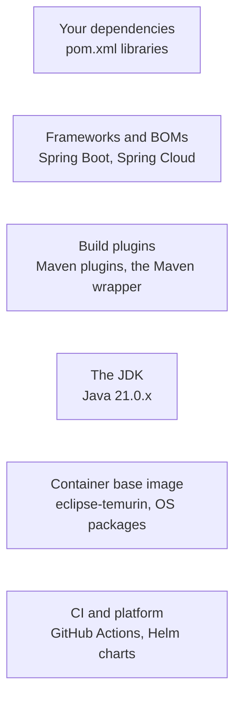
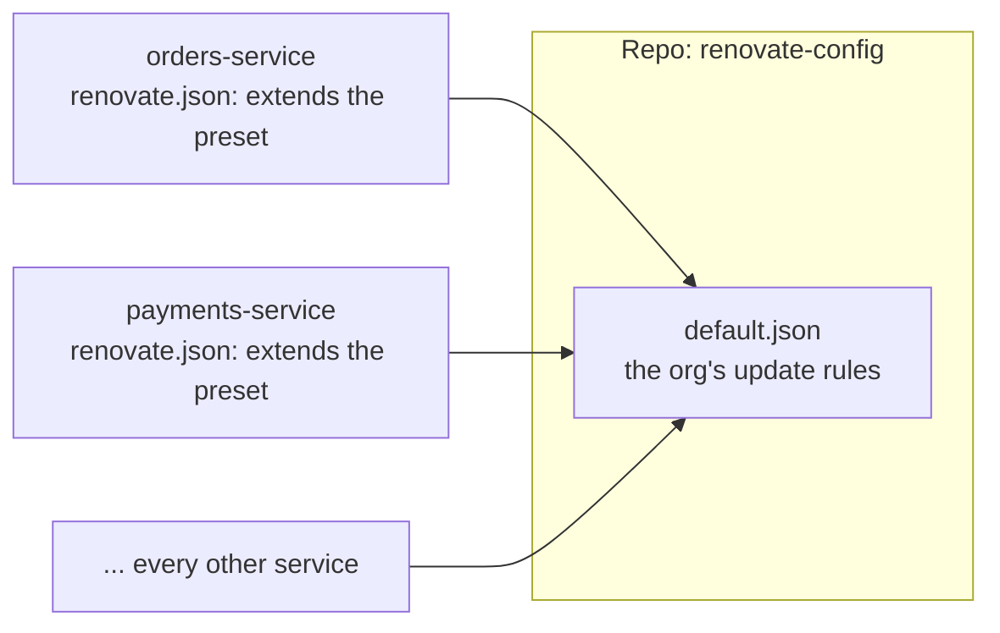
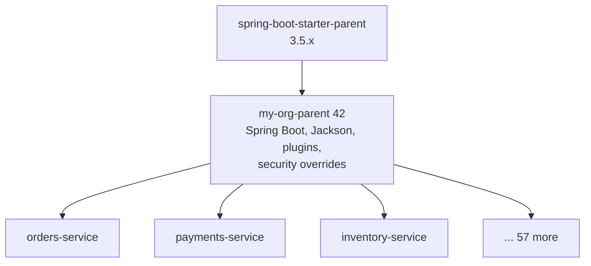
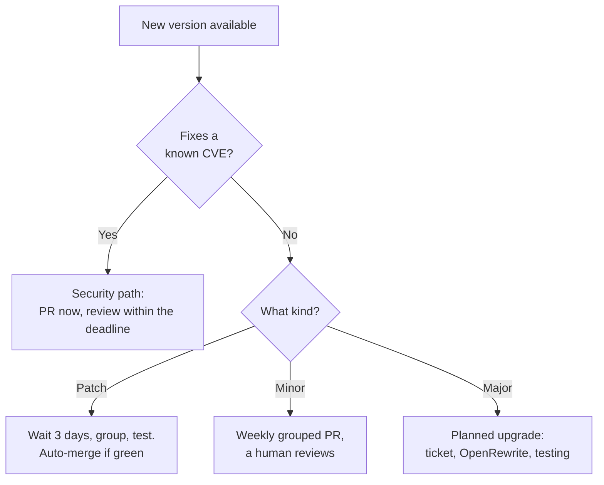
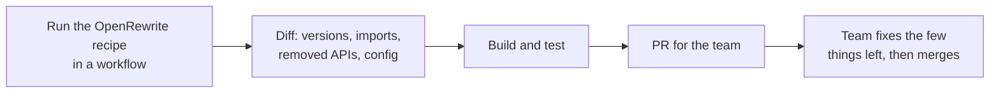
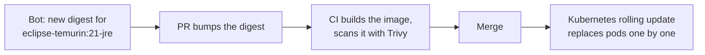
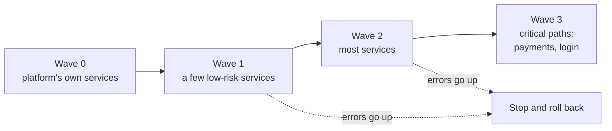

# Version and Patch Updates

The [previous page](./01-automated-remediation.md) fixed vulnerabilities after they were found. But look at what makes those fixes hard. A CVE fix in Spring Boot 3.5 is a **one-line bump** if you are on 3.5. If you are still on 2.7, the same fix is a **migration**: new Java version, new packages, weeks of work.

So the real defence is boring: **stay current all the time**.

:::tip[The one idea]
**Update little and often.** Ten small updates a month, each tested and easy to roll back, are far safer than one huge upgrade a year. Small steps also mean that when a critical CVE lands, you are always one small step away from the fix.
:::

---

## 1. Reading a version number: semantic versioning

Most Java libraries use **semantic versioning**: `MAJOR.MINOR.PATCH`, such as `3.5.2`.

| Part | Example | Promise | Risk | Typical policy |
| --- | --- | --- | --- | --- |
| **Patch** | 3.5.2 to 3.5.3 | Bug and security fixes only | Low | Merge quickly, often automatically |
| **Minor** | 3.5 to 3.6 | New features, nothing removed | Medium | Group weekly, a human reviews |
| **Major** | 3 to 4 | Breaking changes allowed | High | Plan it as a project |

:::warning[A promise, not a guarantee]
Semantic versioning is what the library authors **intend**. Patch releases sometimes break things, and some libraries don't follow the rules at all. Your tests are the real check, which is why every update goes through CI.
:::

---

## 2. What needs updating

Not just the libraries in `pom.xml`. A Java microservice has many layers, and each one gets security patches:



| Layer | How it gets updated |
| --- | --- |
| Dependencies and frameworks | Dependabot or Renovate PRs. A shared parent POM (section 5) |
| Build plugins | Same bots. They understand Maven plugins too |
| The JDK | Bump the base image or `java-version`. Patches come out every quarter |
| Base image | Bots bump the image tag or digest. Rebuild regularly (section 7) |
| GitHub Actions | Dependabot or Renovate bump the pinned SHAs |
| Kubernetes and Helm charts | Usually a platform team, on its own schedule |

---

## 3. Dependabot version updates

GitHub's **Dependabot** has two jobs. **Security updates** fix known CVEs (the previous page). **Version updates** keep everything current, even with no CVE. You turn version updates on with `.github/dependabot.yml`:

```yaml
version: 2
updates:
  - package-ecosystem: maven
    directory: "/"
    schedule:
      interval: weekly
      day: monday
    open-pull-requests-limit: 5
    groups:
      spring:                       # all Spring updates in one PR
        patterns: ["org.springframework*"]
      patches:                      # all other patch updates in one PR
        update-types: ["patch"]

  - package-ecosystem: docker       # the base image in the Dockerfile
    directory: "/"
    schedule:
      interval: weekly

  - package-ecosystem: github-actions
    directory: "/"
    schedule:
      interval: weekly
```

**Groups** are the most important setting. Without them, you get one PR per library, often 20 a week, and people stop reading them.

---

## 4. Renovate: one config for the whole organization

**Renovate** does the same job with far more control. Its big advantage for 60 microservices is **shared presets**: you write the rules once in a central repo, and every service just points to it.



The central preset:

```json
{
  "$schema": "https://docs.renovatebot.com/renovate-schema.json",
  "extends": ["config:recommended"],
  "schedule": ["before 6am on monday"],
  "minimumReleaseAge": "3 days",
  "packageRules": [
    {
      "matchUpdateTypes": ["patch"],
      "groupName": "all patch updates",
      "automerge": true
    },
    {
      "matchPackageNames": ["/^org\\.springframework/"],
      "groupName": "Spring"
    },
    {
      "matchUpdateTypes": ["major"],
      "dependencyDashboardApproval": true
    }
  ],
  "vulnerabilityAlerts": {
    "labels": ["security"]
  }
}
```

And each service's whole config:

```json
{
  "extends": ["local>my-org/renovate-config"]
}
```

| Setting | What it does |
| --- | --- |
| `minimumReleaseAge` | Waits 3 days after a release before proposing it. Broken releases are usually pulled by then, and it also protects against a hijacked package being published |
| `groupName` | Puts related updates in one PR |
| `automerge` | Merges by itself when CI is green. Use it only for low-risk updates |
| `dependencyDashboardApproval` | Majors wait until someone ticks a box in the **Dependency Dashboard** issue |
| `vulnerabilityAlerts` | Security fixes get their own PRs and labels, outside the normal schedule |

| | Dependabot | Renovate |
| --- | --- | --- |
| Setup | Built into GitHub | A GitHub App (hosted) or self-hosted |
| One config for many repos | No, a file in each repo | **Yes**, shared presets |
| Grouping and scheduling | Good | Very flexible |
| Auto-merge | Through GitHub's auto-merge | Built in |
| Waiting period for new releases | Basic | `minimumReleaseAge` |
| Dashboard of pending updates | No | Yes, an issue per repo |

**Rule of thumb:** Dependabot for a few repos, Renovate when you have many services and want one policy.

---

## 5. A shared parent POM: update once, use everywhere

**The problem:** 60 services each choose their own versions of Spring Boot, Jackson, and 30 plugins. Updating means 60 different changes, and they never match.

**The idea:** a company **parent POM** (or a BOM) owned by a platform team. It fixes the versions of the framework, common libraries, and plugins. Services inherit from it and set almost no versions themselves.



1. A patch comes out. The platform team bumps it in the parent once, tests it, and releases `my-org-parent 43`.
2. Renovate or Dependabot opens a PR in every service to move from 42 to 43.
3. Each service's CI tests the change, and teams merge.

The parent is also where **security overrides** go: if a transitive library needs a fix before Spring Boot ships one, override it here once instead of in 60 services.

:::warning[Don't let the parent become a bottleneck]
If the platform team releases the parent rarely, every service waits. Release it often, with its own automated update PRs and tests. Services must still be able to override a version in an emergency.
:::

---

## 6. An update policy by risk

Write the rules down, so nobody argues about each PR.



| Update type | Who merges | When |
| --- | --- | --- |
| Security fix | A human, always | Within the deadline: for example critical 7 days, high 30 |
| Patch | Automatic, if CI is green and tests are trusted | Weekly |
| Minor | A human | Weekly or every two weeks |
| Major | A human, as a planned project | Each quarter, or before the old version's end of life |

If your rules require a human on **every** change, keep auto-merge off. Instead, group all patches into one weekly PR, which takes a reviewer a minute.

---

## 7. Major upgrades with OpenRewrite

Patches are easy. Majors (Java 17 to 21, Spring Boot 3 to 4, `javax` to `jakarta`) change code, and doing that by hand across 60 services takes months.

**OpenRewrite** changes the code for you. It runs **recipes**: tested, automatic refactorings that understand Java and Maven. One recipe updates the versions, renames the packages, replaces removed APIs, and edits your config files.

```bash
mvn -U org.openrewrite.maven:rewrite-maven-plugin:run \
  -Drewrite.recipeArtifactCoordinates=org.openrewrite.recipe:rewrite-migrate-java:RELEASE \
  -Drewrite.activeRecipes=org.openrewrite.java.migrate.UpgradeToJava21
```

The `rewrite-spring` module has similar recipes for each Spring Boot version.



This fits the same pattern as the previous page: a reusable workflow runs the recipe in each service and opens a PR. The recipe does most of the work, and people handle what is left.

---

## 8. The JDK and the base image

Your code can be fully up to date and still ship old, vulnerable software underneath: the JDK, and the operating system packages in the container image.

- **JDK patches** come out every quarter, in January, April, July, and October, together with Oracle's Critical Patch Update. Builds such as Eclipse Temurin follow the same schedule. Stay on an **LTS** version (17, 21, or 25) and take every quarterly patch.
- **Base images** get OS security fixes all the time. Pin the image by **digest** (an exact, unchangeable hash) and let Dependabot or Renovate bump it:

```dockerfile
FROM eclipse-temurin:21-jre@sha256:<digest>
```



:::tip[Rebuild even when the code doesn't change]
An image built 6 months ago contains 6-month-old OS packages, even if nobody touched the code. Rebuild and redeploy every service at least every few weeks, so it picks up the latest patched base image. Smaller images, such as distroless or JRE-only images, have fewer packages and therefore fewer CVEs.
:::

The deploy itself is the safe [rolling update](../kubernetes.md#rolling-update-how-a-new-version-goes-out) from the Kubernetes page: new pods come up and pass their readiness probes before old ones go.

---

## 9. Know your end-of-life dates

Every version stops getting security patches one day. After that, a new CVE has **no fix** for you, and the triage on the previous page ends at "no fixed version". Track the end-of-life dates of Spring Boot, the JDK, and your base images. The site **endoflife.date** lists them for most products.

| Stay | Why |
| --- | --- |
| On a **supported** version of every framework | So security fixes exist for you |
| On the **latest patch** of that version | So fixes are a small step |
| No more than **one minor version** behind | So the next upgrade stays small |

---

## 10. Rolling out updates safely across many services

Even a patch can break something in production that tests missed. Don't update all 60 services at once.



- Each wave waits a day or two and watches error rates and latency.
- Rolling back means reverting the PR, or `kubectl rollout undo`.
- Security fixes for critical CVEs can skip the waiting, because the risk of waiting is higher.

---

## Interview questions

### 1. How do you keep 60 microservices up to date without drowning in PRs?

**In short:** A shared parent POM, a bot with one central config, grouped PRs, and a policy by update type.

Renovate with a shared preset (or Dependabot with groups) opens a few grouped PRs per service each week. Patches can auto-merge when CI is green. Minors get a quick review, and majors are planned with OpenRewrite. The parent POM means most version bumps happen once, not 60 times.

### 2. Patch, minor, and major updates: how do you treat each?

**In short:** Patch: fast and mostly automatic. Minor: grouped and reviewed. Major: a planned project.

Semantic versioning tells you the intended risk. Tests tell you the real risk. Security fixes skip the queue at any level.

### 3. Why wait a few days before taking a new release?

**In short:** Broken or malicious releases are usually found and pulled within days.

Renovate's `minimumReleaseAge` does this. It protects you from bad releases and from hijacked packages. Security fixes for actively exploited CVEs are the exception: take them now.

### 4. Your code hasn't changed in 6 months. Is the service still secure?

**In short:** Probably not. The JDK, the base image, and the dependencies have all had security fixes since.

Pin the base image by digest and let a bot bump it, take the quarterly JDK patch, and rebuild and redeploy regularly even without code changes. Scan the image in CI to confirm.

### 5. How would you upgrade 60 services from Java 17 to Java 21?

**In short:** Automate the code changes with OpenRewrite, open a PR per service with a reusable workflow, and roll out in waves.

Update the parent POM and the CI images first. Then run the `UpgradeToJava21` recipe in each service, build and test, and open PRs. Teams fix what the recipe couldn't, and services go live wave by wave while you watch error rates.

---

:::info[Where to next]
These pages keep your services **patched**. To see how they run and roll out, revisit [Kubernetes](../kubernetes.md), especially Deployments and rolling updates. For how access is controlled around your pipelines and clusters, see [IAM](../iam/01-iam-basics.md).
:::
